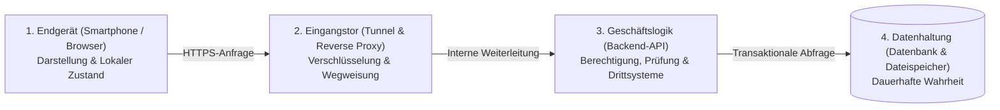
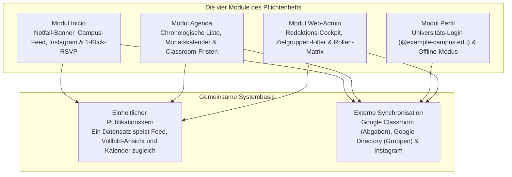

Wie wird aus einer Liste fachlicher Wünsche eine stabile Web-Applikation? Indem man Anzeige, Verkehrsverteilung, Geschäftsregeln und Datenspeicherung konsequent voneinander trennt, statt sämtliche Aufgaben in ein einziges Programm zu pressen. Dieses erste Kapitel vermittelt das universelle Denkmodell moderner Web-Systeme und zeigt, warum die vier Funktionsmodule der UPA Campus App genau so im Pflichtenheft definiert sind.

---

## Warum ein Klick auf dem Bildschirm vier Stationen durchläuft

Wenn Studierende morgens auf dem Smartphone prüfen, ob eine Vorlesung verlegt wurde, oder sich mit einem Fingertipp für einen Workshop anmelden, wirkt die App wie ein einziges Werkzeug. Unter der Oberfläche arbeitet jedoch eine präzise Arbeitsteilung aus vier spezialisierten Stationen:

Warum übernimmt nicht das Smartphone selbst die direkte Kommunikation mit der Datenbank? Ein alltagsnahes Bild aus einem modernen Restaurantbetrieb macht die Antwort sofort greifbar:

* **Das Endgerät (Browser und Mobile App) ist der Gastraum:** Hier liegt die Speisekarte aus, und hier gibt der Gast seine Bestellung auf. Im Gastraum wird jedoch weder gekocht noch die Kasse abgerechnet, weil jeder Besucher den Gastraum frei betreten und manipulieren kann.
* **Das Eingangstor (Ingress und Reverse Proxy) ist der Empfang an der Tür:** Er lässt nur reguläre Besucher herein, beantwortet einfache Standardfragen nach der Speisekarte sofort selbst und leitet echte Bestellungen gezielt an die Küche weiter.
* **Die Geschäftslogik (Backend) ist die Küche:** Hier wird geprüft, ob der Gast überhaupt bestellen darf, ob alle Angaben vollständig sind und nach welchem Rezept das Gericht zubereitet wird.
* **Die Datenhaltung (Datenbank und Medienspeicher) ist das verschlossene Kühlhaus samt Kassenbuch:** Kein Gast darf das Kühlhaus direkt betreten. Nur die Küche besitzt einen Schlüssel und sorgt dafür, dass Bestände und Buchungen zu keinem Zeitpunkt durcheinandergeraten.

---

## Die vier Grundfragen für Wirtschaftsinformatiker und Vibe-Coder

Wer mit KI-Werkzeugen Software entwickelt oder als Wirtschaftsinformatiker ein System entwirft, gerät leicht in die Falle, Anforderungen rein optisch vom Bildschirm her zu denken ("Hier fehlt noch ein Button"). Ein tragfähiger Entwurf entsteht erst, wenn man jede Funktion aus dem Pflichtenheft durch vier architektonische Leitfragen schickt:

1. **Woher stammt die Wahrheit (Single Source of Truth)?** Werden Daten an einer einzigen zentralen Stelle gepflegt, oder drohen doppelte Listen, die sich nach wenigen Tagen widersprechen?
2. **Wer sieht was vor und nach der Anmeldung?** Welche Inhalte dürfen öffentlich sichtbar sein, und ab welchem Punkt greift die geschützte Hochschulidentität?
3. **Welche Fremdsysteme liefern bereits vorhandene Daten?** Welche Informationen existieren bereits an der Universität (etwa in Google Classroom oder auf Instagram) und sollten automatisiert angebunden statt abgetippt werden?
4. **Wer trägt die Verantwortung für Fehlerfälle?** Was passiert, wenn das WLAN im Hörsaal ausfällt oder ein Nutzer zweimal kurz hintereinander auf denselben Anmelde-Button tippt?

---

## Das UPA-Pflichtenheft als logisches Gesamtsystem

Wendet man diese vier Leitfragen auf den Alltag der Universidad Paraguayo Alemana (UPA) an, fügt sich das Pflichtenheft aus vier Modulen (*Inicio*, *Agenda*, *Perfil* und *Web-Admin*) wie ein Uhrwerk zusammen:

### 1. Modul Inicio: Warum öffentlicher Schaukasten und interner Campus getrennt sind
Studieninteressierte und Gäste sollen beim ersten Öffnen der App sofort sehen, dass der Campus lebt, dürfen aber keine internen Hochschulmitteilungen lesen. Deshalb arbeitet der Feed zweistufig: Ohne Login zeigt *Inicio* die synchronisierten Beiträge des öffentlichen Instagram-Kanals der Universität. Sobald sich Studierende mit ihrem Hochschul-Konto anmelden, schaltet das System interne Ankündigungen, zielgruppenspezifische Veranstaltungen mit 1-Klick-Anmeldung sowie zeitkritische Notfall-Banner (etwa bei kurzfristigem Vorlesungsausfall wegen Unwetters) frei.

### 2. Modul Agenda: Warum Fremdsysteme angebunden statt kopiert werden
Ein Kalender wird von Studierenden nur genutzt, wenn er vollständig ist. Dozenten pflegen Prüfungs- und Abgabefristen bereits verbindlich in **Google Classroom**. Würde das Pflichtenheft verlangen, dass Lehrende jede Hausaufgabe zusätzlich im Campus-Portal eintragen, wäre der Kalender binnen kürzester Zeit unvollständig. Die Architektur verknüpft deshalb die internen Hochschulveranstaltungen automatisiert mit den persönlichen Google-Classroom-Fristen des angemeldeten Studierenden.

### 3. Modul Perfil: Warum Identität und Empfangsqualität zusammengehören
Im Modul *Perfil* verschmelzen Sicherheit und Alltagstauglichkeit: Der Login akzeptiert über Google OAuth 2.0 gezielt verifizierte Hochschul-Adressen (`@example-campus.edu`). Gleichzeitig sorgt die lokale Zwischenspeicherung auf dem Endgerät dafür, dass Stundenpläne, Termine und bereits geladene Nachrichten auch in Hörsälen mit schwachem Mobilfunkempfang verzögerungsfrei abrufbar bleiben.

### 4. Modul Web-Admin: Warum Redakteure ein zentrales Cockpit benötigen
Das Marketing- und Verwaltungsteam arbeitet am großen Bildschirm. Statt Nachrichten an einer Stelle und Kalendertermine an einer zweiten Stelle einzupflegen, bietet das *Web-Admin*-Modul einen vereinheitlichten Editor. Wird dort der Raum eines Gastvortrags geändert, aktualisieren sich Feed-Karte, Detailansicht und Monatskalender für alle betroffenen Studiengänge im selben Moment.

---

## Fazit

1. **Vier Schichten schaffen klare Verantwortlichkeiten:** Die Trennung in Endgerät, Eingangstor, Geschäftslogik und Datenhaltung stellt sicher, dass Benutzeroberflächen flexibel bleiben, während Sicherheitsprüfungen und Datenbestände geschützt auf dem Server liegen.
2. **Das Pflichtenheft verhindert Datensilos:** Ob kombinierte Nachrichten- und Event-Pflege im Web-Admin oder die direkte Anbindung von Google Classroom und Instagram: Jede Vorgabe im Pflichtenheft folgt dem Ziel, jede Information nur an einem einzigen Ort zu pflegen.
