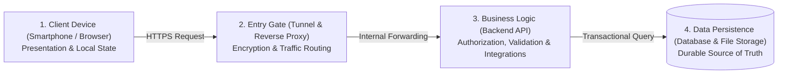
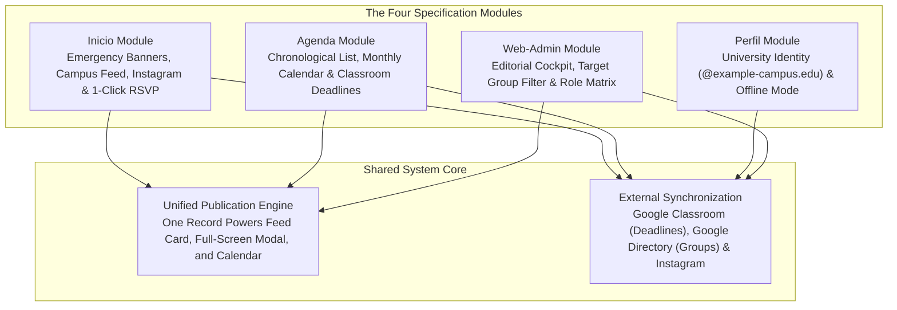

How does a collection of functional requirements become a reliable web application? By strictly separating presentation, traffic routing, business rules, and data persistence instead of cramming every task into a single monolithic program. This first chapter introduces the universal mental model of modern web systems and explains why the four functional modules of the UPA Campus App are specified the way they are.

---

## Why a Single Screen Tap Travels Through Four Stations

When students check their smartphone in the morning to see whether a lecture was moved or tap once to register for a campus workshop, the application feels like a single program. Under the surface, however, a precise relay takes place across four specialized stations:

Why does the smartphone not talk directly to the database? Comparing the system to a well-organized restaurant makes the architectural boundary immediately clear:

* **The Client Device (Browser and Mobile App) is the dining room:** Guests browse the menu and place their orders here. No cooking or accounting happens in the dining room because any visitor can inspect or tamper with what happens at the table.
* **The Entry Gate (Ingress and Reverse Proxy) is the reception desk:** It admits legitimate visitors, hands out printed menus (static files) right away, and directs actual meal orders to the kitchen.
* **The Business Logic (Backend) is the kitchen:** It verifies whether the guest is authorized to order, checks that the order is complete, and prepares the dish according to strict recipes.
* **The Data Persistence (Database and Media Storage) is the locked cold storage and ledger:** Guests have no direct access to the pantry. Only the kitchen holds a key, ensuring inventory counts and records remain consistent at all times.

---

## Four Guiding Questions for Business Informatics and Vibe-Coding

When building software with AI assistants or drafting a system specification in business informatics, it is tempting to think purely in terms of visual screens ("We need a button here"). A resilient architecture emerges when every functional requirement is evaluated through four structural questions:

1. **Where does the single source of truth live?** Is information maintained in one central place, or does the design create duplicate lists that contradict each other within days?
2. **Who sees what before and after authentication?** Which content belongs in the public showcase, and where does institutional identity enforcement begin?
3. **Which external systems already own the data?** Which records are already maintained across the university (such as Google Classroom deadlines or official Instagram posts) and should be synchronized automatically rather than retyped?
4. **How does the system handle failure modes?** What happens when Wi-Fi drops inside a lecture hall or a student taps a registration button twice in rapid succession?

---

## The UPA Specification as a Cohesive System

Applying these four questions to daily life at Universidad Paraguayo Alemana (UPA) reveals how the four specification modules (*Inicio*, *Agenda*, *Perfil*, and *Web-Admin*) interlock:

### 1. Inicio Module: Separating the Public Showcase from Internal Campus Operations
Prospective students and guests opening the app should immediately experience an active campus without gaining access to internal university notices. The feed therefore operates in two tiers: before login, *Inicio* displays synchronized posts from the university's public Instagram channel. Once a student signs in with an institutional account, the backend unlocks internal announcements, targeted cohort events with 1-click registration, and time-critical emergency banners (such as sudden weather-related lecture cancellations).

### 2. Agenda Module: Integrating External Sources Instead of Duplicating Effort
Students rely on a calendar only when it is complete. Professors already maintain binding assignment and exam deadlines in **Google Classroom**. Requiring faculty to enter every deadline a second time in the campus portal would guarantee outdated schedules. Instead, the architecture merges internal university events with live Google Classroom deadlines tied to the authenticated student.

### 3. Perfil Module: Pairing Institutional Identity with Offline Reliability
The *Perfil* module combines access control with everyday usability: Google OAuth 2.0 authentication restricts internal access to verified university accounts (`@example-campus.edu`), while local device caching ensures that schedules, deadlines, and previously loaded announcements remain accessible even in lecture halls with poor mobile reception.

### 4. Web-Admin Module: One Editorial Cockpit for All Channels
Marketing and administrative staff work on desktop screens. Rather than entering news articles in one tool and calendar entries in another, the *Web-Admin* module provides a single unified editor. Updating the room number of a guest lecture immediately updates the feed card, full-screen detail view, and monthly calendar across all targeted student groups.

---

## Key Takeaways

1. **Four Layers Enforce Clear Responsibilities:** Separating client devices, entry routing, backend logic, and storage keeps user interfaces responsive while safeguarding business rules and data on the server.
2. **The Specification Eliminates Data Silos:** Whether combining news and events in the editorial cockpit or synchronizing Google Classroom and Instagram, every specification rule ensures that each piece of information is maintained in one place.
