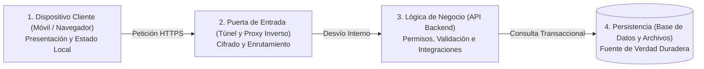
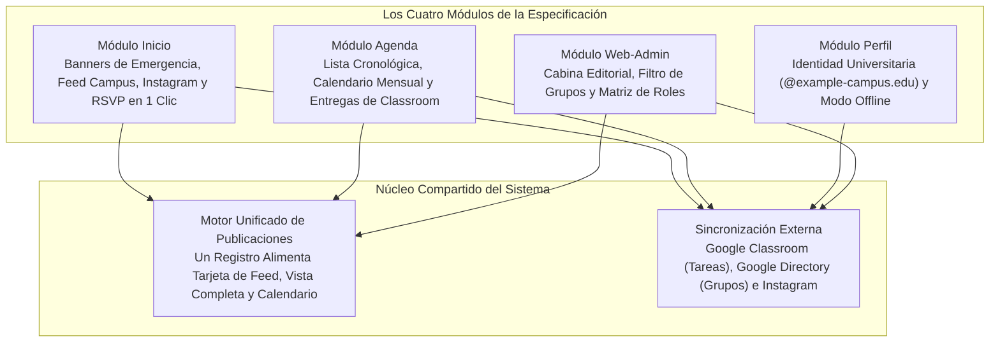

¿Cómo pasa una lista de requerimientos funcionales a convertirse en una aplicación web estable? Separando de forma estricta la visualización, la distribución del tráfico, las reglas de negocio y el almacenamiento de datos, en lugar de concentrar todas las tareas en un único programa monolítico. Este primer capítulo presenta el modelo mental universal de los sistemas web modernos y explica por qué los cuatro módulos funcionales de la UPA Campus App están definidos así en su especificación.

---

## Por Qué un Solo Toque en Pantalla Recorre Cuatro Estaciones

Cuando un estudiante revisa por la mañana en su teléfono si una clase cambió de aula o se inscribe con un toque a un taller universitario, la aplicación parece una sola pieza. Bajo la superficie, sin embargo, ocurre un relevo coordinado entre cuatro estaciones especializadas:

¿Por qué el teléfono móvil no se conecta directamente a la base de datos? La analogía de un restaurante bien organizado aclara de inmediato la frontera arquitectónica:

* **El Dispositivo Cliente (Navegador y App Móvil) es el comedor:** Aquí el comensal consulta el menú y realiza su pedido. En el comedor no se cocina ni se maneja la caja registradora, porque cualquier visitante puede entrar y alterar lo que tiene en su mesa.
* **La Puerta de Entrada (Ingress y Proxy Inverso) es la recepción:** Verifica quién llega, entrega folletos informativos (archivos estáticos) al instante y canaliza los pedidos reales hacia la cocina.
* **La Lógica de Negocio (Backend) es la cocina:** Comprueba si el cliente tiene autorización para pedir, revisa que la orden esté completa y prepara el plato siguiendo recetas estrictas.
* **La Persistencia (Base de Datos y Almacenamiento Multimedia) es la cámara frigorífica y el libro contable bajo llave:** Ningún visitante entra al almacén. Solo la cocina tiene acceso, garantizando que el inventario y los registros mantengan su integridad.

---

## Las Cuatro Preguntas Clave para Informática Empresarial y Vibe-Coding

Al desarrollar software con asistentes de inteligencia artificial o diseñar sistemas en informática empresarial, es común caer en el error de pensar únicamente desde la apariencia de la pantalla ("Aquí falta un botón"). Una arquitectura sólida surge cuando cada requisito funcional pasa por cuatro preguntas estructurales:

1. **¿Dónde reside la fuente única de verdad (Single Source of Truth)?** ¿Cada dato se administra en un solo lugar central, o existen listas duplicadas que entrarán en conflicto a los pocos días?
2. **¿Qué información es pública y cuál requiere identidad institucional?** ¿Qué contenido puede verse sin iniciar sesión y en qué punto entra en vigor la verificación de cuenta universitaria?
3. **¿Qué sistemas externos ya poseen los datos?** ¿Qué información ya se gestiona en la universidad (como entregas en Google Classroom o publicaciones en Instagram) y debe sincronizarse automáticamente en lugar de volver a tipearse?
4. **¿Cómo responde el sistema ante fallos cotidianos?** ¿Qué ocurre si se pierde la señal Wi-Fi en el aula o si un usuario pulsa dos veces seguidas el botón de inscripción?

---

## El Pliego Funcional de la UPA como Sistema Integrado

Al aplicar estas cuatro preguntas a la realidad operativa de la Universidad Paraguayo Alemana (UPA), los cuatro módulos de la especificación (*Inicio*, *Agenda*, *Perfil* y *Web-Admin*) encajan con precisión:

### 1. Módulo Inicio: Separación entre Vitrina Pública y Comunidad Interna
Los aspirantes y visitantes que abren la aplicación por primera vez deben percibir una vida universitaria activa sin acceder a comunicaciones internas. Por ello, el feed opera en dos niveles: sin iniciar sesión, *Inicio* muestra las publicaciones sincronizadas del canal público de Instagram de la universidad. Al autenticarse con una cuenta institucional, el sistema habilita avisos internos, eventos por carrera con inscripción en 1 clic y banners de emergencia prioritarios (por ejemplo, ante suspensión de clases por tormenta severa).

### 2. Módulo Agenda: Integrar Fuentes Oficiales en Lugar de Duplicar Tareas
Un calendario estudiantil solo es útil si está completo. Los docentes ya cargan las fechas de exámenes y entregas en **Google Classroom**. Si el sistema exigiera que los profesores registren cada tarea por segunda vez en el portal del campus, la agenda quedaría desactualizada rápidamente. La arquitectura combina de forma automática los eventos institucionales internos con los vencimientos reales de Google Classroom del estudiante autenticado.

### 3. Módulo Perfil: Identidad Verificada y Resiliencia sin Conexión
El módulo *Perfil* une seguridad y disponibilidad práctica: el inicio de sesión mediante Google OAuth 2.0 admite únicamente correos institucionales verificados (`@example-campus.edu`), mientras que el almacenamiento local en el dispositivo permite consultar horarios, fechas de entrega y noticias previamente cargadas incluso en aulas con baja cobertura móvil.

### 4. Módulo Web-Admin: Una Cabina Editorial Única para Administración
El equipo de marketing y gestión trabaja desde computadoras de escritorio. En lugar de cargar noticias en un formulario y eventos de calendario en otro distinto, el módulo *Web-Admin* ofrece un editor unificado. Si se modifica el horario o el salón de una conferencia, la tarjeta del feed, el modal de pantalla completa y el calendario mensual se actualizan al instante para todos los grupos destinatarios.

---

## Conclusiones

1. **Cuatro Capas Definen Responsabilidades Claras:** La división entre dispositivo cliente, puerta de entrada, lógica de negocio y persistencia permite mantener interfaces ágiles mientras las validaciones de seguridad y los datos permanecen resguardados en el servidor.
2. **La Especificación Evita Silos de Información:** Ya sea mediante la edición unificada de noticias y eventos o la sincronización directa con Google Classroom e Instagram, cada regla funcional garantiza que cada dato se administre en un único lugar.
