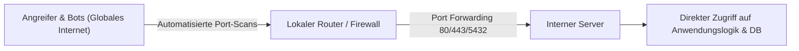
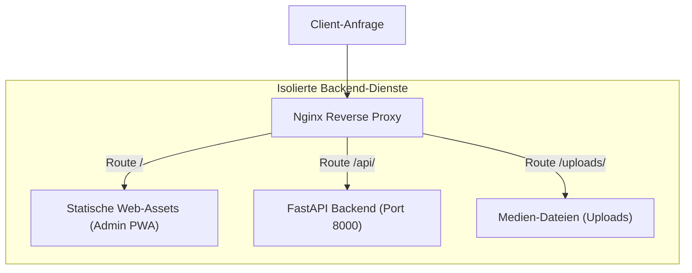
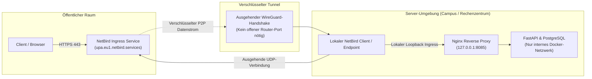

Klassische Serverbereitstellungen scheitern häufig an Netzwerksicherheit und restriktiven Firewall-Regeln: Direkte Portfreigaben im Router exponieren interne Dienste für das gesamte Internet, während Campus- oder Unternehmensnetzwerke eingehende Verbindungen blockieren. Die UPA Campus App löst dieses Dilemma durch die Kombination eines Nginx-Reverse-Proxies mit einem verschlüsselten NetBird-WireGuard-Mesh. Dieser dritte Teil analysiert die Risiken offener Serverports, das Schutzprinzip des Reverse Proxies und die Bereitstellung sicherer Domänen ohne Eingriffe in die lokale Router-Konfiguration.

---

## Das Problem offener Serverports

Der traditionelle Weg, einen lokalen Dienst im Internet bereitzustellen, führt über die Portweiterleitung (Port Forwarding) im Router:



Dieser Ansatz birgt erhebliche Sicherheitsrisiken für jede Produktivumgebung:

1. **Ungefilterte Exposition:** Sobald ein Port am Router ins offene Internet freigegeben wird, erreichen ungefilterte Datenpakete direkt das Zielsystem.
2. **Automatisierte Angriffswellen:** Suchmaschinen wie Shodan oder Censys indexieren freigegebene Ports innerhalb von Minuten. Botnetze starten sofort automatisierte Brute-Force-Attacken auf Passwörter, prüfen auf bekannte Sicherheitslücken (CVEs) und suchen nach Fehlkonfigurationen in Webservern.
3. **Risiko von Konfigurationsfehlern:** Wird versehentlich ein interner Dienst wie der Datenbankport 5432 oder eine Management-Schnittstelle exponiert, drohen sofortiger Datenabfluss oder Ransomware-Infektionen.
4. **Fehlende Router-Kontrolle:** In Universitäts- oder Unternehmensnetzwerken besitzen Entwicklungsteams in der Regel keine Berechtigung, Ports im zentralen Router freizugeben. Zudem verhindert Carrier-Grade NAT (CGNAT) bei vielen Internetanbietern eingehende Portweiterleitungen vollständig, weil sich Hunderte Kunden dieselbe öffentliche IPv4-Adresse teilen.

Sichere moderne Architekturen verzichten daher vollständig auf offene Eingangs-Ports am Router.

---

## Das Prinzip Reverse Proxy: Nginx als Schutzschild

Bevor der Netzwerkverkehr eine Anwendung erreicht, muss er kontrolliert, entkoppelt und weitergeleitet werden. Diese Aufgabe erfüllt ein Reverse Proxy.

Während ein Forward Proxy ausgehende Anfragen von internen Clients ins Internet bündelt, fängt ein Reverse Proxy eingehende Anfragen stellvertretend für die dahinterliegenden Dienste ab:



In der UPA Campus App übernimmt Nginx drei fundamentale Architekturfunktionen:

### 1. Entkopplung und Einfallstor
Clients kommunizieren nicht direkt mit dem Anwendungsbackend oder der Datenbank. Nginx bildet den zentralen Berührungspunkt. Interne Container wie FastAPI und PostgreSQL laufen in einem abgeschotteten Docker-Bridge-Netzwerk ohne eigene Host-Port-Exposition.

### 2. Pfad-basiertes Routing
Nginx analysiert den Uniform Resource Identifier (URI) jeder eingehenden Anfrage und entscheidet über das Ziel:
* Anfragen an `/` oder `/dashboard/` bedienen die statischen Dateien des Web-Admin-Portals direkt aus dem lokalen Dateisystem des Containers.
* Anfragen mit dem Präfix `/api/` werden transparent an den internen Container `http://backend:8000/api/` weitergereicht.
* Anfragen an `/uploads/` leiten auf gespeicherte Mediendateien weiter.
* Alle übrigen Pfade fängt Nginx über `try_files` ab, um clientseitiges Single-Page-Application (SPA) Routing zu ermöglichen.

### 3. Sicherheit und Governance
Nginx filtert fehlerhafte Anfragen ab, bevor sie die Python-Laufzeitumgebung belasten:
* Begrenzung der maximalen Anforderungsgröße (`client_max_body_size 15M`) schützt vor Denial-of-Service-Angriffen durch zu große Payloads.
* Bereinigung und Ergänzung von HTTP-Headern (`X-Real-IP`, `X-Forwarded-Proto`, `Host`) stellt sicher, dass das Backend die tatsächliche Identität und das Übertragungsprotokoll des Clients nachvollziehen kann.
* Browser-Caching-Direktiven für statische Assets entlasten die Server-Ressourcen spürbar.

---

## NetBird Ingress: Verschlüsseltes Mesh-Tunneling

Wie gelangt der Datenverkehr von berechtigten Nutzern zum Nginx-Proxy, wenn die Firewall alle eingehenden Ports sperrt? Die Antwort ist NetBird.

NetBird kombiniert das moderne WireGuard-Protokoll mit einem softwaredefinierten Overlay-Netzwerk (Peer-to-Peer Mesh).



### 1. Ausgehende statt eingehende Verbindungen
Der NetBird-Daemon auf dem Server initiiert eine ausgehende Verbindung zu den NetBird-Koordinationsservern (Signal- und Relay-Knoten). Da Stateful Firewalls ausgehenden Datenverkehr und die zugehörigen Antwortpakete standardmäßig zulassen, erfordert dieser Tunnel keinerlei Portweiterleitung im lokalen Router. Der Server baut die Verbindung von innen nach außen auf.

### 2. NAT-Traversal (STUN / ICE)
Über standardisierte Verbindungsprotokolle (Interactive Connectivity Establishment, ICE) ermittelt NetBird den optimalen Kommunikationspfad zwischen den Netzwerkknoten. Befinden sich beide Endpunkte hinter symmetrischem NAT, leiten verschlüsselte Relay-Server den Datenverkehr verzögerungsarm weiter.

### 3. Bereitstellung sicherer Domänen
Über das Ingress-Routing von NetBird erhält der Zielserver eine feste Domäne (wie `upa.eu1.netbird.services`). Der NetBird-Dienst übernimmt die TLS-Zertifikatsverwaltung und leitet autorisierte HTTPS-Anfragen direkt durch den verschlüsselten WireGuard-Tunnel an den lokalen Host weiter.

### 4. Lokale Bindung an 127.0.0.1
Der Nginx-Container exponiert seinen Port 80 nicht auf allen Netzwerk-Schnittstellen (`0.0.0.0`), sondern bindet ihn strikt an das lokale Loopback-Interface:

```yaml
ports:
  - "127.0.0.1:8085:80"
```

Dieser Schritt ist sicherheitskritisch: Unter Linux modifiziert Docker standardmäßig die Paketfiltertabellen (`iptables`). Eine Freigabe über `8085:80` würde den Port an der Host-Firewall (wie UFW) vorbei öffnen. Durch die Bindung an `127.0.0.1` kann in der Praxis nur ein lokaler Prozess auf dem Server auf den Nginx-Dienst zugreifen. Genau diese Schnittstelle bedient der NetBird-Daemon als Endpunkt des WireGuard-Tunnels.

---

## Die Sicherheitskette im Zusammenspiel

Die Kombination der drei Architekturbausteine ergibt ein durchgängiges Zero-Trust-Netzwerk:

1. **Vollständige Unsichtbarkeit:** Ein Port-Scan gegen die öffentliche IP-Adresse des Campus-Netzwerks bleibt vollkommen ergebnislos. Weder Webserver noch Datenbanken antworten.
2. **Kryptografische Isolation:** Jeder Datenstrom ist durch WireGuard mit modernen kryptografischen Primitiven (ChaCha20, Poly1305, Curve25519) Ende-zu-Ende verschlüsselt.
3. **Schutz der Datenhaltung:** Datenbank und REST-API verbleiben in ihrem isolierten Docker-Bridge-Netzwerk. Selbst wenn ein Dienst innerhalb des Servers kompromittiert würde, verhindert die Netzwerk-Segmentierung den unberechtigten Zugriff auf andere Komponenten.

---

## Fazit

1. **Sicherheit durch Unsichtbarkeit:** Das vollständige Schließen externer Router-Ports und die Nutzung ausgehender WireGuard-Tunnel eliminieren automatisierte Port-Scans und Brute-Force-Angriffe aus dem öffentlichen Internet.
2. **Saubere Schichtentrennung:** Ein vorgeschalteter Nginx Reverse Proxy entkoppelt das Web-Routing von der Geschäftslogik, bündelt SPA-Dateien und isoliert interne API-Container.
3. **Standortunabhängige Bereitstellung:** NetBird ermöglicht den sicheren Produktivbetrieb in anspruchsvollen Universitäts- und Campus-Netzwerken, ohne Sonderregeln oder Freigaben von der zentralen IT-Infrastruktur einfordern zu müssen.
