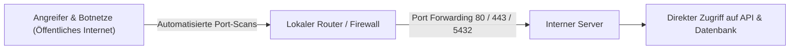
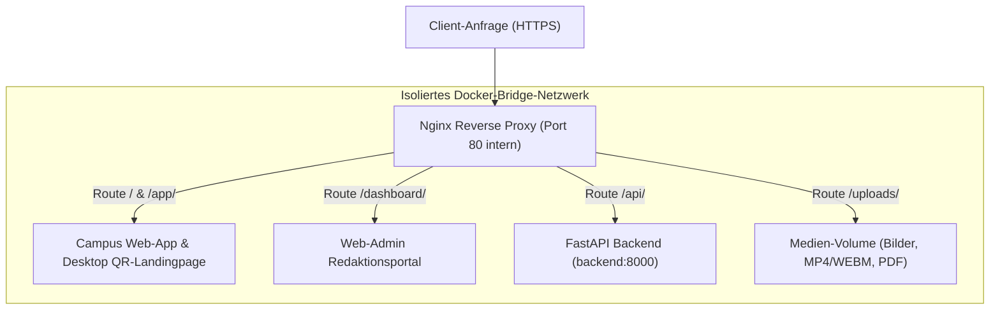
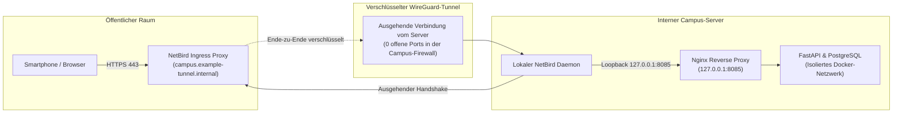

Klassische Serverbereitstellungen scheitern in Universitäts- und Unternehmensnetzwerken regelmäßig an zwei Hürden: Direkte Portfreigaben im Router setzen interne Dienste ungeschützt automatisierten Angriffen aus, während Campus-Firewalls und Carrier-Grade NAT (CGNAT) eingehende Verbindungen von außen blockieren. Die UPA Campus App löst dieses Dilemma durch die Kombination eines lokalen Nginx-Reverse-Proxies mit einem verschlüsselten NetBird-WireGuard-Tunnel (Architekturentscheidung 3.4). Dieses dritte Kapitel vermittelt das mentale Modell moderner Ingress-Architekturen: warum Webanwendungen alle Dienste unter einer einzigen Domain (Single Origin) bündeln und wie ein Server ohne einen einzigen offenen Router-Port weltweit sicher erreichbar wird.

---

## Warum klassische Portfreigaben in der Praxis scheitern

Der traditionelle Weg, einen lokalen Webserver im Internet bereitzustellen, führt über eine Portweiterleitung (Port Forwarding) im Router:



Für produktive Campus- und Enterprise-Systeme ist dieser Ansatz aus drei Gründen ungeeignet:
1. **Automatisierte Angriffswellen:** Suchmaschinen wie Shodan oder Censys scannen den gesamten öffentlichen IPv4-Adressraum kontinuierlich. Sobald ein Port am Router geöffnet wird, registrieren Botnetze den Dienst innerhalb weniger Minuten und starten automatisierte Brute-Force-Angriffe sowie Exploits gegen bekannte Schwachstellen (CVEs).
2. **Gefahr menschlicher Fehlkonfiguration:** Wird bei einem schnellen Testlauf versehentlich der Datenbankport (`5432`) oder ein interner Entwicklungsport ohne Authentifizierung freigegeben, liegen schützenswerte Studierendendaten offen im Netz.
3. **Fehlende Infrastruktur-Hoheit an Universitäten:** In Hochschulnetzen haben Projektteams keinen Zugriff auf die zentralen Firewall-Regeln des Rechenzentrums. Zudem teilen sich bei vielen Internetanbietern über Carrier-Grade NAT (CGNAT) Hunderte Anschlüsse eine gemeinsame öffentliche IPv4-Adresse, wodurch eingehende Portweiterleitungen technisch unmöglich sind.

Moderne Systemarchitekturen kehren die Verbindungsrichtung deshalb um: Statt Ports von außen nach innen zu öffnen, baut der Server von innen nach außen einen verschlüsselten Tunnel auf.

---

## Das Prinzip Reverse Proxy: Warum eine einzige Adresse (Single Origin) alles vereint

Wer als angehender Wirtschaftsinformatiker oder Vibe-Coder eine erste Webanwendung lokal entwickelt, startet das Frontend oft auf `localhost:3000` und das Backend auf `localhost:8000`. Im echten Internet führt diese Trennung sofort zu Problemen: Browser blockieren Anfragen zwischen unterschiedlichen Ports oder Domains aus Sicherheitsgründen über die **Same-Origin-Policy (CORS)**, und Nutzer müssten sich komplexe Portnummern merken.

Ein **Reverse Proxy** (Nginx) löst dieses Problem, indem er als zentrales Empfangstor vor allen Containern steht und die gesamte Plattform unter einer einzigen Domain zusammenführt:



### Wie die Routing-Tabelle in Nginx das Pflichtenheft abbildet

Ein Blick in die `nginx.conf` der UPA Campus App zeigt, wie jede URL-Route eine konkrete Aufgabe aus dem Pflichtenheft erfüllt:

```nginx
server {
    listen 80;
    server_name localhost;
    client_max_body_size 25M;

    # 1. API-Verkehr an den FastAPI-Container weiterleiten
    location /api/ {
        proxy_pass http://backend:8000/api/;
        proxy_set_header Host $host;
        proxy_set_header X-Real-IP $remote_addr;
        proxy_set_header X-Forwarded-Proto $scheme;
    }

    # 2. Hochgeladene Medien (Plakate, Videos, PDFs) ausliefern
    location /uploads/ {
        proxy_pass http://backend:8000/uploads/;
        expires 7d;
        add_header Cache-Control "public, max-age=604800, immutable";
    }

    # 3. Web-Admin Redaktionsportal für das Marketing-Team
    location /dashboard/ {
        alias /usr/share/nginx/html/dashboard/;
        try_files $uri $uri/ /dashboard/index.html;
    }

    # 4. Mobile Web-App und Desktop QR-Landingpage
    location / {
        root /usr/share/nginx/html;
        try_files $uri $uri/ /app/index.html;
    }
}
```

Drei architektonische Mechanismen greifen hier ineinander:
* **Wegfall von CORS-Komplexität durch Single Origin:** Weil Browser sowohl die Benutzeroberfläche (`/dashboard/`), die REST-Schnittstelle (`/api/`) als auch die Veranstaltungsbilder (`/uploads/`) von exakt derselben Adresse laden, gelten alle Aufrufe als *Same-Origin*. Komplexe Preflight-Abfragen entfallen.
* **Schutz des einheitlichen Medien-Uploads (`client_max_body_size`):** Laut Pflichtenheft unterstützt der Beitrags-Editor im Web-Admin neben Bildern und PDFs auch kurze Veranstaltungsvideos (`MP4` und `WEBM`). Die Direktive `client_max_body_size 25M` erlaubt diese regulären Medien-Uploads, weist aber manipulierte Gigabyte-Pakete bereits an der Netzwerkgrenze mit `HTTP 413 (Content Too Large)` ab, bevor sie den Arbeitsspeicher des Python-Backends belasten.
* **SPA-Fallback über `try_files`:** Wenn ein Redakteur im Browser direkt die Unterseite `/dashboard/publicaciones` aktualisiert, sucht Nginx nicht nach einer physischen Datei namens `publicaciones`, sondern liefert über `try_files` sauber die `index.html` des Portals aus, damit das JavaScript-Routing die richtige Ansicht öffnet.

---

## NetBird Ingress: Zero-Trust-Zugang ohne offene Router-Ports

Wie gelangt die Anfrage vom Smartphone eines Studierenden zum lokalen Nginx-Container, wenn am Universitäts-Router kein einziger Port geöffnet ist? Die Antwort liefert **NetBird** auf Basis des **WireGuard**-Protokolls:



1. **Verbindungsaufbau von innen nach außen:** Der NetBird-Dienst auf dem Campus-Server baut selbstständig eine ausgehende, verschlüsselte WireGuard-Verbindung zum Ingress-Knoten (`campus.example-tunnel.internal`) auf. Da Firewalls ausgehende Verbindungen interner Server zulassen, ist keinerlei Portfreigabe im Router erforderlich.
2. **Automatische TLS-Terminierung:** Der Ingress-Knoten stellt gültige HTTPS-Zertifikate bereit (erforderlich für Google OAuth 2.0 und Service Worker in PWAs) und leitet den Datenverkehr Ende-zu-Ende verschlüsselt durch den WireGuard-Tunnel zum Server.
3. **Nahtlose Übergabe an Loopback (`127.0.0.1:8085`):** Auf dem Server nimmt der NetBird-Daemon die Pakete aus dem Tunnel entgegen und übergibt sie lokal an `127.0.0.1:8085`. Wie in Kapitel 2 gezeigt, lauscht der Nginx-Container ausschließlich auf dieser internen Loopback-Adresse und ist von außen über das lokale Netzwerk unangreifbar.

---

## Fazit

1. **Ausgehende Tunnel statt offener Ports:** Durch NetBird und WireGuard benötigt der Server keine Portfreigaben im Router und bleibt für automatisierte Port-Scanner aus dem Internet unsichtbar.
2. **Single-Origin-Architektur durch Nginx:** Der Reverse Proxy vereint Studierenden-App, Web-Admin-Portal, REST-API (`/api/`) und Medienspeicher (`/uploads/`) unter einer einzigen Adresse, verhindert CORS-Fehler und schützt das Backend vor überdimensionierten Upload-Paketen.
3. **Direkte Unterstützung des Pflichtenhefts:** Sicheres HTTPS für den Google-Login (`@example-campus.edu`), schnelles Caching für Veranstaltungsplakate und kontrollierte Upload-Limits für Videos entstehen direkt in dieser Netzwerkschicht.
