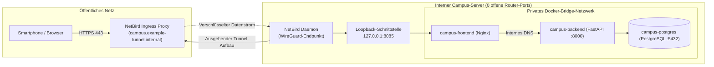

Wie macht man einen lokalen Campus-Server für Smartphones und Browser erreichbar, ohne in der Universitäts-Firewall eingehende Ports zu öffnen oder sich im Browser in CORS-Fehlern zu verfangen? Durch die Kombination eines ausgehenden WireGuard-Mesh-Tunnels (NetBird) mit einem lokalen Nginx-Reverse-Proxy, der sämtliche Anwendungsdienste unter einer einzigen Adresse (Single Origin) zusammenführt. Dieses dritte Kapitel zeigt den Weg eines Datenpakets aus dem öffentlichen Internet bis in das interne Container-Netzwerk.

---

## Warum klassische Portfreigaben in Hochschulnetzen scheitern

In vielen Einsteiger-Tutorials wird empfohlen, im Router eine Portweiterleitung (Port Forwarding) für Port 80 und 443 auf den lokalen Server einzurichten. Im realen Betrieb einer Universität scheitert dieses Vorgehen aus drei Gründen:

1. **Permanente Scans im öffentlichen Internet:** Automatisierte Suchmaschinen und Botnetze prüfen den gesamten IPv4-Adressraum im Minutentakt auf offene Ports. Jeder direkt geöffnete Dienst ist sofort automatisierten Angriffsversuchen ausgesetzt.
2. **Kein Zugriff auf die zentrale Campus-Firewall:** Projektteams erhalten aus guten Sicherheitsgründen keinen administrativen Zugriff auf die Haupt-Router des Universitätsrechenzentrums. Zudem nutzen viele Internetanbieter Carrier-Grade NAT (CGNAT), bei dem sich zahlreiche Anschlüsse eine einzige öffentliche IP-Adresse teilen und eingehende Verbindungen technisch blockiert sind.
3. **Das Docker-Firewall-Risiko auf Linux-Servern:** Selbst wenn auf einem Server eine lokale Firewall wie UFW aktiv ist, überschreibt Docker bei einer normalen Port-Freigabe (`8085:80`) standardmäßig die `iptables`-Ketten des Linux-Kernels und öffnet den Port ungewollt für das gesamte lokale Netzwerk.

---

## Verbindungsrichtung umkehren: Ausgehender WireGuard-Tunnel und Loopback-Schutz

Um diese Risiken an der Wurzel zu beseitigen, dreht die UPA Campus App die Richtung des Verbindungsaufbaus um. Der Server öffnet keinen einzigen eingehenden Port nach außen, sondern baut von innen heraus einen verschlüsselten **NetBird**-Tunnel auf Basis des **WireGuard**-Protokolls zum Ingress-Endpunkt (`campus.example-tunnel.internal`) auf:



Drei Sicherheitsstufen greifen hier nahtlos ineinander:
* **Ausgehender Handshake:** Weil der lokale NetBird-Daemon die Verbindung von innen nach außen initiiert, passiert der Tunnel jede Campus-Firewall und jedes CGNAT ohne Portweiterleitung. Gleichzeitig übernimmt der Ingress-Knoten die Bereitstellung gültiger HTTPS-Zertifikate, die für Google OAuth 2.0 und Progressive Web Apps technisch vorgeschrieben sind.
* **Strikte Loopback-Bindung (`127.0.0.1:8085:80`):** Durch das Voranstellen von `127.0.0.1:` lauscht der Nginx-Container gezielt auf der serverinternen Loopback-Schnittstelle. Nur der lokale NetBird-Daemon auf demselben Rechner kann Pakete dorthin übergeben.
* **Unsichtbare Backend- und Datenbank-Ports:** Weder FastAPI (Port 8000) noch PostgreSQL (Port 5432) besitzen einen `ports`-Eintrag auf dem Host. Sie sind nur über das interne Docker-DNS (`backend:8000` und `postgres:5432`) erreichbar.

---

## Das Single-Origin-Prinzip: Wie Nginx das Pflichtenheft zusammenhält

Wer bei der lokalen Webentwicklung die Oberfläche auf Port `3000` und die API auf Port `8000` startet, stößt im Browser unweigerlich auf die **Same-Origin-Policy**: Aus Sicherheitsgründen blockieren Browser standardmäßig Datenabrufe zwischen unterschiedlichen Ports oder Domains (CORS-Fehler).

Im Produktivbetrieb löst **Nginx** als **Reverse Proxy** dieses Problem. Für das Smartphone existiert nur noch eine einzige Webadresse, hinter der Nginx den Verkehr anhand des URL-Pfads lautlos auf die richtige Ressource verteilt:

```nginx
server {
    listen 80;
    server_name localhost;
    client_max_body_size 25M;

    # 1. REST-API-Aufrufe an den FastAPI-Container weiterleiten
    location /api/ {
        proxy_pass http://backend:8000/api/;
        proxy_set_header Host $host;
        proxy_set_header X-Real-IP $remote_addr;
        proxy_set_header X-Forwarded-Proto $scheme;
    }

    # 2. Veranstaltungsplakate, Videos und PDFs mit Browser-Caching ausliefern
    location /uploads/ {
        proxy_pass http://backend:8000/uploads/;
        expires 7d;
        add_header Cache-Control "public, max-age=604800, immutable";
    }

    # 3. Redaktions-Cockpit für das Marketing-Team
    location /dashboard/ {
        alias /usr/share/nginx/html/dashboard/;
        try_files $uri $uri/ /dashboard/index.html;
    }

    # 4. Mobile Campus-App und Desktop-QR-Landingpage
    location / {
        root /usr/share/nginx/html;
        try_files $uri $uri/ /app/index.html;
    }
}
```

Jeder Block dieser Konfiguration erfüllt eine direkte Anforderung des Pflichtenhefts:
1. **Kein CORS-Overhead (`/api/` und `/uploads/`):** Weil Oberfläche, JSON-Daten und Bilder für den Browser von derselben Adresse stammen, entfallen fehleranfällige Cross-Origin-Sonderregeln. Zusätzlich sorgt der `Cache-Control`-Header unter `/uploads/` dafür, dass einmal geladene Veranstaltungsplakate sieben Tage lang direkt aus dem Gerätespeicher gelesen werden.
2. **Schutzschild für den Medien-Upload (`client_max_body_size 25M`):** Das Pflichtenheft erlaubt im Beitrags-Editor das Hochladen von Bildern, PDF-Dokumenten und kurzen Veranstaltungsvideos (`MP4` und `WEBM`). Die Obergrenze von 25 Megabyte lässt reguläre Campus-Medien problemlos passieren, blockiert aber übergroße Dateien bereits an der Netzwerkgrenze mit `HTTP 413 (Content Too Large)`, noch bevor sie den Arbeitsspeicher des Python-Backends erreichen.
3. **Unterstützung für Client-Routing (`try_files`):** Wenn ein Redakteur im Browser direkt einen tiefen Link wie `/dashboard/publicaciones` neu lädt, sucht Nginx nicht vergeblich nach einem gleichnamigen Dateiordner, sondern liefert über `try_files` die zentrale `index.html` aus, damit die Webanwendung die gewünschte Ansicht aufbaut.

---

## Fazit

1. **Erreichbarkeit ohne offene Firewall-Ports:** Über den ausgehenden NetBird-WireGuard-Tunnel und die lokale Bindung an `127.0.0.1:8085` bleibt der Campus-Server für Port-Scanner aus dem Internet unsichtbar und funktioniert selbst hinter restriktiven Hochschul-Firewalls.
2. **Eine Adresse für alle Module:** Als Single-Origin Reverse Proxy vereint Nginx die mobile Studierenden-App, das Redaktions-Cockpit, die FastAPI-Schnittstelle und die Medienauslieferung unter einer gemeinsamen Domain und fängt zu große Datei-Uploads bereits vor dem Backend ab.
