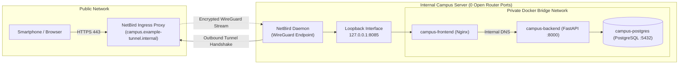

How do you make a local university server accessible to smartphones and browsers worldwide without opening inbound firewall ports or fighting browser CORS blocks? By combining an outbound WireGuard mesh tunnel (NetBird) with a local Nginx reverse proxy that unifies every application service under a single domain (Single Origin). This third chapter traces the path of a network packet from the public internet into the private container network.

---

## Why Traditional Port Forwarding Fails in University Environments

Introductory deployment guides often suggest configuring port forwarding for ports 80 and 443 on the local router. In a real university or enterprise network, that approach breaks down for three reasons:

1. **Continuous Internet-Wide Scanning:** Automated crawlers and botnets scan the public IPv4 address space around the clock. Any port exposed directly on a router is probed by automated exploit scripts within minutes.
2. **No Control Over Central Campus Firewalls:** Student and departmental project teams do not get administrative access to central university perimeter routers. Furthermore, many internet service providers use Carrier-Grade NAT (CGNAT), sharing a single public IPv4 address across hundreds of customers and making inbound port forwarding impossible.
3. **The Docker Firewall Pitfall on Linux Hosts:** Even when a host firewall such as UFW is active on a Linux server, publishing a Docker port normally (`8085:80`) modifies kernel `iptables` rules directly and exposes the port across the local network interface.

---

## Inverting the Connection Direction: Outbound WireGuard Tunnels and Loopback Binding

To eliminate these risks structurally, the UPA Campus App reverses the connection flow. Instead of opening inbound ports on the campus router, the server initiates an outbound encrypted **NetBird** tunnel built on the **WireGuard** protocol toward the ingress proxy (`campus.example-tunnel.internal`):



Three defensive layers work together here:
* **Outbound Handshake:** Because the local NetBird daemon initiates the connection from the inside out, traffic traverses restrictive campus firewalls and CGNAT without any router reconfiguration. The ingress proxy also handles automated TLS certificate provisioning, which is mandatory for Google OAuth 2.0 and PWA service workers.
* **Strict Loopback Binding (`127.0.0.1:8085:80`):** Prefixing the port mapping with `127.0.0.1:` restricts the Nginx container to the host's internal loopback interface. Only the local NetBird daemon running on the same machine can forward traffic to it.
* **Unexposed Backend and Database Ports:** Neither FastAPI (port 8000) nor PostgreSQL (port 5432) binds a port on the host. They communicate exclusively across the private Docker bridge network via internal DNS names (`backend:8000` and `postgres:5432`).

---

## The Single-Origin Principle: How Nginx Holds the Specification Together

When developers run a frontend on port `3000` and an API on port `8000` during local testing, browsers immediately enforce the **Same-Origin Policy**, blocking cross-port requests unless complex CORS headers and preflight checks are configured.

In production, **Nginx** acts as a **Reverse Proxy** in front of all containers. To the user's smartphone, the entire platform lives under a single domain, while Nginx inspects the URL path of each incoming request and routes it internally:

```nginx
server {
    listen 80;
    server_name localhost;
    client_max_body_size 25M;

    # 1. Forward REST API calls to the FastAPI container
    location /api/ {
        proxy_pass http://backend:8000/api/;
        proxy_set_header Host $host;
        proxy_set_header X-Real-IP $remote_addr;
        proxy_set_header X-Forwarded-Proto $scheme;
    }

    # 2. Serve event posters, videos, and PDFs with browser caching
    location /uploads/ {
        proxy_pass http://backend:8000/uploads/;
        expires 7d;
        add_header Cache-Control "public, max-age=604800, immutable";
    }

    # 3. Editorial cockpit for the marketing team
    location /dashboard/ {
        alias /usr/share/nginx/html/dashboard/;
        try_files $uri $uri/ /dashboard/index.html;
    }

    # 4. Mobile campus app and desktop QR landing page
    location / {
        root /usr/share/nginx/html;
        try_files $uri $uri/ /app/index.html;
    }
}
```

Each block in this configuration directly supports a requirement from the functional specification:
1. **Zero CORS Friction (`/api/` and `/uploads/`):** Because the web interface, JSON endpoints, and uploaded media all share the exact same origin, browser security policies are satisfied natively. Additionally, the `Cache-Control` header on `/uploads/` instructs client devices to cache downloaded event posters locally for seven days.
2. **Perimeter Protection for Media Uploads (`client_max_body_size 25M`):** The specification allows editors to attach images, PDF documents, and short promotional videos (`MP4` and `WEBM`). Setting a 25-megabyte ceiling accommodates legitimate campus media while rejecting oversized payloads at the proxy edge with `HTTP 413 (Content Too Large)` before they consume Python backend memory.
3. **Client-Side Routing Support (`try_files`):** When an editor refreshes a deep link such as `/dashboard/publicaciones`, Nginx does not fail looking for a physical directory on disk; instead, `try_files` serves `/dashboard/index.html` so the client router renders the appropriate screen.

---

## Key Takeaways

1. **Global Reach With Zero Open Firewall Ports:** Combining an outbound NetBird WireGuard tunnel with a strict `127.0.0.1:8085` loopback binding keeps the server invisible to public port scanners and operational behind restrictive university firewalls.
2. **One Unified Origin for Every Module:** Acting as a single-origin reverse proxy, Nginx unites the student app, editorial portal, FastAPI backend, and media storage under one address while blocking oversized uploads at the network perimeter.
