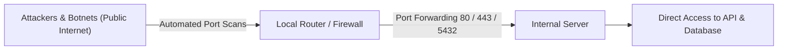
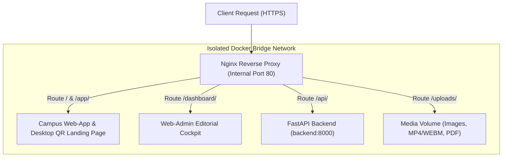
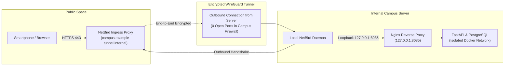

Traditional server deployments in university and enterprise networks regularly run into two roadblocks: opening ports on a router exposes internal services to automated internet-wide attacks, while campus firewalls and Carrier-Grade NAT (CGNAT) block incoming connections altogether. The UPA Campus App resolves this dilemma by pairing a local Nginx reverse proxy with an encrypted NetBird WireGuard tunnel (Architectural Decision 3.4). This third chapter builds the mental model of modern ingress architecture: why production web apps unify all services behind a single origin and how a server becomes securely reachable worldwide without opening a single router port.

---

## Why Traditional Port Forwarding Fails in Production

The conventional way to publish a local web server to the internet relies on router port forwarding:



For campus and enterprise systems, this approach breaks down for three reasons:
1. **Automated Attack Waves:** Search engines such as Shodan and Censys scan the public IPv4 address space continuously. Within minutes of opening a port, automated bots begin brute-forcing credentials and probing for unpatched vulnerabilities (CVEs).
2. **Human Configuration Risk:** Accidentally exposing database port `5432` or an unauthenticated debug service during a quick deployment test immediately puts student records at risk.
3. **Lack of Router Control on Campus:** University engineering teams rarely control central campus firewall rules. Furthermore, many internet service providers use Carrier-Grade NAT (CGNAT), sharing a single public IPv4 address across hundreds of customers and making inbound port forwarding technically impossible.

Modern system architectures therefore invert the connection direction: instead of opening ports from the outside in, the server establishes an encrypted tunnel from the inside out.

---

## The Reverse Proxy Mental Model: Why a Single Origin Unifies Everything

When business informatics students or vibe-coders build a prototype locally, they often run the frontend on `localhost:3000` and the backend on `localhost:8000`. Moving that setup to production immediately triggers **Same-Origin Policy (CORS)** blocks in the browser and forces clients to juggle multiple ports.

An **Nginx Reverse Proxy** solves this by acting as the single front door in front of all containers, unifying the entire platform under one domain and origin:



### How the Nginx Routing Table Maps to the Functional Specification

Inspecting the `nginx.conf` of the UPA Campus App reveals how each URL route directly serves a requirement from the functional specification:

```nginx
server {
    listen 80;
    server_name localhost;
    client_max_body_size 25M;

    # 1. Forward API traffic to the FastAPI container
    location /api/ {
        proxy_pass http://backend:8000/api/;
        proxy_set_header Host $host;
        proxy_set_header X-Real-IP $remote_addr;
        proxy_set_header X-Forwarded-Proto $scheme;
    }

    # 2. Deliver uploaded media (posters, videos, PDFs) with browser caching
    location /uploads/ {
        proxy_pass http://backend:8000/uploads/;
        expires 7d;
        add_header Cache-Control "public, max-age=604800, immutable";
    }

    # 3. Serve the Web-Admin cockpit for the marketing team
    location /dashboard/ {
        alias /usr/share/nginx/html/dashboard/;
        try_files $uri $uri/ /dashboard/index.html;
    }

    # 4. Serve the mobile Web-App and desktop QR landing page
    location / {
        root /usr/share/nginx/html;
        try_files $uri $uri/ /app/index.html;
    }
}
```

Three architectural mechanisms work together here:
* **Eliminating CORS Complexity via Single Origin:** Because the browser loads the user interface (`/dashboard/`), the REST API (`/api/`), and event posters (`/uploads/`) from the exact same domain, every request satisfies the browser's same-origin policy without brittle cross-origin hacks.
* **Protecting the Unified Media Upload (`client_max_body_size`):** According to the specification, the Web-Admin publication editor supports short event videos (`MP4` and `WEBM`) alongside posters and PDFs. Setting `client_max_body_size 25M` permits legitimate campus videos while rejecting multi-gigabyte Denial-of-Service payloads at the network perimeter with `HTTP 413 (Content Too Large)` before they ever touch Python memory.
* **SPA Routing via `try_files`:** When an editor refreshes `/dashboard/publicaciones` in the browser, Nginx does not fail looking for a physical file named `publicaciones`; instead, `try_files` serves `/dashboard/index.html` so the client-side router restores the exact view.

---

## NetBird Ingress: Zero-Trust Access Without Open Router Ports

How does a student's smartphone reach the local Nginx container when zero ports are open on the campus firewall? **NetBird** provides the answer on top of the **WireGuard** protocol:



1. **Inside-Out Connection Initiation:** The NetBird daemon on the campus server initiates an outbound encrypted WireGuard tunnel to the ingress node (`campus.example-tunnel.internal`). Because stateful firewalls allow outbound connections from internal servers, no port forwarding is needed on the router.
2. **Automated TLS Termination:** The ingress endpoint provisions valid HTTPS certificates (which are mandatory for Google OAuth 2.0 redirects and PWA Service Workers) and forwards traffic end-to-end encrypted through the WireGuard tunnel.
3. **Loopback Handoff (`127.0.0.1:8085`):** On the host server, the NetBird daemon decrypts the tunnel traffic and hands it directly to `127.0.0.1:8085`. As shown in Chapter 2, the Nginx container listens exclusively on this loopback address, keeping it completely unreachable from untrusted machines on the local network.

---

## Key Takeaways

1. **Outbound Tunnels Instead of Open Ports:** Using NetBird and WireGuard eliminates router port forwarding and makes the server invisible to automated internet port scanners.
2. **Single-Origin Architecture via Nginx:** The reverse proxy unifies the student app, Web-Admin cockpit, REST API (`/api/`), and media storage (`/uploads/`) under a single domain, preventing CORS failures and shielding the backend from oversized uploads.
3. **Direct Support for Specification Rules:** Valid HTTPS for institutional Google OAuth (`@example-campus.edu`), fast browser caching for posters, and strict upload size limits for event videos are enforced directly at this network layer.
