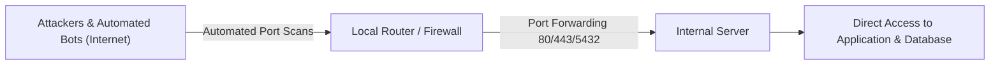
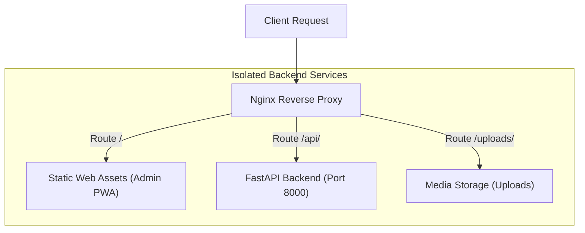
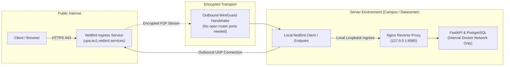

Traditional server deployments often struggle with network security and restrictive firewall policies: Direct port forwarding exposes internal services to the global internet, while enterprise or campus networks strictly block incoming connections. The UPA Campus App resolves this conflict by combining an Nginx reverse proxy with an encrypted NetBird WireGuard mesh. This third installment examines the risks of open server ports, the architectural purpose of a reverse proxy, and how to publish secure domains without modifying local router settings.

---

## The Problem with Open Server Ports

The conventional way to expose a local service to the internet relies on port forwarding at the router:



This setup introduces severe security hazards for any production system:

1. **Unfiltered Exposure:** As soon as a port is opened on a router, unfiltered TCP and UDP packets reach the internal host directly.
2. **Automated Attack Waves:** Scanning engines such as Shodan and Censys index newly open ports within minutes. Botnets immediately launch automated password brute-force attacks, probe for known vulnerabilities (CVEs), and search for common web server misconfigurations.
3. **Configuration Drift and Human Error:** Inadvertently opening database ports such as 5432 or internal administration endpoints can cause immediate data breaches or ransomware infections.
4. **Lack of Router Control:** In university or corporate settings, development teams rarely possess administrative permissions to modify gateway routers. Furthermore, Carrier-Grade NAT (CGNAT) often makes inbound port forwarding technically impossible because multiple subscribers share a single public IPv4 address.

Modern zero-trust architectures avoid opening inbound ports on edge routers entirely.

---

## The Reverse Proxy Principle: Nginx as an Architectural Shield

Before network traffic reaches application code, it must be inspected, decoupled, and routed. This role belongs to the reverse proxy.

While a forward proxy handles outbound requests from internal clients to the internet, a reverse proxy accepts inbound client requests on behalf of backend services:



In the UPA Campus App, Nginx fulfills three essential architectural duties:

### 1. Decoupling and Single Entry Point
Clients do not connect directly to the application backend or database. Nginx serves as the primary interface. Internal containers such as FastAPI and PostgreSQL remain isolated within a dedicated Docker bridge network with no direct host port bindings.

### 2. Path-Based Ingress Routing
Nginx inspects the Uniform Resource Identifier (URI) of each request and steers it to the appropriate destination:
* Requests targeting `/` or `/dashboard/` serve static files for the administrative web portal directly from the container file system.
* Requests with the `/api/` prefix route to the internal container at `http://backend:8000/api/`.
* Requests to `/uploads/` stream uploaded media assets.
* Unmatched paths fall back to `index.html` via `try_files` to enable seamless client-side single-page application (SPA) routing.

### 3. Security and Governance
Nginx sanitizes and bounds requests before they hit the Python runtime:
* Restricting payload size (`client_max_body_size 15M`) prevents denial-of-service attempts via bloated uploads.
* Header management (`X-Real-IP`, `X-Forwarded-Proto`, `Host`) guarantees that the backend knows the genuine client origin and transmission protocol.
* Static caching headers reduce server load and latency for repeat visits.

---

## NetBird Ingress: Encrypted Mesh Tunneling

If edge firewalls block all inbound traffic, how do authorized clients reach the Nginx proxy? The answer is NetBird.

NetBird combines the WireGuard cryptographic protocol with an overlay peer-to-peer mesh:



### 1. Outbound-Only Connections
The NetBird daemon running on the host initiates an outbound connection to coordination servers (signal and relay nodes). Because stateful firewalls permit outbound traffic and track response packets automatically, this tunnel requires no open inbound ports on the router. Connection initiation occurs strictly from the inside out.

### 2. NAT Traversal (STUN / ICE)
Using Interactive Connectivity Establishment (ICE), NetBird establishes direct peer-to-peer tunnels across firewalls and NAT layers. When symmetric NAT blocks direct communication, encrypted relay nodes forward packets with minimal overhead.

### 3. Domain Provisioning via NetBird Ingress
Through NetBird Ingress, the host is assigned an authenticated domain name (such as `upa.eu1.netbird.services`). NetBird terminates or validates TLS and forwards authorized HTTPS requests through the WireGuard tunnel directly into the host.

### 4. Local Binding to 127.0.0.1
The Nginx container does not publish port 80 to `0.0.0.0`. Instead, it explicitly binds to the local loopback interface:

```yaml
ports:
  - "127.0.0.1:8085:80"
```

This configuration prevents a dangerous security gap: On Linux hosts, Docker manipulates `iptables` rules directly. Binding to `0.0.0.0:8085:80` would bypass local host firewalls like UFW. Binding strictly to `127.0.0.1` ensures that only processes running on the local host can reach Nginx. The NetBird daemon acts as that trusted local consumer.

---

## The Cohesive Zero-Trust Defense

Unifying these layers yields a resilient zero-trust architecture:

1. **Total Invisibility:** Port scans against the public IP address of the campus router find zero listening services. Neither application servers nor databases are discoverable.
2. **Cryptographic Isolation:** All transit traffic relies on WireGuard with modern cryptographic primitives (ChaCha20, Poly1305, Curve25519).
3. **Compartmentalized Data:** The database and API execute within an isolated Docker bridge network. Even if one component faces issues, network segmentation prevents unauthorized lateral movement.

---

## Summary

1. **Security Through Invisibility:** Outbound-only WireGuard tunnels replace external port forwarding, eliminating automated internet scans and perimeter attacks.
2. **Clean Separation of Concerns:** A dedicated Nginx reverse proxy decouples routing and static assets from backend business logic.
3. **Infrastructure Agnostic:** NetBird guarantees reliable ingress in restrictive university and enterprise networks without requiring custom exceptions from central network administrators.
