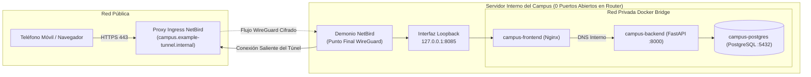

¿Cómo se logra que un servidor local en el campus sea accesible desde teléfonos móviles y navegadores sin abrir puertos entrantes en el firewall de la universidad ni sufrir bloqueos CORS en el navegador? Combinando un túnel cifrado saliente sobre WireGuard (NetBird) con un proxy inverso Nginx local que agrupa todos los servicios bajo un único dominio (Single Origin). Este tercer capítulo sigue el recorrido de un paquete de red desde internet hasta la red privada de contenedores.

---

## Por Qué Falla la Apertura Tradicional de Puertos en Redes Universitarias

Muchos tutoriales básicos recomiendan abrir los puertos 80 y 443 en el router mediante reenvío de puertos (Port Forwarding). En el entorno real de una universidad, esa práctica fracasa por tres motivos:

1. **Escaneo Constante en Internet:** Motores automatizados y redes de bots rastrean todo el espacio público de direcciones IPv4 minuto a minuto. Cualquier puerto expuesto directamente recibe intentos automatizados de intrusión de inmediato.
2. **Sin Acceso al Firewall Central del Campus:** Por razones de seguridad institucional, los equipos de proyecto no administran los cortafuegos perimetrales de la universidad. Además, numerosos proveedores de internet emplean Carrier-Grade NAT (CGNAT), compartiendo una misma dirección IPv4 pública entre cientos de conexiones e impidiendo técnicamente las conexiones entrantes.
3. **El Riesgo de Docker sobre el Firewall de Linux:** Incluso cuando un servidor Linux cuenta con un firewall local activo como UFW, publicar un puerto de Docker de forma convencional (`8085:80`) modifica directamente las reglas `iptables` del kernel y expone el puerto en todas las interfaces de red locales.

---

## Invertir el Sentido de Conexión: Túnel Saliente WireGuard y Aislamiento Loopback

Para eliminar estos riesgos de raíz, la UPA Campus App invierte la dirección de enlace. El servidor no abre ningún puerto entrante hacia el exterior, sino que establece desde adentro una conexión saliente cifrada mediante **NetBird** y el protocolo **WireGuard** hacia el nodo de ingreso (`campus.example-tunnel.internal`):



Tres mecanismos de defensa operan aquí en conjunto:
* **Handshake Saliente:** Como el demonio local de NetBird inicia la comunicación desde adentro hacia afuera, el túnel atraviesa cortafuegos universitarios y redes CGNAT sin tocar el router. Al mismo tiempo, el nodo de ingreso gestiona los certificados HTTPS válidos que exigen Google OAuth 2.0 y los Service Workers de la PWA.
* **Vinculación Estricta a Loopback (`127.0.0.1:8085:80`):** Al anteponer `127.0.0.1:`, el contenedor Nginx escucha únicamente en la interfaz interna de bucle local del servidor. Solo el demonio NetBird que corre en esa misma máquina puede entregarle tráfico.
* **Puertos de Backend y Base de Datos Ocultos:** Ni FastAPI (puerto 8000) ni PostgreSQL (puerto 5432) exponen puertos en el servidor anfitrión. Se comunican exclusivamente dentro de la red privada de Docker mediante sus nombres DNS internos (`backend:8000` y `postgres:5432`).

---

## El Principio Single-Origin: Cómo Nginx Une Toda la Especificación

Cuando durante el desarrollo local se levanta la interfaz en el puerto `3000` y la API en el puerto `8000`, el navegador aplica la política **Same-Origin** y bloquea las peticiones cruzadas por seguridad (errores CORS).

En producción, **Nginx** actúa como **Proxy Inverso** frente a todos los contenedores. Para el teléfono del estudiante solo existe una dirección web única, detrás de la cual Nginx distribuye cada petición según el prefijo de la ruta:

```nginx
server {
    listen 80;
    server_name localhost;
    client_max_body_size 25M;

    # 1. Desviar llamadas a la API REST hacia el contenedor FastAPI
    location /api/ {
        proxy_pass http://backend:8000/api/;
        proxy_set_header Host $host;
        proxy_set_header X-Real-IP $remote_addr;
        proxy_set_header X-Forwarded-Proto $scheme;
    }

    # 2. Entregar afiches, videos y PDFs con caché en el navegador
    location /uploads/ {
        proxy_pass http://backend:8000/uploads/;
        expires 7d;
        add_header Cache-Control "public, max-age=604800, immutable";
    }

    # 3. Cabina editorial para el equipo de marketing
    location /dashboard/ {
        alias /usr/share/nginx/html/dashboard/;
        try_files $uri $uri/ /dashboard/index.html;
    }

    # 4. Aplicación móvil del campus y página QR de escritorio
    location / {
        root /usr/share/nginx/html;
        try_files $uri $uri/ /app/index.html;
    }
}
```

Cada bloque de esta configuración responde a una regla concreta del pliego funcional:
1. **Eliminación de Fricción CORS (`/api/` y `/uploads/`):** Como las pantallas, las respuestas JSON y los archivos multimedia provienen del mismo dominio, el navegador valida las peticiones de forma nativa. Además, la cabecera `Cache-Control` en `/uploads/` permite que los afiches descargados se conserven siete días en la memoria del teléfono.
2. **Escudo Perimetral para Carga Multimedia (`client_max_body_size 25M`):** La especificación admite imágenes, documentos PDF y videos cortos de eventos (`MP4` y `WEBM`). El límite de 25 megabytes permite subir contenido institucional válido, pero rechaza archivos desproporcionados en la frontera de red con `HTTP 413 (Content Too Large)` antes de que consuman memoria RAM en el contenedor de Python.
3. **Soporte para Enrutamiento del Cliente (`try_files`):** Cuando un editor recarga directamente una ruta interna como `/dashboard/publicaciones`, Nginx no busca una carpeta física inexistente, sino que entrega `/dashboard/index.html` mediante `try_files` para que la aplicación web muestre la vista correspondiente.

---

## Conclusiones

1. **Conectividad Segura sin Abrir Puertos en el Firewall:** Mediante el túnel saliente WireGuard de NetBird y el enlace local `127.0.0.1:8085`, el servidor permanece invisible ante escáneres externos y opera sin inconvenientes detrás de redes universitarias restringidas.
2. **Un Único Origen para Todos los Módulos:** Como proxy inverso single-origin, Nginx integra la aplicación estudiantil, el portal editorial, el backend FastAPI y la entrega de archivos multimedia bajo una misma dirección, filtrando cargas excesivas en el borde de la red.
