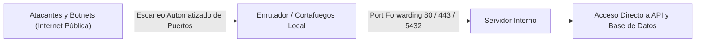
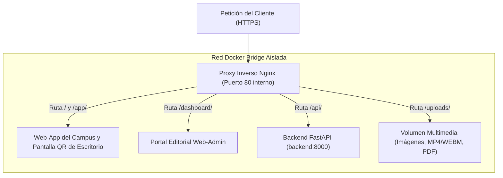
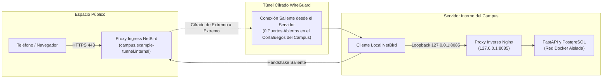

Los despliegues tradicionales de servidores en redes universitarias y corporativas suelen chocar contra dos obstáculos: abrir puertos en el enrutador expone los servicios internos a ataques automatizados desde toda Internet, mientras que los cortafuegos del campus y el Carrier-Grade NAT (CGNAT) bloquean las conexiones entrantes. La UPA Campus App resuelve este dilema combinando un proxy inverso Nginx local con un túnel cifrado WireGuard mediante NetBird (Decisión Arquitectónica 3.4). Este tercer capítulo construye el modelo mental de la arquitectura de red moderna: por qué las aplicaciones web agrupan todos sus servicios bajo un mismo dominio (Single Origin) y cómo un servidor puede operar de forma segura sin abrir un solo puerto público en el enrutador.

---

## Por Qué el Reenvío Tradicional de Puertos Falla en Producción

El método clásico para publicar un servidor local en Internet consiste en abrir puertos (Port Forwarding) en el enrutador:



En entornos universitarios y empresariales, este esquema resulta inviable por tres motivos:
1. **Oleadas de Ataques Automatizados:** Motores como Shodan o Censys rastrean de forma continua todo el espacio público de direcciones IPv4. Minutos después de abrir un puerto, redes de bots inician ataques de fuerza bruta sobre contraseñas y buscan vulnerabilidades conocidas (CVEs).
2. **Riesgo de Error Humano:** Si durante una prueba se expone accidentalmente el puerto de la base de datos (`5432`) o un puerto de depuración sin contraseña, los registros académicos quedan expuestos de inmediato.
3. **Ausencia de Control sobre el Enrutador del Campus:** En una universidad, los equipos de desarrollo no tienen permisos para modificar el cortafuegos central. Además, muchos proveedores de Internet utilizan Carrier-Grade NAT (CGNAT), compartiendo una misma dirección IPv4 pública entre cientos de clientes e impidiendo técnicamente la apertura de puertos entrantes.

Por ello, las arquitecturas modernas invierten el sentido de la conexión: en lugar de abrir puertos de afuera hacia adentro, el servidor establece un túnel cifrado de adentro hacia afuera.

---

## El Modelo Mental del Proxy Inverso: Por Qué un Origen Único (Single Origin) lo Unifica Todo

Quien desarrolla un primer prototipo con herramientas de inteligencia artificial (vibe-coding) suele levantar el frontend en `localhost:3000` y el backend en `localhost:8000`. Al llevar ese esquema a Internet aparecen de inmediato bloqueos de seguridad en el navegador por la **Política del Mismo Origen (CORS)** y URLs con puertos confusos para los usuarios.

Un **Proxy Inverso** (Nginx) resuelve esto actuando como puerta principal única delante de todos los contenedores, unificando toda la plataforma bajo un solo dominio:



### Cómo la Tabla de Enrutamiento de Nginx Refleja la Especificación Funcional

Al revisar el archivo `nginx.conf` de la UPA Campus App, se observa cómo cada ruta URL responde directamente a un requisito del pliego funcional:

```nginx
server {
    listen 80;
    server_name localhost;
    client_max_body_size 25M;

    # 1. Redirigir llamadas de API al contenedor FastAPI
    location /api/ {
        proxy_pass http://backend:8000/api/;
        proxy_set_header Host $host;
        proxy_set_header X-Real-IP $remote_addr;
        proxy_set_header X-Forwarded-Proto $scheme;
    }

    # 2. Entregar archivos multimedia (afiches, videos, PDFs) con caché
    location /uploads/ {
        proxy_pass http://backend:8000/uploads/;
        expires 7d;
        add_header Cache-Control "public, max-age=604800, immutable";
    }

    # 3. Portal administrativo Web-Admin para el equipo de marketing
    location /dashboard/ {
        alias /usr/share/nginx/html/dashboard/;
        try_files $uri $uri/ /dashboard/index.html;
    }

    # 4. Aplicación móvil web y pantalla QR de escritorio
    location / {
        root /usr/share/nginx/html;
        try_files $uri $uri/ /app/index.html;
    }
}
```

Aquí convergen tres decisiones clave de diseño:
* **Eliminación de Errores CORS mediante Origen Único:** Como el navegador descarga la interfaz (`/dashboard/`), consulta la API (`/api/`) y muestra los afiches (`/uploads/`) desde exactamente el mismo dominio, todas las peticiones cumplen la política de mismo origen de forma nativa.
* **Protección de la Subida Multimedia Unificada (`client_max_body_size`):** Según la especificación funcional, el editor de publicaciones admite tanto afiches y documentos PDF como videos cortos de eventos (`MP4` y `WEBM`). La directiva `client_max_body_size 25M` permite subir estos videos sin inconvenientes, pero rechaza en el perímetro cualquier archivo gigante malicioso con `HTTP 413 (Content Too Large)` antes de que consuma memoria RAM en el contenedor de Python.
* **Soporte SPA con `try_files`:** Cuando un editor recarga directamente la ruta `/dashboard/publicaciones`, Nginx no devuelve un error 404 buscando un archivo físico con ese nombre, sino que entrega `/dashboard/index.html` para que el enrutador de JavaScript reconstruya la vista exacta.

---

## NetBird Ingress: Acceso Zero-Trust sin Puertos Abiertos en el Enrutador

¿Cómo llega la consulta desde el teléfono de un estudiante hasta el contenedor local de Nginx si el enrutador de la universidad no tiene ningún puerto abierto? La respuesta es **NetBird** sobre el protocolo **WireGuard**:



1. **Conexión Iniciada de Adentro hacia Afuera:** El servicio NetBird dentro del servidor universitario abre una conexión saliente cifrada con WireGuard hacia el nodo de ingreso (`campus.example-tunnel.internal`). Dado que los cortafuegos permiten el tráfico saliente, no hace falta abrir puertos en el enrutador local.
2. **Certificados HTTPS Automáticos:** El nodo de ingreso gestiona certificados TLS válidos (indispensables para el inicio de sesión con Google OAuth 2.0 y los Service Workers de la PWA) y reenvía el tráfico cifrado de extremo a extremo por el túnel WireGuard.
3. **Entrega en Loopback (`127.0.0.1:8085`):** Al llegar al servidor, el demonio de NetBird entrega los paquetes directamente en `127.0.0.1:8085`. Como vimos en el Capítulo 2, el contenedor Nginx escucha únicamente en esa dirección interna, manteniéndose invisible incluso para otros equipos conectados a la misma red local.

---

## Conclusiones

1. **Túneles Salientes en Lugar de Puertos Abiertos:** Con NetBird y WireGuard, el servidor opera sin abrir puertos en el enrutador y permanece invisible ante los escáneres de vulnerabilidades en Internet.
2. **Arquitectura de Origen Único con Nginx:** El proxy inverso unifica la aplicación estudiantil, el portal Web-Admin, la API REST (`/api/`) y los archivos multimedia (`/uploads/`) bajo un mismo dominio, evitando fallos CORS y filtrando cargas excesivas en el perímetro.
3. **Soporte Directo a la Especificación Funcional:** El cifrado HTTPS exigido por Google OAuth (`@example-campus.edu`), la caché de afiches y el límite seguro para videos `MP4`/`WEBM` quedan garantizados desde la capa de red.
