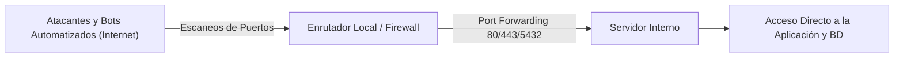
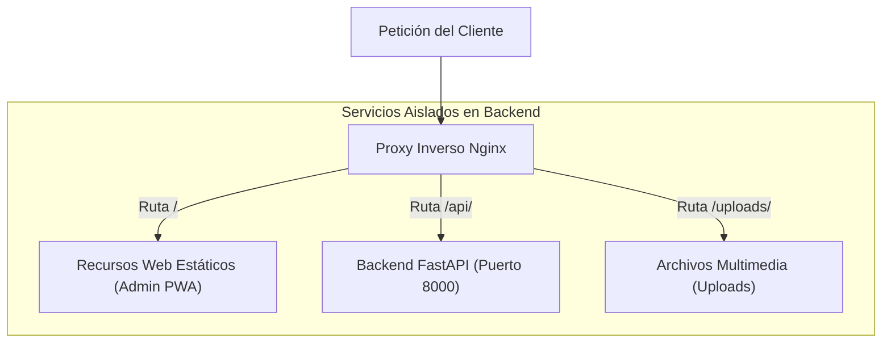
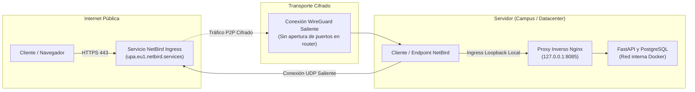

El despliegue tradicional de servidores suele enfrentar desafíos de seguridad de red y políticas restrictivas de firewall: El reenvío directo de puertos en el enrutador expone los servicios internos a la Internet global, mientras que las redes corporativas o de campus universitarios bloquean de forma estricta las conexiones entrantes. UPA Campus App resuelve este conflicto mediante la combinación de un proxy inverso Nginx con una red mallada cifrada NetBird basada en WireGuard. Esta tercera entrega examina los peligros de los puertos abiertos en servidores, la función protectora del proxy inverso y la publicación de dominios seguros sin alterar la configuración del enrutador local.

---

## El problema de los puertos abiertos en el servidor

El enfoque convencional para publicar un servicio interno en Internet consiste en configurar el reenvío de puertos (Port Forwarding) en el enrutador:



Este esquema genera riesgos críticos para cualquier entorno de producción:

1. **Exposición sin filtros:** En el instante en que un puerto se abre en el enrutador hacia Internet, los paquetes TCP y UDP alcanzan el sistema interno de forma directa.
2. **Oleadas continuas de ataques:** Motores de indexación como Shodan o Censys detectan puertos abiertos en cuestión de minutos. Las redes de bots inician ataques automatizados de fuerza bruta, buscan vulnerabilidades conocidas (CVEs) y rastrean fallos de configuración en servidores web.
3. **Riesgo por error humano:** La exposición involuntaria de un puerto de base de datos como 5432 o de interfaces de gestión interna puede derivar en fugas masivas de información o secuestro de datos (ransomware).
4. **Falta de control del enrutador:** En entornos corporativos o universitarios, los equipos de desarrollo no disponen de privilegios administrativos para modificar los enrutadores centrales. Además, el uso de Carrier-Grade NAT (CGNAT) por parte de proveedores de telecomunicaciones impide técnicamente el reenvío de puertos entrantes al compartir una sola dirección IPv4 pública entre cientos de usuarios.

Por estas razones, las arquitecturas modernas Zero-Trust descartan por completo la apertura de puertos entrantes en enrutadores perimetrales.

---

## El principio del Reverse Proxy: Nginx como escudo protector

Antes de que el tráfico de red alcance los componentes de la aplicación, debe ser inspeccionado, desacoplado y dirigido. Esta es la función del proxy inverso.

A diferencia de un forward proxy, que canaliza peticiones salientes de clientes internos hacia Internet, un reverse proxy recibe peticiones entrantes en representación de los servicios situados detrás:



En UPA Campus App, Nginx cumple tres funciones clave:

### 1. Desacoplamiento y punto único de contacto
Los clientes no interactúan directamente con el backend ni con la base de datos. Nginx opera como la puerta de entrada principal. Los contenedores internos (FastAPI y PostgreSQL) residen en una red bridge privada de Docker sin exposición directa de puertos al host.

### 2. Enrutamiento basado en rutas
Nginx evalúa la ruta solicitada (URI) y redirige el flujo de datos:
* Las peticiones a `/` o `/dashboard/` entregan los archivos estáticos compilados del portal administrativo directamente desde el sistema de archivos del contenedor.
* Las peticiones con el prefijo `/api/` se reenvían al contenedor interno `http://backend:8000/api/`.
* Las peticiones a `/uploads/` entregan archivos multimedia almacenados.
* Las rutas no coincidentes son gestionadas por la directiva `try_files`, asegurando el funcionamiento fluido de las aplicaciones de página única (SPA).

### 3. Seguridad y control perimetral
Nginx valida las peticiones antes de que consuman recursos en Python:
* El límite de tamaño (`client_max_body_size 15M`) previene sobrecargas por archivos excesivamente grandes.
* La gestión de encabezados HTTP (`X-Real-IP`, `X-Forwarded-Proto`, `Host`) garantiza que el backend reconozca el origen auténtico del cliente y el protocolo de cifrado.
* Las cabeceras de caché reducen la carga del servidor para recursos estáticos recurrentes.

---

## NetBird Ingress: Túneles cifrados punto a punto

Si el firewall bloquea todo el tráfico entrante, ¿cómo acceden los usuarios autorizados al proxy Nginx? La solución es NetBird.

NetBird combina el protocolo criptográfico WireGuard con una red superpuesta mallada (Peer-to-Peer Mesh):



### 1. Conexiones exclusivamente salientes
El daemon de NetBird instalado en el servidor inicia una conexión saliente hacia los servidores de coordinación (señalización y retransmisión). Debido a que los firewalls de inspección de estado permiten el tráfico saliente y sus respuestas asociadas, el túnel opera sin necesidad de abrir puertos entrantes en el enrutador. La conexión se establece desde adentro hacia afuera.

### 2. Traversal de NAT (STUN / ICE)
Mediante Interactive Connectivity Establishment (ICE), NetBird negocia la ruta más directa entre pares a través de firewalls y NAT. Si el entorno utiliza NAT simétrico, nodos de retransmisión cifrados garantizan la continuidad de la comunicación con mínima latencia.

### 3. Asignación de dominios seguros
A través de NetBird Ingress, el servidor dispone de un dominio institucional autenticado (como `upa.eu1.netbird.services`). NetBird gestiona los certificados TLS y canaliza las peticiones HTTPS autorizadas directamente por el túnel WireGuard hacia el host.

### 4. Vinculación estricta a 127.0.0.1
El contenedor Nginx no expone su puerto en todas las interfaces de red (`0.0.0.0`). En su lugar, se asocia estrictamente a la interfaz local loopback:

```yaml
ports:
  - "127.0.0.1:8085:80"
```

Esta configuración evita una brecha frecuente: en entornos Linux, Docker administra directamente las tablas de `iptables`. Un mapeo a `0.0.0.0:8085:80` evadiría las reglas de firewalls locales como UFW. Al vincularse a `127.0.0.1`, solo los procesos que se ejecutan localmente en el servidor pueden acceder a Nginx. El daemon de NetBird actúa como el receptor local de confianza.

---

## Seguridad integral en conjunto

La integración de estos tres elementos conforma una arquitectura Zero-Trust sólida:

1. **Invisibilidad total:** Un escaneo de puertos sobre la dirección IP pública del campus no detecta ningún servicio en escucha. Los servidores web y bases de datos permanecen ocultos.
2. **Aislamiento criptográfico:** Todo el tráfico en tránsito utiliza WireGuard con algoritmos de última generación (ChaCha20, Poly1305, Curve25519).
3. **Compartimentación de datos:** La base de datos y la API operan en una red bridge aislada. Incluso ante incidentes en un componente expuesto, la segmentación impide el movimiento lateral hacia los datos críticos.

---

## Conclusión

1. **Seguridad mediante invisibilidad:** Los túneles salientes de WireGuard eliminan la necesidad de abrir puertos externos, anulando escaneos automatizados y ataques directos desde Internet.
2. **Separación limpia de responsabilidades:** Un proxy inverso Nginx desacopla el enrutamiento y la entrega de archivos estáticos respecto a la lógica de negocio del backend.
3. **Independencia de la infraestructura:** NetBird asegura conectividad confiable en redes universitarias y corporativas restrictivas sin requerir excepciones en los cortafuegos institucionales.
