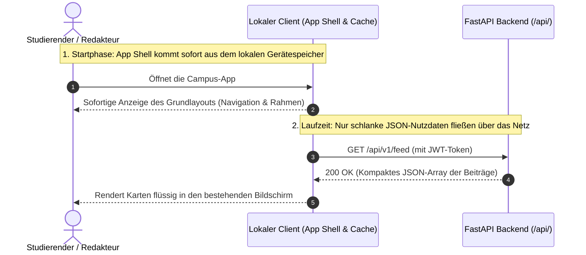
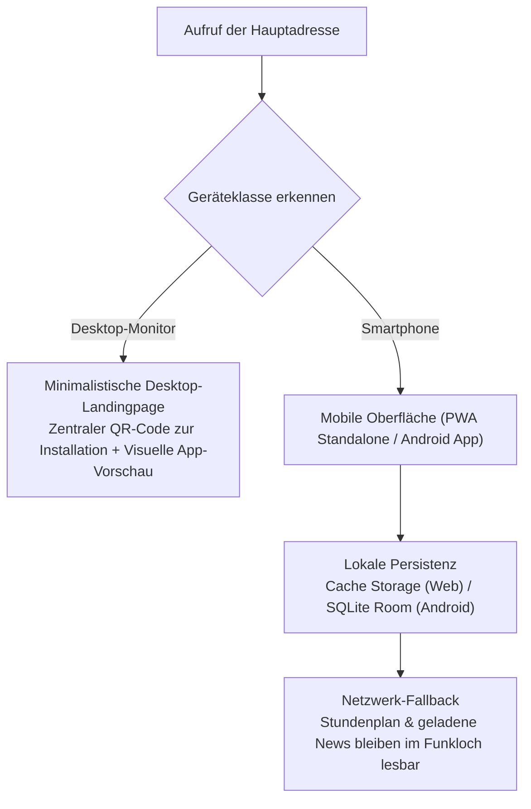

Warum fühlt sich eine moderne Web-Applikation auf dem Smartphone so flüssig an wie ein lokal installiertes Programm, selbst wenn das WLAN im Untergeschoss-Hörsaal schwankt? Weil das Endgerät das optische Grundgerüst (App Shell) nur ein einziges Mal lädt, während der laufenden Nutzung lediglich kompakte JSON-Datenpakete austauscht und geladene Inhalte in einem lokalen Gerätespeicher vorhält. Dieses vierte Kapitel zeigt, wie die UPA Campus App dieses Client-Modell im mobilen Frontend (PWA und nativer Android-Client mit Kotlin und Jetpack Compose) sowie im Desktop-Redaktionsportal umsetzt.

---

## App Shell statt kompletter Seiten-Neuladung

In traditionellen Webanwendungen berechnet der Server bei jedem Klick ein vollständiges HTML-Dokument neu. Auf dem Smartphone führt das bei schwacher Verbindung zu flackernden weißen Bildschirmen und verlorenen Scroll-Positionen.

Moderne Clients trennen deshalb die **Darstellungsschale (App Shell)** von den **dynamischen Nutzdaten (JSON)**:



1. **Sofortiger Start aus dem Gerätespeicher:** Navigationsleisten, Schriften und Icons liegen nach dem ersten Aufruf lokal auf dem Smartphone. Beim Öffnen erscheint die Oberfläche ohne Wartezeit.
2. **Gezielte Teil-Aktualisierung im Speicher:** Meldet sich ein Studierender per Fingertipp für eine Veranstaltung an, tauscht der Client nur ein winziges JSON-Paket mit dem Server aus und färbt den Button direkt im Arbeitsspeicher um.

---

## Geräte-Weiche am Desktop und Offline-Resilienz auf dem Smartphone

Die UPA Campus App bedient zwei grundverschiedene Nutzungssituationen am Campus: Studierende nutzen das System unterwegs mit einer Hand auf dem Smartphone, während das Marketing-Team Beiträge am großen Büro-Monitor verfasst.



* **Warum zeigt der Desktop eine QR-Landingpage statt einer breitgezogenen Smartphone-Ansicht?** Eine für schmale Telefonbildschirme entworfene Drei-Tab-Navigation wirkt auf einem 27-Zoll-Monitor unübersichtlich. Öffnet jemand die Hauptadresse am Laptop, präsentiert das Frontend deshalb eine aufgeräumte Übersichtsseite mit einer visuellen Vorschau der App-Bildschirme und einem zentralen QR-Code, über den Studierende die App sofort auf ihr Smartphone holen können.
* **Vollbild-Installation per Web App Manifest (`manifest.json`):** Auf Mobilgeräten sorgt die Einstellung `"display": "standalone"` dafür, dass die Anwendung ohne störende Browser-Adressleiste wie eine reguläre App vom Startbildschirm aus startet.
* **Lokale Zwischenspeicherung gegen Funklöcher:** Während die zentrale Datenbank auf dem Server die verbindlichen Bestände führt, nutzen die mobilen Clients eine zweite, lokale Speicherschicht (`Cache Storage` im Browser bzw. `SQLite / Room` in der Android-App). Für den Feed und den Kalender gilt das Prinzip *Network First mit lokalem Fallback*: Antwortet das Campus-WLAN im Hörsaal nicht, zeigt das Endgerät automatisch den zuletzt geladenen Stand an, statt eine leere Fehlerseite zu präsentieren.

---

## Wie die UI-Zustandslogik die Regeln des Pflichtenhefts abbildet

Ein gutes Frontend verlässt sich nicht darauf, dass Nutzer ein Handbuch lesen, sondern führt sie über klare Zustandsregeln direkt durch die Anforderungen des Pflichtenhefts:

### 1. Reservierter Warnbereich, Vollbild-Modal und Optimistic UI (*Inicio*)
* **Fester Platz für Notfall-Banner:** Zeitkritische Warnungen (`EMERGENCY_BANNER`, etwa bei kurzfristiger Campus-Schließung) dürfen beim Scrollen nicht zwischen regulären Veranstaltungsplakaten verschwinden. Der Client filtert diese Einträge vor der Anzeige heraus und heftet sie in einen eigenen, farblich abgehobenen Bereich oberhalb des Feeds.
* **Vollbild-Modal erhält den Lesefluss:** Tippt man eine Karte im Feed an, öffnet sich kein neues Browserfenster, sondern ein **Vollbild-Modal** über der bestehenden Liste. Dort lassen sich lange Texte lesen, PDF-Anhänge öffnen oder eingebettete Videos (`MP4` und `WEBM`) abspielen. Schließt der Studierende das Modal, steht der Feed exakt an derselben Stelle wie zuvor.
* **Verzögerungsfreie 1-Klick-Anmeldung (Optimistic UI):** Beim Tipp auf den Anmelde-Button einer Veranstaltung schaltet die Oberfläche den Status sofort sichtbar auf "Angemeldet" um, während der Netzwerkaufruf im Hintergrund abläuft. Sollte die Verbindung abbrechen, setzt der Client den Schalter zurück und blendet einen kurzen Hinweis ein.

### 2. Geteilter Daten-State zwischen Liste und Monatsgitter (*Agenda*)
Auf einem kompakten Smartphone-Bildschirm bietet ein klassisches Monatsgitter zwar einen schnellen Überblick über freie und belegte Tage, hat aber keinen Platz für lange Veranstaltungstitel oder Google-Classroom-Aufgaben. Das *Agenda*-Modul kombiniert deshalb beide Darstellungen auf einem Bildschirm und speist sie aus demselben lokalen Zustandsspeicher: Ein Tipp auf einen markierten Kalendertag im unteren Monatsgitter filtert sofort die chronologische Detail-Liste im oberen Bereich.

### 3. Intelligente Formularführung im Redaktions-Cockpit (*Web-Admin*)
Im Redaktionsportal (`/dashboard/`) übersetzt JavaScript die Schutzregeln des Pflichtenhefts bereits während der Eingabe in sichtbares Formularverhalten:

```javascript
function updateEditorConstraints(postRecord, ui) {
  // 1. Wer einen Beitrag oben anheftet, muss zwingend ein Ablaufdatum setzen
  const pinned = ui.pinToggle.checked;
  ui.expiryFieldWrapper.hidden = !pinned;
  ui.expiryDateInput.required = pinned;

  // 2. Importierte Instagram-Beiträge sind für Text und Medien schreibgeschützt
  const fromInstagram = Boolean(postRecord && postRecord.post_type === "INSTAGRAM");
  ui.titleInput.readOnly = fromInstagram;
  ui.bodyTextarea.readOnly = fromInstagram;
  ui.mediaPicker.disabled = fromInstagram;
}
```

* **Sichtbarer Zwang zum Ablaufdatum:** Sobald ein Redakteur das Häkchen bei "Oben anheften" setzt, klappt das Formular das Datumsfeld für das Ablaufdatum (`expires_at`) auf und markiert es als Pflichteingabe. So entsteht gar nicht erst der Versuch, einen Hinweis ohne Verfallsdatum zu veröffentlichen.
* **Visueller Schreibschutz für Instagram-Importe:** Stammt ein Beitrag aus der automatischen Instagram-Synchronisation, sperrt der Editor Titel, Text und Bildfeld optisch gegen Bearbeitung, weil der nächste Hintergrund-Abgleich manuelle Textänderungen wieder mit dem Original von Instagram überschreiben würde.
* **Flache alphabetische Gruppenliste mit Sofort-Filter:** Um eine Mitteilung an bestimmte Studiengänge zu richten, verzichtet das Cockpit auf verschachtelte Untermenüs. Stattdessen zeigt es alle Google-Workspace-Gruppen in einer flachen, alphabetisch sortierten Liste mit direktem Suchfeld (*Instant Filter*), sodass jede Zielgruppe mit wenigen Tastenanschlägen gefunden wird.

---

## Fazit

1. **Trennung von App Shell und Nutzdaten:** Weil das Endgerät das grafische Programmgerüst lokal speichert und über das Netzwerk nur noch kompakte JSON-Daten abruft, reagiert die Anwendung ohne Seiten-Neuladung.
2. **Praxistauglichkeit im Campus-Alltag:** Durch die automatische Desktop-QR-Weiche, den lokalen Offline-Speicher für Hörsäle mit schwachem Empfang und eine zustandsgesteuerte Formularlogik im Web-Admin setzt der Client die fachlichen Vorgaben unmittelbar in flüssige Bedienung um.
