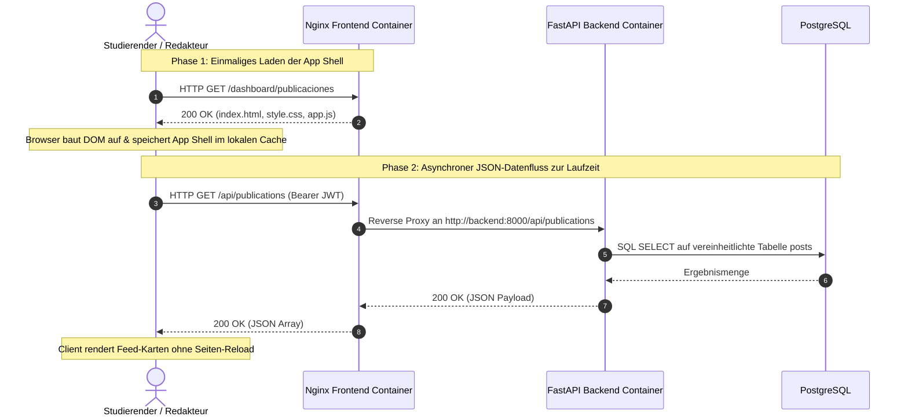
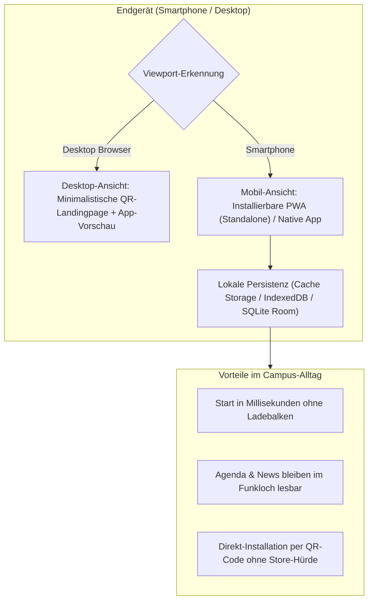

Moderne Web-Applikationen berechnen ihre Benutzeroberfläche nicht mehr bei jedem Klick neu auf dem Server, sondern verlagern Darstellung, Zustandsverwaltung (State Management) und Zwischenspeicherung vollständig auf das Endgerät des Nutzers. Die UPA Campus App nutzt diese Entkopplung, um über dasselbe Backend sowohl das Desktop-Redaktionsportal (`web-admin`), die mobile Progressive Web App (PWA) als auch den nativen Android-Client (Kotlin und Jetpack Compose, Architekturentscheidung 3.1) zu versorgen. Dieses vierte Kapitel vermittelt das mentale Modell moderner Frontend-Clients und zeigt, wie die konkreten Anforderungen des Pflichtenhefts vom Notfall-Banner über das Vollbild-Modal bis zum Read-Only-Schutz im Editor im Client umgesetzt werden.

---

## Server-Rendering vs. Entkoppelte Client-Architektur

In klassischen Websystemen (wie traditionellen PHP- oder Server-Template-Anwendungen) erzeugt der Server bei jedem Klick ein komplett neues HTML-Dokument. Bei schwachem Mobilfunknetz im Hörsaal führt das zu weißen Ladebildschirmen und abgebrochenen Formularen.

Eine moderne Single-Page-Application (SPA) und Progressive Web App (PWA) trennt das **Programmgerüst (App Shell)** strikt von den **Nutzdaten (JSON)**:



1. **Aufgabe des Servers (Nginx):** Liefert beim ersten Aufruf lediglich die statischen Programmdateien (`index.html`, Stylesheets, JavaScript) aus und verbraucht dabei kaum CPU-Leistung.
2. **Aufgabe des Clients (Browser / App):** Hält den aktuellen Anwendungszustand im Arbeitsspeicher, ruft im Hintergrund gezielt JSON-Daten über `/api/` ab und aktualisiert bei einer Aktion (etwa einer 1-Klick-Veranstaltungsanmeldung) nur den betroffenen Teilbaum im Document Object Model (DOM).

---

## PWA, Desktop-QR-Weiche und Duale Offline-Persistenz

Warum kombiniert die Plattform Web-Standards (PWA) mit einer nativen mobilen Persistenzstrategie? Ein Blick auf den Alltag am Campus liefert die Begründung:



* **Die minimalistische Desktop-Landingpage mit QR-Weiche:** Öffnet ein Studierender die Hauptadresse der Campus-App am Laptop, wäre eine breitgezogene Smartphone-Oberfläche unübersichtlich. Das Frontend erkennt daher die Bildschirmbreite und zeigt auf dem Desktop automatisch eine aufgeräumte Landingpage mit einem einzigen zentralen QR-Code zur direkten Smartphone-Installation sowie einer visuellen Vorschau der App-Bildschirme.
* **Web App Manifest (`manifest.json`):** Auf dem Smartphone sorgt das Manifest mit `"display": "standalone"` dafür, dass die Web-App ohne Browser-Adressleiste im Vollbild startet und als eigenes Icon auf dem Homescreen liegt.
* **Duale Persistenz für Offline-Resilienz (Architekturentscheidung 3.2):** Während PostgreSQL auf dem Server als zentrales Buchungssystem arbeitet, nutzen die Clients einen lokalen Zwischenspeicher (Service Worker `Cache Storage` im Web sowie `SQLite / Room` in der nativen Android-App). Statische Icons und Stylesheets werden nach dem Prinzip **Cache First** sofort aus dem Gerätespeicher geladen. Für den Campus-Feed und den Kalender gilt **Network First mit Cache-Fallback**: Ist das WLAN im Untergeschoss-Hörsaal unterbrochen, zeigt die App nahtlos den zuletzt synchronisierten Stand an, statt mit einer Fehlermeldung abzustürzen.

---

## Wie das Pflichtenheft die vier UI-Module im Client formt

Für Wirtschaftsinformatiker und Vibe-Coder ist entscheidend zu verstehen, wie die Anforderungen des Pflichtenhefts in konkrete Zustandsregeln der Benutzeroberfläche übersetzt werden:

### 1. Modul Inicio (Campus-Feed, Vollbild-Modal und 1-Klick-RSVP)
* **Dedizierter Slot für Notfall-Banner:** Eilmeldungen (`EMERGENCY_BANNER`, etwa bei kurzfristigem Vorlesungsausfall wegen Unwetters) dürfen beim Scrollen nicht zwischen normalen Beiträgen untergehen. Der Client filtert angeheftete Eilmeldungen vor dem Rendern heraus und platziert sie in einem eigenen, farblich hervorgehobenen Warnbereich oberhalb des Feeds.
* **Vollbild-Modal statt Seitenwechsel:** Tippt ein Studierender auf eine Veranstaltungsankündigung, öffnet sich ein **Vollbild-Modal**, das den gesamten Text, hochauflösende Plakate, eingebettete Videos (`MP4`/`WEBM`) oder PDF-Anhänge anzeigt. Beim Schließen des Modals befindet sich der Nutzer sofort wieder an exakt derselben Scroll-Position im Feed.
* **Optimistic UI beim 1-Klick-RSVP:** Ein Tipp auf "Teilnehmen" sendet asynchron ein `POST /api/v1/posts/{id}/register` im Hintergrund und schaltet den Button ohne Seiten-Reload sofort auf "Angemeldet" um.

### 2. Modul Agenda (Synchronisierter Dual-Kalender)
* **Kombination aus Monatsgitter und chronologischer Liste:** Ein reines Monatsgitter auf dem Smartphone ist zu klein für lange Veranstaltungstitel, während einer reinen Liste der zeitliche Überblick fehlt. Deshalb teilt das Agenda-Modul den Bildschirm: Oben steht die chronologische Liste der anstehenden Aktivitäten, unten der Monatskalender mit farbigen Indikator-Punkten. Beide Ansichten teilen sich denselben lokalen Daten-State aus internen Hochschul-Events und importierten **Google Classroom** Abgabefristen.

### 3. Modul Web-Admin (Das Redaktions-Cockpit für Marketing)
Im Desktop-Portal (`/dashboard/`) übersetzt die Benutzeroberfläche die Sicherheits- und Datenmodellregeln des Backends direkt in sichtbare Formularlogik:

```javascript
// Formular-Zustandssteuerung im vereinheitlichten Editor (web-admin)
function syncEditorState(postData, formElements) {
  // Regel 1: Pflicht-Ablaufdatum bei "Oben anheften" (is_pinned)
  if (formElements.isPinnedCheckbox.checked) {
    formElements.expiresAtInput.required = true;
    formElements.expiresAtContainer.classList.remove("hidden");
  } else {
    formElements.expiresAtInput.required = false;
  }

  // Regel 2: Read-Only-Schutz für synchronisierte Instagram-Beiträge
  const isInstagram = postData && postData.post_type === "INSTAGRAM";
  formElements.titleInput.readOnly = isInstagram;
  formElements.contentInput.readOnly = isInstagram;
  formElements.mediaUploadInput.disabled = isInstagram;
}
```

* **Warum erzwingt die Checkbox "Oben anheften" sofort ein Ablaufdatum?** Sobald ein Redakteur `is_pinned` aktiviert, blendet das Formular das Pflichtfeld `expires_at` ein. So versteht der Redakteur bereits bei der Eingabe, dass kein Banner dauerhaft ohne Verfallsdatum den Campus-Feed blockieren darf.
* **Warum sind Text und Medien bei Instagram-Beiträgen im Editor ausgegraut (`Read-Only`)?** Beiträge mit `post_type === "INSTAGRAM"` stammen aus dem automatischen Hintergrund-Sync. Würde das Marketing-Team den Text im Web-Admin umschreiben, würde der nächste Synchronisationslauf die Änderung wieder mit dem Originaltext von Instagram überschreiben. Der Editor sperrt daher die Originalfelder visuell und erlaubt nur interne Ergänzungen wie das Anheften.
* **Warum nutzt die Gruppen-Auswahl eine flache alphabetische Liste mit Sofort-Filter?** An einer Universität existieren Dutzende Google-Workspace-Gruppen (`@example-campus.edu`) für Studiengänge und Jahrgänge. Verschachtelte Baum-Menüs kosten im Redaktionsalltag unnötige Klicks. Eine flache, alphabetisch sortierte Liste mit verzögerungsfreiem Suchfeld (`Instant Filter`) erlaubt die Zielgruppenauswahl in zwei Sekunden.
* **Warum sind in der Rollen-Matrix alle Berechtigungs-Checkboxen standardmäßig leer?** Nach dem Sicherheitsprinzip minimaler Rechte (*Least Privilege*) darf kein neuer Account versehentlich mit Administratorrechten angelegt werden. Jede Berechtigung muss bewusst einzeln angehakt werden, und Entwickler-Schnellzugänge sind auf dem Login-Bildschirm vollständig entfernt.

---

## Fazit

1. **Entkopplung von App Shell und Daten:** Weil Nginx nur das statische Grundgerüst ausliefert und der Client ausschließlich kompakte JSON-Payloads über `/api/` nachlädt, reagiert die Oberfläche ohne Seiten-Reloads in Millisekunden.
2. **Offline-Fähigkeit durch Dual-Persistenz:** Über lokale Zwischenspeicher (Service Worker Cache im Web, SQLite/Room unter Android) bleiben Stundenpläne, Fristen und Nachrichten auch in Hörsälen ohne stabiles WLAN jederzeit abrufbar.
3. **Pflichtenheft-Regeln direkt im UI-State verankert:** Vom verpflichtenden Ablaufdatum bei angehefteten Bannern über den Read-Only-Schutz für Instagram-Posts bis zur leeren Checkbox-Vorauswahl in der Rollen-Matrix führt die Oberfläche den Nutzer exakt entlang der Systemarchitektur.
