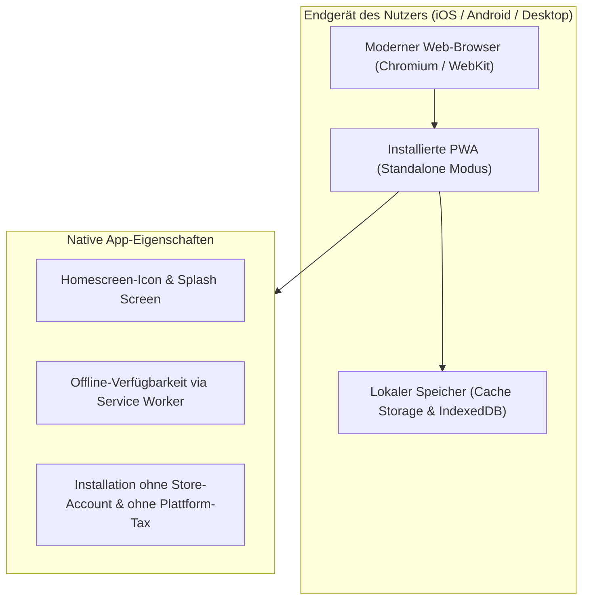
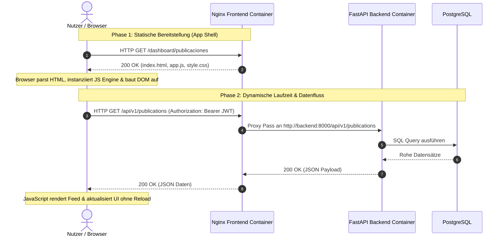

Moderne Unternehmensanwendungen verlangen eine native Benutzererfahrung auf mobilen Endgeräten, ohne die organisatorische und finanzielle Last nativer App-Store-Ökosysteme zu tragen. Die UPA Campus App setzt für ihr Web-Admin- und Studierendenportal auf eine Progressive Web App (PWA) in Kombination mit einer strikt entkoppelten Single-Page-Architektur. Dieser vierte Teil analysiert die architektonischen Vorteile von PWAs gegenüber nativen Store-Anwendungen, die Trennung zwischen statischer Server-Auslieferung und clientseitiger Browser-Ausführung, das Caching über Service Worker sowie die asynchrone API-Kommunikation.

---

## Progressive Web Apps: Das Web als universelle Plattform

Im Enterprise-Kontext scheitern native Mobile-Entwicklungen häufig an überdimensionierten Betriebs- und Wartungskosten: Separate Codebasen für iOS (Swift) und Android (Kotlin) verdoppeln Entwicklungsaufwände, während starre Freigabeprozesse der App Stores Bugfixes und zeitkritische Funktions-Rollouts um Tage verzögern.

Eine Progressive Web App (PWA) schließt die Lücke zwischen klassischer Webseite und nativer Anwendung, indem sie standardisierte Web-APIs nutzt, um native Gerätefunktionen bereitzustellen:



Die architektonischen Kernvorteile im Überblick:

1. **Plattformunabhängigkeit und Single Codebase:** Eine einzige HTML-, CSS- und JavaScript-Codebasis bedient alle Betriebssysteme (iOS, Android, Windows, macOS, Linux). Das eliminiert redundante Geschäftslogik und senkt Wartungskosten nachhaltig.
2. **Unmittelbare Release-Zyklen:** Änderungen und Sicherheitspatches sind in dem Moment für alle Anwender verfügbar, in dem der Webserver aktualisiert wird. Es gibt keine Gatekeeper, keine manuellen Store-Reviews und keine fragmentierten Nutzerbasen mit veralteten App-Versionen.
3. **Direkte Installation (Add to Home Screen):** Nutzer installieren die Anwendung mit einem Klick direkt aus dem Browser auf ihrem Homescreen. Die Anwendung startet in einem eigenen Fenster ohne störende Browser-Adressleiste (`standalone`), besitzt ein eigenes Icon und verhält sich optisch wie eine native Applikation.
4. **Wirtschaftliche Effizienz:** Durch den Verzicht auf offizielle App Stores entfallen jährliche Entwicklergebühren sowie obligatorische Plattformabgaben auf Transaktionen.

### Das Web App Manifest

Technisches Fundament für die Erkennung als PWA ist das Web App Manifest (`manifest.json`), eine standardisierte JSON-Konfigurationsdatei. Sie deklariert die visuellen und funktionalen Metadaten für das Betriebssystem:

```json
{
  "name": "UPA Campus Portal",
  "short_name": "UPA Portal",
  "start_url": "/dashboard/publicaciones",
  "display": "standalone",
  "background_color": "#ffffff",
  "theme_color": "#1a365d",
  "icons": [
    {
      "src": "/icons/icon-192.png",
      "sizes": "192x192",
      "type": "image/png"
    },
    {
      "src": "/icons/icon-512.png",
      "sizes": "512x512",
      "type": "image/png"
    }
  ]
}
```

Über das Attribut `display: standalone` instruiert die Konfiguration das Betriebssystem, Navigationsleisten und Menüs des Browsers vollständig auszublenden. Der Anwender interagiert mit einer fokussierten Vollbild-Oberfläche.

---

## Auslieferung und Browser Execution: Server vs. Client

Klassische monolithische Webframeworks (wie Django, Ruby on Rails oder PHP) erzeugen HTML-Dokumente dynamisch auf dem Server: Bei jeder Nutzeraktion berechnet der Webserver die Seite neu und sendet fertiges HTML über das Netzwerk. 

Die UPA Campus App wählt ein strikt entkoppeltes Single-Page-Application (SPA) Modell. Der Nginx Frontend Container dient als reiner Auslieferungsknoten für statische Artefakte, während die Rendering- und Zustandskontrolle vollständig im Browser abläuft:



### Die Aufgabenteilung im Detail:

1. **Was auf dem Server passiert:**
   * **Reine statische Dateibereitstellung:** Nginx liest vorkompilierte HTML-, CSS-, JavaScript- und Bilddateien direkt aus dem Container-Dateisystem (`/usr/share/nginx/html`).
   * **Gzip-Kompression und Caching-Header:** Textbasierte Ressourcen werden komprimiert und mit präzisen HTTP-Cache-Headern (`Cache-Control: public, max-age=86400`) ausgeliefert, während die Einstiegsseite `index.html` ein striktes `no-cache` erhält, um neue Deployments sofort wirksam zu machen.
   * **Minimale Last:** Da Nginx keine serverseitigen Templates auswertet und keine Geschäftslogik ausführt, verbraucht der Frontend-Container kaum Arbeitsspeicher und CPU. Tausende gleichzeitige Verbindungen lassen sich auf kleinster Hardware bedienen.

2. **Was im Browser des Nutzers passiert:**
   * **Parsing und DOM-Konstruktion:** Die Rendering-Engine des Browsers (Blink, Gecko oder WebKit) parst den HTML-Quelltext, konstruiert den Document Object Model (DOM) Baum und verarbeitet Stylesheets.
   * **JavaScript-Ausführung:** Die lokale Script-Engine (wie V8 in Chrome) führt den Anwendungscode aus, initialisiert globale Variablen, bindet Event-Listener an Steuerelemente und übernimmt das clientseitige Routing.
   * **Dynamisches Re-Rendering:** Änderungen des Anwendungszustands führen nicht zu einem Neuladen der gesamten Webseite. Stattdessen modifiziert JavaScript gezielt einzelne Knoten im DOM.

---

## Service Worker und lokales Caching

Ein Service Worker ist ein im Hintergrund laufendes JavaScript-Skript, das der Browser getrennt von der eigentlichen Webseite ausführt. Er fungiert als programmierbarer Netzwerk-Proxy zwischen dem Webclient, dem lokalen Speicher und dem Internet:

```mermaid
flowchart TD
    Client["Browser UI / DOM"] -->|HTTP Request| SW["Service Worker (Proxy im Browser)"]
    SW -->|1. Cache Prüfung| Cache["Cache Storage (Lokaler Speicher)"]
    Cache -->|Treffer (Cache Hit)| SW
    SW -->|Antwort liefern (< 50ms)| Client
    SW -.->|2. Cache Miss / Dynamische Daten| Network["Server / Nginx (/api/)"]
    Network -.->|Netzwerk-Antwort| SW
    SW -.->|Im Cache ablegen & UI bedienen| Client
```

### 1. Die App-Shell-Architektur
Der Service Worker ermöglicht die Umsetzung der App-Shell-Architektur. Beim ersten Aufruf der App speichert der Service Worker das Grundgerüst (HTML, Stylesheets, Logos, Icons und Kern-JavaScript) im Cache Storage des Browsers. Bei Folgeaufrufen lädt die Shell direkt aus dem lokalen Speicher, ohne eine einzige Netzwerk-Anfrage abzuwarten. Das reduziert Ladezeiten auf wenige Millisekunden.

### 2. Caching-Strategien nach Einsatzzweck
Nicht alle Daten dürfen identisch behandelt werden. Eine solide Architektur differenziert strikt:

* **Cache First (Assets & Fonts):** Statische Design-Komponenten und Bibliotheken ändern sich selten. Der Service Worker prüft zuerst den lokalen Cache. Nur wenn die Datei dort fehlt, erfolgt ein Netzwerk-Download.
* **Network First mit Cache-Fallback (Inhalte & Feeds):** Relevante Daten wie studentische Veröffentlichungen oder Vorlesungspläne müssen aktuell sein. Der Service Worker versucht zuerst, die neuesten Daten vom Backend abzurufen. Schlägt die Verbindung fehl (beispielsweise in Hörsälen mit schwachem Funknetz), serviert er die zuletzt erfolgreich geladenen Datensätze aus dem Cache.

### 3. Grundlegende Offline-Fähigkeit
Fällt das Netzwerk komplett aus, stürzt die Anwendung nicht mit einer Standard-Fehlerseite ab. Die App-Shell bleibt voll funktionsfähig, signalisiert dem Nutzer über dezente Banner den Offline-Status und erlaubt das Durchsuchen bereits gecachter Informationen.

---

## API-Kommunikation und dynamisches Rendering

Die Trennung von Benutzeroberfläche und Datenhaltung setzt eine klare Kommunikationsschnittstelle voraus. Die UPA Campus App nutzt die native `Fetch API` für asynchrone HTTP-Abfragen an das FastAPI-Backend.

### Asynchrone Datenbeschaffung mit Bearer-Token
Statt synchroner Formular-Übertragungen mit Seitenwechsel sendet die Anwendung Hintergrund-Requests mit strukturierten JSON-Nutzlasten:

```javascript
async function fetchWithAuth(endpoint, options = {}) {
  const token = localStorage.getItem("upa_access_token");
  const headers = {
    "Content-Type": "application/json",
    ...(options.headers || {}),
  };

  if (token) {
    headers["Authorization"] = `Bearer ${token}`;
  }

  const response = await fetch(endpoint, {
    ...options,
    headers,
  });

  if (response.status === 401) {
    localStorage.removeItem("upa_access_token");
    window.location.href = "/dashboard/login";
    throw new Error("Sitzung abgelaufen");
  }

  return response.json();
}
```

### Dynamische UI-Transformation ohne Reload
Sobald die Rohdaten als JSON eintreffen, transformiert JavaScript die Datenstrukturen in HTML-Elemente und fügt sie in das DOM ein:

```javascript
async function renderPublicacionesFeed() {
  const container = document.getElementById("feed-container");
  container.innerHTML = '<div class="spinner">Lade Inhalte...</div>';

  try {
    const publications = await fetchWithAuth("/api/v1/publications");
    container.innerHTML = "";

    publications.forEach((item) => {
      const card = document.createElement("article");
      card.className = "post-card";
      card.innerHTML = `
        <h3>${escapeHtml(item.title)}</h3>
        <p class="meta">${new Date(item.created_at).toLocaleDateString()}</p>
        <p>${escapeHtml(item.content)}</p>
      `;
      container.appendChild(card);
    });
  } catch (err) {
    container.innerHTML = `<p class="error">Fehler beim Laden: ${err.message}</p>`;
  }
}
```

Dieser Ablauf garantiert eine extrem flüssige Benutzeroberfläche (Single Page Application): Der Anwender bleibt zu jedem Zeitpunkt im selben Kontext, während Ladeindikatoren, Optimistic UI Updates und selektive Teilbereichsaktualisierungen für sofortiges Feedback sorgen.

---

## Fazit

1. **Wirtschaftlichkeit durch PWAs:** Der Verzicht auf plattformspezifische App-Store-Builds zugunsten einer standardisierten Progressive Web App halbiert Wartungskosten, garantiert sofortige Auslieferung neuer Releases und befreit von restriktiven Store-Regeln.
2. **Effizienz durch Schichtentrennung:** Ein schlanker Nginx-Container liefert ausschließlich statische Assets aus. Das entlastet die Server-Infrastruktur drastisch, da teure Rendering-Arbeitsschritte auf die JavaScript-Engine des Browsers ausgelagert werden.
3. **Resilienz durch Service Worker und APIs:** Gecachte App-Shells in Verbindung mit entkoppelten REST-APIs ermöglichen Ladezeiten im Millisekundenbereich und bieten verlässliche Offline-Funktionen in anspruchsvollen Campus-Netzen.
