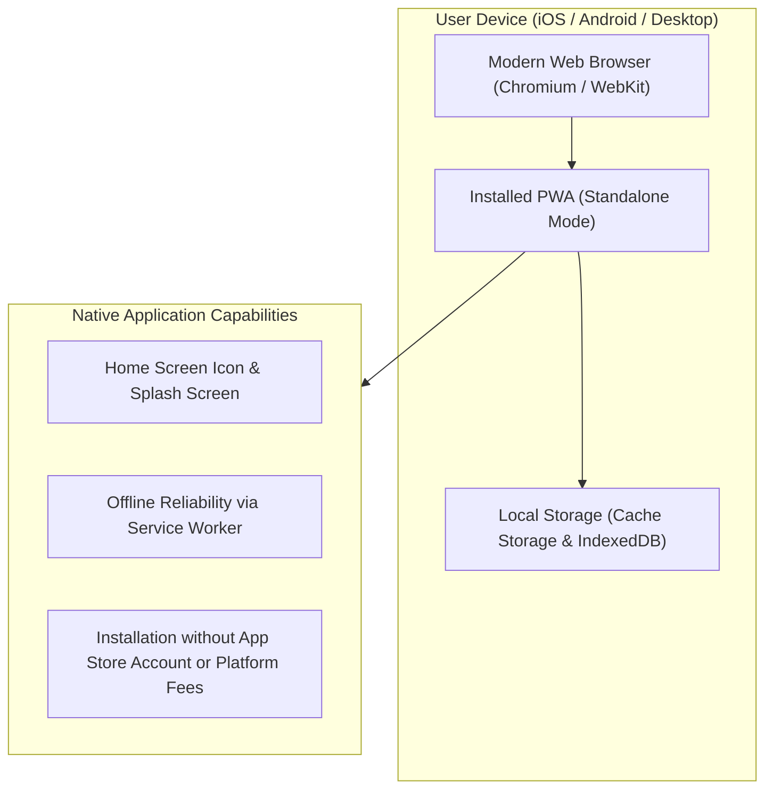
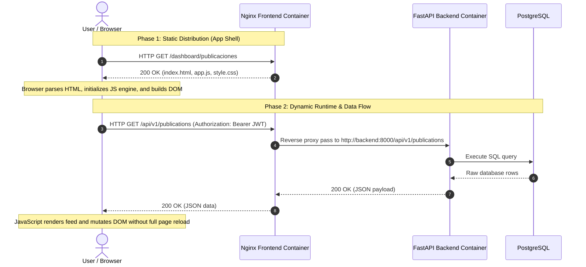

Modern enterprise software requires a native user experience across mobile devices without the organizational and financial friction of native app store ecosystems. The UPA Campus App implements a Progressive Web App (PWA) combined with a strictly decoupled Single Page Application architecture for its administration and student portals. This fourth installment analyzes the architectural benefits of PWAs over store-distributed native applications, the separation between static server delivery and client-side browser execution, caching with Service Workers, and asynchronous API communication.

---

## Progressive Web Apps: The Web as a Universal Platform

In enterprise environments, native mobile development often incurs high operational overhead: Maintaining distinct codebases for iOS (Swift) and Android (Kotlin) multiplies engineering effort, while restrictive app store review cycles delay critical bug fixes and features.

A Progressive Web App (PWA) bridges the divide between standard websites and native binaries by leveraging modern web standards to provide native device capabilities:



Core architectural advantages include:

1. **Cross-Platform Portability and Single Codebase:** One HTML, CSS, and JavaScript codebase supports all operating systems (iOS, Android, Windows, macOS, Linux). This avoids duplicating domain logic and minimizes maintenance overhead.
2. **Immediate Release Cycles:** Updates and security patches reach users the moment the web server deploys new bundles. There are no gatekeepers, manual review delays, or fragmented user bases running obsolete software builds.
3. **Frictionless Installation (Add to Home Screen):** Users install the application directly from the browser onto their device screen. The application opens in its own window without browser address bars (`standalone`), displays a custom icon, and functions like a native client.
4. **Economic Efficiency:** Bypassing commercial app stores removes annual developer licensing fees and mandatory revenue cuts on enterprise transactions.

### The Web App Manifest

The foundation for PWA recognition is the Web App Manifest (`manifest.json`), a standardized JSON configuration file. It declares visual and behavioral parameters for the host operating system:

```json
{
  "name": "UPA Campus Portal",
  "short_name": "UPA Portal",
  "start_url": "/dashboard/publicaciones",
  "display": "standalone",
  "background_color": "#ffffff",
  "theme_color": "#1a365d",
  "icons": [
    {
      "src": "/icons/icon-192.png",
      "sizes": "192x192",
      "type": "image/png"
    },
    {
      "src": "/icons/icon-512.png",
      "sizes": "512x512",
      "type": "image/png"
    }
  ]
}
```

Setting `display: standalone` directs the operating system to omit default browser controls and URLs. The user interacts with a distraction-free application viewport.

---

## Static Delivery vs. Browser Execution

Traditional monolithic frameworks (such as Django, Rails, or PHP) assemble HTML documents dynamically on the server: Every user request triggers server-side templating and database lookups before returning complete markup across the network.

The UPA Campus App relies on a decoupled Single Page Application (SPA) design. The Nginx frontend container acts strictly as a static asset server, leaving presentation state and UI rendering to the client browser:



### Breakdown of Architectural Roles:

1. **Server Operations (Nginx):**
   * **Static File Distribution:** Nginx serves prebuilt HTML, CSS, JavaScript, and image assets directly from the container file system (`/usr/share/nginx/html`).
   * **Gzip Compression and Cache Headers:** Text assets are compressed on the fly and distributed with explicit HTTP headers (`Cache-Control: public, max-age=86400`), while `index.html` receives a strict `no-cache` directive so new deployments take effect immediately.
   * **Resource Efficiency:** Because Nginx processes neither server-side templates nor application business rules, CPU and memory utilization remain low. Small hardware footprints handle thousands of concurrent requests reliably.

2. **Client Operations (Browser):**
   * **Parsing and DOM Generation:** The browser layout engine (Blink, Gecko, or WebKit) parses incoming HTML, constructs the Document Object Model (DOM), and calculates computed CSS styles.
   * **JavaScript Runtime Execution:** The browser script engine (such as V8 in Chrome) executes client logic, stores application state, attaches event listeners, and evaluates frontend routes.
   * **Targeted DOM Mutation:** User interactions update specific UI elements dynamically rather than requesting full page regenerations.

---

## Service Workers and Local Caching

A Service Worker is an event-driven background script executed independently of the main browser window. It acts as an in-browser network proxy between the presentation layer, persistent client caches, and remote servers:

```mermaid
flowchart TD
    Client["Browser UI / DOM"] -->|HTTP Request| SW["Service Worker (Client Proxy)"]
    SW -->|1. Cache Check| Cache["Cache Storage (Local Device)"]
    Cache -->|Cache Hit| SW
    SW -->|Return Asset (< 50ms)| Client
    SW -.->|2. Cache Miss / Remote Data| Network["Server / Nginx (/api/)"]
    Network -.->|Network Response| SW
    SW -.->|Store in Cache & Render UI| Client
```

### 1. App Shell Architecture
Service Workers enable the App Shell pattern. During the initial application visit, the Service Worker stores foundational structural resources (HTML markup, stylesheets, brand iconography, and core JavaScript) inside the browser Cache Storage. Subsequent page loads draw directly from local disk caches without waiting for round-trip network traffic, reducing launch latency below 50 milliseconds.

### 2. Tailored Caching Strategies
Enterprise applications handle heterogeneous assets with differing lifecycles:

* **Cache First (Static Assets & Typography):** Stable design elements and vendor bundles rarely change. The Service Worker returns local cached assets immediately, hitting the network only when files are absent.
* **Network First with Cache Fallback (Content Feeds & Schedules):** Data such as institutional announcements must stay current. The Service Worker requests fresh records from the backend first. If connectivity drops (for example, in dead zones across campus), it serves previously cached records automatically.

### 3. Graceful Offline Operation
When network connectivity is unavailable, the application avoids generic browser connectivity errors. The core interface remains active, informs users of current network limits via non-intrusive status badges, and preserves read access to cached content.

---

## API Communication and Dynamic Rendering

Decoupling visual presentation from data storage requires clear network contracts. The UPA Campus App relies on the native `Fetch API` for asynchronous communication with the FastAPI backend.

### Asynchronous Data Retrieval with Bearer Tokens
Rather than triggering synchronous form posts that refresh the document, frontend logic issues background HTTP calls carrying JSON payloads and authentication tokens:

```javascript
async function fetchWithAuth(endpoint, options = {}) {
  const token = localStorage.getItem("upa_access_token");
  const headers = {
    "Content-Type": "application/json",
    ...(options.headers || {}),
  };

  if (token) {
    headers["Authorization"] = `Bearer ${token}`;
  }

  const response = await fetch(endpoint, {
    ...options,
    headers,
  });

  if (response.status === 401) {
    localStorage.removeItem("upa_access_token");
    window.location.href = "/dashboard/login";
    throw new Error("Session expired");
  }

  return response.json();
}
```

### Dynamic DOM Updates
Upon receiving structured JSON responses, client JavaScript builds corresponding DOM nodes and mounts them into the document:

```javascript
async function renderPublicacionesFeed() {
  const container = document.getElementById("feed-container");
  container.innerHTML = '<div class="spinner">Loading content...</div>';

  try {
    const publications = await fetchWithAuth("/api/v1/publications");
    container.innerHTML = "";

    publications.forEach((item) => {
      const card = document.createElement("article");
      card.className = "post-card";
      card.innerHTML = `
        <h3>${escapeHtml(item.title)}</h3>
        <p class="meta">${new Date(item.created_at).toLocaleDateString()}</p>
        <p>${escapeHtml(item.content)}</p>
      `;
      container.appendChild(card);
    });
  } catch (err) {
    container.innerHTML = `<p class="error">Failed to load: ${err.message}</p>`;
  }
}
```

This interaction model produces a responsive Single Page Application experience: The user remains within a unified viewport while loading states, optimistic UI updates, and scoped view refreshes provide real-time feedback.

---

## Key Takeaways

1. **Strategic Agility through PWAs:** Replacing multi-platform native app builds with a single Progressive Web App reduces development costs, guarantees instant deployment of releases, and bypasses proprietary store restrictions.
2. **Operational Efficiency through Separation:** Serving static assets through an optimized Nginx proxy keeps server overhead minimal, transferring computational rendering workloads to client browser engines.
3. **Resilience through Service Workers and APIs:** Caching application shells while consuming decoupled REST endpoints ensures sub-second load times and dependable offline reliability across constrained enterprise networks.
