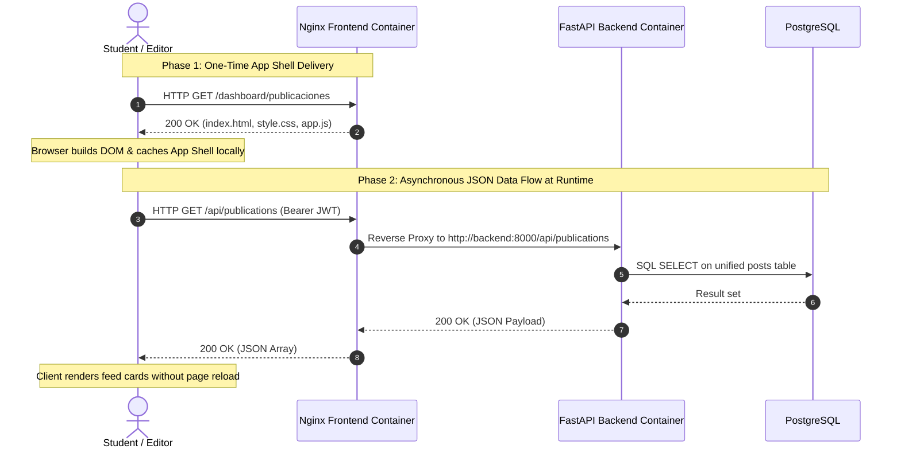
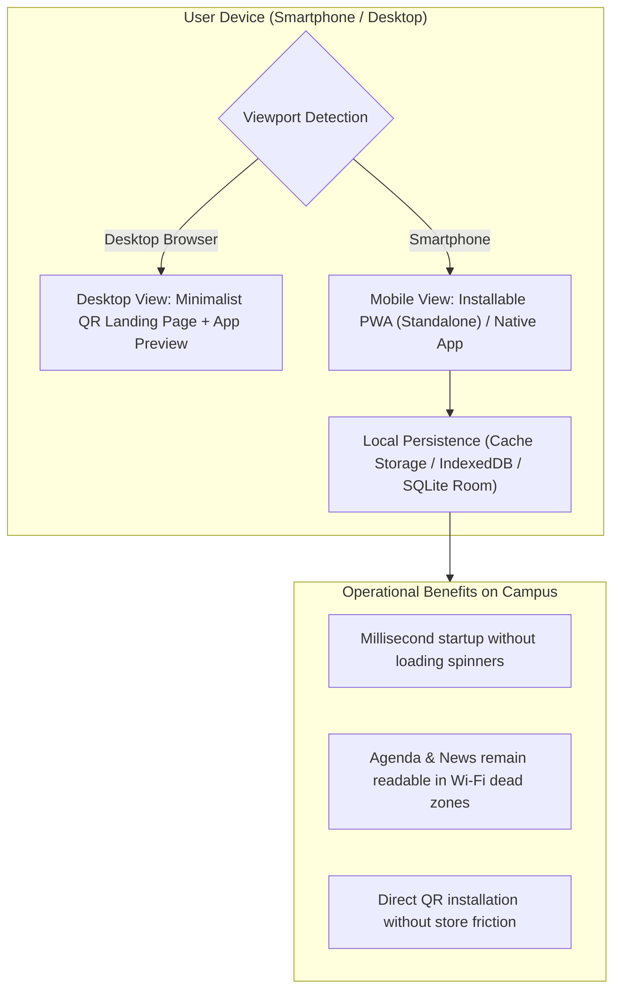

Modern web applications no longer rebuild the entire user interface on the server with every click; instead, they delegate rendering, state management, and local caching directly to the user's device. The UPA Campus App leverages this decoupling so a single backend powers the desktop editorial cockpit (`web-admin`), the mobile Progressive Web App (PWA), and the native Android client (Kotlin and Jetpack Compose, Architectural Decision 3.1). This fourth chapter establishes the mental model of modern frontend clients and demonstrates how specific functional specification rules, from emergency banners and fullscreen modals to read-only Instagram locks, are implemented in client state.

---

## Server Rendering vs. Decoupled Client Architecture

In legacy web systems (such as traditional PHP or server-rendered template engines), every click forces the server to generate a brand-new HTML document. Inside a lecture hall with spotty cellular reception, that model results in blank white loading screens and lost form submissions.

A modern Single-Page Application (SPA) and Progressive Web App (PWA) strictly separates the **application shell (App Shell)** from the **dynamic payload (JSON)**:



1. **Server Responsibility (Nginx):** Delivers the static application bundle (`index.html`, stylesheets, JavaScript) once with near-zero CPU overhead.
2. **Client Responsibility (Browser / Mobile App):** Maintains application state in memory, fetches lightweight JSON payloads asynchronously via `/api/`, and updates only the affected Document Object Model (DOM) nodes when a student interacts with the interface (such as a 1-click event RSVP).

---

## PWA, Desktop QR Gate, and Dual Offline Persistence

Why does the platform combine Progressive Web App standards with native local persistence? Daily campus conditions dictate the design:



* **Minimalist Desktop QR Landing Page:** If a student opens the main campus app URL on a laptop, stretching a mobile interface across a widescreen monitor looks broken. Instead, the frontend detects desktop viewports and renders a clean landing page featuring a single QR code for instant smartphone installation alongside store-style app preview cards.
* **Web App Manifest (`manifest.json`):** On mobile browsers, setting `"display": "standalone"` strips away the browser address bar so the web app launches full-screen from its own homescreen icon.
* **Dual Persistence for Offline Resilience (Architectural Decision 3.2):** While PostgreSQL acts as the central transactional ledger on the server, clients maintain a local persistence layer (Service Worker `Cache Storage` on the web and `SQLite / Room` on the native Android client). Static icons and stylesheets follow a **Cache First** strategy for instant startup. Campus news and calendar schedules use **Network First with Cache Fallback**: if Wi-Fi drops inside a basement auditorium, the app immediately displays the last synchronized schedule instead of crashing.

---

## How the Functional Specification Shapes the Four Client Modules

For business informatics students and vibe-coders, the key insight is seeing how functional requirements translate into deterministic UI state rules:

### 1. Home Module (Campus Feed, Fullscreen Modal, and 1-Click RSVP)
* **Dedicated Emergency Banner Slot:** Urgent alerts (`EMERGENCY_BANNER`, such as lecture cancellations due to severe storms) must never get buried beneath regular social posts when scrolling. Before rendering the stream, the client extracts active pinned alerts into a dedicated high-contrast banner slot at the top of the viewport.
* **Fullscreen Detail Modal Instead of Page Navigation:** Tapping an announcement opens a **Fullscreen Modal** displaying the full text, high-resolution posters, embedded videos (`MP4`/`WEBM`), or PDF documents. Closing the modal returns the student to their exact scroll position in the feed without re-fetching data.
* **Optimistic UI for 1-Click RSVP:** Tapping "Register" fires an asynchronous `POST /api/v1/posts/{id}/register` call in the background while immediately toggling the button state in the UI.

### 2. Agenda Module (Synchronized Dual Calendar)
* **Combining a Chronological List with a Monthly Grid:** A monthly grid on a smartphone screen is too cramped to display full lecture titles, while a plain list lacks spatial context across the month. The Agenda module therefore splits the view: a chronological upcoming-activity list at the top paired with a synchronized monthly dot-indicator calendar below. Both components read from the same merged client state combining internal campus events with live **Google Classroom** deadlines.

### 3. Web-Admin Module (The Editorial Cockpit for Marketing)
Inside the desktop portal (`/dashboard/`), the user interface translates backend data integrity rules directly into interactive form constraints:

```javascript
// Form state synchronization inside the unified editor (web-admin)
function syncEditorState(postData, formElements) {
  // Rule 1: Mandatory expiration date when "Pin to top" (is_pinned) is checked
  if (formElements.isPinnedCheckbox.checked) {
    formElements.expiresAtInput.required = true;
    formElements.expiresAtContainer.classList.remove("hidden");
  } else {
    formElements.expiresAtInput.required = false;
  }

  // Rule 2: Read-Only protection for synchronized Instagram posts
  const isInstagram = postData && postData.post_type === "INSTAGRAM";
  formElements.titleInput.readOnly = isInstagram;
  formElements.contentInput.readOnly = isInstagram;
  formElements.mediaUploadInput.disabled = isInstagram;
}
```

* **Why does checking "Pin to top" immediately require an expiration date?** As soon as an editor checks `is_pinned`, the form reveals and enforces the `expires_at` timestamp field. This prevents outdated weather warnings from permanently occupying the top of the student feed.
* **Why are caption and media fields locked (`Read-Only`) for Instagram posts?** Items with `post_type === "INSTAGRAM"` originate from the automated background sync service. If an editor rewrote the caption manually in Web-Admin, the next synchronization cycle would overwrite those edits with the original Instagram caption. Locking those fields visually in the editor prevents lost updates while still allowing internal actions such as pinning.
* **Why use a flat alphabetical group list with an instant filter?** Universities maintain dozens of Google Workspace groups (`@example-campus.edu`) across faculties and cohorts. Nested tree dropdowns slow editors down; a flat alphabetical list with an instant client-side search filter lets marketing target the right student cohort in two seconds.
* **Why do all permission checkboxes start unchecked in the Role Matrix?** Enforcing *Least Privilege* in the UI means new user dialogs initialize with zero pre-selected permissions, and development quick-login buttons are completely stripped from the login screen.

---

## Key Takeaways

1. **Decoupling App Shell from Data:** Because Nginx serves only the static shell and the client exchanges compact JSON payloads over `/api/`, the interface responds in milliseconds without full-page reloads.
2. **Offline Resilience via Dual Persistence:** Local storage layers (Service Worker cache on the web, SQLite/Room on Android) keep schedules, deadlines, and announcements accessible even in lecture halls with unstable Wi-Fi.
3. **Specification Rules Embedded in UI State:** From mandatory expiration dates on pinned banners and read-only protection on Instagram imports to unchecked default permissions in the role matrix, the client interface actively guides users along architectural constraints.
