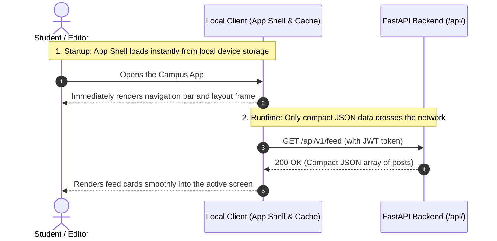
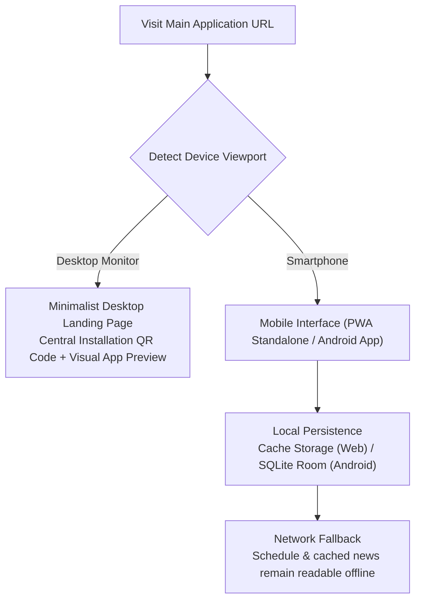

Why does a modern mobile web application feel as responsive as a native program even when Wi-Fi signal drops inside a basement lecture hall? Because the client device loads the visual application frame (App Shell) only once, exchanges compact JSON payloads during active use, and keeps synchronized records in local on-device storage. This fourth chapter explains how the UPA Campus App implements this client model across its mobile frontend (PWA and native Android client built with Kotlin and Jetpack Compose) and its desktop editorial cockpit.

---

## App Shell Architecture Instead of Full Page Reloads

In traditional server-rendered websites, clicking a link forces the server to generate and transmit a brand-new HTML document. Over congested mobile networks, that model causes blank white loading screens and lost scroll positions.

Modern clients decouple the **structural interface (App Shell)** from **dynamic payload data (JSON)**:



1. **Instant Startup From Local Storage:** Navigation bars, typography, and icons are cached on the smartphone after the initial visit. Opening the app renders the interface frame immediately.
2. **Targeted In-Memory Updates:** When a student taps to register for an event, the client exchanges a small JSON message with the API and updates only that specific button state in memory.

---

## Desktop QR Routing and Mobile Offline Resilience

The UPA Campus App serves two distinct usage contexts: students check updates one-handed on their phones between classes, while marketing staff compose announcements on desktop monitors.



* **Why Desktop Browsers See a QR Landing Page Instead of a Stretched Phone UI:** Stretching a three-tab mobile interface across a widescreen desktop monitor creates an awkward layout. When a visitor opens the main URL on a laptop, the frontend automatically displays a clean landing page featuring a visual preview of the mobile screens and a single central QR code for instant smartphone installation.
* **Full-Screen Launch via Web App Manifest (`manifest.json`):** On smartphones, configuring `"display": "standalone"` removes the browser address bar so the web app launches from the home screen like a native utility.
* **Local Persistence for Dead Zones:** While the server database remains the primary system of record, mobile clients maintain a local persistence layer (`Cache Storage` in the browser and `SQLite / Room` on Android). Feed and calendar data follow a *Network First with Local Fallback* strategy: if lecture hall Wi-Fi drops, the app seamlessly displays the last synchronized state instead of crashing with a connection error.

---

## Translating Specification Rules Into UI State Logic

A well-engineered interface does not rely on users memorizing a manual; it embeds specification rules directly into visual state transitions:

### 1. Dedicated Alert Slot, Full-Screen Modal, and Optimistic UI (*Inicio*)
* **Reserved Slot for Emergency Banners:** Time-critical alerts (`EMERGENCY_BANNER`, such as sudden campus closures) must not get buried beneath regular event posters when scrolling. Before rendering the feed, the client separates pinned emergency alerts into a high-contrast banner slot fixed at the top of the view.
* **Full-Screen Modal Preserves Scroll Context:** Tapping a feed card opens a **Full-Screen Modal** layered over the feed rather than navigating to a separate URL. Students can read the full announcement, view embedded videos (`MP4` and `WEBM`), or open PDF attachments, and return to their exact previous scroll position upon closing the modal.
* **Instant 1-Click Registration (Optimistic UI):** Tapping the event registration button toggles the button state to "Registered" right away while the `POST` request completes asynchronously in the background. If the network call fails, the client rolls the button state back and notifies the user.

### 2. Shared State Between Chronological List and Monthly Grid (*Agenda*)
On a smartphone screen, a compact monthly grid shows busy days at a glance but lacks room for full event titles or Google Classroom assignment descriptions. The *Agenda* module therefore splits the screen: the upper half displays a chronological list of upcoming items, while the lower half renders the monthly calendar grid with color-coded indicator dots. Both views read from the same local state object, so tapping a date in the grid filters the list above without another network request.

### 3. Guided Form State in the Editorial Cockpit (*Web-Admin*)
Inside the desktop portal (`/dashboard/`), client-side state logic enforces editorial rules while the user is typing:

```javascript
function updateEditorConstraints(postRecord, ui) {
  // 1. Pinning a post to the top requires a mandatory expiration timestamp
  const pinned = ui.pinToggle.checked;
  ui.expiryFieldWrapper.hidden = !pinned;
  ui.expiryDateInput.required = pinned;

  // 2. Synchronized Instagram posts are read-only for text and media
  const fromInstagram = Boolean(postRecord && postRecord.post_type === "INSTAGRAM");
  ui.titleInput.readOnly = fromInstagram;
  ui.bodyTextarea.readOnly = fromInstagram;
  ui.mediaPicker.disabled = fromInstagram;
}
```

* **Dynamic Expiration Requirement:** Checking "Pin to top" immediately reveals the `expires_at` date picker and marks it as required, preventing editors from submitting open-ended banners that would clutter the feed indefinitely.
* **Visual Read-Only Lock for Instagram Imports:** When opening a post originating from the automated Instagram sync (`post_type === "INSTAGRAM"`), the editor disables the title, body, and media upload inputs visually because the background sync job would overwrite manual text edits on its next run.
* **Flat Alphabetical Group Selector With Instant Filter:** To assign target cohorts without clicking through nested trees, the cockpit renders all university Google Workspace groups in a flat alphabetical list paired with an instant search box, allowing editors to filter dozens of study groups in seconds.

---

## Key Takeaways

1. **Decoupling App Shell From Payload Data:** Storing the visual application frame locally and fetching only lightweight JSON data over `/api/` eliminates full-page reloads and keeps interactions instantaneous.
2. **Built for Real Campus Conditions:** From automatic desktop QR routing and offline lecture-hall caching to guided form constraints in the editorial portal, the client architecture turns specification rules into intuitive user workflows.
