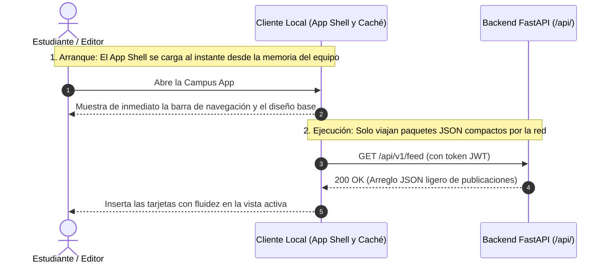
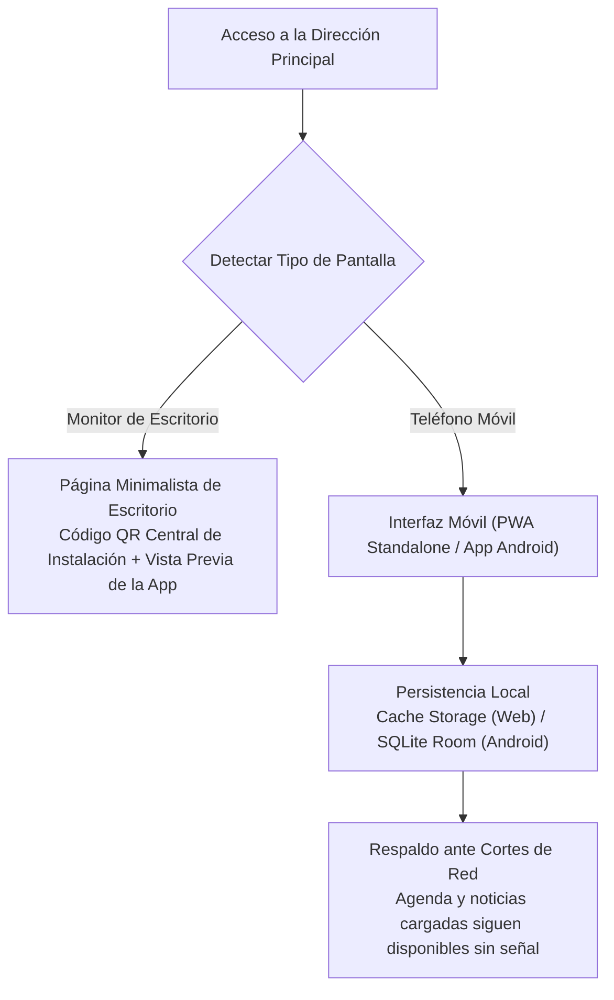

¿Por qué una aplicación web moderna responde en el teléfono móvil con la misma fluidez que un programa nativo, incluso cuando la señal Wi-Fi fluctúa dentro de un aula en el subsuelo? Porque el dispositivo descarga la estructura visual (App Shell) una sola vez, intercambia únicamente paquetes ligeros de datos JSON durante el uso y conserva una copia local en la memoria del equipo. Este cuarto capítulo explica cómo la UPA Campus App implementa este diseño tanto en el cliente móvil (PWA y aplicación Android nativa con Kotlin y Jetpack Compose) como en el portal editorial de escritorio.

---

## Modelo App Shell en Lugar de Recargas Completas de Página

En los sitios web tradicionales renderizados en el servidor, cada clic obliga a generar y descargar un documento HTML completo desde cero. En redes móviles inestables, eso provoca pantallas en blanco y pérdida de la posición de lectura.

Los clientes modernos separan la **estructura visual (App Shell)** de los **datos dinámicos (JSON)**:



1. **Inicio Instantáneo desde Memoria Local:** Barras de navegación, tipografías e íconos quedan guardados en el teléfono tras la primera visita. Al abrir la aplicación, el marco visual aparece sin esperas.
2. **Actualización Parcial en Memoria:** Cuando un estudiante pulsa para inscribirse a un evento, el cliente envía un pequeño mensaje JSON al servidor y actualiza únicamente el estado de ese botón en pantalla.

---

## Derivación con Código QR en Escritorio y Resiliencia Offline en el Móvil

La UPA Campus App atiende dos contextos de uso muy distintos en la universidad: el estudiante consulta novedades con una sola mano desde su teléfono entre clases, mientras que el equipo de comunicación redacta avisos en monitores de escritorio.



* **Por Qué en Escritorio Aparece una Página con Código QR en Vez de una Vista Móvil Estirada:** Estirar una interfaz móvil de tres pestañas en un monitor panorámico resulta incómodo y poco claro. Cuando alguien abre la dirección principal desde una computadora portátil, el frontend detecta el ancho de pantalla y presenta una portada limpia con una vista previa de la aplicación y un único código QR central para instalarla de inmediato en el teléfono.
* **Ejecución a Pantalla Completa mediante Web App Manifest (`manifest.json`):** En teléfonos móviles, el ajuste `"display": "standalone"` oculta la barra de direcciones del navegador para que la aplicación inicie desde el ícono de inicio como una herramienta nativa.
* **Almacenamiento Local frente a Zonas sin Cobertura:** Mientras PostgreSQL en el servidor actúa como registro central, los clientes móviles mantienen una base de datos local (`Cache Storage` en la web y `SQLite / Room` en Android). El feed y el calendario aplican la estrategia *Network First con respaldo local*: si se corta el Wi-Fi en el aula, el teléfono muestra de forma transparente la última sincronización guardada en lugar de fallar con un mensaje de error.

---

## Cómo la Lógica de Interfaz Materializa las Reglas del Pliego Funcional

Una interfaz bien diseñada no espera que el usuario memorice un reglamento, sino que traduce cada regla funcional en comportamientos visuales claros:

### 1. Espacio Reservado de Emergencia, Modal de Pantalla Completa y Optimistic UI (*Inicio*)
* **Franja Exclusiva para Banners de Emergencia:** Los avisos críticos (`EMERGENCY_BANNER`, como una suspensión repentina de actividades por tormenta) no pueden perderse entre afiches culturales al deslizar la pantalla. El cliente filtra estos avisos antes de dibujar la lista y los fija en un bloque destacado en la parte superior.
* **Modal de Pantalla Completa que Conserva la Posición de Lectura:** Al tocar una publicación del feed no se cambia de página web, sino que se despliega un **Modal de Pantalla Completa** sobre la lista. Allí el estudiante lee el texto completo, reproduce videos integrados (`MP4` y `WEBM`) o abre adjuntos PDF, y al cerrarlo continúa exactamente en el mismo punto del feed.
* **Inscripción en 1 Clic sin Esperas (Optimistic UI):** Al pulsar "Inscribirse" en un evento, el botón cambia de inmediato a "Inscrito" mientras la petición `POST` viaja en segundo plano. Si la red falla, la interfaz revierte el botón e informa al usuario.

### 2. Estado Compartido entre Lista Cronológica y Cuadrícula Mensual (*Agenda*)
En la pantalla de un teléfono, un calendario mensual muestra de un vistazo qué días tienen actividad, pero carece de espacio para leer títulos largos o entregas de Google Classroom. Por eso el módulo *Agenda* divide la vista en dos bloques conectados al mismo estado local: arriba aparece la lista cronológica detallada y abajo la cuadrícula del mes con puntos indicadores. Tocar un día en el calendario filtra al instante la lista superior sin realizar nuevas consultas al servidor.

### 3. Formulario Guiado en la Cabina Editorial (*Web-Admin*)
En el portal administrativo (`/dashboard/`), el código del cliente aplica las reglas de negocio mientras el redactor completa el formulario:

```javascript
function updateEditorConstraints(postRecord, ui) {
  // 1. Fijar un aviso arriba exige obligatoriamente una fecha de vencimiento
  const pinned = ui.pinToggle.checked;
  ui.expiryFieldWrapper.hidden = !pinned;
  ui.expiryDateInput.required = pinned;

  // 2. Las publicaciones sincronizadas desde Instagram son de solo lectura en texto y medios
  const fromInstagram = Boolean(postRecord && postRecord.post_type === "INSTAGRAM");
  ui.titleInput.readOnly = fromInstagram;
  ui.bodyTextarea.readOnly = fromInstagram;
  ui.mediaPicker.disabled = fromInstagram;
}
```

* **Exigencia Dinámica de Fecha de Vencimiento:** En cuanto el editor marca la casilla "Fijar arriba", el formulario despliega el campo `expires_at` y lo vuelve obligatorio, evitando que alertas temporales queden fijadas de forma indefinida.
* **Bloqueo Visual de Solo Lectura para Publicaciones de Instagram:** Si el registro proviene de la sincronización automática con Instagram (`post_type === "INSTAGRAM"`), el editor bloquea visualmente el título, el texto y el archivo multimedia porque el proceso periódico de sincronización sobrescribiría cualquier cambio manual en el siguiente ciclo.
* **Lista Alfabética Plana de Grupos con Filtro Instantáneo:** Para elegir a qué carreras o cohortes dirigir un comunicado sin navegar por menús anidados, el panel presenta todos los grupos de Google Workspace en una lista plana ordenada alfabéticamente con búsqueda en tiempo real (*Instant Filter*).

---

## Conclusiones

1. **Separación entre App Shell y Datos:** Guardar la estructura gráfica en el dispositivo y transferir solo paquetes JSON compactos por `/api/` elimina las recargas de página y brinda respuesta inmediata.
2. **Diseño Adaptado a la Vida en el Campus:** Desde la portada con código QR en escritorio y el respaldo offline para aulas sin señal hasta las validaciones dinámicas en el editor administrativo, el cliente convierte las reglas de la especificación en una experiencia fluida.
