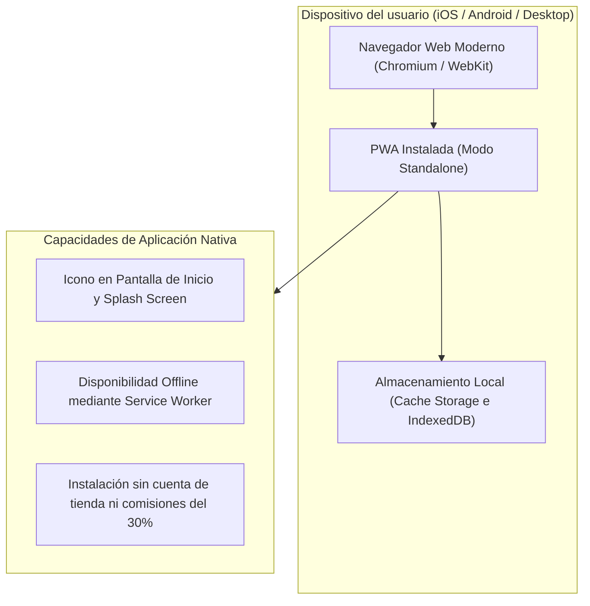
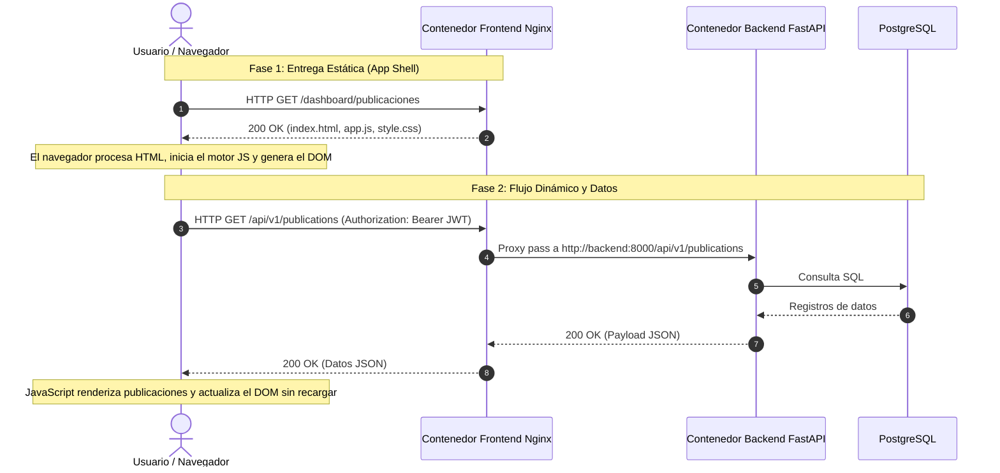

El software empresarial actual exige una experiencia de usuario fluida en dispositivos móviles sin la sobrecarga organizativa y financiera de las tiendas de aplicaciones nativas. UPA Campus App implementa una Aplicación Web Progresiva (PWA) combinada con una arquitectura Single Page Application estrictamente desacoplada para sus portales administrativo y estudiantil. Esta cuarta entrega examina las ventajas arquitectónicas de las PWAs frente a las aplicaciones nativas de tienda, la separación entre la entrega estática del servidor y la ejecución en el navegador cliente, el almacenamiento en caché mediante Service Workers y la comunicación asíncrona vía API.

---

## Aplicaciones Web Progresivas: La Web como plataforma universal

En el ámbito empresarial, el desarrollo móvil nativo genera costos operativos elevados: Mantener bases de código independientes para iOS (Swift) y Android (Kotlin) duplica el esfuerzo de ingeniería, mientras que los lentos procesos de revisión en las tiendas retrasan correcciones críticas y nuevas funciones.

Una Aplicación Web Progresiva (PWA) une las ventajas de un sitio web con las capacidades de una aplicación nativa mediante estándares web modernos:



Principales ventajas arquitectónicas:

1. **Portabilidad multiplataforma y código único:** Una única base de código en HTML, CSS y JavaScript atiende a todos los sistemas operativos (iOS, Android, Windows, macOS, Linux). Esto elimina duplicidades en la lógica de negocio y reduce drásticamente los gastos de mantenimiento.
2. **Ciclos de despliegue inmediatos:** Las actualizaciones y parches de seguridad quedan disponibles para todos los usuarios en el instante en que el servidor web actualiza sus archivos. No existen intermediarios, revisiones manuales ni usuarios estancados en versiones obsoletas.
3. **Instalación directa en pantalla de inicio:** Los usuarios instalan la aplicación directamente desde el navegador con un solo toque. La aplicación se ejecuta en su propia ventana sin barra de direcciones (`standalone`), posee un icono propio y ofrece la apariencia de un cliente nativo.
4. **Eficiencia económica:** Al prescindir de las tiendas oficiales, se eliminan tarifas anuales de desarrollador y comisiones forzosas sobre transacciones empresariales.

### El Manifiesto de Aplicación Web

El componente técnico para el reconocimiento como PWA es el Manifiesto de Aplicación Web (`manifest.json`), un archivo de configuración estándar en formato JSON. Este define los metadatos visuales y de comportamiento para el sistema operativo:

```json
{
  "name": "UPA Campus Portal",
  "short_name": "UPA Portal",
  "start_url": "/dashboard/publicaciones",
  "display": "standalone",
  "background_color": "#ffffff",
  "theme_color": "#1a365d",
  "icons": [
    {
      "src": "/icons/icon-192.png",
      "sizes": "192x192",
      "type": "image/png"
    },
    {
      "src": "/icons/icon-512.png",
      "sizes": "512x512",
      "type": "image/png"
    }
  ]
}
```

Al configurar `display: standalone`, el sistema operativo oculta los controles estándar del navegador, permitiendo al usuario interactuar con una interfaz a pantalla completa sin distracciones.

---

## Entrega Estática frente a Ejecución en el Navegador

Los entornos monolíticos tradicionales (como Django, Rails o PHP) generan páginas HTML de forma dinámica en el servidor: Cada interacción del usuario hace que el servidor procese plantillas y consulte la base de datos antes de transferir documentos HTML completos por la red.

UPA Campus App opta por un modelo desacoplado Single Page Application (SPA). El contenedor Nginx opera como un servidor de archivos estáticos, mientras que la gestión del estado y el renderizado ocurren por completo en el navegador del cliente:



### Distribución de responsabilidades técnicas:

1. **Operaciones en el servidor (Nginx):**
   * **Servicio de archivos estáticos:** Nginx entrega archivos HTML, CSS, JavaScript e imágenes directamente desde el sistema de archivos del contenedor (`/usr/share/nginx/html`).
   * **Compresión Gzip y cabeceras de caché:** Los recursos textuales se comprimen y entregan con cabeceras HTTP optimizadas (`Cache-Control: public, max-age=86400`), mientras que `index.html` recibe una directiva estricta `no-cache` para reflejar nuevos despliegues de inmediato.
   * **Consumo mínimo de recursos:** Dado que Nginx no ejecuta plantillas ni lógica de negocio, el uso de CPU y memoria es mínimo. Equipos con recursos reducidos pueden atender miles de conexiones simultáneas.

2. **Operaciones en el cliente (Navegador):**
   * **Procesamiento y construcción del DOM:** El motor de renderizado del navegador (Blink, Gecko o WebKit) interpreta el código HTML, construye el árbol Document Object Model (DOM) y aplica estilos CSS calculados.
   * **Ejecución de JavaScript:** El motor de scripts local (como V8 en Chrome) ejecuta la lógica de la aplicación, administra el estado global, vincula eventos a los elementos y evalúa las rutas del cliente.
   * **Actualización selectiva del DOM:** Las interacciones modifican únicamente los nodos necesarios de la interfaz sin reiniciar el ciclo de carga de la página.

---

## Service Workers y Almacenamiento en Caché Local

Un Service Worker es un script que el navegador ejecuta en segundo plano, aislado de la página web. Actúa como un proxy de red programable entre la interfaz de usuario, el almacenamiento local y los servidores remotos:

```mermaid
flowchart TD
    Client["Interfaz del Navegador / DOM"] -->|Petición HTTP| SW["Service Worker (Proxy en Navegador)"]
    SW -->|1. Búsqueda en Caché| Cache["Cache Storage (Almacenamiento Local)"]
    Cache -->|Acierto de Caché| SW
    SW -->|Entrega rápida (< 50ms)| Client
    SW -.->|2. Petición a Red / Datos Dinámicos| Network["Servidor / Nginx (/api/)"]
    Network -.->|Respuesta de Red| SW
    SW -.->|Guardar en Caché y responder| Client
```

### 1. Patrón App Shell
El Service Worker hace posible la arquitectura App Shell. En la primera visita, el Service Worker guarda los componentes estructurales básicos (HTML, estilos, iconos institucionales y JavaScript central) en el Cache Storage del navegador. En las visitas siguientes, el cascarón visual se recupera al instante desde el almacenamiento local sin requerir tráfico de red, reduciendo el tiempo de inicio a menos de 50 milisegundos.

### 2. Estrategias de caché según el tipo de recurso
Una arquitectura robusta clasifica los datos según su frecuencia de actualización:

* **Cache First (Recursos estáticos y fuentes):** Los elementos visuales y librerías cambian con poca frecuencia. El Service Worker consulta primero la caché local y solo acude a la red si el recurso no está presente.
* **Network First con respaldo en caché (Feeds de noticias y avisos):** Datos relevantes como publicaciones institucionales o calendarios deben mantenerse actualizados. El Service Worker intenta obtener los datos frescos del backend. Si la conexión falla (por ejemplo, en áreas del campus con baja cobertura móvil), entrega de inmediato la última copia válida almacenada en caché.

### 3. Funcionamiento offline controlado
Ante una pérdida de conectividad a Internet, la aplicación no colapsa con la pantalla de error estándar del navegador. La interfaz estructural sigue operativa, notifica al usuario mediante avisos discretos sobre el estado de la conexión y permite consultar toda la información previamente almacenada.

---

## Comunicación con APIs y Renderizado Dinámico

Separar la capa visual del almacenamiento persistente exige contratos de red bien definidos. UPA Campus App utiliza la interfaz estándar `Fetch API` para gestionar solicitudes HTTP asíncronas con el backend en FastAPI.

### Peticiones asíncronas con tokens Bearer
En lugar de procesar envíos de formularios que recargan la pantalla, el cliente ejecuta llamadas en segundo plano transmitiendo datos en formato JSON y credenciales de autenticación:

```javascript
async function fetchWithAuth(endpoint, options = {}) {
  const token = localStorage.getItem("upa_access_token");
  const headers = {
    "Content-Type": "application/json",
    ...(options.headers || {}),
  };

  if (token) {
    headers["Authorization"] = `Bearer ${token}`;
  }

  const response = await fetch(endpoint, {
    ...options,
    headers,
  });

  if (response.status === 401) {
    localStorage.removeItem("upa_access_token");
    window.location.href = "/dashboard/login";
    throw new Error("Sesión expirada");
  }

  return response.json();
}
```

### Actualización dinámica del DOM
Al recibir los datos en formato JSON, JavaScript construye las estructuras visuales correspondientes y las inserta en el DOM:

```javascript
async function renderPublicacionesFeed() {
  const container = document.getElementById("feed-container");
  container.innerHTML = '<div class="spinner">Cargando publicaciones...</div>';

  try {
    const publications = await fetchWithAuth("/api/v1/publications");
    container.innerHTML = "";

    publications.forEach((item) => {
      const card = document.createElement("article");
      card.className = "post-card";
      card.innerHTML = `
        <h3>${escapeHtml(item.title)}</h3>
        <p class="meta">${new Date(item.created_at).toLocaleDateString()}</p>
        <p>${escapeHtml(item.content)}</p>
      `;
      container.appendChild(card);
    });
  } catch (err) {
    container.innerHTML = `<p class="error">Error al cargar: ${err.message}</p>`;
  }
}
```

Este esquema de interacción produce una experiencia continua en una sola página (Single Page Application): El usuario conserva el contexto de trabajo en todo momento, mientras que los estados de carga y las modificaciones parciales de la vista entregan retroalimentación inmediata.

---

## Conclusiones

1. **Rentabilidad mediante PWAs:** Adoptar una Aplicación Web Progresiva frente a desarrollos nativos para tiendas reduce los costos de mantenimiento a la mitad, asegura el despliegue inmediato de actualizaciones y prescinde de las restricciones comerciales de las tiendas de aplicaciones.
2. **Eficiencia en la separación de capas:** Distribuir componentes estáticos a través de un contenedor Nginx optimizado minimiza el consumo de recursos en el servidor, trasladando el procesamiento gráfico a los navegadores de los usuarios.
3. **Resiliencia con Service Workers y APIs:** La combinación de cascarones visuales en caché con servicios REST desacoplados ofrece tiempos de respuesta instantáneos y garantiza operatividad básica en redes institucionales con conectividad intermitente.
