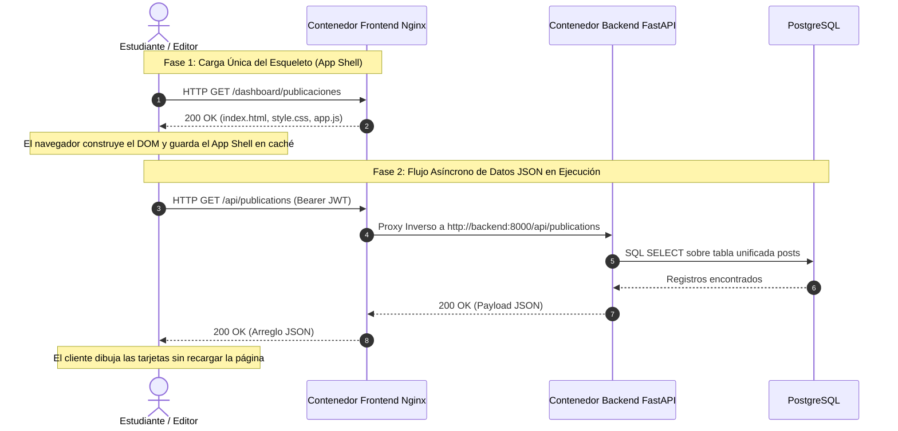
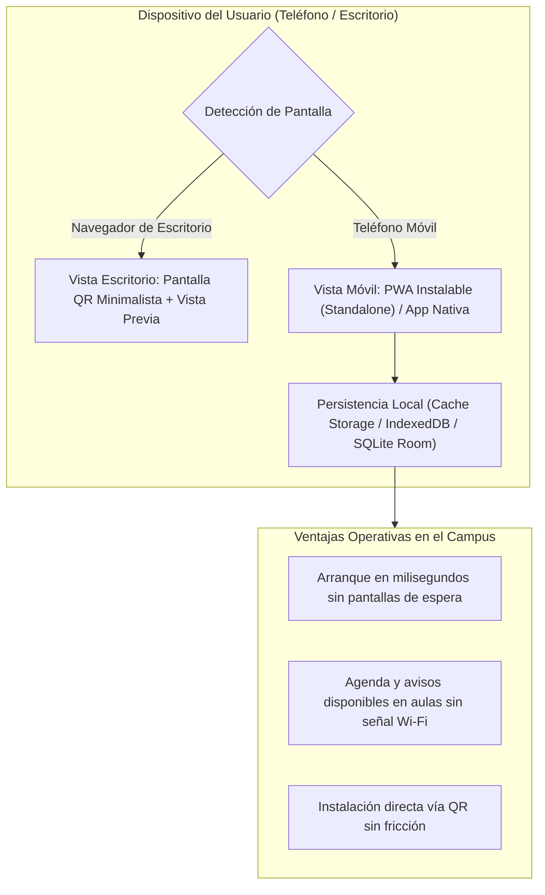

Las aplicaciones web modernas ya no reconstruyen toda la pantalla en el servidor con cada clic, sino que delegan el renderizado, el control de estado (State Management) y el almacenamiento en caché directamente al dispositivo del usuario. La UPA Campus App aprovecha este desacoplamiento para que un único backend alimente tanto al portal editorial de escritorio (`web-admin`) como a la Progressive Web App (PWA) móvil y a la aplicación nativa Android en Kotlin y Jetpack Compose (Decisión Arquitectónica 3.1). Este cuarto capítulo explica el modelo mental de los clientes frontend modernos y muestra cómo cada regla de la especificación funcional, desde los banners de emergencia y el modal a pantalla completa hasta el bloqueo de solo lectura para Instagram, cobra vida en la interfaz.

---

## Renderizado en Servidor frente a Arquitectura de Cliente Desacoplada

En los sistemas web tradicionales (como aplicaciones clásicas en PHP o motores de plantillas del lado del servidor), cada clic obliga al servidor a generar un documento HTML nuevo. En un aula universitaria con señal móvil inestable, ese modelo produce pantallas en blanco y formularios perdidos.

Una Single-Page Application (SPA) y Progressive Web App (PWA) moderna separa estrictamente el **esqueleto del programa (App Shell)** de los **datos dinámicos (JSON)**:



1. **Tarea del Servidor (Nginx):** Entrega una sola vez los archivos estáticos de la aplicación (`index.html`, hojas de estilo, código JavaScript) con un consumo mínimo de procesador.
2. **Tarea del Cliente (Navegador / App Móvil):** Conserva el estado de la pantalla en memoria, solicita datos ligeros en formato JSON a través de `/api/` y actualiza únicamente el nodo afectado en el Document Object Model (DOM) cuando el estudiante interactúa (por ejemplo, al inscribirse en 1 clic a una charla).

---

## PWA, Pantalla QR de Escritorio y Persistencia Dual Offline

¿Por qué la plataforma combina estándares PWA con almacenamiento local nativo? Las condiciones reales del campus determinan esta arquitectura:



* **Pantalla Minimalista de Escritorio con Código QR:** Si un estudiante abre el enlace principal de la aplicación desde una computadora portátil, mostrar una interfaz móvil estirada resultaría confuso. Por ello, el cliente detecta el tamaño de pantalla de escritorio y presenta una página limpia con un único código QR central para instalar la aplicación en el teléfono, acompañado de capturas de vista previa estilo tienda de aplicaciones.
* **Web App Manifest (`manifest.json`):** En el teléfono, el atributo `"display": "standalone"` oculta la barra de direcciones del navegador para que la aplicación inicie a pantalla completa desde su propio icono en la pantalla de inicio.
* **Persistencia Dual para Resiliencia Offline (Decisión Arquitectónica 3.2):** Mientras PostgreSQL opera como motor transaccional central en el servidor, los clientes cuentan con almacenamiento local (Service Worker `Cache Storage` en web y `SQLite / Room` en la aplicación nativa Android). Los iconos y hojas de estilo aplican la estrategia **Cache First** para abrir al instante. El feed de noticias y la agenda aplican **Network First con respaldo en caché**: si se corta el Wi-Fi dentro de un auditorio, el estudiante sigue consultando sus horarios y entregas sincronizadas sin sufrir errores de pantalla.

---

## Cómo la Especificación Funcional Define los Cuatro Módulos Visuales

Para un estudiante de informática empresarial o un desarrollador que utiliza asistentes de IA (vibe-coding), lo fundamental es comprender cómo las reglas de negocio del pliego funcional se traducen en comportamientos exactos de la interfaz:

### 1. Módulo Inicio (Feed del Campus, Modal a Pantalla Completa y RSVP en 1 Clic)
* **Franja Superior Exclusiva para Avisos de Emergencia:** Las alertas críticas (`EMERGENCY_BANNER`, como la suspensión de clases por tormenta severa) no pueden perderse entre noticias antiguas al deslizar la pantalla. El cliente filtra los avisos fijados y los ubica en un banner superior de alto contraste por encima del feed general.
* **Modal a Pantalla Completa en Lugar de Cambio de Página:** Al pulsar sobre una conferencia o noticia, se despliega un **modal a pantalla completa** con el texto íntegro, afiches en alta resolución, videos (`MP4`/`WEBM`) o documentos PDF. Al cerrar el modal, el estudiante permanece exactamente en la misma posición de lectura dentro del feed.
* **Actualización Optimista (Optimistic UI) en el RSVP de 1 Clic:** Pulsar "Inscribirse" dispara en segundo plano una petición `POST /api/v1/posts/{id}/register` y cambia de inmediato el estado del botón a "Inscrito" sin recargar la vista.

### 2. Módulo Agenda (Calendario Dual Sincronizado)
* **Lista Cronológica Superior y Calendario Mensual Inferior:** En una pantalla móvil, una cuadrícula mensual por sí sola no permite leer títulos largos de entregas académicas, mientras que una lista suelta pierde el panorama del mes. Por eso el módulo Agenda divide la vista: arriba muestra la lista cronológica de próximas actividades y abajo el calendario mensual sincronizado con puntos indicadores. Ambos componentes leen del mismo estado unificado que fusiona los eventos internos de la universidad con las fechas límite importadas en vivo desde **Google Classroom**.

### 3. Módulo Web-Admin (El Cockpit Editorial para Marketing)
En el portal administrativo de escritorio (`/dashboard/`), el formulario traduce las reglas de integridad del backend directamente en controles interactivos:

```javascript
// Control de estado del formulario en el editor unificado (web-admin)
function syncEditorState(postData, formElements) {
  // Regla 1: Vigencia obligatoria al marcar "Fijar arriba" (is_pinned)
  if (formElements.isPinnedCheckbox.checked) {
    formElements.expiresAtInput.required = true;
    formElements.expiresAtContainer.classList.remove("hidden");
  } else {
    formElements.expiresAtInput.required = false;
  }

  // Regla 2: Bloqueo de solo lectura para publicaciones de Instagram
  const isInstagram = postData && postData.post_type === "INSTAGRAM";
  formElements.titleInput.readOnly = isInstagram;
  formElements.contentInput.readOnly = isInstagram;
  formElements.mediaUploadInput.disabled = isInstagram;
}
```

* **¿Por qué marcar "Fijar arriba" exige inmediatamente una fecha de vencimiento?** Al activar `is_pinned`, el editor despliega y marca como obligatorio el campo `expires_at`. Así se evita desde la propia interfaz que un aviso temporal de lluvia quede fijado por error durante todo el semestre.
* **¿Por qué los campos de texto y multimedia están bloqueados (`Read-Only`) en publicaciones de Instagram?** Los registros con `post_type === "INSTAGRAM"` provienen del sincronizador automático. Si marketing editara el texto manualmente en el portal, el siguiente ciclo de sincronización con la API de Instagram sobrescribiría el cambio. Bloquear esos campos en modo lectura evita pérdidas de edición y deja habilitadas únicamente las opciones internas del campus.
* **¿Por qué la selección de grupos utiliza una lista plana alfabética con filtro instantáneo?** La universidad cuenta con decenas de grupos en Google Workspace (`@example-campus.edu`) por carrera y cohorte. Una lista plana ordenada alfabéticamente con buscador instantáneo en el cliente permite segmentar destinatarios en dos segundos sin navegar por menús anidados.
* **¿Por qué todas las casillas de permisos aparecen desmarcadas por defecto en el módulo de Roles?** Aplicando el principio de *Privilegio Mínimo*, la creación de una cuenta nueva arranca con cero permisos preseleccionados y sin botones de acceso rápido de desarrollo en la pantalla de login.

---

## Conclusiones

1. **Separación entre App Shell y Datos:** Como Nginx solo entrega el esqueleto estático y el cliente intercambia únicamente datos JSON ligeros por `/api/`, la interfaz responde en milisegundos sin recargar páginas completas.
2. **Continuidad Offline mediante Persistencia Dual:** Gracias a las cachés locales (Service Worker en web y SQLite/Room en Android), la agenda y las noticias siguen disponibles incluso en aulas con mala cobertura Wi-Fi.
3. **Reglas de la Especificación Integradas en el Estado Visual:** Desde el vencimiento obligatorio al fijar avisos y el modo de solo lectura para Instagram hasta las casillas desmarcadas por defecto en los roles, la interfaz guía al usuario respetando la arquitectura del sistema.
