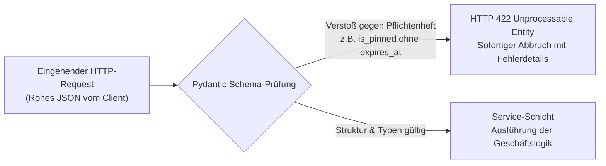
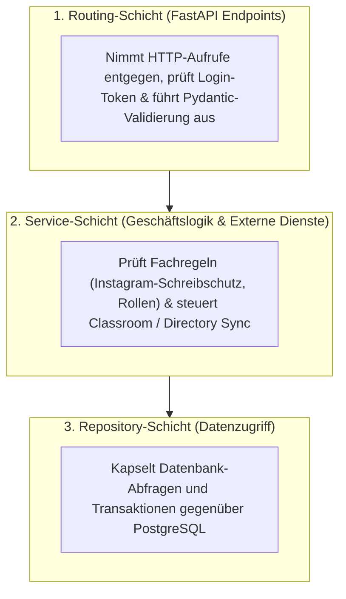

Warum reicht es nicht aus, Pflichtfelder und Schreibschutz-Regeln nur im Browser-Formular einzubauen? Weil jeder Nutzer die Oberfläche im Browser umgehen und manipulierte Datenpakete per Skript oder Kommandozeile (`curl`) direkt an den Server senden kann. Erst das Backend bildet die unbestechliche Sicherheits- und Logikgrenze einer Web-Applikation. Dieses fünfte Kapitel zeigt, wie die UPA Campus App ihr Pflichtenheft mithilfe von Python, FastAPI und Pydantic in verbindliche Schnittstellenverträge (API Contracts) und eine saubere dreistufige Schichtenarchitektur übersetzt.

---

## API-First mit FastAPI: Wie Backend und Mobile-Team synchron arbeiten

Wenn in einem Projektteam gleichzeitig am Web-Admin-Portal und an einer nativen Android-App (Kotlin) gearbeitet wird, führt jede Unklarheit über Datenfelder oder Datumsformate sofort zu Fehlern. Die UPA Campus App setzt deshalb auf einen strikten **API-First-Ansatz** mit **FastAPI**:

1. **Automatische Schnittstellendokumentation (`/docs`):** FastAPI liest die Python-Typdefinitionen aus dem Quellcode und erzeugt daraus vollautomatisch eine interaktive OpenAPI-Spezifikation. Entwickler im Android-Team sehen dort jederzeit live, welche Parameter ein Endpunkt erwartet und welche Antwortstruktur zurückkommt.
2. **Asynchrone Verarbeitung für externe Schnittstellen (`ASGI`):** Wenn viele Studierende morgens gleichzeitig ihren Kalender öffnen und das Backend dazu Abgabefristen von den Servern von Google Classroom abfragt, blockiert das Warten auf die externe Antwort keinen Server-Prozess. Die asynchrone Ereignisschleife (Event Loop) bearbeitet in dieser kurzen Wartezeit nahtlos die Anfragen weiterer Nutzer.

---

## Pydantic als Türsteher: Das Pflichtenheft als ausführbares Schema

Bevor eine Anfrage im Backend überhaupt eine Datenbankabfrage auslösen darf, muss sie die **Pydantic-Eingangskontrolle** passieren. Dort sind die formalen Regeln des Pflichtenhefts als präzises Datenmodell hinterlegt:



Ein Blick in das Schema `PublicationCreate` für den vereinheitlichten Endpunkt `/api/publications` zeigt, wie fachliche Vorgaben direkt als Code erzwungen werden:

```python
from datetime import datetime, timezone
from typing import Literal
from pydantic import BaseModel, Field, model_validator

class PublicationCreate(BaseModel):
    title: str = Field(..., min_length=3, max_length=200)
    content: str = Field(..., min_length=1, max_length=10000)
    post_type: Literal["MANUAL", "EVENT", "EMERGENCY_BANNER", "INSTAGRAM"] = "MANUAL"
    media_type: Literal["NONE", "IMAGE", "VIDEO", "DOCUMENT"] = "NONE"
    media_url: str | None = None
    is_event: bool = False
    event_date: datetime | None = None
    is_pinned: bool = False
    expires_at: datetime | None = None
    reminder_value: int | None = Field(default=None, ge=1, le=365)
    reminder_unit: Literal["MINUTES", "HOURS", "DAYS"] | None = None
    target_groups: list[str] = Field(default_factory=list)

    @model_validator(mode="after")
    def validate_publication_constraints(self) -> "PublicationCreate":
        if self.is_pinned:
            if self.expires_at is None:
                raise ValueError("Angeheftete Beiträge benötigen ein Ablaufdatum (expires_at).")
            if self.expires_at <= datetime.now(timezone.utc):
                raise ValueError("Das Ablaufdatum (expires_at) muss in der Zukunft liegen.")

        if self.is_event and self.event_date is None:
            raise ValueError("Kalender-Veranstaltungen benötigen ein Datum (event_date).")

        return self
```

Selbst wenn jemand ein eigenes Skript schreibt, um ein Notfall-Banner ohne Ablaufdatum an `/api/publications` zu schicken, lehnt Pydantic das Datenpaket bereits vor der eigentlichen Programmlogik mit dem Statuscode `HTTP 422` ab.

---

## Dreistufige Schichtenarchitektur statt unübersichtlichem Spaghetticode

Ein typisches Risiko beim KI-gestützten Programmieren (Vibe-Coding) besteht darin, dass das Sprachmodell HTTP-Routing, Geschäftsregeln, Google-Aufrufe und SQL-Befehle in eine einzige lange Funktion schreibt. Sobald später eine Regel angepasst wird, entstehen unbemerkte Seiteneffekte.

Das Backend der UPA Campus App gliedert jeden Vorgang in drei streng getrennte Schichten:



### Welche Aufgaben die Service-Schicht im Campus-Alltag übernimmt

Während Pydantic prüft, ob ein einzelnes JSON-Paket formal korrekt aufgebaut ist, entscheidet die **Service-Schicht** über alle Regeln, die den bestehenden Systemzustand oder Drittsysteme betreffen:

#### 1. Serverseitiger Schreibschutz für synchronisierte Instagram-Beiträge
Im Frontend sind Titel und Text importierter Instagram-Beiträge ausgegraut. Damit diese Regel auch bei direkten API-Aufrufen unumstößlich gilt, vergleicht die Service-Schicht vor jedem Speichern den Beitragsursprung:

```python
from fastapi import HTTPException, status

def apply_publication_update(existing_post, payload):
    if existing_post.post_type == "INSTAGRAM":
        if payload.title != existing_post.title or payload.content != existing_post.content:
            raise HTTPException(
                status_code=status.HTTP_403_FORBIDDEN,
                detail="Synchronisierte Instagram-Beiträge dürfen inhaltlich nicht verändert werden.",
            )
    existing_post.is_pinned = payload.is_pinned
    existing_post.expires_at = payload.expires_at
    return existing_post
```

#### 2. Lokaler Verzeichnis-Cache für die schnelle Zielgruppen-Auswahl
Damit Redakteure im Web-Admin beim Tippen ohne Verzögerung durch alle Google-Workspace-Gruppen der Universität (`@example-campus.edu`) filtern können, fragt das Backend die Google Admin Directory API nicht bei jedem Klick neu über das Internet ab. Stattdessen hält die Service-Schicht die Gruppenliste in einem vorab alphabetisch sortierten Speicher-Cache vor und beantwortet Abfragen in wenigen Millisekunden.

#### 3. Universitäre Identität und das Prinzip minimaler Rechte (Least Privilege)
Auch die Sicherheitsvorgaben für Benutzerkonten und Rollen werden zentral in dieser Schicht durchgesetzt:
* **Kryptografische Domain-Prüfung:** Beim Google-OAuth-Login verifiziert das Backend die Signatur des Tokens und lässt für geschützte Campus-Inhalte nur Konten der Hochschul-Domain (`@example-campus.edu`) zu. Alle während der Entwicklungsphase genutzten Schnell-Login-Buttons sind im Produktivmodus deaktiviert.
* **Keine vorausgewählten Berechtigungen:** Wird in der Rollen-Matrix ein neues Verwaltungsprofil angelegt, starten sämtliche Berechtigungen im Zustand `false`. Jeder schreibende API-Endpunkt prüft über eine vorgeschaltete FastAPI-Abhängigkeit (`Depends(require_permission)`), ob das aufrufende Konto genau das benötigte Einzelrecht besitzt.

---

## Fazit

1. **Verbindliche Verträge durch API-First und Pydantic:** Durch die Kombination aus automatischer OpenAPI-Dokumentation und deklarativen Pydantic-Modellen werden ungültige Datenpakete (wie angeheftete Beiträge ohne Verfallsdatum) bereits an der Servergrenze abgewiesen.
2. **Klare Aufgabentrennung in drei Schichten:** Die Aufteilung in Routing, Service-Logik und Datenzugriff hält das Backend übersichtlich, schützt importierte Instagram-Beiträge zuverlässig vor Überschreibung und setzt das Prinzip minimaler Rechte bei jedem Aufruf durch.
