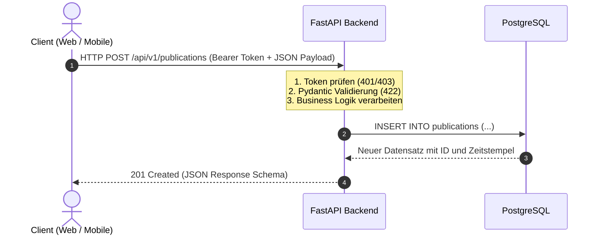
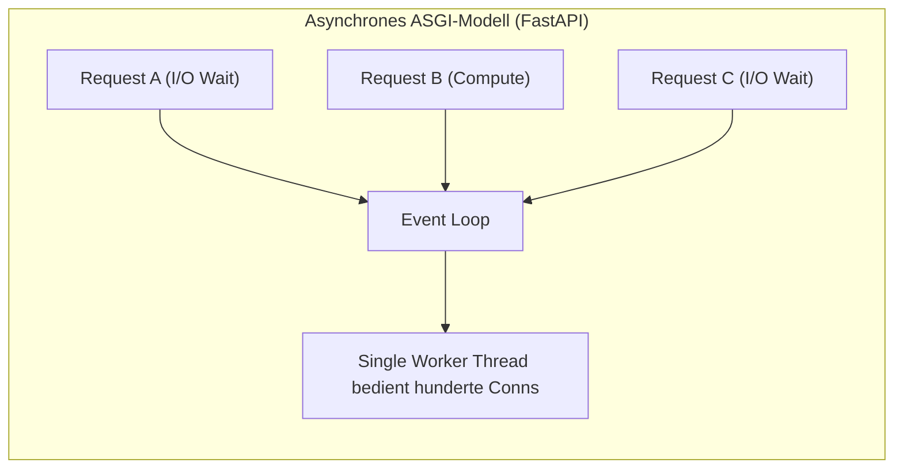
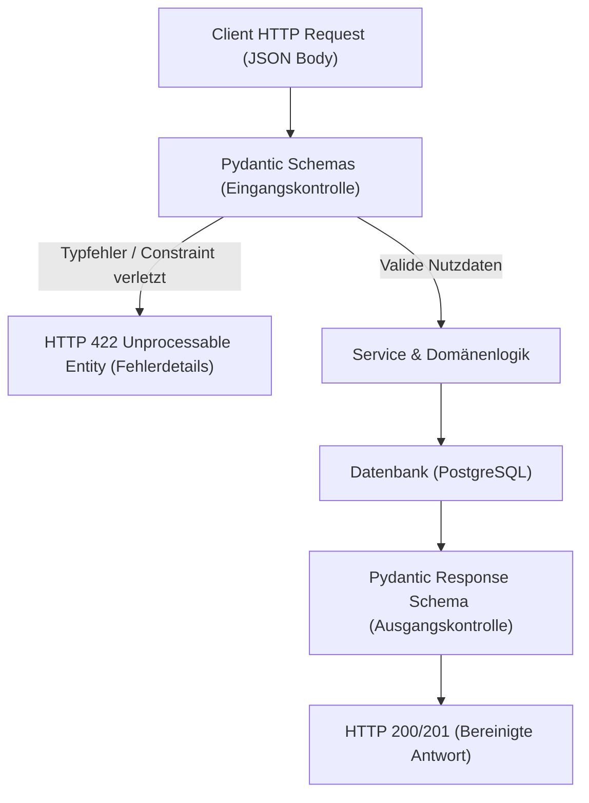
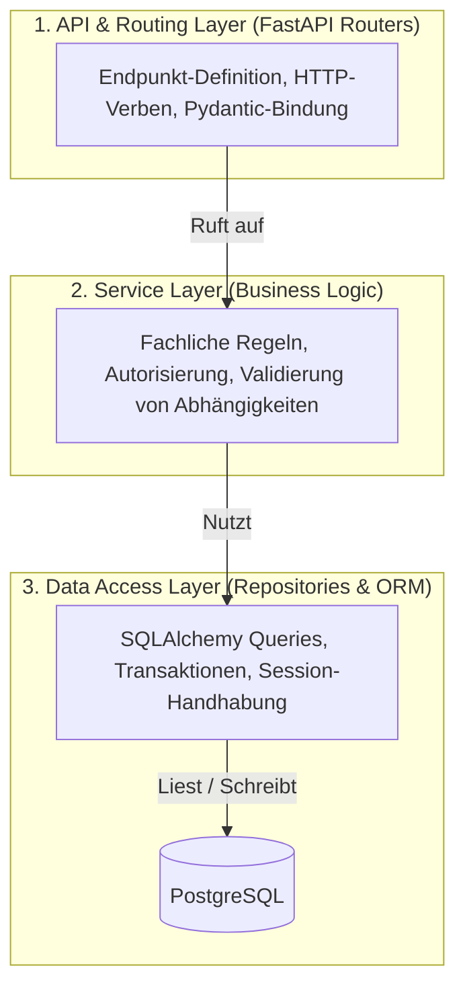

Robuste Unternehmensanwendungen benötigen ein zuverlässiges Backend, das Datenmodelle schützt, Business-Regeln durchsetzt und Schnittstellen für Web- und Mobilclients bereitstellt. Die UPA Campus App setzt für diesen Kern auf Python mit FastAPI und Pydantic. Während Teil 4 die Auslieferung über den Webclient beleuchtet hat, widmet sich dieser fünfte Teil der Backend-Logik: den Prinzipien moderner REST-APIs, den Gründen für FastAPI und asynchrone Ein- und Ausgabe, der schema-basierten Eingangskontrolle sowie einer modularen Schichtenarchitektur zur Trennung von Zuständigkeiten.

---

## Was ist eine REST API: Ressourcen und Semantik

Representational State Transfer (REST) ist ein bewährter Architekturstil für verteilte Systeme im Web. Im Zentrum steht das zustandslose Request-Response-Modell: Jeder HTTP-Aufruf eines Clients enthält alle zur Verarbeitung erforderlichen Informationen, beispielsweise Authentifizierungs-Token in den Headern und Nutzdaten im Rumpf. Der Server speichert keine flüchtigen Client-Zustände im Speicher, was horizontale Skalierbarkeit und einfaches Caching ermöglicht.



### 1. Ressourcenzentrierung und Standard-HTTP-Verben

REST strukturiert Schnittstellen um fachliche Ressourcen (z.B. `/api/v1/publications` oder `/api/v1/courses`). Operationen auf diesen Ressourcen werden durch standardisierte HTTP-Methoden gesteuert:

* **GET:** Liest Ressourcen ab. Die Operation ist idempotent und seiteneffektfrei (z.B. `GET /api/v1/publications`).
* **POST:** Erstellt eine neue Ressource unterhalb der angegebenen Kollektion (z.B. `POST /api/v1/publications`).
* **PUT / PATCH:** Aktualisiert Ressourcen. `PUT` ersetzt den gesamten Datensatz, während `PATCH` gezielt einzelne Attribute modifiziert.
* **DELETE:** Entfernt eine Ressource idempotent aus dem System (z.B. `DELETE /api/v1/publications/42`).

### 2. Semantische HTTP-Statuscodes

Eine saubere REST API kommuniziert den Ausgang einer Operation nicht über proprietäre Fehlerobjekte mit HTTP 200, sondern über offizielle HTTP-Statuscodes:

* **200 OK:** Erfolgreiche Anfrage mit Datenrückgabe (z.B. bei GET oder PATCH).
* **201 Created:** Ressource erfolgreich erzeugt (Standardantwort bei POST).
* **400 Bad Request:** Syntaktisch fehlerhafter Aufruf, der vom Server nicht interpretiert werden kann.
* **401 Unauthorized:** Fehlende oder ungültige Authentifizierung (z.B. abgelaufenes JWT-Token).
* **403 Forbidden:** Authentifizierter Nutzer besitzt keine ausreichenden Berechtigungen für diese Ressource.
* **404 Not Found:** Angefragte Ressource existiert nicht im Datenbestand.
* **422 Unprocessable Entity:** Syntaktisch korrektes JSON, dessen Felder fachliche oder typbezogene Validierungsregeln verletzen.
* **500 Internal Server Error:** Unerwarteter Laufzeitfehler auf Serverseite.

---

## FastAPI als Framework: Performance und Schnittstellenverträge

Klassische Python-Webframeworks wie Django oder Flask basieren auf dem synchronen WSGI-Standard (Web Server Gateway Interface). Jeder eingehende Request blockiert einen Worker-Thread, solange die Anwendung auf langsame Datenbanken oder Netzwerkverbindungen wartet.

FastAPI nutzt moderne Python-Typisierung (PEP 484) und den asynchronen ASGI-Standard (Asynchronous Server Gateway Interface) auf Basis von Starlette und Uvicorn:



Die architektonischen Hauptgründe für den Einsatz in der UPA Campus App:

1. **Hohe Nebenläufigkeit durch async/await:** I/O-intensive Operationen (wie Datenbankabfragen via SQLAlchemy oder HTTP-Calls an Universitätskataloge) blockieren keine Threads. Der Event-Loop wechselt während der Wartezeit sofort zur Bearbeitung anderer Anfragen.
2. **Native OpenAPI- und Swagger-Spezifikation:** FastAPI generiert aus den Python-Typdefinitionen vollautomatisch OpenAPI-3-Spezifikationen. Unter `/docs` steht eine interaktive Swagger-Benutzeroberfläche zur Verfügung, unter `/redoc` eine strukturierte Dokumentation. Frontend-Entwickler und externe Systeme erhalten verbindliche Schnittstellenverträge ohne manuelle Synchronisationsarbeit.
3. **Dependency Injection als Entkopplungsmechanismus:** FastAPI bietet ein deklaratives Dependency-Injection-System über `Depends()`. Datenbankverbindungen, Authentifizierungskontexte und Repositories werden typsicher in Controller-Funktionen injiziert, was Unit- und Integrationstests signifikant vereinfacht.

---

## Pydantic Schemas und strenge Eingangskontrolle

Sicherheit und Datenintegrität beginnen an der Systemgrenze. Ungültige, fehlerhaft typisierte oder schadhafte Nutzdaten dürfen niemals die Geschäfts- oder Persistenzschicht erreichen. Pydantic dient als Schutzschild vor unvalidierten Payloads.



### Trennung von Eingabe- und Ausgabe-Schemas

In der UPA Campus App existiert für jede Entität eine strikte Trennung zwischen Create-, Update- und Response-Modellen:

```python
from datetime import datetime
from pydantic import BaseModel, Field, ConfigDict

class PublicationBase(BaseModel):
    title: str = Field(..., min_length=3, max_length=150, description="Titel des Beitrags")
    content: str = Field(..., min_length=10, max_length=5000, description="Inhalt des Beitrags")
    category: str = Field(default="general", max_length=50)

class PublicationCreate(PublicationBase):
    """Schema für eingehende POST-Requests."""
    pass

class PublicationResponse(PublicationBase):
    """Schema für ausgehende Responses mit System-Metadaten."""
    id: int
    author_id: int
    created_at: datetime
    updated_at: datetime | None = None

    model_config = ConfigDict(from_attributes=True)
```

### Automatische Validierung und präzise Fehlerdiagnose

Sendet ein Client fehlerhafte Daten (z.B. einen Titel mit nur 2 Zeichen oder ein ungültiges Datenformat), verwirft FastAPI den Aufruf automatisch vor der Ausführung von Programmcode und liefert eine strukturierte Fehlermeldung:

```json
{
  "detail": [
    {
      "type": "string_too_short",
      "loc": ["body", "title"],
      "msg": "String should have at least 3 characters",
      "input": "Hi"
    }
  ]
}
```

Durch das Response-Schema (`PublicationResponse`) wird zudem sichergestellt, dass interne Felder (wie Passworthashes oder interne Flags) niemals versehentlich an den Client ausgeliefert werden.

---

## Schichtenarchitektur im Backend: Trennung von Belangen

Wachsende Enterprise-Systeme erfordern eine strikte Trennung von Zuständigkeiten (Separation of Concerns). Die UPA Campus App folgt einer dreistufigen Schichtenarchitektur, bei der jede Schicht eine klar definierte Aufgabe erfüllt:



### Die Schichten im Detail

1. **Routing Layer (`api/v1/endpoints/`):**
   * Definiert URL-Pfade, HTTP-Methoden und Statuscodes.
   * Prüft Authentifizierungs-Header und instanziiert Pydantic-Schemas.
   * Übergibt validierte DTOs (Data Transfer Objects) an den Service Layer.
   * Enthält keinerlei SQL-Statements oder komplexe Geschäftsregeln.

2. **Service Layer (`services/`):**
   * Kapselt die zentrale Domänenlogik.
   * Prüft fachliche Bedingungen: Darf dieser Nutzer in dieser Kategorie publizieren? Ist das Vorlesungssemester noch aktiv?
   * Koordiniert mehrere Repositories und externe Benachrichtigungen.
   * Ist vollständig unabhängig vom Transportprotokoll HTTP.

3. **Repository Layer (`repositories/` & `models/`):**
   * Kapselt Datenbankoperationen über SQLAlchemy ORM.
   * Verhindert das Streuen von ORM-Abfragen über die gesamte Codebasis.
   * Kontrolliert Transaktionen, Joins und Datenbank-Sessions.

### Konkrete Implementierung mit Dependency Injection

Das Zusammenspiel der drei Schichten zeigt sich in der Erstellung einer studentischen Publikation:

```python
# 1. Routing Schicht (api/v1/endpoints/publications.py)
from fastapi import APIRouter, Depends, status
from sqlalchemy.orm import Session
from app.database import get_db
from app.schemas.publication import PublicationCreate, PublicationResponse
from app.services.publication_service import PublicationService
from app.core.security import get_current_user

router = APIRouter(prefix="/publications", tags=["Publications"])

@router.post("/", response_model=PublicationResponse, status_code=status.HTTP_201_CREATED)
def create_publication(
    payload: PublicationCreate,
    db: Session = Depends(get_db),
    current_user = Depends(get_current_user),
):
    service = PublicationService(db)
    return service.create_for_user(payload, user_id=current_user.id)
```

```python
# 2. Service Schicht (services/publication_service.py)
from fastapi import HTTPException, status
from app.repositories.publication_repository import PublicationRepository
from app.schemas.publication import PublicationCreate

class PublicationService:
    def __init__(self, db):
        self.repo = PublicationRepository(db)

    def create_for_user(self, payload: PublicationCreate, user_id: int):
        # Fachliche Prüfung: Spam-Schutz oder Statusüberprüfung
        recent_count = self.repo.count_recent_by_user(user_id, minutes=5)
        if recent_count >= 3:
            raise HTTPException(
                status_code=status.HTTP_429_TOO_MANY_REQUESTS,
                detail="Publikationslimit erreicht. Bitte einige Minuten warten.",
            )
        return self.repo.create(payload, author_id=user_id)
```

```python
# 3. Repository Schicht (repositories/publication_repository.py)
from datetime import datetime, timedelta, timezone
from sqlalchemy.orm import Session
from app.models.publication import Publication
from app.schemas.publication import PublicationCreate

class PublicationRepository:
    def __init__(self, db: Session):
        self.db = db

    def count_recent_by_user(self, user_id: int, minutes: int) -> int:
        threshold = datetime.now(timezone.utc) - timedelta(minutes=minutes)
        return self.db.query(Publication).filter(
            Publication.author_id == user_id,
            Publication.created_at >= threshold
        ).count()

    def create(self, payload: PublicationCreate, author_id: int) -> Publication:
        db_obj = Publication(
            title=payload.title,
            content=payload.content,
            category=payload.category,
            author_id=author_id,
        )
        self.db.add(db_obj)
        self.db.commit()
        self.db.refresh(db_obj)
        return db_obj
```

Dieser Entwurf entkoppelt Komponenten vollständig: Änderungen am Datenbankschema berühren lediglich das Repository, während Validierungsänderungen isoliert in Pydantic-Schemas stattfinden.

---

## Fazit

1. **Typsicherheit und Resilienz:** Die Kombination aus FastAPI und Pydantic sichert Systemgrenzen deklarativ ab. Fehlerhafte Payloads werden abgewiesen, bevor Geschäftslogik ausgeführt wird, was die Anfälligkeit für Injektionen und inkonsistente Zustände minimiert.
2. **Entwickler- und Integrationseffizienz:** Die automatische Bereitstellung standardisierter OpenAPI-Spezifikationen eliminiert Diskrepanzen zwischen Frontend- und Backend-Teams und beschleunigt Schnittstellen-Tests.
3. **Wartbarkeit durch Schichtentrennung:** Die modulare Aufteilung in Router, Services und Repositories isoliert HTTP-Transport, Domänenregeln und Persistenz. Das System bleibt auch bei wachsendem Funktionsumfang modular testbar und flexibel erweiterbar.
