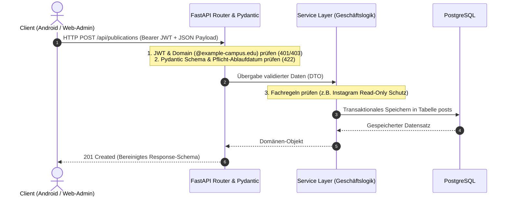
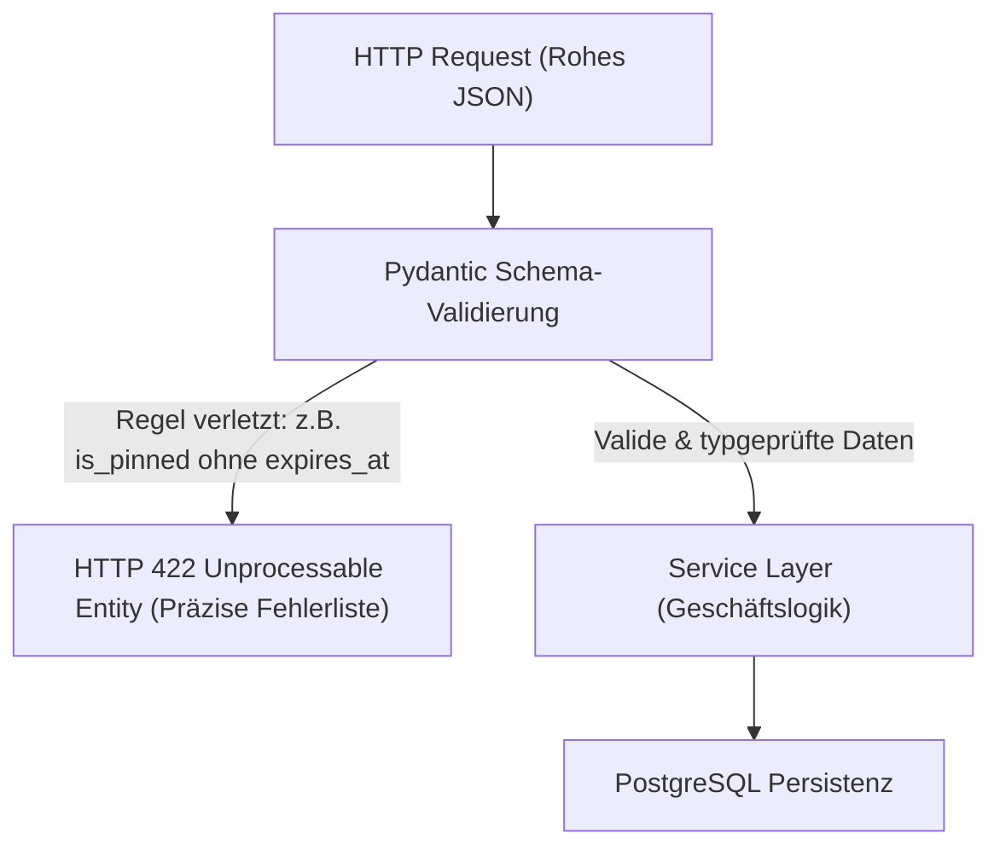
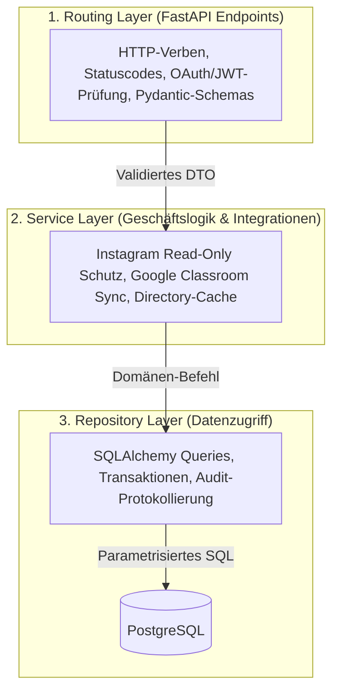

Eine goldene Regel der Systemarchitektur lautet: Vertraue niemals dem Client. Jede Prüfung im Browser (wie ein deaktiviertes Textfeld oder ein Pflichtfeld-Häkchen in HTML) lässt sich mit den Entwicklerwerkzeugen des Browsers oder einem direkten Aufruf per `curl` in Sekunden umgehen. Erst das Backend bildet die verlässliche Sicherheits- und Logikgrenze einer Webanwendung. Die UPA Campus App setzt für diesen Kern auf Python mit FastAPI und Pydantic. Dieses fünfte Kapitel zeigt angehenden Wirtschaftsinformatikern und Vibe-Codern, wie man ein Pflichtenheft in verbindliche Schnittstellenverträge (API Contracts), strenge Eingabevalidierung und eine saubere Schichtenarchitektur übersetzt.

---

## Warum API-First und FastAPI das Fundament bilden

In einem arbeitsteiligen Projekt entwickeln das Web-Team und das Android-Team (Kotlin) gleichzeitig gegen denselben Server. Ohne einen präzisen Schnittstellenvertrag entstehen sofort Reibungsverluste über Feldnamen, Datumsformate oder Fehlercodes.

Das Pflichtenheft der UPA Campus App begründet die Wahl von Python und FastAPI mit drei konkreten Engineering-Faktoren:
1. **Reduktion von Boilerplate-Code:** Im Vergleich zu klassischen, stark zeremoniellen Enterprise-Stacks reduziert FastAPI repetitiven Infrastruktur-Code um rund 60 Prozent, sodass sich das Team voll auf die fachlichen Anforderungen des Campus konzentrieren kann.
2. **Automatischer Schnittstellenvertrag über OpenAPI (`/docs`):** FastAPI liest die Python-Typannotationen aus und generiert vollautomatisch eine interaktive Swagger-Dokumentation unter `/docs`. Das Android-Team sieht dort live jeden Endpunkt, jedes Pflichtfeld und jeden HTTP-Statuscode, ohne auf manuell gepflegte Word-Dokumente warten zu müssen.
3. **Asynchrone Nebenläufigkeit (`ASGI`):** Wenn Dutzende Studierende gleichzeitig ihre Agenda öffnen und das Backend im Hintergrund Abgabefristen von der Google Classroom API abruft, blockiert das Warten auf Google keinen Server-Thread. Die asynchrone Event-Loop bedient währenddessen nahtlos weitere Anfragen.



---

## Pydantic als Türsteher: Das Pflichtenheft als ausführbares Schema

Wie verhindert man auf Architekturebene, dass ein angeheftetes Notfall-Banner ohne Ablaufdatum gespeichert wird, selbst wenn jemand das Web-Formular umgeht? Die Antwort liegt in **Pydantic**: Jede eingehende JSON-Nachricht muss zuerst durch ein deklaratives Schema-Tor, bevor auch nur eine Zeile Geschäftslogik ausgeführt wird.



Das folgende Schema aus der UPA Campus App zeigt, wie die Anforderungen des vereinheitlichten Publikationsmodells (`/api/publications`) eins zu eins in Code gegossen werden:

```python
from datetime import datetime, timezone
from typing import Literal
from pydantic import BaseModel, Field, model_validator

class PublicationCreate(BaseModel):
    title: str = Field(..., min_length=3, max_length=200)
    content: str = Field(..., min_length=1, max_length=10000)
    post_type: Literal["MANUAL", "EVENT", "EMERGENCY_BANNER", "INSTAGRAM"] = "MANUAL"
    media_type: Literal["NONE", "IMAGE", "VIDEO", "DOCUMENT"] = "NONE"
    media_url: str | None = None
    is_event: bool = False
    event_date: datetime | None = None
    is_pinned: bool = False
    expires_at: datetime | None = None
    reminder_value: int | None = Field(default=None, ge=1, le=365)
    reminder_unit: Literal["MINUTES", "HOURS", "DAYS"] | None = None
    target_groups: list[str] = Field(default_factory=list)

    @model_validator(mode="after")
    def enforce_specification_rules(self) -> "PublicationCreate":
        # Pflichtenheft-Regel 1: Angeheftete Beiträge (is_pinned) benötigen zwingend ein Ablaufdatum
        if self.is_pinned:
            if self.expires_at is None:
                raise ValueError("Angeheftete Beiträge erfordern ein Ablaufdatum (expires_at).")
            if self.expires_at <= datetime.now(timezone.utc):
                raise ValueError("Das Ablaufdatum (expires_at) muss in der Zukunft liegen.")

        # Pflichtenheft-Regel 2: Kalender-Events benötigen ein Veranstaltungsdatum
        if self.is_event and self.event_date is None:
            raise ValueError("Veranstaltungen im Kalender erfordern ein Datum (event_date).")

        return self
```

Versucht ein fehlerhafter Client, einen angehefteten Beitrag ohne `expires_at` zu senden, bricht FastAPI die Anfrage sofort mit `HTTP 422 Unprocessable Entity` ab. Ungültige Zustände können die Datenbank gar nicht erst erreichen.

---

## Die dreistufige Schichtenarchitektur im Backend

Wenn KI-Assistenten ohne architektonische Vorgaben Code generieren, landet häufig alles in einer einzigen Datei: HTTP-Routing, Berechtigungsprüfungen, Drittanbieter-Aufrufe und SQL-Abfragen. Sobald sich eine Anforderung im Pflichtenheft ändert, bricht das System an unerwarteten Stellen.

Die UPA Campus App trennt das Backend deshalb strikt in drei Schichten:



### Wie der Service Layer die Geschäftsregeln des Pflichtenhefts durchsetzt

Während Pydantic die Struktur einer einzelnen Anfrage prüft, überwacht der **Service Layer** die Regeln, die den aktuellen Datenbankzustand oder externe Systeme betreffen:

#### 1. Schreibschutz (`Read-Only`) für synchronisierte Instagram-Beiträge
Warum verbietet das Pflichtenheft das Bearbeiten von Text und Bild bei importierten Instagram-Beiträgen? Weil ein Hintergrund-Job den offiziellen Instagram-Feed der Universität periodisch abgleicht. Der Service Layer setzt diese Schutzregel hart durch:

```python
from fastapi import HTTPException, status

def update_publication(db_post, payload, current_user):
    # Pflichtenheft-Regel: Instagram-Beiträge sind für Text und Medien schreibgeschützt
    if db_post.post_type == "INSTAGRAM":
        if payload.title != db_post.title or payload.content != db_post.content:
            raise HTTPException(
                status_code=status.HTTP_403_FORBIDDEN,
                detail="Synchronisierte Instagram-Beiträge sind schreibgeschützt (Read-Only).",
            )
    # Interne Metadaten (wie Zielgruppen oder Anheften mit Ablaufdatum) dürfen aktualisiert werden
    db_post.is_pinned = payload.is_pinned
    db_post.expires_at = payload.expires_at
    return db_post
```

#### 2. Google Workspace Directory Cache für den Sofort-Filter
Im Web-Admin wählt das Marketing-Team Zielgruppen aus einer alphabetisch sortierten Liste echter Google-Workspace-Gruppen (`@example-campus.edu`). Würde das Backend bei jedem Öffnen des Editors live die Google Admin Directory API aufrufen, würde das Laden mehrere Sekunden dauern und in Google-Rate-Limits laufen. Der Service Layer hält die Gruppenliste deshalb in einem lokalen Backend-Cache vor, sortiert sie alphabetisch vor und liefert sie in unter 5 Millisekunden an das Frontend aus.

#### 3. Identitäts-Föderation, Google Classroom Sync und Least Privilege
* **Exklusiver Domain-Check:** Beim Login über Google OAuth 2.0 prüft das Backend kryptografisch die Signatur des Google-Tokens und weist jede E-Mail-Adresse ab, die nicht zur Hochschul-Domain (`@example-campus.edu`) gehört.
* **Live-Synchronisation mit Google Classroom:** Mit dem beim OAuth-Login gewährten Zugriffstoken ruft der `ClassroomService` die persönlichen Kurs-Abgabefristen des Studierenden ab und führt sie für das Agenda-Modul mit den internen Campus-Terminen zusammen.
* **Prinzip minimaler Rechte (Least Privilege):** Neue Benutzerkonten erhalten bei der Anlage keine vorausgewählten Administrator-Berechtigungen, und jeder schreibende Endpunkt unter `/api/publications` oder `/api/roles` prüft über FastAPI Dependency Injection (`Depends(require_permission)`), ob die benötigte Einzelberechtigung vorliegt.

---

## Fazit

1. **Das Backend ist die einzige verlässliche Sicherheitsgrenze:** Weil Client-Code jederzeit manipuliert werden kann, müssen Authentifizierung, Rollenprüfung und Schema-Validierung kompromisslos auf dem Server stattfinden.
2. **Pydantic übersetzt das Pflichtenheft in ausführbare Regeln:** Vorgaben wie das verpflichtende Ablaufdatum beim Anheften von Bannern (`is_pinned` erfordert `expires_at`) werden als Schema-Validator definiert und weisen fehlerhafte Aufrufe automatisch mit `HTTP 422` ab.
3. **Saubere Schichten und intelligentes Caching:** Die Trennung in Router, Service und Repository hält den Code wartbar, schützt synchronisierte Instagram-Beiträge vor versehentlichem Überschreiben und beschleunigt die Google-Workspace-Gruppenauswahl durch lokales Caching.
