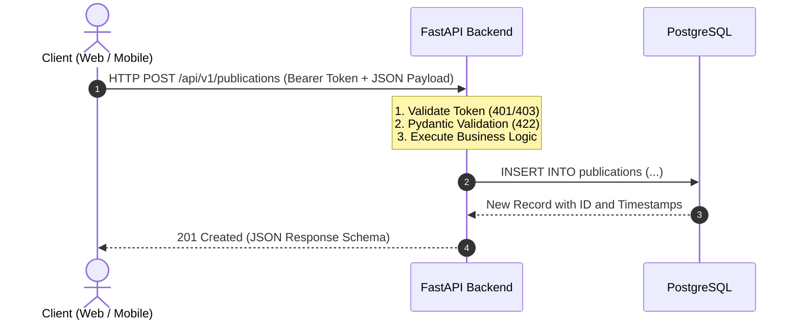
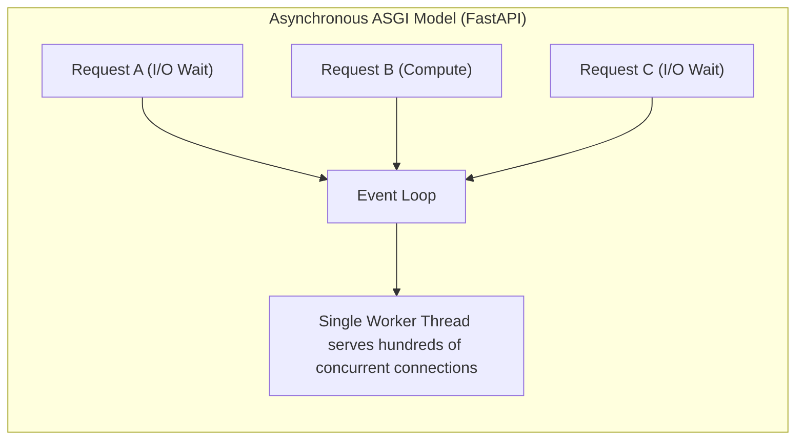
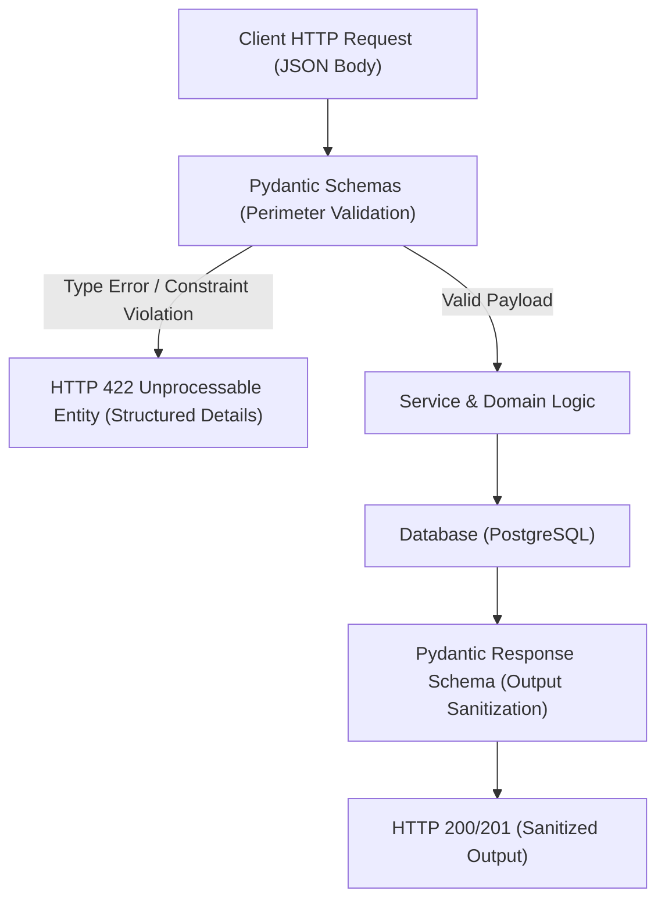
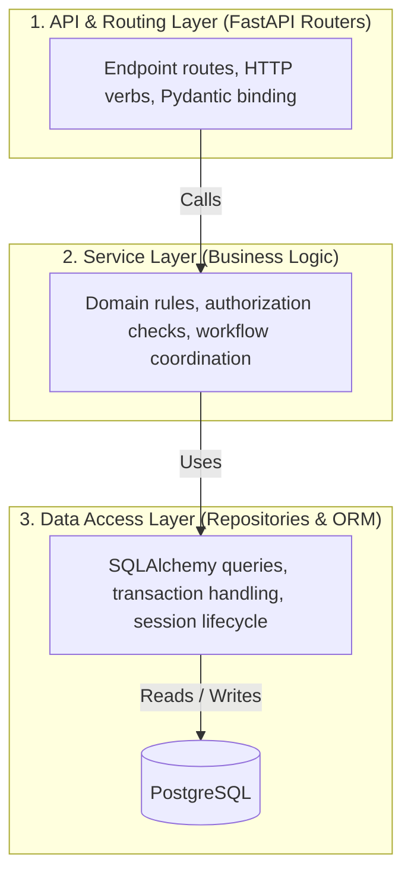

Enterprise applications rely on a deterministic backend to guard domain state, enforce business constraints, and expose reliable interfaces to client applications. The UPA Campus App builds this foundation on Python with FastAPI and Pydantic. Following the client delivery analysis in Part 4, this fifth installment focuses on the core backend architecture: REST interface design, asynchronous execution with FastAPI, schema-driven payload validation via Pydantic, and a clean layered architecture separating concerns across the stack.

---

## What is a REST API: Resource Modeling and Protocol Semantics

Representational State Transfer (REST) provides an established architectural framework for distributed systems over HTTP. At its center lies the stateless request-response model: Every HTTP request from a client carries all necessary context, including authentication tokens in headers and structured payloads in the body. The server retains no ephemeral client session state in memory, enabling horizontal scalability and edge caching.



### 1. Resource Orientation and Standard HTTP Verbs

REST organizes interfaces around distinct business entities (such as `/api/v1/publications` or `/api/v1/courses`). Client interactions rely on standardized HTTP verbs:

* **GET:** Retrieves resource representations. The operation is idempotent and safe without mutations (e.g., `GET /api/v1/publications`).
* **POST:** Creates a new entity within the targeted resource collection (e.g., `POST /api/v1/publications`).
* **PUT / PATCH:** Modifies resource state. `PUT` replaces the resource representation completely, whereas `PATCH` applies partial delta updates.
* **DELETE:** Removes a resource idempotently from persistent storage (e.g., `DELETE /api/v1/publications/42`).

### 2. Semantic HTTP Status Codes

A robust REST API signals execution outcomes through standard HTTP status codes rather than masked HTTP 200 bodies with proprietary error envelopes:

* **200 OK:** Successful request with an expected response body (e.g., GET or PATCH operations).
* **201 Created:** Successful creation of a new entity (standard for POST operations).
* **400 Bad Request:** Malformed request syntax that cannot be processed by the parser.
* **401 Unauthorized:** Missing, expired, or invalid authentication credentials (e.g., an invalid JWT token).
* **403 Forbidden:** Authenticated identity lacks permission to access the designated resource.
* **404 Not Found:** Target resource does not exist in the datastore.
* **422 Unprocessable Entity:** Syntactically valid JSON payload that violates domain constraints or schema types.
* **500 Internal Server Error:** Unhandled server exception during runtime execution.

---

## FastAPI as Framework: Performance and Contract Generation

Traditional Python web frameworks like Django or Flask were conceived around the synchronous WSGI (Web Server Gateway Interface) standard. Under WSGI, each incoming request consumes an operating system thread while waiting on database queries or external network calls.

FastAPI builds upon modern Python type annotations (PEP 484) and the asynchronous ASGI (Asynchronous Server Gateway Interface) standard powered by Starlette and Uvicorn:



Key architectural factors driving this choice for the UPA Campus App:

1. **High Concurrency via async/await:** I/O-bound operations (such as PostgreSQL queries via SQLAlchemy or upstream campus catalog calls) yield execution to the event loop. The worker handles other incoming traffic while waiting on socket responses.
2. **Native OpenAPI and Swagger Specifications:** FastAPI produces compliant OpenAPI 3 documentation directly from Python type declarations. Interactive documentation is available out of the box at `/docs` (Swagger UI) and `/redoc` (ReDoc). Frontend engineers and third-party integrations obtain machine-readable contracts without documentation drift.
3. **Dependency Injection Architecture:** FastAPI provides a composable dependency injection framework through `Depends()`. Database sessions, security contexts, and repository instances resolve cleanly inside endpoint handlers, simplifying unit testing and mocking.

---

## Pydantic Schemas and Perimeter Validation

Data integrity and security must be enforced at the API perimeter. Malformed, incomplete, or hostile inputs should never reach the service or database layers. Pydantic serves as an automated gatekeeper.



### Decoupling Input and Output Schemas

The UPA Campus App maintains explicit schema models for creation, updates, and serialized responses:

```python
from datetime import datetime
from pydantic import BaseModel, Field, ConfigDict

class PublicationBase(BaseModel):
    title: str = Field(..., min_length=3, max_length=150, description="Title of publication")
    content: str = Field(..., min_length=10, max_length=5000, description="Body content")
    category: str = Field(default="general", max_length=50)

class PublicationCreate(PublicationBase):
    """Schema for incoming creation requests."""
    pass

class PublicationResponse(PublicationBase):
    """Schema for outgoing responses including persistence metadata."""
    id: int
    author_id: int
    created_at: datetime
    updated_at: datetime | None = None

    model_config = ConfigDict(from_attributes=True)
```

### Deterministic Validation and Error Responses

When a client submits invalid parameters (for instance, a title shorter than 3 characters), FastAPI interrupts execution before touching domain logic and returns a standardized HTTP 422 response:

```json
{
  "detail": [
    {
      "type": "string_too_short",
      "loc": ["body", "title"],
      "msg": "String should have at least 3 characters",
      "input": "Hi"
    }
  ]
}
```

By defining a dedicated response schema (`PublicationResponse`), internal database columns (such as password hashes or private flags) are filtered from the serialized response payload automatically.

---

## Layered Backend Architecture: Separation of Concerns

As applications expand, separating operational concerns becomes critical for long-term maintainability. The UPA Campus App enforces a three-tier architecture:



### Responsibilities by Tier

1. **Routing Layer (`api/v1/endpoints/`):**
   * Declares URI paths, HTTP methods, and status codes.
   * Validates authentication headers and binds request bodies to Pydantic schemas.
   * Hands typed Data Transfer Objects (DTOs) down to the service layer.
   * Contains zero database queries or domain business logic.

2. **Service Layer (`services/`):**
   * Encapsulates core business rules and workflows.
   * Evaluates operational rules: Has the author exceeded publication quotas? Is the course semester active?
   * Coordinates multiple repositories or background tasks.
   * Remains decoupled from the HTTP transport layer.

3. **Repository Layer (`repositories/` & `models/`):**
   * Manages data persistence via SQLAlchemy ORM.
   * Prevents database query leakage across the codebase.
   * Handles database sessions, filtering, joins, and transaction commits.

### Implementation with Dependency Injection

The interaction across all three layers is illustrated in the publication workflow:

```python
# 1. Routing Layer (api/v1/endpoints/publications.py)
from fastapi import APIRouter, Depends, status
from sqlalchemy.orm import Session
from app.database import get_db
from app.schemas.publication import PublicationCreate, PublicationResponse
from app.services.publication_service import PublicationService
from app.core.security import get_current_user

router = APIRouter(prefix="/publications", tags=["Publications"])

@router.post("/", response_model=PublicationResponse, status_code=status.HTTP_201_CREATED)
def create_publication(
    payload: PublicationCreate,
    db: Session = Depends(get_db),
    current_user = Depends(get_current_user),
):
    service = PublicationService(db)
    return service.create_for_user(payload, user_id=current_user.id)
```

```python
# 2. Service Layer (services/publication_service.py)
from fastapi import HTTPException, status
from app.repositories.publication_repository import PublicationRepository
from app.schemas.publication import PublicationCreate

class PublicationService:
    def __init__(self, db):
        self.repo = PublicationRepository(db)

    def create_for_user(self, payload: PublicationCreate, user_id: int):
        # Business policy: rate limiting per author
        recent_count = self.repo.count_recent_by_user(user_id, minutes=5)
        if recent_count >= 3:
            raise HTTPException(
                status_code=status.HTTP_429_TOO_MANY_REQUESTS,
                detail="Publication limit reached. Please wait a few minutes.",
            )
        return self.repo.create(payload, author_id=user_id)
```

```python
# 3. Repository Layer (repositories/publication_repository.py)
from datetime import datetime, timedelta, timezone
from sqlalchemy.orm import Session
from app.models.publication import Publication
from app.schemas.publication import PublicationCreate

class PublicationRepository:
    def __init__(self, db: Session):
        self.db = db

    def count_recent_by_user(self, user_id: int, minutes: int) -> int:
        threshold = datetime.now(timezone.utc) - timedelta(minutes=minutes)
        return self.db.query(Publication).filter(
            Publication.author_id == user_id,
            Publication.created_at >= threshold
        ).count()

    def create(self, payload: PublicationCreate, author_id: int) -> Publication:
        db_obj = Publication(
            title=payload.title,
            content=payload.content,
            category=payload.category,
            author_id=author_id,
        )
        self.db.add(db_obj)
        self.db.commit()
        self.db.refresh(db_obj)
        return db_obj
```

This decoupled design ensures isolation: Changes to the database schema affect only repository queries, while API validation updates remain confined to Pydantic definitions.

---

## Key Takeaways

1. **Perimeter Security through Type Contracts:** Pairing FastAPI with Pydantic ensures declarative validation at the system boundary. Invalid requests are rejected before executing business code, preventing injection flaws and invalid system states.
2. **Engineering Efficiency via OpenAPI:** Automated OpenAPI schema generation removes communication friction between frontend and backend engineers, speeding up integration and automated contract testing.
3. **Maintainability via Layered Isolation:** Strict separation into routes, services, and repositories decouples transport protocols from core domain logic. The architecture remains cleanly testable and scalable as features grow.
