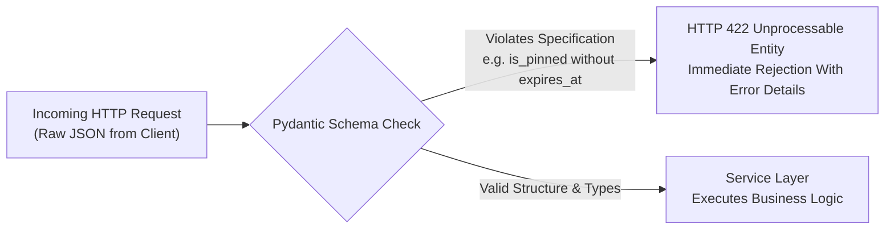
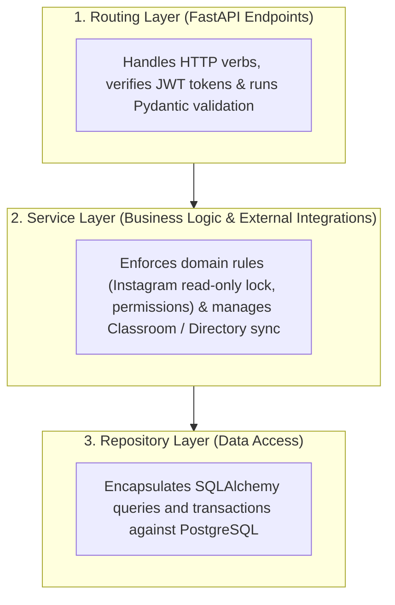

Why is it insufficient to enforce required fields and read-only locks solely inside a browser form? Because any user can bypass the visual interface using browser developer tools or a command-line script (`curl`) and send crafted requests straight to the server. The backend is the true security and business-logic boundary of a web application. This fifth chapter demonstrates how the UPA Campus App translates its functional specification into executable API contracts and a clean three-tier backend architecture using Python, FastAPI, and Pydantic.

---

## API-First With FastAPI: Keeping Backend and Mobile Teams in Sync

When one team builds the desktop editorial portal while another develops the native Android application (Kotlin), any ambiguity around field names or timestamp formats quickly causes integration bugs. The UPA Campus App prevents this friction through an **API-First** approach built on **FastAPI**:

1. **Automated OpenAPI Documentation (`/docs`):** FastAPI inspects Python type annotations directly from the source code and generates an interactive OpenAPI specification automatically. Mobile developers can inspect every endpoint, required parameter, and status code live without waiting for manually updated documents.
2. **Asynchronous Concurrency for External Integrations (`ASGI`):** When dozens of students open their schedules simultaneously in the morning and the backend requests assignment deadlines from the Google Classroom API, waiting on network responses from Google does not block server worker threads. The asynchronous event loop continues serving other campus requests in the meantime.

---

## Pydantic as the Gatekeeper: The Specification as an Executable Schema

Before an incoming request is allowed to touch business logic or trigger a database query, it must pass **Pydantic schema validation**. Here, the formal constraints of the specification are expressed as declarative Python models:



Looking at the `PublicationCreate` schema for the unified `/api/publications` endpoint illustrates how product rules become self-enforcing code:

```python
from datetime import datetime, timezone
from typing import Literal
from pydantic import BaseModel, Field, model_validator

class PublicationCreate(BaseModel):
    title: str = Field(..., min_length=3, max_length=200)
    content: str = Field(..., min_length=1, max_length=10000)
    post_type: Literal["MANUAL", "EVENT", "EMERGENCY_BANNER", "INSTAGRAM"] = "MANUAL"
    media_type: Literal["NONE", "IMAGE", "VIDEO", "DOCUMENT"] = "NONE"
    media_url: str | None = None
    is_event: bool = False
    event_date: datetime | None = None
    is_pinned: bool = False
    expires_at: datetime | None = None
    reminder_value: int | None = Field(default=None, ge=1, le=365)
    reminder_unit: Literal["MINUTES", "HOURS", "DAYS"] | None = None
    target_groups: list[str] = Field(default_factory=list)

    @model_validator(mode="after")
    def validate_publication_constraints(self) -> "PublicationCreate":
        if self.is_pinned:
            if self.expires_at is None:
                raise ValueError("Pinned publications require an expiration timestamp (expires_at).")
            if self.expires_at <= datetime.now(timezone.utc):
                raise ValueError("The expiration timestamp (expires_at) must be in the future.")

        if self.is_event and self.event_date is None:
            raise ValueError("Calendar events require an event timestamp (event_date).")

        return self
```

Even if someone bypasses the web form entirely and sends a raw API request to pin an alert without an expiration date, Pydantic rejects the payload at the perimeter with `HTTP 422`.

---

## Three-Tier Backend Architecture Instead of Spaghetti Code

A common pitfall in AI-assisted coding (vibe-coding) occurs when generated code mixes HTTP routing, permission checks, third-party API calls, and SQL queries inside a single endpoint function. As soon as a requirement evolves, changing one line breaks unrelated features.

To keep the system maintainable, the UPA Campus App separates the backend into three distinct layers:



### How the Service Layer Enforces Domain Rules

While Pydantic validates the shape of an individual request, the **Service Layer** enforces rules that depend on existing database state or external university systems:

#### 1. Server-Side Read-Only Protection for Synchronized Instagram Posts
In the web editor, title and body fields for imported Instagram posts are visually disabled. To guarantee that this rule holds even against direct API calls, the service layer inspects the existing record before applying updates:

```python
from fastapi import HTTPException, status

def apply_publication_update(existing_post, payload):
    if existing_post.post_type == "INSTAGRAM":
        if payload.title != existing_post.title or payload.content != existing_post.content:
            raise HTTPException(
                status_code=status.HTTP_403_FORBIDDEN,
                detail="Synchronized Instagram publications are read-only for text and media.",
            )
    existing_post.is_pinned = payload.is_pinned
    existing_post.expires_at = payload.expires_at
    return existing_post
```

#### 2. In-Memory Directory Cache for Instant Target Group Filtering
To let editors filter university Google Workspace groups (`@example-campus.edu`) instantaneously in the web portal, the backend does not query the remote Google Admin Directory API on every keystroke. Instead, the service layer caches the synchronized group list in memory, pre-sorted alphabetically, serving the list to the editor in milliseconds.

#### 3. Institutional Identity and Least-Privilege Access Control
Identity and authorization policies are enforced consistently across all endpoints:
* **Cryptographic Domain Verification:** During Google OAuth 2.0 sign-in, the backend verifies the token signature and restricts internal campus access to verified `@example-campus.edu` email addresses. Any development shortcut buttons used during local testing are disabled in production.
* **Unchecked Default Permissions:** When creating a new administrative role, all permission flags initialize to `false`. Every mutating endpoint verifies the caller's exact permission via FastAPI dependency injection (`Depends(require_permission)`).

---

## Key Takeaways

1. **Enforceable Contracts With API-First and Pydantic:** Combining live OpenAPI documentation with declarative Pydantic validators stops malformed requests (such as pinned banners missing an expiration date) before they reach business logic.
2. **Clean Separation Across Three Layers:** Dividing the backend into routing, service logic, and data repositories keeps the codebase modular, protects synchronized Instagram content from accidental overwrites, and enforces least-privilege permissions on every call.
