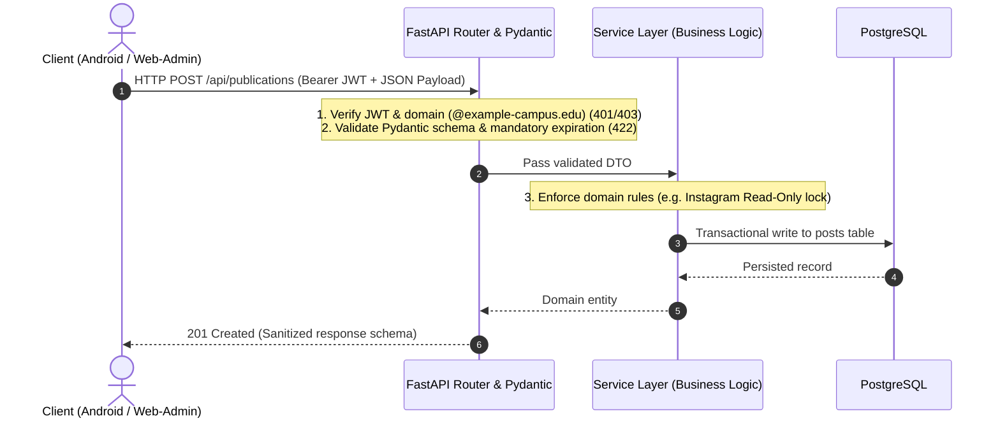
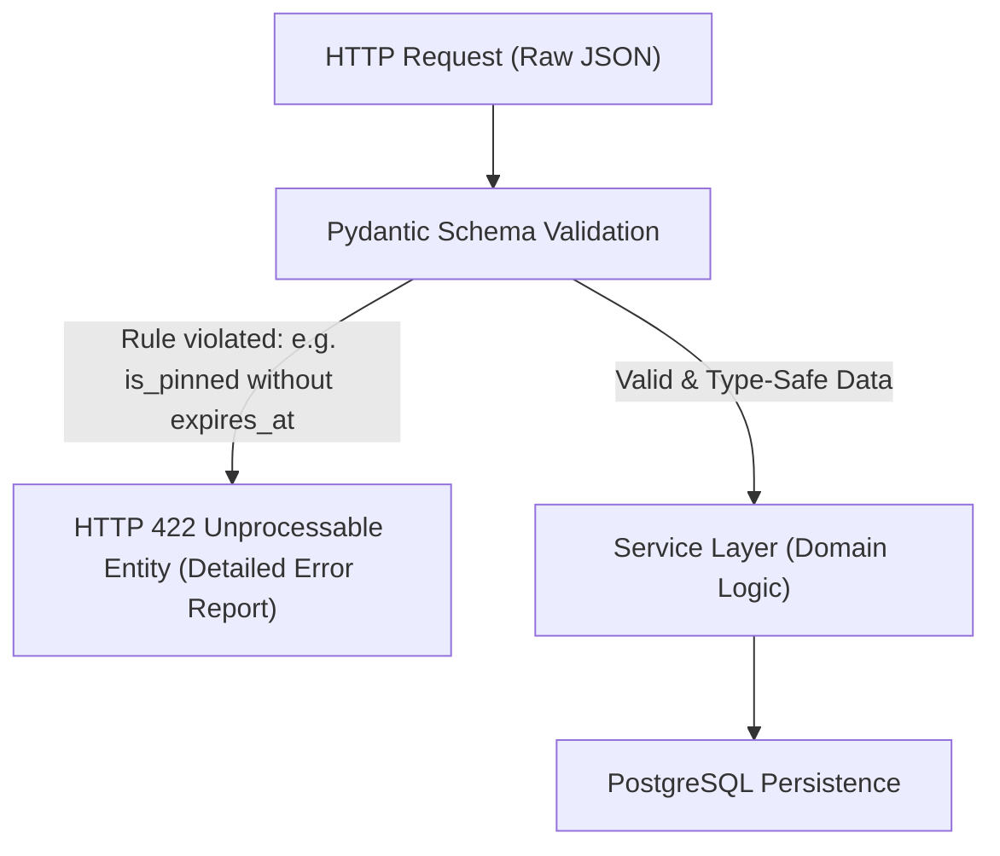
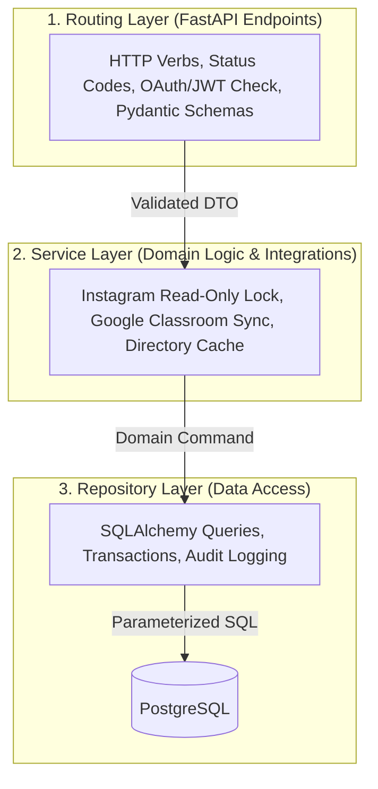

A foundational rule of system architecture is simple: never trust the client. Any check performed inside a browser (such as a disabled text input or a required checkbox in HTML) can be bypassed in seconds using browser developer tools or a direct `curl` command. Only the backend constitutes a trustworthy security and domain boundary. The UPA Campus App builds this core on Python with FastAPI and Pydantic. This fifth chapter shows business informatics students and vibe-coders how to translate a functional specification into binding API contracts, strict input validation, and a clean three-tier service architecture.

---

## Why API-First and FastAPI Form the Core

In a multi-platform engineering project, the web team and the native Android team (Kotlin) build against the same server simultaneously. Without an explicit interface contract, teams quickly collide over field names, timestamp formats, or error codes.

Section 1 of the UPA Campus App functional specification justifies Python and FastAPI on three concrete engineering grounds:
1. **60 Percent Less Boilerplate Code:** Compared to verbose traditional Java enterprise stacks, FastAPI eliminates repetitive ceremony so the team can focus directly on campus domain logic and timely MVP delivery.
2. **Automated Interface Contracts via OpenAPI (`/docs`):** FastAPI inspects Python type annotations and automatically generates an interactive Swagger UI at `/docs`. Android engineers inspect live endpoints, required fields, and HTTP status codes directly without waiting for manually updated specification documents.
3. **Asynchronous Concurrency (`ASGI`):** When dozens of students open their Agenda simultaneously and the backend fetches live assignment deadlines from the Google Classroom API, waiting on external network I/O never blocks a server thread. The asynchronous event loop immediately processes other incoming requests in the meantime.



---

## Pydantic as Gatekeeper: The Specification as an Executable Schema

How do you guarantee at the architectural level that a pinned emergency banner is never saved without an expiration timestamp, even if someone bypasses the web form? The answer is **Pydantic**: every incoming JSON payload must pass through a declarative schema gate before a single line of business logic executes.



The following schema from the UPA Campus App demonstrates how the requirements of the unified publication model (`/api/publications`) translate directly into executable validation logic:

```python
from datetime import datetime, timezone
from typing import Literal
from pydantic import BaseModel, Field, model_validator

class PublicationCreate(BaseModel):
    title: str = Field(..., min_length=3, max_length=200)
    content: str = Field(..., min_length=1, max_length=10000)
    post_type: Literal["MANUAL", "EVENT", "EMERGENCY_BANNER", "INSTAGRAM"] = "MANUAL"
    media_type: Literal["NONE", "IMAGE", "VIDEO", "DOCUMENT"] = "NONE"
    media_url: str | None = None
    is_event: bool = False
    event_date: datetime | None = None
    is_pinned: bool = False
    expires_at: datetime | None = None
    reminder_value: int | None = Field(default=None, ge=1, le=365)
    reminder_unit: Literal["MINUTES", "HOURS", "DAYS"] | None = None
    target_groups: list[str] = Field(default_factory=list)

    @model_validator(mode="after")
    def enforce_specification_rules(self) -> "PublicationCreate":
        # Specification Rule 1: Pinned posts (is_pinned) require a future expiration date
        if self.is_pinned:
            if self.expires_at is None:
                raise ValueError("Pinned publications require an expiration timestamp (expires_at).")
            if self.expires_at <= datetime.now(timezone.utc):
                raise ValueError("The expiration timestamp (expires_at) must lie in the future.")

        # Specification Rule 2: Calendar events require an event timestamp
        if self.is_event and self.event_date is None:
            raise ValueError("Calendar events require an event date (event_date).")

        return self
```

If a buggy or manipulated client attempts to submit a pinned post without `expires_at`, FastAPI rejects the request immediately with `HTTP 422 Unprocessable Entity`. Invalid state never reaches the database.

---

## Three-Tier Layered Architecture in the Backend

When AI coding assistants generate backend code without architectural guidance, they frequently dump HTTP routing, permission checks, external API calls, and raw SQL queries into a single file. As soon as a business rule changes, the system breaks in unpredictable ways.

To prevent this, the UPA Campus App divides the backend into three strictly separated layers:



### How the Service Layer Enforces Functional Specification Rules

While Pydantic validates the shape of a single request payload, the **Service Layer** enforces domain rules that depend on existing database state or external integrations:

#### 1. Read-Only Protection for Synchronized Instagram Posts
Why does the specification prohibit editing the caption and media of imported Instagram posts? Because a periodic background worker continuously synchronizes the official university Instagram feed. The service layer enforces this invariant strictly:

```python
from fastapi import HTTPException, status

def update_publication(db_post, payload, current_user):
    # Specification Rule: Instagram posts are read-only for text and media fields
    if db_post.post_type == "INSTAGRAM":
        if payload.title != db_post.title or payload.content != db_post.content:
            raise HTTPException(
                status_code=status.HTTP_403_FORBIDDEN,
                detail="Synchronized Instagram publications are read-only.",
            )
    # Internal campus metadata (such as pinning with expiration) remains editable
    db_post.is_pinned = payload.is_pinned
    db_post.expires_at = payload.expires_at
    return db_post
```

#### 2. Google Workspace Directory Cache for Instant Audience Filtering
In the Web-Admin portal, the marketing team targets announcements using a flat alphabetical list of real Google Workspace groups (`@example-campus.edu`). Querying the external Google Admin Directory API live every time an editor opens the form would add seconds of latency and trigger rate limits. Instead, the backend caches the directory groups locally, sorts them alphabetically, and serves them to the Web-Admin instant filter in under 5 milliseconds.

#### 3. Identity Federation, Google Classroom Sync, and Least Privilege
* **Institutional Domain Enforcement:** During Google OAuth 2.0 login, the backend cryptographically verifies the Google ID token and rejects any account outside the university domain (`@example-campus.edu`).
* **Live Google Classroom Synchronization:** Using the authorized OAuth token, the `ClassroomService` fetches the student's upcoming coursework deadlines and merges them with internal university events for the Agenda module.
* **Least Privilege Access Control:** New user accounts initialize with zero administrative permissions checked by default, and every mutating endpoint under `/api/publications` or `/api/roles` verifies explicit granular permissions via FastAPI Dependency Injection (`Depends(require_permission)`).

---

## Key Takeaways

1. **The Backend Is the Only True Security Boundary:** Because client interfaces can always be bypassed, authentication, role checks, and schema validation must be enforced unconditionally on the server.
2. **Pydantic Turns Specification Rules into Executable Contracts:** Requirements such as mandatory expiration timestamps on pinned banners (`is_pinned` requires `expires_at`) run as declarative validators that block malformed requests with `HTTP 422`.
3. **Layered Architecture and Smart Caching:** Separating routers, services, and repositories keeps domain logic maintainable, protects synchronized Instagram posts from lost updates, and accelerates Google Workspace group targeting via local caching.
