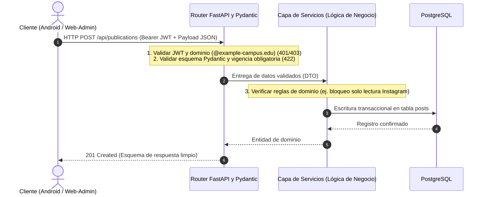
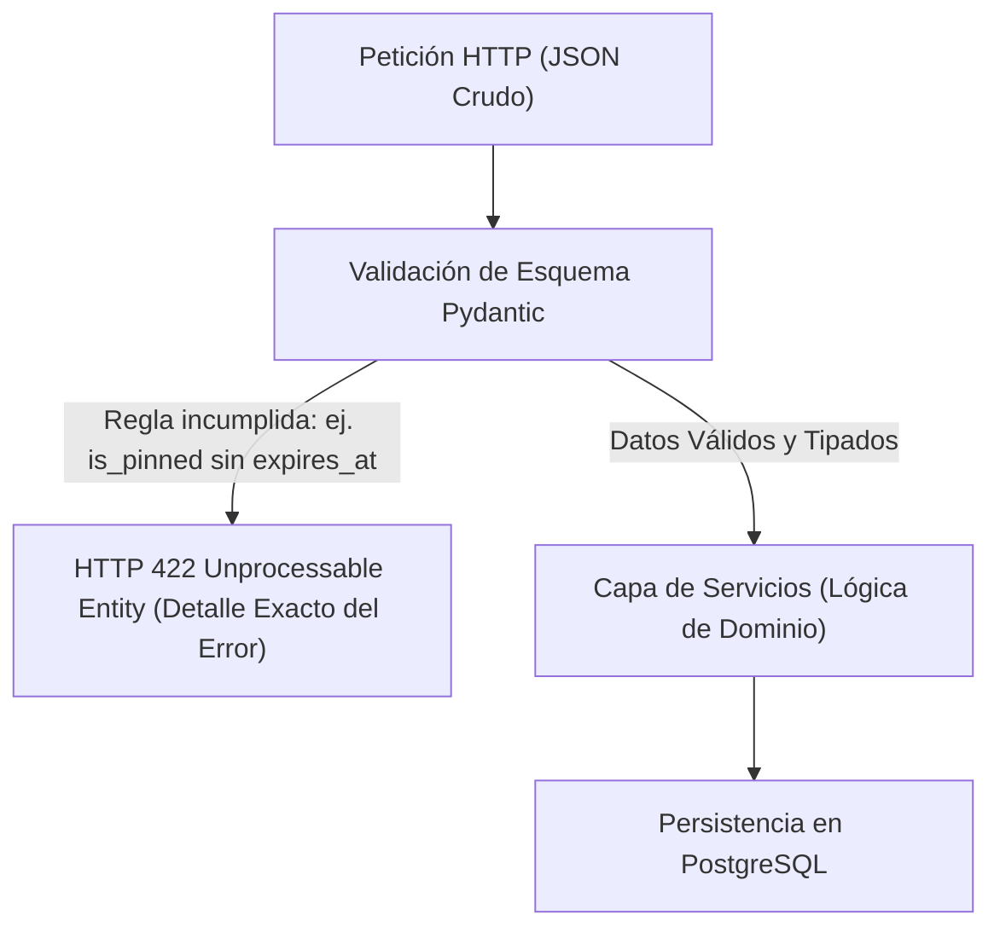
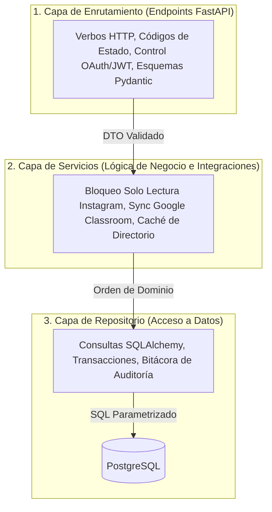

Una regla de oro en la ingeniería de sistemas es no confiar nunca ciegamente en el cliente. Cualquier validación visual dentro del navegador (como un campo deshabilitado o una casilla obligatoria en HTML) puede saltarse en segundos utilizando la consola de desarrollo o enviando una petición directa con `curl`. Únicamente el backend constituye la frontera real de seguridad y lógica de negocio. La UPA Campus App construye este núcleo sobre Python con FastAPI y Pydantic. Este quinto capítulo enseña a estudiantes de informática empresarial y desarrolladores asistidos por IA (vibe-coders) cómo traducir una especificación funcional en contratos de interfaz (API Contracts), validaciones estrictas de entrada y una arquitectura limpia en tres capas.

---

## Por Qué API-First y FastAPI Constituyen el Núcleo

En un proyecto universitario donde el equipo Web-Admin y el equipo móvil de Android (Kotlin) desarrollan en paralelo contra el mismo servidor, la falta de un contrato de interfaz explícito provoca errores inmediatos por nombres de campos o formatos de fecha incompatibles.

El apartado 1 de la especificación funcional de la UPA Campus App fundamenta la elección de Python y FastAPI en tres ventajas técnicas directas:
1. **60 por Ciento Menos de Código Repetitivo:** Frente a entornos verbosos tradicionales en Java, FastAPI reduce drásticamente el código de infraestructura repetitivo (boilerplate), priorizando el cumplimiento de plazos y la solidez de las reglas de negocio del campus.
2. **Contratos Automáticos con OpenAPI y Swagger (`/docs`):** FastAPI lee los tipos declarados en Python y genera automáticamente la documentación interactiva en `/docs`. El equipo de Android Studio consulta allí cada ruta, parámetro obligatorio y código de respuesta en vivo sin depender de manuales externos desactualizados.
3. **Concurrencia Asíncrona (`ASGI`):** Cuando decenas de estudiantes consultan su agenda al mismo tiempo y el backend solicita entregas en vivo a la API de Google Classroom, la espera de red no bloquea al servidor. El bucle de eventos asíncrono atiende otras peticiones mientras aguarda la respuesta externa.



---

## Pydantic como Guardián: La Especificación Funcional Hecha Esquema Ejecutable

¿Cómo se garantiza a nivel arquitectónico que ningún aviso fijado arriba se guarde sin fecha de vencimiento, incluso si alguien intenta saltarse el formulario web? La respuesta es **Pydantic**: cada paquete JSON entrante debe atravesar un filtro declarativo antes de ejecutar una sola línea de lógica de negocio.



El siguiente esquema de la UPA Campus App muestra cómo los requisitos del modelo unificado de publicaciones (`/api/publications`) se convierten directamente en reglas de código:

```python
from datetime import datetime, timezone
from typing import Literal
from pydantic import BaseModel, Field, model_validator

class PublicationCreate(BaseModel):
    title: str = Field(..., min_length=3, max_length=200)
    content: str = Field(..., min_length=1, max_length=10000)
    post_type: Literal["MANUAL", "EVENT", "EMERGENCY_BANNER", "INSTAGRAM"] = "MANUAL"
    media_type: Literal["NONE", "IMAGE", "VIDEO", "DOCUMENT"] = "NONE"
    media_url: str | None = None
    is_event: bool = False
    event_date: datetime | None = None
    is_pinned: bool = False
    expires_at: datetime | None = None
    reminder_value: int | None = Field(default=None, ge=1, le=365)
    reminder_unit: Literal["MINUTES", "HOURS", "DAYS"] | None = None
    target_groups: list[str] = Field(default_factory=list)

    @model_validator(mode="after")
    def enforce_specification_rules(self) -> "PublicationCreate":
        # Regla 1 del pliego: Fijar arriba (is_pinned) exige fecha de vencimiento futura
        if self.is_pinned:
            if self.expires_at is None:
                raise ValueError("Las publicaciones fijadas arriba exigen fecha de vencimiento (expires_at).")
            if self.expires_at <= datetime.now(timezone.utc):
                raise ValueError("La fecha de vencimiento (expires_at) debe estar en el futuro.")

        # Regla 2 del pliego: Los eventos de calendario requieren fecha de realización
        if self.is_event and self.event_date is None:
            raise ValueError("Los eventos de calendario requieren fecha y hora (event_date).")

        return self
```

Si un cliente defectuoso intenta enviar una publicación fijada sin `expires_at`, FastAPI rechaza la llamada automáticamente con `HTTP 422 Unprocessable Entity`. Los datos inconsistentes jamás llegan a la base de datos.

---

## Arquitectura en Tres Capas dentro del Backend

Cuando se genera código con asistentes de IA sin una estructura clara, es común terminar con rutas HTTP, validaciones de permisos, llamadas a Google y consultas SQL mezcladas dentro de un mismo archivo. Al cambiar cualquier requisito del pliego, el código se rompe en cadena.

Por ello, la UPA Campus App divide el backend en tres capas con responsabilidades estrictas:



### Cómo la Capa de Servicios Ejecuta el Pliego Funcional

Mientras Pydantic valida la estructura de los datos entrantes, la **Capa de Servicios** protege las reglas de negocio que dependen del estado almacenado o de integraciones externas:

#### 1. Bloqueo de Solo Lectura (`Read-Only`) para Publicaciones de Instagram
¿Por qué la especificación funcional prohíbe editar el texto o la imagen de las publicaciones importadas desde Instagram? Porque un proceso automático sincroniza periódicamente la cuenta oficial de la universidad. La capa de servicios blinda esta regla en el servidor:

```python
from fastapi import HTTPException, status

def update_publication(db_post, payload, current_user):
    # Regla del pliego: Las publicaciones de Instagram son de solo lectura en texto y medios
    if db_post.post_type == "INSTAGRAM":
        if payload.title != db_post.title or payload.content != db_post.content:
            raise HTTPException(
                status_code=status.HTTP_403_FORBIDDEN,
                detail="Las publicaciones sincronizadas de Instagram son de solo lectura.",
            )
    # Los metadatos internos del campus (como fijar arriba con vencimiento) sí pueden actualizarse
    db_post.is_pinned = payload.is_pinned
    db_post.expires_at = payload.expires_at
    return db_post
```

#### 2. Caché Local de Google Workspace Directory para el Filtro Instantáneo
En el portal Web-Admin, marketing segmenta los comunicados eligiendo destinatarios sobre una lista plana ordenada alfabéticamente de grupos reales de Google Workspace (`@example-campus.edu`). Si el backend consultara en vivo la API de Google Admin Directory cada vez que un editor abre la pantalla, la carga demoraría segundos y agotaría las cuotas de Google. Por ello, el servicio mantiene una caché local en el backend, ordena los grupos alfabéticamente y responde al filtro instantáneo en menos de 5 milisegundos.

#### 3. Federación de Identidad, Sincronización con Google Classroom y Privilegio Mínimo
* **Validación Estricta de Dominio:** Durante el inicio de sesión con Google OAuth 2.0, el backend verifica criptográficamente el token y rechaza cualquier correo que no pertenezca al dominio institucional (`@example-campus.edu`).
* **Sincronización en Vivo con Google Classroom:** Con el token OAuth autorizado por el estudiante, el servicio `ClassroomService` importa sus entregas académicas pendientes y las unifica con los eventos del campus dentro del módulo Agenda.
* **Principio de Privilegio Mínimo:** Las cuentas nuevas nacen sin permisos administrativos preseleccionados, y cada endpoint de escritura bajo `/api/publications` o `/api/roles` exige el permiso específico mediante inyección de dependencias (`Depends(require_permission)`).

---

## Conclusiones

1. **El Backend es la Única Frontera Real de Seguridad:** Como la interfaz del cliente siempre puede manipularse desde fuera, la autenticación, el control de roles y la validación de datos deben ejecutarse sin excepciones en el servidor.
2. **Pydantic Convierte la Especificación en Código Ejecutable:** Reglas como la vigencia obligatoria al fijar avisos arriba (`is_pinned` exige `expires_at`) operan como validadores automáticos que detienen peticiones inválidas con `HTTP 422`.
3. **Capas Limpias y Caché Inteligente:** Separar enrutadores, servicios y repositorios mantiene el sistema ordenado, protege las publicaciones de Instagram frente a sobrescrituras accidentales y acelera la segmentación de grupos de Google Workspace mediante caché local.
