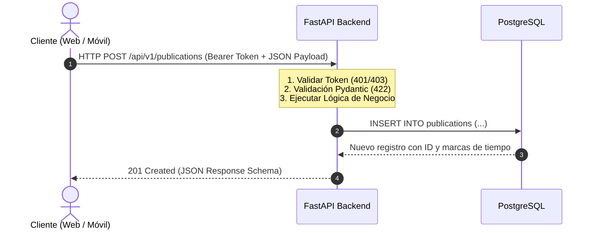
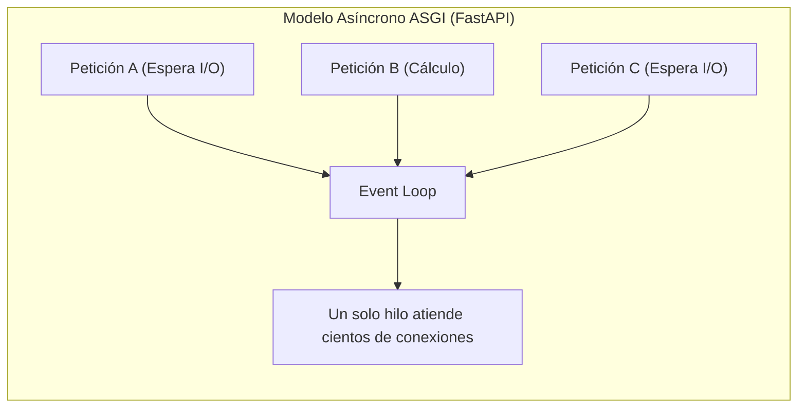
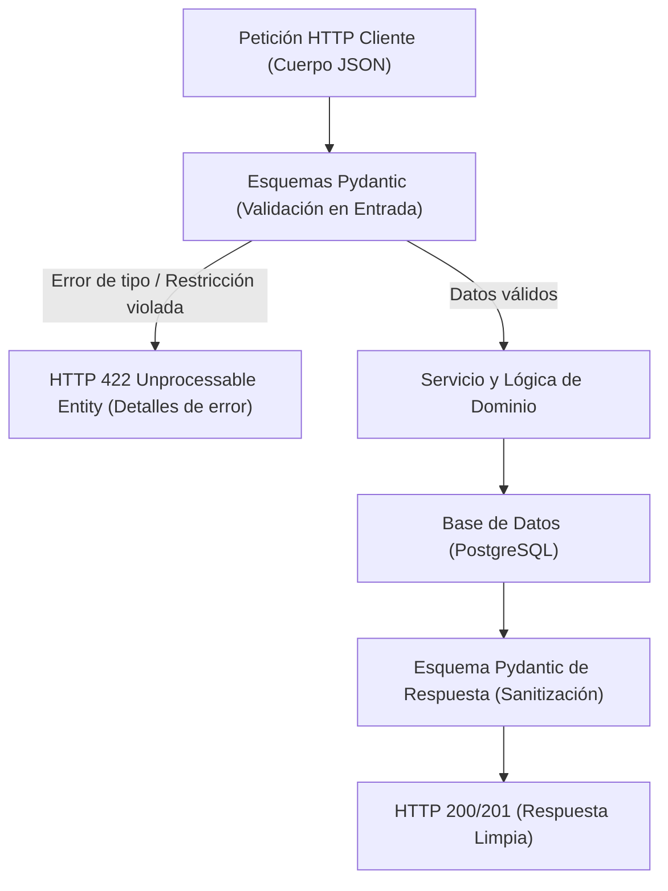
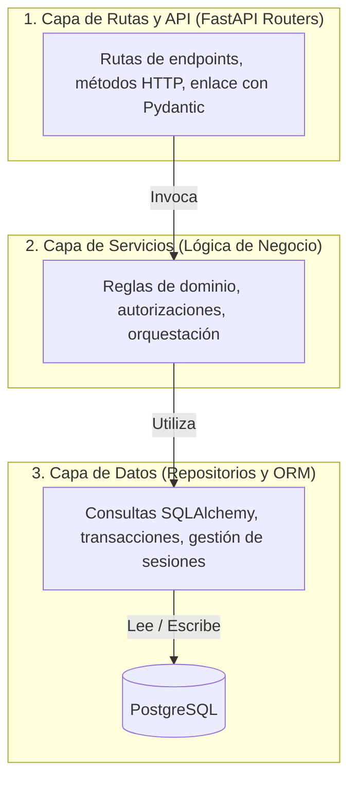

Las aplicaciones empresariales dependen de un backend determinista para proteger el estado del dominio, aplicar reglas de negocio y proporcionar interfaces fiables a los clientes web y móviles. UPA Campus App construye esta base sobre Python utilizando FastAPI y Pydantic. Tras examinar la entrega en clientes web en la parte 4, esta quinta entrega analiza la arquitectura del backend: los principios de diseño de APIs REST, las ventajas de FastAPI y el procesamiento asíncrono, la validación estricta de entradas mediante Pydantic y una arquitectura modular por capas para separar responsabilidades.

---

## Qué es una API REST: Modelado de recursos y semántica

Representational State Transfer (REST) es un estilo de arquitectura probado para sistemas distribuidos en la web. Su núcleo es el modelo sin estado (stateless) de petición y respuesta: Cada llamada HTTP de un cliente incluye toda la información necesaria para el procesamiento, como tokens de autenticación en cabeceras y datos estructurados en el cuerpo. El servidor no almacena sesiones efímeras en memoria, lo que facilita la escalabilidad horizontal y el almacenamiento en caché.



### 1. Orientación a recursos y verbos HTTP estándar

REST estructura los servicios en torno a recursos de negocio específicos (por ejemplo, `/api/v1/publications` o `/api/v1/courses`). Las operaciones sobre estos recursos se gestionan mediante métodos HTTP estandarizados:

* **GET:** Recupera representaciones de recursos. La operación es idempotente y no genera mutaciones (por ejemplo, `GET /api/v1/publications`).
* **POST:** Crea una nueva entidad dentro de la colección especificada (por ejemplo, `POST /api/v1/publications`).
* **PUT / PATCH:** Actualiza el estado de un recurso. `PUT` reemplaza la representación completa, mientras que `PATCH` aplica modificaciones parciales.
* **DELETE:** Elimina un recurso de forma idempotente del sistema (por ejemplo, `DELETE /api/v1/publications/42`).

### 2. Códigos de estado HTTP semánticos

Una API REST sólida comunica los resultados mediante códigos de estado HTTP oficiales en lugar de encapsular errores en respuestas genéricas HTTP 200:

* **200 OK:** Petición exitosa con datos de respuesta esperados (GET o PATCH).
* **201 Created:** Creación exitosa de un nuevo recurso (estándar para POST).
* **400 Bad Request:** Sintaxis de petición defectuosa que el servidor no puede interpretar.
* **401 Unauthorized:** Autenticación ausente, caducada o inválida (por ejemplo, token JWT expirado).
* **403 Forbidden:** La identidad autenticada carece de permisos para el recurso solicitado.
* **404 Not Found:** El recurso solicitado no existe en la base de datos.
* **422 Unprocessable Entity:** Carga JSON sintácticamente válida que incumple restricciones de tipo o reglas de validación.
* **500 Internal Server Error:** Error imprevisto en el servidor durante la ejecución.

---

## FastAPI como framework: Rendimiento y contratos de interfaz

Los frameworks web clásicos en Python, como Django o Flask, se diseñaron sobre el estándar síncrono WSGI (Web Server Gateway Interface). En WSGI, cada petición entrante bloquea un hilo del sistema operativo mientras espera respuestas de bases de datos o servicios externos.

FastAPI aprovecha el tipado moderno de Python (PEP 484) y el estándar asíncrono ASGI (Asynchronous Server Gateway Interface) mediante Starlette y Uvicorn:



Factores arquitectónicos determinantes en UPA Campus App:

1. **Alta concurrencia mediante async/await:** Las operaciones intensivas en entrada/salida (consultas a PostgreSQL mediante SQLAlchemy o llamadas a catálogos universitarios) no bloquean hilos. El bucle de eventos procesa otras peticiones concurrentes durante los tiempos de espera de red.
2. **Especificación OpenAPI y Swagger nativa:** FastAPI genera documentación OpenAPI 3 de forma automática a partir de las declaraciones de tipos de Python. La interfaz interactiva Swagger UI se encuentra disponible en `/docs` y ReDoc en `/redoc`. Los desarrolladores de frontend disponen de contratos de datos formales sin desincronización documental.
3. **Inyección de dependencias modular:** FastAPI incluye un sistema declarativo de inyección de dependencias mediante `Depends()`. Sesiones de base de datos, credenciales de usuario y repositorios se inyectan en los controladores de forma tipada, facilitando las pruebas unitarias.

---

## Esquemas Pydantic y validación en el perímetro

La integridad de datos y la seguridad deben garantizarse en la frontera del sistema. Datos no válidos, mal estructurados o potencialmente dañinos nunca deben alcanzar la capa de negocio o de persistencia. Pydantic actúa como barrera de control.



### Separación de esquemas de entrada y salida

En UPA Campus App se mantiene una separación estricta entre modelos de creación, actualización y respuesta:

```python
from datetime import datetime
from pydantic import BaseModel, Field, ConfigDict

class PublicationBase(BaseModel):
    title: str = Field(..., min_length=3, max_length=150, description="Título de la publicación")
    content: str = Field(..., min_length=10, max_length=5000, description="Contenido de la publicación")
    category: str = Field(default="general", max_length=50)

class PublicationCreate(PublicationBase):
    """Esquema para peticiones POST entrantes."""
    pass

class PublicationResponse(PublicationBase):
    """Esquema para respuestas salientes con metadatos del sistema."""
    id: int
    author_id: int
    created_at: datetime
    updated_at: datetime | None = None

    model_config = ConfigDict(from_attributes=True)
```

### Validación automática y diagnóstico preciso

Si un cliente envía datos incorrectos (por ejemplo, un título con menos de 3 caracteres), FastAPI cancela la ejecución antes de invocar la lógica interna y genera una respuesta de error normalizada:

```json
{
  "detail": [
    {
      "type": "string_too_short",
      "loc": ["body", "title"],
      "msg": "String should have at least 3 characters",
      "input": "Hi"
    }
  ]
}
```

El esquema de respuesta (`PublicationResponse`) garantiza además que campos confidenciales de base de datos nunca se expongan al cliente.

---

## Arquitectura por capas en el backend: Separación de responsabilidades

A medida que los sistemas empresariales crecen, resulta indispensable separar responsabilidades técnicas (Separation of Concerns). UPA Campus App implementa una arquitectura en tres capas:



### Responsabilidades por capa

1. **Capa de Rutas (`api/v1/endpoints/`):**
   * Define rutas URL, métodos HTTP y códigos de estado.
   * Valida cabeceras de autenticación y vincula cargas con esquemas Pydantic.
   * Transfiere objetos de transferencia de datos (DTOs) a la capa de servicios.
   * No contiene consultas directas a base de datos ni lógica de negocio.

2. **Capa de Servicios (`services/`):**
   * Centraliza las reglas de negocio del dominio.
   * Evalúa condiciones operativas: ¿El usuario superó el límite de publicaciones? ¿El semestre académico está activo?
   * Coordina múltiples repositorios y llamadas a servicios auxiliares.
   * Es completamente independiente del protocolo HTTP.

3. **Capa de Repositorios (`repositories/` y `models/`):**
   * Gestiona el acceso a la base de datos mediante SQLAlchemy ORM.
   * Evita la dispersión de consultas SQL por el código fuente.
   * Administra transacciones, filtros, uniones y confirmaciones de cambios.

### Implementación con inyección de dependencias

La interacción entre las tres capas se refleja en la creación de publicaciones:

```python
# 1. Capa de Rutas (api/v1/endpoints/publications.py)
from fastapi import APIRouter, Depends, status
from sqlalchemy.orm import Session
from app.database import get_db
from app.schemas.publication import PublicationCreate, PublicationResponse
from app.services.publication_service import PublicationService
from app.core.security import get_current_user

router = APIRouter(prefix="/publications", tags=["Publications"])

@router.post("/", response_model=PublicationResponse, status_code=status.HTTP_201_CREATED)
def create_publication(
    payload: PublicationCreate,
    db: Session = Depends(get_db),
    current_user = Depends(get_current_user),
):
    service = PublicationService(db)
    return service.create_for_user(payload, user_id=current_user.id)
```

```python
# 2. Capa de Servicios (services/publication_service.py)
from fastapi import HTTPException, status
from app.repositories.publication_repository import PublicationRepository
from app.schemas.publication import PublicationCreate

class PublicationService:
    def __init__(self, db):
        self.repo = PublicationRepository(db)

    def create_for_user(self, payload: PublicationCreate, user_id: int):
        # Regla de negocio: control de frecuencia de publicaciones
        recent_count = self.repo.count_recent_by_user(user_id, minutes=5)
        if recent_count >= 3:
            raise HTTPException(
                status_code=status.HTTP_429_TOO_MANY_REQUESTS,
                detail="Límite de publicaciones alcanzado. Espere unos minutos.",
            )
        return self.repo.create(payload, author_id=user_id)
```

```python
# 3. Capa de Repositorios (repositories/publication_repository.py)
from datetime import datetime, timedelta, timezone
from sqlalchemy.orm import Session
from app.models.publication import Publication
from app.schemas.publication import PublicationCreate

class PublicationRepository:
    def __init__(self, db: Session):
        self.db = db

    def count_recent_by_user(self, user_id: int, minutes: int) -> int:
        threshold = datetime.now(timezone.utc) - timedelta(minutes=minutes)
        return self.db.query(Publication).filter(
            Publication.author_id == user_id,
            Publication.created_at >= threshold
        ).count()

    def create(self, payload: PublicationCreate, author_id: int) -> Publication:
        db_obj = Publication(
            title=payload.title,
            content=payload.content,
            category=payload.category,
            author_id=author_id,
        )
        self.db.add(db_obj)
        self.db.commit()
        self.db.refresh(db_obj)
        return db_obj
```

Este diseño desacoplado garantiza mantenibilidad: Modificaciones en las tablas de base de datos afectan únicamente a los repositorios, mientras que los cambios en validaciones se gestionan de forma aislada en los esquemas Pydantic.

---

## Conclusiones

1. **Seguridad y robustez mediante contratos tipados:** La integración de FastAPI y Pydantic establece una validación declarativa en el perímetro. Las cargas inválidas se descartan antes de procesar lógica interna, reduciendo vulnerabilidades y estados inconsistentes.
2. **Eficiencia en la integración gracias a OpenAPI:** La creación automatizada de esquemas OpenAPI facilita la sincronización entre equipos de desarrollo frontend y backend, acelerando las pruebas de interfaz.
3. **Mantenibilidad mediante desacoplamiento por capas:** La división modular en rutas, servicios y repositorios aísla el transporte HTTP, las reglas de dominio y la persistencia de datos. El sistema permanece modular y preparado para crecer.
