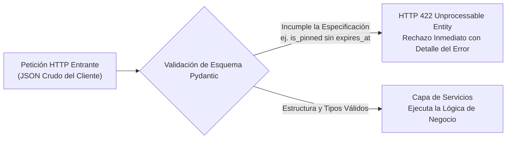
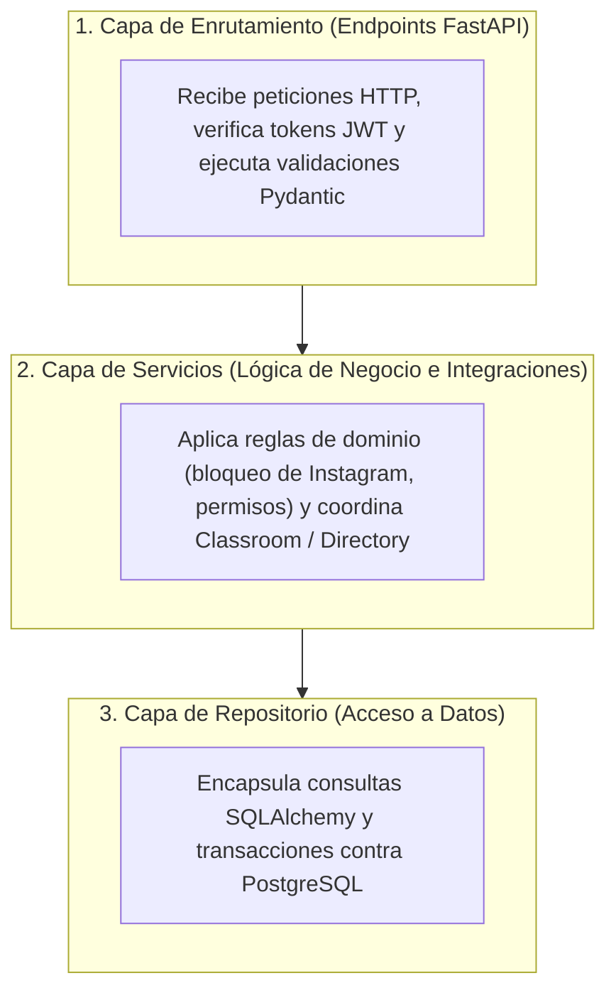

¿Por qué no basta con programar campos obligatorios y bloqueos de solo lectura únicamente en el formulario del navegador? Porque cualquier usuario puede saltar la interfaz visual usando las herramientas de desarrollo o un comando directo (`curl`) y enviar paquetes manipulados al servidor. El backend constituye la verdadera frontera de seguridad y lógica de una aplicación web. Este quinto capítulo muestra cómo la UPA Campus App traduce su especificación funcional en contratos de interfaz (API Contracts) y una arquitectura limpia de tres capas mediante Python, FastAPI y Pydantic.

---

## Enfoque API-First con FastAPI: Sincronía entre Backend y Equipo Móvil

Cuando un equipo desarrolla en paralelo el portal editorial web y la aplicación nativa para Android (Kotlin), cualquier duda sobre nombres de campos o formatos de fecha genera errores de integración. La UPA Campus App evita estos roces mediante un diseño **API-First** basado en **FastAPI**:

1. **Documentación Interactiva Automática (`/docs`):** FastAPI lee las anotaciones de tipos de Python directamente del código y genera una especificación OpenAPI interactiva. El equipo de Android puede consultar en vivo qué parámetros exige cada ruta y qué estructura devuelve sin depender de manuales externos.
2. **Concurrencia Asíncrona para Integraciones Externas (`ASGI`):** Cuando decenas de estudiantes abren su agenda al mismo tiempo por la mañana y el backend consulta las entregas pendientes en los servidores de Google Classroom, la espera de red no bloquea el servidor. El bucle de eventos asíncrono sigue atendiendo las peticiones del resto del campus sin demoras.

---

## Pydantic como Guardián de Entrada: La Especificación Hecha Esquema

Antes de que una petición entrante pueda ejecutar lógica de negocio o tocar la base de datos, debe superar la **validación de esquemas de Pydantic**, donde las reglas del pliego funcional están escritas como modelos declarativos:



El esquema `PublicationCreate` del endpoint unificado `/api/publications` muestra cómo las reglas funcionales se vuelven código autoverificable:

```python
from datetime import datetime, timezone
from typing import Literal
from pydantic import BaseModel, Field, model_validator

class PublicationCreate(BaseModel):
    title: str = Field(..., min_length=3, max_length=200)
    content: str = Field(..., min_length=1, max_length=10000)
    post_type: Literal["MANUAL", "EVENT", "EMERGENCY_BANNER", "INSTAGRAM"] = "MANUAL"
    media_type: Literal["NONE", "IMAGE", "VIDEO", "DOCUMENT"] = "NONE"
    media_url: str | None = None
    is_event: bool = False
    event_date: datetime | None = None
    is_pinned: bool = False
    expires_at: datetime | None = None
    reminder_value: int | None = Field(default=None, ge=1, le=365)
    reminder_unit: Literal["MINUTES", "HOURS", "DAYS"] | None = None
    target_groups: list[str] = Field(default_factory=list)

    @model_validator(mode="after")
    def validate_publication_constraints(self) -> "PublicationCreate":
        if self.is_pinned:
            if self.expires_at is None:
                raise ValueError("Las publicaciones fijadas requieren fecha de vencimiento (expires_at).")
            if self.expires_at <= datetime.now(timezone.utc):
                raise ValueError("La fecha de vencimiento (expires_at) debe estar en el futuro.")

        if self.is_event and self.event_date is None:
            raise ValueError("Los eventos de calendario requieren una fecha (event_date).")

        return self
```

Aunque alguien intente eludir el formulario web enviando una petición directa para fijar un banner sin fecha de caducidad, Pydantic detiene el paquete en la puerta misma del servidor devolviendo `HTTP 422`.

---

## Arquitectura en Tres Capas frente al Código Espagueti

Un riesgo frecuente al programar con asistentes de IA (vibe-coding) es que el código generado mezcle rutas HTTP, validaciones de permisos, llamadas a Google y consultas SQL dentro de una sola función. Al cambiar un requisito más adelante, el sistema falla en lugares inesperados.

El backend de la UPA Campus App organiza cada operación en tres capas bien delimitadas:



### Qué Reglas Protege la Capa de Servicios

Mientras Pydantic comprueba la validez formal de un mensaje individual, la **Capa de Servicios** aplica las reglas que dependen del estado almacenado o de sistemas externos:

#### 1. Protección de Solo Lectura en el Servidor para Publicaciones de Instagram
En el editor web, los campos de texto e imagen de las publicaciones importadas desde Instagram aparecen bloqueados. Para asegurar que esa regla se respete también ante llamadas directas a la API, la capa de servicios verifica el origen del registro antes de guardar:

```python
from fastapi import HTTPException, status

def apply_publication_update(existing_post, payload):
    if existing_post.post_type == "INSTAGRAM":
        if payload.title != existing_post.title or payload.content != existing_post.content:
            raise HTTPException(
                status_code=status.HTTP_403_FORBIDDEN,
                detail="Las publicaciones sincronizadas desde Instagram son de solo lectura.",
            )
    existing_post.is_pinned = payload.is_pinned
    existing_post.expires_at = payload.expires_at
    return existing_post
```

#### 2. Caché en Memoria del Directorio para el Filtro Instantáneo de Grupos
Para que el equipo editorial filtre sin demoras la lista de grupos de Google Workspace (`@example-campus.edu`), el backend no consulta los servidores de Google en cada pulsación de tecla. La capa de servicios mantiene la lista sincronizada y preordenada alfabéticamente en memoria caché, entregándola en pocos milisegundos.

#### 3. Identidad Institucional y Principio de Privilegio Mínimo (Least Privilege)
Las políticas de acceso se aplican de forma uniforme en esta capa:
* **Verificación Criptográfica de Dominio:** Durante el inicio de sesión con Google OAuth 2.0, el backend valida la firma del token y restringe el acceso interno a cuentas institucionales `@example-campus.edu`, eliminando cualquier botón de acceso rápido de prueba en el entorno productivo.
* **Permisos Desmarcados por Defecto:** Al dar de alta un nuevo perfil administrativo en la matriz de roles, todos los permisos inician desactivados (`false`). Cada endpoint de escritura exige el permiso específico mediante inyección de dependencias en FastAPI (`Depends(require_permission)`).

---

## Conclusiones

1. **Contratos Ejecutables con API-First y Pydantic:** La combinación de documentación OpenAPI automática y esquemas Pydantic rechaza peticiones incompletas (como avisos fijados sin fecha de vencimiento) antes de llegar a la lógica central.
2. **Separación Clara en Tres Capas:** Dividir el backend en enrutamiento, servicios y repositorio mantiene el código limpio, impide sobrescribir publicaciones sincronizadas de Instagram y garantiza el principio de privilegio mínimo en cada operación.
