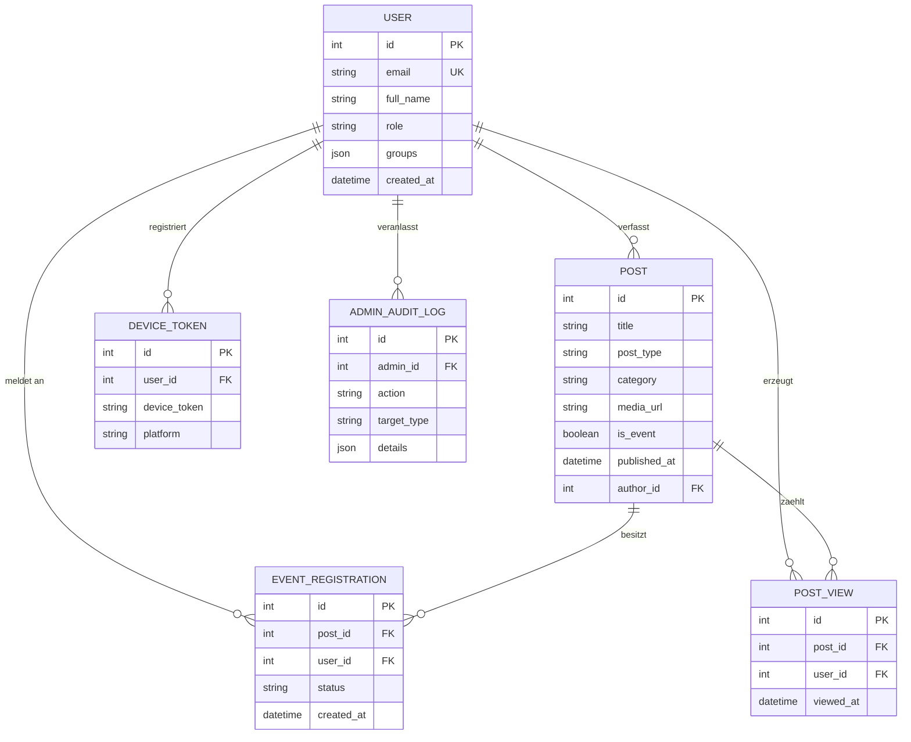
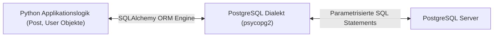
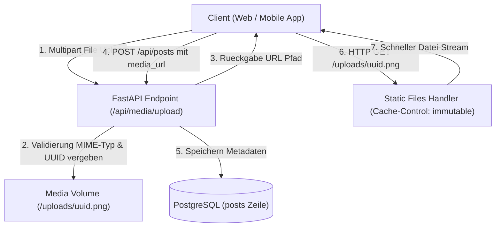
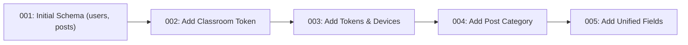

Unternehmensanwendungen stehen und fallen mit der Integrität und Leistungsfähigkeit ihrer Persistenzschicht. Während Teil 5 die API-Schnittstellen und das Routing mit FastAPI beleuchtet hat, widmet sich dieser sechste Teil dem relationalen Datenfundament der UPA Campus App. Im Mittelpunkt stehen relationale Integritätsgarantien in PostgreSQL, das Zusammenspiel mit dem Object-Relational Mapper SQLAlchemy, eine skalierbare Speicherstrategie für Bilder und Medien sowie versionierte Schema-Migrationen mit Alembic.

---

## Relationale Datenmodellierung und Integrität in PostgreSQL

Die Wahl von PostgreSQL für den Datenkern der UPA Campus App basiert auf dem Bedarf nach verlässlichen ACID-Eigenschaften (Atomizität, Konsistenz, Isolation, Dauerhaftigkeit). Campus-Prozesse wie Event-Anmeldungen, Rollenvergaben und Berechtigungsprüfungen verlangen transaktionale Sicherheit: Ein Nutzer darf sich nicht doppelt für ein limitiertes Seminar eintragen, und verwaiste Datensätze nach dem Löschen von Inhalten müssen auf Datenbankebene ausgeschlossen werden.

### 1. Tabellen, Primärschlüssel und Fremdschlüssel

In relationalen Schemata repräsentiert jede Tabelle eine eigenständige fachliche Entität. Beziehungen zwischen diesen Entitäten werden über Fremdschlüssel (Foreign Keys) abgebildet:

* **Primärschlüssel (Primary Keys):** Identifizieren jede Tabellenzeile eindeutig. Für hochfrequente interne Tabellen nutzt die UPA Campus App automatisch inkrementierende Ganzzahlen (`Integer` mit Index), die speichereffizient indiziert werden können.
* **Fremdschlüssel (Foreign Keys):** Verknüpfen Datensätze logisch miteinander. Ein Beitrag (`posts`) verweist über `author_id` auf die Tabelle `users`. Eine Anmeldung (`event_registrations`) bindet `user_id` an `users.id` und `post_id` an `posts.id`.
* **Kaskadierende Löschregeln (`ON DELETE CASCADE`):** Wird ein Beitrag entfernt, sorgt die relationale Datenbank selbstständig dafür, dass alle zugehörigen Anmeldungen (`event_registrations`) und Lese-Einträge (`post_views`) gelöscht werden. Dadurch entstehen keine verwaisten Fremdschlüsselverweise im Datenbestand.



### 2. Deklarative Integritäts-Constraints

Anwendungslogik allein reicht zur Durchsetzung von Geschäftsregeln nicht aus, da parallele Requests Race Conditions hervorrufen können. Datenbankgestützte Constraints garantieren Konsistenz direkt im Speicherkern:

* **Eindeutigkeit (`UniqueConstraint`):** In der Tabelle `event_registrations` erzwingt `UniqueConstraint("post_id", "user_id", name="uq_post_user_registration")`, dass pro Nutzer und Veranstaltung maximal ein Registrierungsdatensatz existiert. Parallele Klicks in der Mobil-App führen nicht zu doppelten Buchungen, weil PostgreSQL den zweiten INSERT-Versuch mit einem Constraint-Fehler blockiert.
* **Not-Null-Vorgaben:** Attribute wie `title` oder `email` sind als `nullable=False` deklariert. Unvollständige Zustände werden bereits vor dem Schreiben auf Festplatte abgewiesen.

---

## Objekt-Relationales Mapping (ORM) mit SQLAlchemy

Die direkte Formulierung von rohen SQL-Strings in Anwendungscodes birgt Wartungsrisiken und Sicherheitslücken. SQLAlchemy dient als Abstraktionsschicht zwischen der Python-Laufzeitumgebung und der PostgreSQL-Datenbank.



### 1. Deklarative Modelle und Python-Klassen

Über das deklarative System von SQLAlchemy (`declarative_base`) werden Tabellenschemata direkt als Python-Klassen definiert. Attribute spiegeln Tabellenspalten wider, während Methoden und Typ-Annotationen die Handhabung im Backend vereinfachen:

```python
from sqlalchemy import Column, Integer, String, Text, Boolean, DateTime, ForeignKey, UniqueConstraint, func
from sqlalchemy.orm import relationship
from app.database import Base

class Post(Base):
    __tablename__ = "posts"

    id = Column(Integer, primary_key=True, index=True)
    title = Column(String(255), nullable=False)
    content = Column(Text, nullable=True)
    post_type = Column(String(50), default="MANUAL", nullable=False)
    category = Column(String(50), nullable=True)
    media_url = Column(Text, nullable=True)
    is_event = Column(Boolean, default=False, nullable=False)
    published_at = Column(DateTime(timezone=True), nullable=True)

    author_id = Column(Integer, ForeignKey("users.id"), nullable=True)
    created_at = Column(DateTime(timezone=True), server_default=func.now(), nullable=False)

    # Relationale Verknuepfungen
    author = relationship("User", back_populates="posts")
    registrations = relationship("EventRegistration", back_populates="post", cascade="all, delete-orphan")
```

### 2. Schutz vor SQL Injection durch parametrisierte Abfragen

Einer der wichtigsten Sicherheitsaspekte von ORM-Systemen ist die automatische Parametrisierung aller Queries. Bei manueller String-Konkatenation können manipulierte Eingabedaten den Syntaxbaum des SQL-Parsers verändern:

```python
# Unsicheres Negativbeispiel (String-Konkatenation):
# Eingabe von user_input: "test@example.com' OR '1'='1"
query = f"SELECT * FROM users WHERE email = '{user_input}'"
# Resultiert in vollstaendigem Datenabfluss!
```

SQLAlchemy trennt den SQL-Befehl und die Nutzdaten strikt voneinander. Der ORM-Compiler erzeugt parametrisierte Platzhalter:

```python
# Sichere Variante mit SQLAlchemy:
user = db.query(User).filter(User.email == user_input).first()
```

Auf Datenbankebene wird dieser Aufruf als vorbereitetes Statement ausgeführt:

```sql
SELECT users.id, users.email, users.full_name, users.role
FROM users
WHERE users.email = %(email_1)s
LIMIT 1;
```

Die Datenbank interpretiert den übergebenen Wert rein als Datenliteral, niemals als ausführbaren SQL-Code. SQL Injection wird dadurch auf Architekturebene wirksam verhindert.

### 3. Session-Management und Transaktionssteuerung

In FastAPI wird die Datenbankverbindung über einen Generator-basierten Dependency-Injection-Mechanismus (`get_db`) verwaltet. Dadurch erhält jeder HTTP-Request eine eigene, isolierte Session:

```python
from sqlalchemy.orm import Session
from app.database import SessionLocal

def get_db():
    db = SessionLocal()
    try:
        yield db
    finally:
        db.close()
```

Tritt während der Verarbeitung im Service ein Fehler auf, wird die Transaktion zurückgerollt (`db.rollback()`), bevor Verbindungen an den Verbindungspool zurückgegeben werden. Bei erfolgreichem Abschluss werden die Änderungen atomar mit `db.commit()` festgeschrieben.

---

## Speicherstrategie für Bilder und Medien

Mobile Campus-Anwendungen transportieren täglich Fotos von Aushängen, Veranstaltungs-Flyer und Dokumente. Ein häufiger Architekturfehler in wachsenden Systemen besteht darin, diese Binärdaten direkt in der relationalen Datenbank als BLOB (Binary Large Object) abzulegen.

### 1. Warum BLOBs in relationalen Datenbanken problematisch sind

Das Speichern von Binärdateien direkt in relationalen Tabellen führt in Produktionsumgebungen zu gravierenden Engpässen:

1. **Database Bloat und Backup-Kosten:** Tabellen mit MB-großen Binärfeldern vergrößern Datenbank-Dumps und Write-Ahead Logs (WAL) massiv. Tägliche Backups dauern um ein Vielfaches länger und belasten Speicherressourcen.
2. **Speicher-Fragmentierung im Cache:** PostgreSQL verwaltet gelesene Seiten im Hauptspeicher (Shared Buffers). Werden große Binärdatenblöcke abgefragt, verdrängen sie geschäftskritische Tabellen- und Indexseiten aus dem RAM-Cache. Die Gesamtleistung der Datenbank bricht messbar ein.
3. **Eingeschränkte Streaming-Fähigkeit:** Relationale Datenbanken sind nicht darauf ausgelegt, HTTP-Range-Requests für Mobilgeräte oder progressive Bildauslieferung über CDNs performant bereitzustellen.

### 2. Saubere Architektur: Trennung von Datei und Metadaten

Die UPA Campus App trennt physische Dateien und relationale Metadaten konsequent voneinander:

* **Dateispeicher:** Die Binärdatei wird im Dateisystem des Containers abgelegt, das über ein persistentes Docker-Volume (`/uploads`) an den Host gebunden ist.
* **Kryptografische Dateinamen:** Bei Upload wird der vom Client gesendete Dateiname verworfen. Stattdessen generiert das System eine UUID Version 4, ergänzt um die validierte MIME-Dateiendung (z.B. `3f2b8c1e4d5a4f7e9a0b1c2d3e4f5a6b.png`). Dies verhindert Verzeichnis-Traversierungs-Angriffe (`../`) und Namenskollisionen.
* **Metadaten in PostgreSQL:** In der Tabelle `posts` wird lediglich der relative oder absolute Pfad als Text (`posts.media_url`) gespeichert.
* **Effiziente Auslieferung:** Die Datei wird über einen spezialisierten Static-Files-Handler ausgeliefert, der HTTP-Header für langlebiges Browser- und Client-Caching setzt (`Cache-Control: public, max-age=31536000, immutable`).



Der Python-Upload-Endpunkt liest Dateien in Chunks ein, um den Arbeitsspeicher des Servers auch bei größeren Dateien stabil zu halten:

```python
import tempfile
import uuid
from pathlib import Path
from fastapi import APIRouter, UploadFile, HTTPException, status

router = APIRouter(prefix="/api/media", tags=["Media"])
ALLOWED_TYPES = {"image/jpeg": ".jpg", "image/png": ".png", "image/webp": ".webp"}

@router.post("/upload")
async def upload_media(file: UploadFile):
    if file.content_type not in ALLOWED_TYPES:
        raise HTTPException(status_code=status.HTTP_415_UNSUPPORTED_MEDIA_TYPE, detail="Format nicht unterstuetzt.")

    extension = ALLOWED_TYPES[file.content_type]
    unique_filename = f"{uuid.uuid4().hex}{extension}"
    target_path = Path("/app/uploads") / unique_filename

    # Chunkweises Schreiben verhindert unkontrollierten RAM-Verbrauch
    with open(target_path, "wb") as buffer:
        while chunk := await file.read(64 * 1024):
            buffer.write(chunk)

    return {"url": f"/uploads/{unique_filename}", "filename": unique_filename}
```

---

## Schema-Migrationen mit Alembic

Software-Anforderungen verändern sich kontinuierlich. In frühen Entwicklungsphasen genügt oft ein einfacher Aufruf von `Base.metadata.create_all(bind=engine)`. In Produktivumgebungen stößt dieser Ansatz sofort an Grenzen: `create_all()` erzeugt zwar neue Tabellen, fügt aber in bereits existierenden Tabellen keine neuen Spalten hinzu und verändert keine Datentypen.

### 1. Das Problem von Schema-Drift

Werden Spalten auf Produktivservern manuell über SQL-Konsolen hinzugefügt, weicht der reale Zustand der Datenbank schnell von den Definitionen im Git-Repository ab (Schema-Drift). Entwicklungs-, Test- und Produktivumgebungen geraten aus dem Gleichgewicht, was Deployments unberechenbar macht.

Alembic bringt die Prinzipien von Versionskontrollsystemen in die Datenbank: Jede Schema-Änderung wird als nummerierte Revisionsdatei im Repository hinterlegt.



### 2. Aufbau einer Alembic-Revisionsdatei

Eine Migration enthält zwei Kernfunktionen: `upgrade()` zur Vorwärtsmigration und `downgrade()` zur Wiederherstellung des vorherigen Zustands:

```python
"""add post category and publication date

Revision ID: 004_add_post_category
Revises: 003_add_refresh_and_device_tokens
Create Date: 2026-10-15 10:00:00.000000
"""
from alembic import op
import sqlalchemy as sa

revision = '004_add_post_category'
down_revision = '003_add_refresh_and_device_tokens'

def upgrade() -> None:
    op.add_column('posts', sa.Column('category', sa.String(length=50), nullable=True))
    op.add_column('posts', sa.Column('published_at', sa.DateTime(timezone=True), nullable=True))

def downgrade() -> None:
    op.drop_column('posts', 'published_at')
    op.drop_column('posts', 'category')
```

### 3. Automatisierte Ausführung im CI/CD-Prozess

In modernen Containern wird die Migration beim Container-Start vor der Initialisierung des Webservers ausgeführt:

```bash
# Vor dem Start der Anwendung: Migrationen auf den neuesten Stand bringen
alembic upgrade head

# Anschliessend Start des ASGI-Webservers
uvicorn app.main:app --host 0.0.0.0 --port 8000
```

Durch das automatisierte Ausführen von `alembic upgrade head` wird sichergestellt, dass die Datenbank exakt den vom Code erwarteten Zustand besitzt, bevor eingehender Produktivverkehr verarbeitet wird.

---

## Fazit

1. **Relationale Datenintegrität an der Basis:** Primär- und Fremdschlüssel sowie Datenbank-Constraints wie `UniqueConstraint` und kaskadierende Löschregeln sichern Konsistenz und verhindern verwaiste Datensätze direkt im Speicherkern.
2. **Entkoppelte Medienarchitektur:** Relationale Datenbanken verwalten strukturierte Metadaten und Pfadverweise, während Binärdateien über persistente Dateisystem-Volumes und optimierte HTTP-Cache-Header ausgeliefert werden.
3. **Reproduzierbare Schema-Evolution:** Versionierte Migrationen mit Alembic eliminieren Schema-Drift und stellen sicher, dass Datenbankschemata kontrolliert und automatisiert mit der Anwendungslogik mitwachsen.
