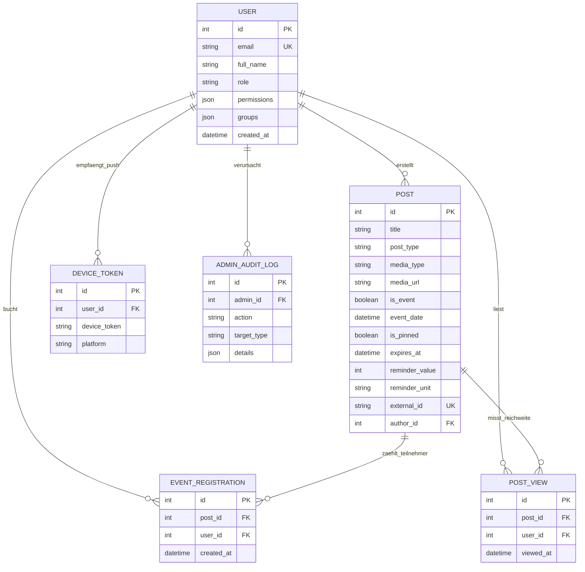

Benutzeroberflächen lassen sich in wenigen Tagen umgestalten, doch das Datenbankschema bildet das bleibende Rückgrat jeder Software. Gerade beim schnellen Prototypenbau mit KI-Assistenten (Vibe-Coding) entsteht oft der Fehler, für jedes neue Formular spontan eine eigene Tabelle anzulegen, bis dieselbe Veranstaltung an drei Stellen mit unterschiedlichen Uhrzeiten gespeichert ist. Dieses sechste und letzte Kapitel zeigt, wie die UPA Campus App ihren gesamten Datenbestand in PostgreSQL über sechs präzise abgestimmte Kerntabellen abbildet, Doppelbuchungen auf Speicherebene ausschließt, große Mediendateien aus dem Datenbank-Arbeitsspeicher fernhält und Schema-Änderungen mit Alembic sicher ausrollt.

---

## Das Entity-Relationship-Diagramm: Sechs Tabellen für den gesamten Campus

Anstatt Nachrichten, Kalendertermine, Notfall-Banner und Instagram-Beiträge in getrennte Datensilos aufzuspalten, führt das Datenmodell in PostgreSQL alle Fäden um die zentrale Tabelle `POST` zusammen:



### Warum dieses Tabellendesign Widersprüche strukturell verhindert

1. **Ein Datensatz für Feed und Kalender (`POST`):** Ein Gastvortrag ist gleichzeitig eine Ankündigung mit Plakat im Feed und ein buchbarer Termin im Kalender. Weil beide Ansichten auf dieselbe Tabellenzeile zugreifen (gesteuert über `is_event` und `event_date`), existiert im gesamten System nur eine einzige Quelle der Wahrheit. Zusätzlich speichert `external_id` die Originalkennung importierter Instagram-Beiträge, sodass der Hintergrund-Sync bereits vorhandene Posts sofort wiedererkennt.
2. **Schutz vor Doppelbuchungen bei schlechtem Empfang (`EVENT_REGISTRATION`):** Tippt ein Studierender bei langsamem Mobilfunknetz zweimal kurz hintereinander auf "Teilnehmen", erreichen zwei fast gleichzeitige Anfragen den Server. Ein zusammengesetzter Eindeutigkeitsschlüssel (`UniqueConstraint("post_id", "user_id")`) in PostgreSQL garantiert, dass die Datenbank den zweiten Schreibversuch abweist und jeder Studierende höchstens einmal auf der Teilnehmerliste steht.
3. **Echte Lesereichweite statt Klick-Inflation (`POST_VIEW`):** Derselbe zusammengesetzte Schlüssel aus `post_id` und `user_id` kommt auch in der Tabelle `post_views` zum Einsatz. Öffnet eine Person denselben Beitrag zehnmal, zählt die Datenbank dennoch genau einen erreichten Studierenden. So erhält das Marketing-Team belastbare Kennzahlen zur tatsächlichen Reichweite.
4. **Automatische Bereinigung über `ON DELETE CASCADE`:** Wird eine abgelaufene Ankündigung gelöscht, entfernt PostgreSQL verknüpfte Anmeldungen und Lesezähler in derselben Transaktion automatisch, sodass keine verwaisten Datensätze zurückbleiben.

---

## Typsichere Abbildung mit SQLAlchemy und Schutz vor SQL-Injection

Im Python-Backend übersetzt das Object-Relational Mapping (**SQLAlchemy**) die Tabellenstruktur in klar definierte Klassen:

```python
from sqlalchemy import Boolean, Column, DateTime, ForeignKey, Integer, String, Text, UniqueConstraint, func
from sqlalchemy.orm import relationship
from app.database import Base

class EventRegistration(Base):
    __tablename__ = "event_registrations"
    __table_args__ = (
        UniqueConstraint("post_id", "user_id", name="uq_event_registration_post_user"),
    )

    id = Column(Integer, primary_key=True, index=True)
    post_id = Column(Integer, ForeignKey("posts.id", ondelete="CASCADE"), nullable=False)
    user_id = Column(Integer, ForeignKey("users.id", ondelete="CASCADE"), nullable=False)
    created_at = Column(DateTime(timezone=True), server_default=func.now(), nullable=False)
```

Neben der übersichtlichen Struktur liefert SQLAlchemy einen entscheidenden Sicherheitsvorteil: Alle Datenbankabfragen werden als **parametrisierte Prepared Statements** an PostgreSQL übergeben. Selbst wenn ein Nutzer in ein Suchfeld SQL-Steuerzeichen eingibt, behandelt PostgreSQL die Eingabe strikt als harmlosen Textwert und führt ihn zu keinem Zeitpunkt als Datenbankbefehl aus.

---

## Warum Bilder, Videos und PDFs nicht in Datenbankspalten gehören

Das Pflichtenheft erlaubt im Redaktions-Editor das Hochladen von Plakaten (`JPG`, `PNG`, `WEBP`), kurzen Videos (`MP4`, `WEBM`) und Dokumenten (`PDF`). Würde man diese mehrere Megabyte großen Dateien direkt als Binärblock (`BLOB`) in einer Spalte von PostgreSQL ablegen, hätte das zwei gravierende Nachteile:
* **Verdrängung des Datenbank-Arbeitsspeichers (`Shared Buffers`):** PostgreSQL hält häufig genutzte Tabellenindizes im schnellen RAM vor. Große Videoblöcke würden diese Indizes aus dem Speicher verdrängen und sämtliche Suchabfragen ausbremsen.
* **Aufgeblähte Backups:** Ein tägliches Backup der reinen Text- und Strukturdaten ist wenige Megabyte klein und in Sekunden gesichert.

Die Architektur teilt den Speichervorgang deshalb sauber auf:

```mermaid
flowchart LR
    Editor["Web-Admin Editor"] -->|1. Datei senden (Bild / MP4 / PDF)| UploadAPI["FastAPI (/api/media/upload)"]
    UploadAPI -->|2. 64-KB-Streaming mit UUIDv4-Name| Volume[("Dateisystem-Volume\n/app/uploads/a8f9...mp4")]
    UploadAPI -->|3. Kurzen Dateipfad speichern| DB[("PostgreSQL Tabelle posts\nmedia_url = '/uploads/a8f9...mp4'")]
```

Der Upload-Endpunkt prüft das Dateiformat, vergibt einen zufälligen Dateinamen (`UUIDv4`) gegen Namenskonflikte und schreibt die Datei in speicherschonenden 64-Kilobyte-Blöcken auf das Medien-Volume, während in der Datenbanktabelle `posts` lediglich der kurze Textpfad hinterlegt wird:

```python
import uuid
from pathlib import Path
from fastapi import APIRouter, HTTPException, UploadFile, status

router = APIRouter(prefix="/api/media", tags=["Media"])

ALLOWED_TYPES = {
    "image/jpeg": (".jpg", "IMAGE"),
    "image/png": (".png", "IMAGE"),
    "image/webp": (".webp", "IMAGE"),
    "video/mp4": (".mp4", "VIDEO"),
    "video/webm": (".webm", "VIDEO"),
    "application/pdf": (".pdf", "DOCUMENT"),
}

@router.post("/upload")
async def upload_media_file(file: UploadFile):
    if file.content_type not in ALLOWED_TYPES:
        raise HTTPException(
            status_code=status.HTTP_415_UNSUPPORTED_MEDIA_TYPE,
            detail="Unterstützt werden JPG, PNG, WEBP, MP4, WEBM und PDF.",
        )

    ext, category = ALLOWED_TYPES[file.content_type]
    safe_name = f"{uuid.uuid4().hex}{ext}"
    dest = Path("/app/uploads") / safe_name

    with open(dest, "wb") as out_file:
        while chunk := await file.read(64 * 1024):
            out_file.write(chunk)

    return {"url": f"/uploads/{safe_name}", "media_type": category}
```

---

## Kontrollierte Weiterentwicklung des Schemas mit Alembic

Wächst das Pflichtenheft im Laufe eines Semesters um neue Funktionen (wie die Erinnerungsfelder `reminder_value` und `reminder_unit`), darf eine laufende Produktivdatenbank weder gelöscht noch per Hand verändert werden. **Alembic** versioniert jede Strukturänderung an den Tabellen in fortlaufenden Migrationsdateien:

```python
"""add unified post expiry and reminder columns

Revision ID: 004_unified_post_fields
Revises: 003_add_views_and_audit
"""
from alembic import op
import sqlalchemy as sa

revision = "004_unified_post_fields"
down_revision = "003_add_views_and_audit"

def upgrade() -> None:
    op.add_column("posts", sa.Column("media_type", sa.String(length=20), server_default="NONE", nullable=False))
    op.add_column("posts", sa.Column("expires_at", sa.DateTime(timezone=True), nullable=True))
    op.add_column("posts", sa.Column("reminder_value", sa.Integer(), nullable=True))
    op.add_column("posts", sa.Column("reminder_unit", sa.String(length=20), nullable=True))

def downgrade() -> None:
    op.drop_column("posts", "reminder_unit")
    op.drop_column("posts", "reminder_value")
    op.drop_column("posts", "expires_at")
    op.drop_column("posts", "media_type")
```

Beim Start des Backend-Containers prüft `alembic upgrade head` automatisch den aktuellen Stand der Datenbank und spielt fehlende Erweiterungen deterministisch ein, ohne vorhandene Einträge anzutasten.

---

## Gesamtfazit zum Abschluss der Serie

1. **Datenintegrität auf Speicherebene:** Die zentrale Tabelle `posts` verhindert widersprüchliche Daten zwischen Feed und Kalender, während `UniqueConstraint`-Regeln in PostgreSQL Doppelanmeldungen und verzerrte Lesezähler zuverlässig unterbinden.
2. **Arbeitsteilung zwischen Datenbank und Dateisystem:** Strukturierte Metadaten liegen transaktionssicher in PostgreSQL, während große Bilder, Videos und PDFs auf dem Medien-Volume gespeichert werden, um den Datenbank-RAM schnell zu halten.
3. **Das Gesamtbild moderner Web-Architektur:** Wer den Weg vom Pflichtenheft (Kapitel 1) über isolierte Docker-Container (Kapitel 2), geschützte WireGuard- und Reverse-Proxy-Wege (Kapitel 3), reaktionsschnelle Offline-Clients (Kapitel 4) und strenge Pydantic-Verträge (Kapitel 5) bis zur relationalen Datenbanktransaktion (Kapitel 6) nachvollzogen hat, besitzt das handwerkliche Rüstzeug, um eigene Web-Applikationen strukturiert zu planen und mit modernen Werkzeugen souverän umzusetzen.
