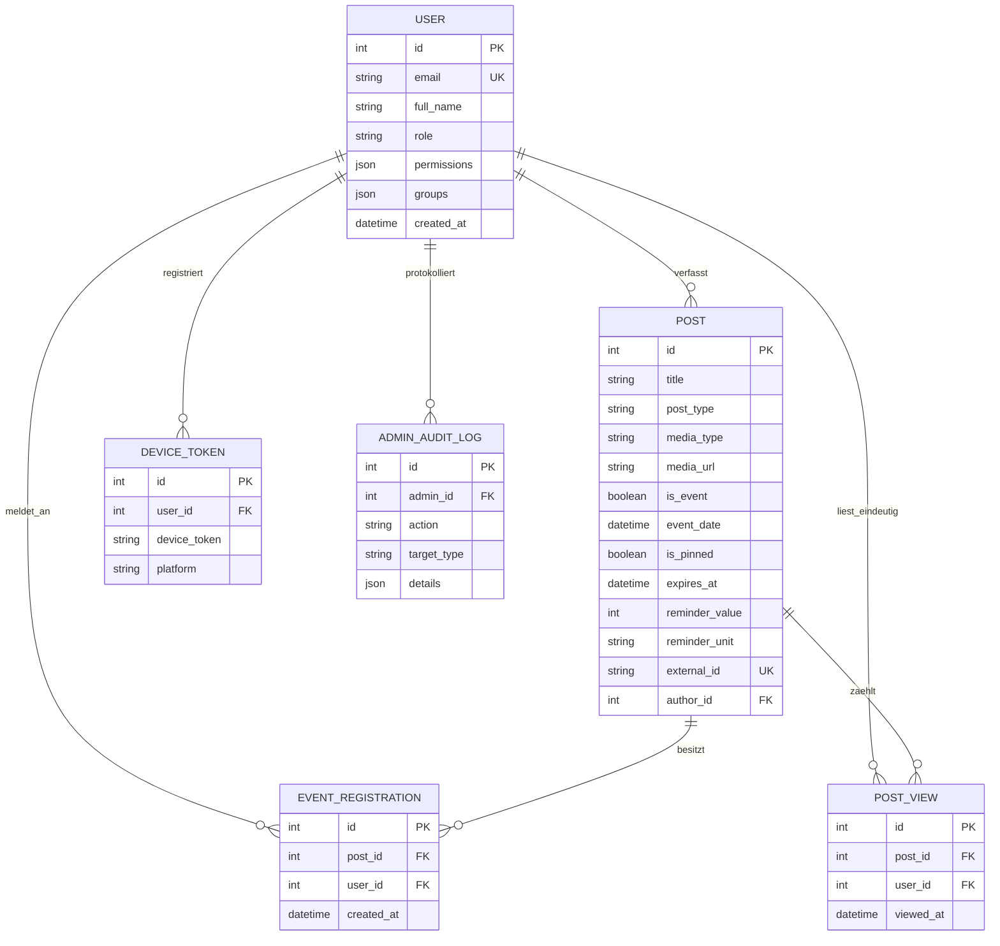
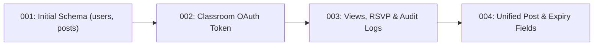

Benutzeroberflächen lassen sich in wenigen Stunden austauschen, doch das Datenmodell bildet das bleibende Rückgrat jeder Software. Gerade beim KI-gestützten Programmieren (Vibe-Coding) entsteht häufig der Fehler, für jede neue Bildschirmansicht spontan eine eigene Tabelle anzulegen, bis sich Daten widersprechen. Die UPA Campus App verfolgt in PostgreSQL den gegenteiligen Ansatz: Ein präzise normalisiertes, vereinheitlichtes Datenmodell sichert alle Campus-Prozesse mit vollen ACID-Garantien ab. Dieses sechste Kapitel zeigt, wie sich jede Anforderung des Pflichtenhefts in relationalen Tabellen, eindeutigen Datenbank-Constraints, einem entkoppelten Medienspeicher für Bilder, Videos und PDFs sowie versionierten Alembic-Migrationen widerspiegelt.

---

## Das relationale Datenmodell als Blaupause des Pflichtenhefts

Warum setzt die UPA Campus App auf PostgreSQL und wie hängen die sechs Kerntabellen zusammen? Das Entity-Relationship-Diagramm (ER-Diagramm) zeigt die gesamte Datenarchitektur auf einen Blick:



### Warum dieses Datenmodell die Anforderungen des Pflichtenhefts perfekt trägt

1. **Die Tabelle `POST` als Single Source of Truth:** Statt getrennte Tabellen für Nachrichten, Kalendertermine, Notfall-Banner und Instagram-Posts zu pflegen, vereint die Tabelle `posts` alle Publikationsformen. Über `is_event` und `event_date` erscheint ein Beitrag automatisch im Agenda-Kalender. Über `is_pinned` und `expires_at` wird er zeitlich begrenzt oben angeheftet. Über `reminder_value` und `reminder_unit` (`MINUTES`, `HOURS`, `DAYS`) steuert er Erinnerungen, und über `external_id` erkennt der Hintergrund-Sync bereits importierte Instagram-Beiträge wieder.
2. **Doppelbuchungs-Schutz bei der 1-Klick-Anmeldung (`EVENT_REGISTRATION`):** Wenn ein Studierender im Hörsaal bei schlechtem Empfang zweimal kurz hintereinander auf "Teilnehmen" tippt, treffen zwei parallele Requests im Server ein. Ein Datenbank-Constraint (`UniqueConstraint("post_id", "user_id")`) garantiert auf Speicherebene, dass exakt ein Anmeldedatensatz angelegt wird.
3. **Echte Reichweitenmessung statt Klick-Inflation (`POST_VIEW`):** Auch die Tabelle `post_views` besitzt einen zusammengesetzten Eindeutigkeitsschlüssel aus `post_id` und `user_id`. Öffnet ein Studierender denselben Beitrag zehnmal, zählt PostgreSQL ihn trotzdem nur als einen eindeutigen Leser. So erhält das Marketing-Team im Web-Admin verlässliche Lesestatistiken.
4. **Kaskadierende Bereinigung (`ON DELETE CASCADE`):** Wird eine abgelaufene Veranstaltung gelöscht, räumt PostgreSQL zugehörige Anmeldungen (`event_registrations`) und Lesezähler (`post_views`) automatisch ab, sodass niemals verwaiste Datensätze zurückbleiben.

---

## Objekt-Relationales Mapping (ORM) und SQL-Injection-Schutz

Im Python-Backend übersetzt **SQLAlchemy** die relationalen Tabellen in typsichere Python-Klassen und schützt das System gleichzeitig vor SQL-Injection:

```python
from sqlalchemy import Column, Integer, String, Text, Boolean, DateTime, ForeignKey, UniqueConstraint, func
from sqlalchemy.orm import relationship
from app.database import Base

class Post(Base):
    __tablename__ = "posts"

    id = Column(Integer, primary_key=True, index=True)
    title = Column(String(200), nullable=False)
    content = Column(Text, nullable=True)
    post_type = Column(String(50), default="MANUAL", nullable=False)
    media_type = Column(String(20), default="NONE", nullable=False)
    media_url = Column(Text, nullable=True)

    is_event = Column(Boolean, default=False, nullable=False)
    event_date = Column(DateTime(timezone=True), nullable=True)
    is_pinned = Column(Boolean, default=False, nullable=False)
    expires_at = Column(DateTime(timezone=True), nullable=True)

    reminder_value = Column(Integer, nullable=True)
    reminder_unit = Column(String(20), nullable=True)
    external_id = Column(String(120), unique=True, nullable=True)

    author_id = Column(Integer, ForeignKey("users.id"), nullable=True)
    created_at = Column(DateTime(timezone=True), server_default=func.now(), nullable=False)

    registrations = relationship("EventRegistration", back_populates="post", cascade="all, delete-orphan")
```

Weil SQLAlchemy bei jeder Abfrage den SQL-Befehl und die Benutzereingabe strikt voneinander trennt (parametrisierte Prepared Statements), wird ein übergebener Suchbegriff von PostgreSQL ausschließlich als reiner Textwert behandelt und niemals als ausführbarer SQL-Befehl interpretiert.

---

## Speicherstrategie für den einheitlichen Medien-Upload (Bilder, Videos und PDFs)

Das Pflichtenheft sieht im Beitrags-Editor ein einziges, vereinheitlichtes Upload-Feld für Veranstaltungsplakate (`JPG`, `PNG`, `WEBP`), kurze Videos (`MP4`, `WEBM`) und Dokumente (`PDF`) vor. Warum speichert man diese Dateien nicht einfach als Binärdaten (BLOB) direkt in einer Tabellenspalte von PostgreSQL?

1. **Schutz des Datenbank-Arbeitsspeichers (`Shared Buffers`):** PostgreSQL hält häufig gelesene Tabellen- und Indexseiten im schnellen Arbeitsspeicher (RAM) vor. Würde die Datenbank mehrere Megabyte große `MP4`-Videos aus Tabellenzeilen lesen, würden diese Videoblöcke die wichtigen Suchindizes aus dem RAM verdrängen und alle Abfragen verlangsamen.
2. **Schnelle Backups und direktes HTTP-Streaming:** Ohne Binärballast bleibt das tägliche Datenbank-Backup wenige Megabyte klein, während Nginx und der Static-Handler Videodateien direkt vom Dateisystem per HTTP-Chunk-Streaming an Smartphones ausliefern können.

```mermaid
flowchart TD
    Client["Web-Admin Editor"] -->|1. Multipart Upload (Bild / MP4 / PDF)| API["FastAPI (/api/media/upload)"]
    API -->|2. MIME-Typ prüfen & UUIDv4-Dateinamen erzeugen| Storage["Host Volume (/uploads/uuid.mp4)"]
    API -->|3. Pfad zurückgeben (/uploads/uuid.mp4)| Client
    Client -->|4. POST /api/publications mit media_url & media_type| API
    API -->|5. Nur schlanken Textpfad speichern| DB[("PostgreSQL (Tabelle posts)")]
```

Der Upload-Endpunkt prüft den MIME-Typ, vergibt einen kryptografisch zufälligen Dateinamen (`UUIDv4`) gegen Pfad-Manipulationen und schreibt die Datei in speicherschonenden 64-KB-Blöcken auf das persistente Volume:

```python
import uuid
from pathlib import Path
from fastapi import APIRouter, UploadFile, HTTPException, status

router = APIRouter(prefix="/api/media", tags=["Media"])

ALLOWED_MEDIA = {
    "image/jpeg": (".jpg", "IMAGE"),
    "image/png": (".png", "IMAGE"),
    "image/webp": (".webp", "IMAGE"),
    "video/mp4": (".mp4", "VIDEO"),
    "video/webm": (".webm", "VIDEO"),
    "application/pdf": (".pdf", "DOCUMENT"),
}

@router.post("/upload")
async def upload_media(file: UploadFile):
    if file.content_type not in ALLOWED_MEDIA:
        raise HTTPException(
            status_code=status.HTTP_415_UNSUPPORTED_MEDIA_TYPE,
            detail="Dateiformat nicht erlaubt. Unterstützt werden JPG, PNG, WEBP, MP4, WEBM und PDF.",
        )

    extension, media_category = ALLOWED_MEDIA[file.content_type]
    unique_filename = f"{uuid.uuid4().hex}{extension}"
    target_path = Path("/app/uploads") / unique_filename

    with open(target_path, "wb") as buffer:
        while chunk := await file.read(64 * 1024):
            buffer.write(chunk)

    return {
        "url": f"/uploads/{unique_filename}",
        "media_type": media_category,
    }
```

---

## Kontrollierte Schema-Evolution mit Alembic

Wenn während des Semesters im Pflichtenheft neue Anforderungen hinzukommen (etwa das verpflichtende Ablaufdatum `expires_at` oder die einstellbaren Erinnerungen `reminder_value` und `reminder_unit`), darf man die Produktivdatenbank weder löschen noch manuell per Konsole umbauen. **Alembic** verwaltet jede Änderung am Datenbankschema wie Git-Commits in nummerierten Migrationsdateien:



```python
"""add unified post expiry and reminder columns

Revision ID: 004_unified_post_fields
Revises: 003_add_views_and_audit
"""
from alembic import op
import sqlalchemy as sa

revision = "004_unified_post_fields"
down_revision = "003_add_views_and_audit"

def upgrade() -> None:
    op.add_column("posts", sa.Column("media_type", sa.String(length=20), server_default="NONE", nullable=False))
    op.add_column("posts", sa.Column("expires_at", sa.DateTime(timezone=True), nullable=True))
    op.add_column("posts", sa.Column("reminder_value", sa.Integer(), nullable=True))
    op.add_column("posts", sa.Column("reminder_unit", sa.String(length=20), nullable=True))

def downgrade() -> None:
    op.drop_column("posts", "reminder_unit")
    op.drop_column("posts", "reminder_value")
    op.drop_column("posts", "expires_at")
    op.drop_column("posts", "media_type")
```

Beim Start des Backend-Containers führt das Startskript automatisch `alembic upgrade head` aus, bevor FastAPI die erste Anfrage entgegennimmt. Dadurch sind Datenbankschema und Python-Code auf jedem Entwicklerrechner und auf dem Produktivserver zu jeder Sekunde synchron.

---

## Gesamtfazit der Serie

1. **Das Datenmodell sichert das Pflichtenheft im Kern ab:** Die vereinheitlichte Tabelle `posts` verhindert Datensilos zwischen Feed und Kalender, während `UniqueConstraint`-Regeln in PostgreSQL Doppelbuchungen bei Events und künstlich aufgeblähte Lesezähler unmöglich machen.
2. **Metadaten in die Datenbank, Binärdateien auf das Volume:** Durch die Auslagerung von Bildern, Videos (`MP4`/`WEBM`) und PDFs auf das Volume `uploads_data` bleibt der Arbeitsspeicher-Cache von PostgreSQL frei für schnelle Abfragen.
3. **Vom Pflichtenheft zur Gesamtarchitektur:** Wer den Weg einer Anfrage vom verschlüsselten NetBird-Tunnel über den Nginx-Reverse-Proxy, den offline-fähigen Client, die Pydantic-Eingangskontrolle bis in die PostgreSQL-Transaktion durchdrungen hat, besitzt das mentale Werkzeug, um jede moderne Web-Applikation fundiert zu entwerfen und zu bauen.
