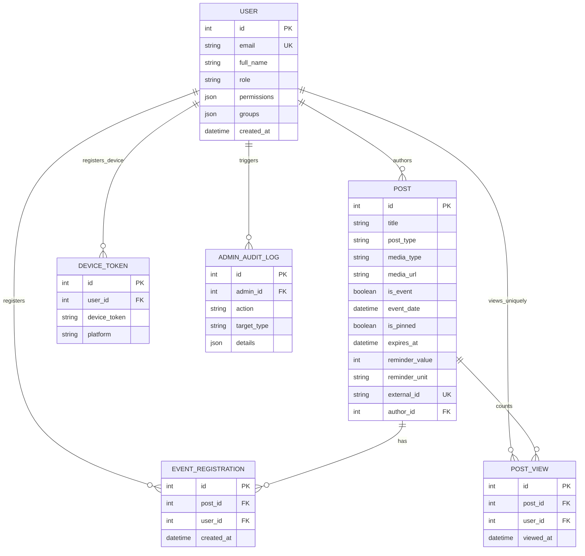
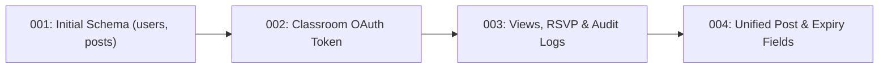

User interfaces can be redesigned in a weekend, but the data model forms the permanent spine of any software system. A frequent pitfall in rapid AI-assisted coding (vibe-coding) is spinning up a separate database table for every new screen until duplicated data falls out of sync. In PostgreSQL, the UPA Campus App takes the opposite path: a normalized, unified relational data model backs every campus workflow with strict ACID guarantees. This sixth chapter shows how every requirement in the functional specification maps directly to relational tables, uniqueness constraints, decoupled media storage for images, videos, and PDFs, and version-controlled Alembic migrations.

---

## The Relational Data Model as the Blueprint of the Specification

Why does the UPA Campus App rely on PostgreSQL, and how do its six core tables fit together? The Entity-Relationship (ER) diagram captures the entire persistence architecture at a glance:



### Why This Schema Directly Enforces the Functional Specification

1. **The `POST` Table as a Single Source of Truth:** Instead of maintaining disconnected tables for news articles, calendar events, emergency banners, and Instagram imports, the `posts` table unifies every publication format. Setting `is_event` and `event_date` surfaces an item automatically inside the Agenda calendar. Setting `is_pinned` and `expires_at` pins it to the top of the feed until expiration. Setting `reminder_value` and `reminder_unit` (`MINUTES`, `HOURS`, `DAYS`) schedules notifications, while `external_id` prevents duplicate imports during periodic Instagram synchronization.
2. **Duplicate-Booking Prevention on 1-Click RSVP (`EVENT_REGISTRATION`):** If a student on spotty lecture-hall Wi-Fi taps "Register" twice in rapid succession, two concurrent requests hit the server. A composite database constraint (`UniqueConstraint("post_id", "user_id")`) guarantees at the storage engine level that at most one registration row can exist per student and event.
3. **True Reach Analytics Instead of Inflated Click Counters (`POST_VIEW`):** The `post_views` table enforces a composite uniqueness constraint across `post_id` and `user_id`. Even if a student opens the same announcement ten times, PostgreSQL records exactly one unique view, giving the marketing team trustworthy reach metrics in Web-Admin.
4. **Cascading Cleanup (`ON DELETE CASCADE`):** When an expired event is deleted, PostgreSQL automatically removes its associated `event_registrations` and `post_views` rows, preventing orphaned foreign keys.

---

## Object-Relational Mapping (ORM) and SQL Injection Prevention

Inside the Python backend, **SQLAlchemy** maps relational tables to type-safe Python classes while eliminating SQL injection vulnerabilities:

```python
from sqlalchemy import Column, Integer, String, Text, Boolean, DateTime, ForeignKey, UniqueConstraint, func
from sqlalchemy.orm import relationship
from app.database import Base

class Post(Base):
    __tablename__ = "posts"

    id = Column(Integer, primary_key=True, index=True)
    title = Column(String(200), nullable=False)
    content = Column(Text, nullable=True)
    post_type = Column(String(50), default="MANUAL", nullable=False)
    media_type = Column(String(20), default="NONE", nullable=False)
    media_url = Column(Text, nullable=True)

    is_event = Column(Boolean, default=False, nullable=False)
    event_date = Column(DateTime(timezone=True), nullable=True)
    is_pinned = Column(Boolean, default=False, nullable=False)
    expires_at = Column(DateTime(timezone=True), nullable=True)

    reminder_value = Column(Integer, nullable=True)
    reminder_unit = Column(String(20), nullable=True)
    external_id = Column(String(120), unique=True, nullable=True)

    author_id = Column(Integer, ForeignKey("users.id"), nullable=True)
    created_at = Column(DateTime(timezone=True), server_default=func.now(), nullable=False)

    registrations = relationship("EventRegistration", back_populates="post", cascade="all, delete-orphan")
```

Because SQLAlchemy compiles every query into a parameterized prepared statement, PostgreSQL treats user-supplied search strings strictly as literal values and never as executable SQL syntax.

---

## Storage Strategy for Unified Media Uploads (Images, Videos, and PDFs)

The functional specification defines a single unified upload field in the publication editor supporting event posters (`JPG`, `PNG`, `WEBP`), short videos (`MP4`, `WEBM`), and documents (`PDF`). Why not store these files directly inside PostgreSQL as binary large objects (`BLOB`)?

1. **Protecting the Database RAM Cache (`Shared Buffers`):** PostgreSQL caches frequently accessed table and index pages in RAM. Reading multi-megabyte `MP4` videos out of table rows would evict hot index pages from memory and degrade query performance across the entire platform.
2. **Lean Backups and Direct HTTP Streaming:** Keeping binary files out of relational tables keeps daily database dumps small and fast, while allowing Nginx and the static file handler to stream video chunks directly from disk to mobile devices.

```mermaid
flowchart TD
    Client["Web-Admin Editor"] -->|1. Multipart Upload (Image / MP4 / PDF)| API["FastAPI (/api/media/upload)"]
    API -->|2. Validate MIME type & generate UUIDv4 filename| Storage["Host Volume (/uploads/uuid.mp4)"]
    API -->|3. Return URL path (/uploads/uuid.mp4)| Client
    Client -->|4. POST /api/publications with media_url & media_type| API
    API -->|5. Store lightweight path string only| DB[("PostgreSQL (posts table)")]
```

The upload endpoint validates the MIME type, assigns a cryptographically random `UUIDv4` filename to prevent path traversal attacks, and streams the file to the persistent volume in 64 KB chunks so server RAM usage stays flat:

```python
import uuid
from pathlib import Path
from fastapi import APIRouter, UploadFile, HTTPException, status

router = APIRouter(prefix="/api/media", tags=["Media"])

ALLOWED_MEDIA = {
    "image/jpeg": (".jpg", "IMAGE"),
    "image/png": (".png", "IMAGE"),
    "image/webp": (".webp", "IMAGE"),
    "video/mp4": (".mp4", "VIDEO"),
    "video/webm": (".webm", "VIDEO"),
    "application/pdf": (".pdf", "DOCUMENT"),
}

@router.post("/upload")
async def upload_media(file: UploadFile):
    if file.content_type not in ALLOWED_MEDIA:
        raise HTTPException(
            status_code=status.HTTP_415_UNSUPPORTED_MEDIA_TYPE,
            detail="Unsupported media format. Allowed types: JPG, PNG, WEBP, MP4, WEBM, and PDF.",
        )

    extension, media_category = ALLOWED_MEDIA[file.content_type]
    unique_filename = f"{uuid.uuid4().hex}{extension}"
    target_path = Path("/app/uploads") / unique_filename

    with open(target_path, "wb") as buffer:
        while chunk := await file.read(64 * 1024):
            buffer.write(chunk)

    return {
        "url": f"/uploads/{unique_filename}",
        "media_type": media_category,
    }
```

---

## Version-Controlled Schema Evolution with Alembic

When new requirements are added to the specification during the semester (such as the mandatory expiration timestamp `expires_at` or configurable reminders `reminder_value` and `reminder_unit`), wiping the production database or running ad-hoc SQL commands by hand is not an option. **Alembic** tracks every schema change as a versioned migration script committed to Git:



```python
"""add unified post expiry and reminder columns

Revision ID: 004_unified_post_fields
Revises: 003_add_views_and_audit
"""
from alembic import op
import sqlalchemy as sa

revision = "004_unified_post_fields"
down_revision = "003_add_views_and_audit"

def upgrade() -> None:
    op.add_column("posts", sa.Column("media_type", sa.String(length=20), server_default="NONE", nullable=False))
    op.add_column("posts", sa.Column("expires_at", sa.DateTime(timezone=True), nullable=True))
    op.add_column("posts", sa.Column("reminder_value", sa.Integer(), nullable=True))
    op.add_column("posts", sa.Column("reminder_unit", sa.String(length=20), nullable=True))

def downgrade() -> None:
    op.drop_column("posts", "reminder_unit")
    op.drop_column("posts", "reminder_value")
    op.drop_column("posts", "expires_at")
    op.drop_column("posts", "media_type")
```

Whenever the backend container starts, its entrypoint runs `alembic upgrade head` automatically before launching FastAPI. This guarantees that the database schema matches the application code across every developer laptop and production server.

---

## Series Conclusion

1. **The Data Model Anchors the Specification:** The unified `posts` table eliminates data silos between the news feed and the calendar, while PostgreSQL `UniqueConstraint` rules prevent duplicate event registrations and inflated view counts at the database level.
2. **Metadata in PostgreSQL, Binaries on the Volume:** Offloading images, videos (`MP4`/`WEBM`), and PDFs to the `uploads_data` volume preserves PostgreSQL RAM buffers for fast relational queries.
3. **From Functional Specification to End-to-End Architecture:** Tracing a single request from the encrypted NetBird tunnel through the Nginx reverse proxy, the offline-capable client, the Pydantic validation gate, and down into the PostgreSQL transaction equips you with the universal mental model needed to architect and build any modern web application.
