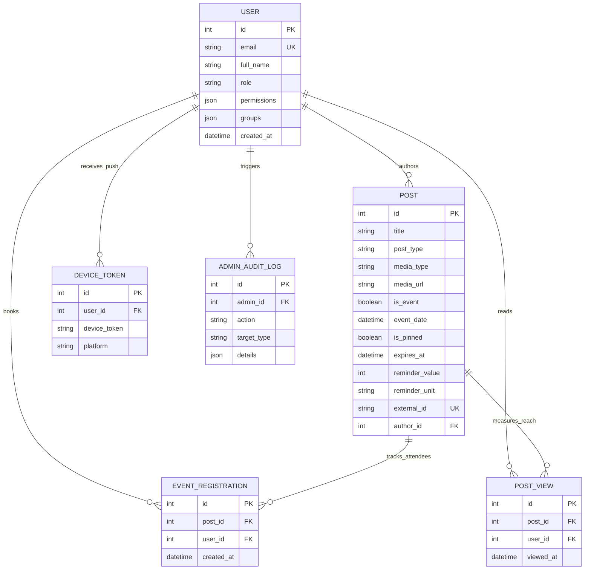

User interfaces can be redesigned in a few days, but the database schema forms the lasting backbone of any software system. When prototyping rapidly with AI coding assistants (vibe-coding), a common mistake is spinning up a separate table for every new screen until the same campus event exists in three places with conflicting timestamps. This sixth and final chapter shows how the UPA Campus App models its entire domain in PostgreSQL across six cohesive tables, eliminates duplicate bookings at the storage engine level, keeps large video and PDF files out of database memory buffers, and evolves the schema safely using Alembic.

---

## The Entity-Relationship Diagram: Six Tables Powering the Entire Campus

Rather than splitting announcements, calendar events, emergency alerts, and Instagram imports into separate data silos, the PostgreSQL schema centers around a unified `POST` table:



### How This Schema Prevents Data Inconsistencies by Design

1. **One Row for Feed and Calendar (`POST`):** A guest lecture is both a poster announcement in the news feed and a bookable date on the calendar. Because both screens read from the same row (controlled via `is_event` and `event_date`), there is only one source of truth across the platform. In addition, the unique `external_id` column stores the original identifier of imported Instagram posts so background synchronization recognizes existing entries immediately.
2. **Preventing Double Bookings Over Spotty Connections (`EVENT_REGISTRATION`):** If a student on a slow mobile connection taps "Register" twice in rapid succession, two concurrent requests hit the server. A composite uniqueness rule (`UniqueConstraint("post_id", "user_id")`) in PostgreSQL guarantees at the storage layer that the second insert is rejected and each student appears at most once on the attendance list.
3. **True Reach Metrics Instead of Click Inflation (`POST_VIEW`):** The same composite key (`post_id`, `user_id`) protects the `post_views` table. Even if a student opens the same announcement ten times, PostgreSQL records exactly one unique reader, giving the marketing team accurate reach statistics in the admin portal.
4. **Automated Cleanup via `ON DELETE CASCADE`:** Deleting an expired event automatically removes its associated registrations and view records within the same transaction, preventing orphaned rows.

---

## Type-Safe ORM Mapping With SQLAlchemy and SQL Injection Protection

Inside the Python backend, **SQLAlchemy** maps relational tables to strongly typed Python classes:

```python
from sqlalchemy import Boolean, Column, DateTime, ForeignKey, Integer, String, Text, UniqueConstraint, func
from sqlalchemy.orm import relationship
from app.database import Base

class EventRegistration(Base):
    __tablename__ = "event_registrations"
    __table_args__ = (
        UniqueConstraint("post_id", "user_id", name="uq_event_registration_post_user"),
    )

    id = Column(Integer, primary_key=True, index=True)
    post_id = Column(Integer, ForeignKey("posts.id", ondelete="CASCADE"), nullable=False)
    user_id = Column(Integer, ForeignKey("users.id", ondelete="CASCADE"), nullable=False)
    created_at = Column(DateTime(timezone=True), server_default=func.now(), nullable=False)
```

Beyond clean code organization, SQLAlchemy provides a critical security guarantee: every database query is executed using **parameterized prepared statements**. Even if a user types SQL control characters into a search box, PostgreSQL treats the input strictly as a literal text value rather than executing it as a command.

---

## Why Images, Videos, and PDFs Do Not Belong Inside Database Columns

The specification provides a unified upload field in the editorial cockpit for event posters (`JPG`, `PNG`, `WEBP`), short videos (`MP4`, `WEBM`), and documents (`PDF`). Storing multi-megabyte binary files directly inside PostgreSQL columns (`BLOB`) would create two severe bottlenecks:
* **Evicting Database RAM Caches (`Shared Buffers`):** PostgreSQL keeps frequently queried table and index pages in fast system memory. Reading large video chunks through table rows would flush those indexes out of RAM and slow down every query.
* **Bloated Backups:** Keeping binary files out of the database ensures daily SQL dumps remain a few megabytes in size and finish in seconds.

The architecture therefore separates binary storage from metadata persistence:

```mermaid
flowchart LR
    Editor["Web-Admin Editor"] -->|1. Upload File (Image / MP4 / PDF)| UploadAPI["FastAPI (/api/media/upload)"]
    UploadAPI -->|2. Stream 64 KB Chunks With UUIDv4 Name| Volume[("Filesystem Volume\n/app/uploads/a8f9...mp4")]
    UploadAPI -->|3. Store Lightweight Path String| DB[("PostgreSQL Table posts\nmedia_url = '/uploads/a8f9...mp4'")]
```

The upload endpoint verifies the MIME type, generates a random `UUIDv4` filename to prevent path collisions, and streams the file in 64-kilobyte chunks to the persistent volume, storing only the short URL string in the `posts` table:

```python
import uuid
from pathlib import Path
from fastapi import APIRouter, HTTPException, UploadFile, status

router = APIRouter(prefix="/api/media", tags=["Media"])

ALLOWED_TYPES = {
    "image/jpeg": (".jpg", "IMAGE"),
    "image/png": (".png", "IMAGE"),
    "image/webp": (".webp", "IMAGE"),
    "video/mp4": (".mp4", "VIDEO"),
    "video/webm": (".webm", "VIDEO"),
    "application/pdf": (".pdf", "DOCUMENT"),
}

@router.post("/upload")
async def upload_media_file(file: UploadFile):
    if file.content_type not in ALLOWED_TYPES:
        raise HTTPException(
            status_code=status.HTTP_415_UNSUPPORTED_MEDIA_TYPE,
            detail="Supported formats: JPG, PNG, WEBP, MP4, WEBM, and PDF.",
        )

    ext, category = ALLOWED_TYPES[file.content_type]
    safe_name = f"{uuid.uuid4().hex}{ext}"
    dest = Path("/app/uploads") / safe_name

    with open(dest, "wb") as out_file:
        while chunk := await file.read(64 * 1024):
            out_file.write(chunk)

    return {"url": f"/uploads/{safe_name}", "media_type": category}
```

---

## Controlled Schema Evolution With Alembic

When new requirements are added during the semester (such as the configurable reminder fields `reminder_value` and `reminder_unit`), a production database cannot simply be dropped and recreated. **Alembic** tracks every schema change in versioned migration scripts, just like Git commits for SQL tables:

```python
"""add unified post expiry and reminder columns

Revision ID: 004_unified_post_fields
Revises: 003_add_views_and_audit
"""
from alembic import op
import sqlalchemy as sa

revision = "004_unified_post_fields"
down_revision = "003_add_views_and_audit"

def upgrade() -> None:
    op.add_column("posts", sa.Column("media_type", sa.String(length=20), server_default="NONE", nullable=False))
    op.add_column("posts", sa.Column("expires_at", sa.DateTime(timezone=True), nullable=True))
    op.add_column("posts", sa.Column("reminder_value", sa.Integer(), nullable=True))
    op.add_column("posts", sa.Column("reminder_unit", sa.String(length=20), nullable=True))

def downgrade() -> None:
    op.drop_column("posts", "reminder_unit")
    op.drop_column("posts", "reminder_value")
    op.drop_column("posts", "expires_at")
    op.drop_column("posts", "media_type")
```

Whenever the backend container starts, `alembic upgrade head` checks the current database revision and applies any pending migrations automatically without touching existing records.

---

## Series Conclusion

1. **Data Integrity Enforced at the Storage Layer:** The unified `posts` table prevents data silos between the feed and calendar, while composite `UniqueConstraint` rules in PostgreSQL make duplicate event registrations and inflated read counts impossible.
2. **Structured Metadata in SQL, Binary Media on Disk:** Offloading images, videos, and PDFs to the `uploads_data` volume keeps PostgreSQL memory buffers dedicated to fast relational queries.
3. **The Complete Mental Model of Modern Web Applications:** Tracing the journey from functional specification (Chapter 1) through isolated Docker containers (Chapter 2), zero-port WireGuard tunnels and single-origin proxies (Chapter 3), offline-capable clients (Chapter 4), and strict Pydantic API contracts (Chapter 5) down to ACID database transactions (Chapter 6) provides the architectural foundation needed to design and build resilient software systems.
