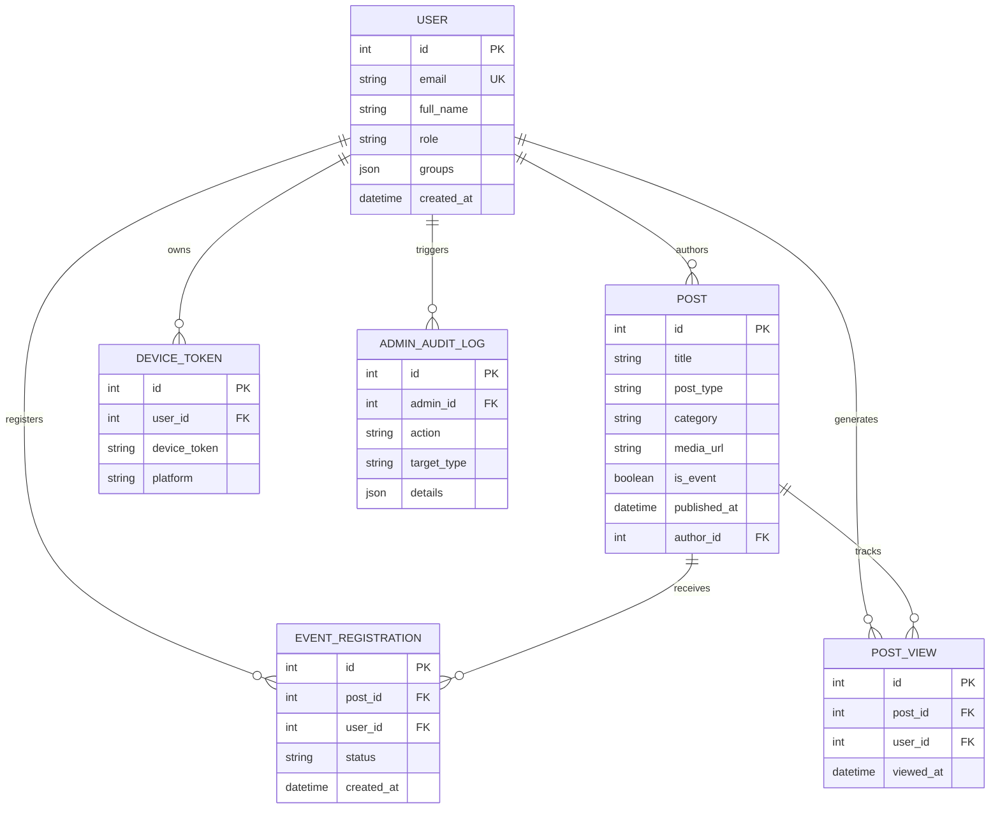
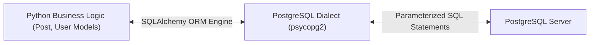
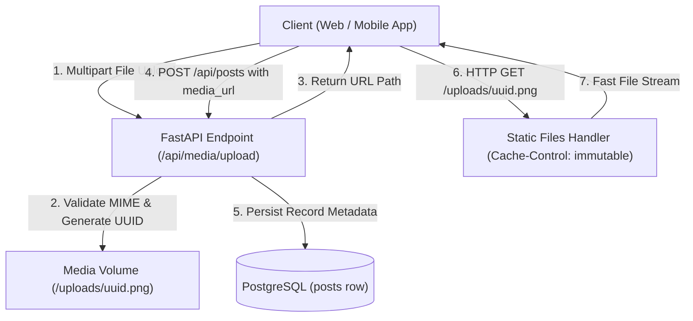
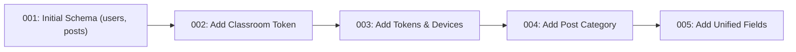

Enterprise software relies entirely on the integrity, consistency, and performance of its persistence tier. Following the discussion of REST APIs and ASGI routing with FastAPI in Part 5, this sixth installment examines the relational data architecture of the UPA Campus App. Key themes include relational integrity guarantees in PostgreSQL, object-relational mapping through SQLAlchemy, an efficient media storage strategy, and disciplined schema migrations using Alembic.

---

## Relational Data Modeling and Integrity in PostgreSQL

Selecting PostgreSQL as the core transactional engine for the UPA Campus App stems from the necessity of strict ACID guarantees (Atomicity, Consistency, Isolation, Durability). Higher education operations such as event RSVPs, role assignments, and access control require absolute transactional reliability: A user must never register twice for a capacity-limited course, and orphaned records following content deletion must be blocked at the database engine level.

### 1. Tables, Primary Keys, and Foreign Keys

In relational design, each table represents a discrete business entity. Relationships between these entities are established through explicit foreign keys:

* **Primary Keys:** Provide unique identification for every record. For high-volume operational tables, the UPA Campus App uses auto-incrementing indexed integers, which optimize b-tree index size and query performance.
* **Foreign Keys:** Enforce logical relationships across entities. A record in `posts` references `users` via `author_id`. An attendance record in `event_registrations` binds `user_id` to `users.id` and `post_id` to `posts.id`.
* **Cascading Deletions (`ON DELETE CASCADE`):** When a post is deleted, the relational engine automatically prunes dependent records in `event_registrations` and `post_views`. This rule prevents orphaned keys without requiring error-prone application cleanup routines.



### 2. Declarative Integrity Constraints

Application code alone cannot guarantee data invariants under high concurrency, as simultaneous requests create race conditions. Engine-level constraints enforce consistency directly at the storage layer:

* **Uniqueness Constraints (`UniqueConstraint`):** Within `event_registrations`, the constraint `UniqueConstraint("post_id", "user_id", name="uq_post_user_registration")` guarantees that only one registration exists per user and event. Rapid duplicate taps in the mobile client do not generate duplicate bookings, because PostgreSQL rejects the second INSERT transaction.
* **Non-Nullable Fields:** Core attributes such as `title` or `email` are declared with `nullable=False`, ensuring incomplete payloads are rejected before committing to disk.

---

## Object-Relational Mapping (ORM) with SQLAlchemy

Constructing raw SQL strings directly in business logic introduces maintenance overhead and severe security exposure. SQLAlchemy provides an abstraction boundary between the Python runtime and the PostgreSQL engine.



### 1. Declarative Models and Entity Classes

Using SQLAlchemy's declarative system (`declarative_base`), database tables map directly to Python classes. Attributes mirror relational columns, while relationship descriptors simplify navigation across entities:

```python
from sqlalchemy import Column, Integer, String, Text, Boolean, DateTime, ForeignKey, UniqueConstraint, func
from sqlalchemy.orm import relationship
from app.database import Base

class Post(Base):
    __tablename__ = "posts"

    id = Column(Integer, primary_key=True, index=True)
    title = Column(String(255), nullable=False)
    content = Column(Text, nullable=True)
    post_type = Column(String(50), default="MANUAL", nullable=False)
    category = Column(String(50), nullable=True)
    media_url = Column(Text, nullable=True)
    is_event = Column(Boolean, default=False, nullable=False)
    published_at = Column(DateTime(timezone=True), nullable=True)

    author_id = Column(Integer, ForeignKey("users.id"), nullable=True)
    created_at = Column(DateTime(timezone=True), server_default=func.now(), nullable=False)

    # Relationships
    author = relationship("User", back_populates="posts")
    registrations = relationship("EventRegistration", back_populates="post", cascade="all, delete-orphan")
```

### 2. SQL Injection Prevention via Parameterized Queries

A fundamental security benefit of modern ORMs is automatic query parameterization. Unsanitized string concatenation allows malicious input to alter the abstract syntax tree of the database parser:

```python
# Insecure pattern (manual string concatenation):
# Input user_input: "test@example.com' OR '1'='1"
query = f"SELECT * FROM users WHERE email = '{user_input}'"
# Results in unauthorized bulk data exposure!
```

SQLAlchemy completely separates command syntax from user data. The engine compiles queries into parameterized templates:

```python
# Secure pattern with SQLAlchemy ORM:
user = db.query(User).filter(User.email == user_input).first()
```

PostgreSQL executes this query as a prepared statement:

```sql
SELECT users.id, users.email, users.full_name, users.role
FROM users
WHERE users.email = %(email_1)s
LIMIT 1;
```

The database treats user input strictly as literal values, never as executable SQL expressions. This approach neutralizes SQL injection vulnerabilities at the architectural level.

### 3. Session Boundaries and Transaction Lifecycles

In FastAPI, connection pooling and session scopes are managed via generator-based dependency injection (`get_db`). Each incoming HTTP request receives an isolated database session:

```python
from sqlalchemy.orm import Session
from app.database import SessionLocal

def get_db():
    db = SessionLocal()
    try:
        yield db
    finally:
        db.close()
```

If an unhandled exception occurs during request execution, the session rolls back (`db.rollback()`) before returning the physical connection to the pool. When execution completes successfully, state transitions commit atomically via `db.commit()`.

---

## Media Storage Strategy: Decoupling Files from Metadata

Campus applications process daily photo uploads, event flyers, and administrative documents. Storing binary assets directly inside relational tables as BLOBs (Binary Large Objects) represents a critical anti-pattern in scalable systems.

### 1. The Operational Pitfalls of In-Database BLOB Storage

Persisting raw binary files within relational database rows creates severe operational bottlenecks:

1. **Database Bloat and Backup Degradation:** Tables containing multi-megabyte binary columns expand write-ahead logs (WAL) and logical backup dumps exponentially. Backup windows lengthen and storage costs rise unnecessarily.
2. **Buffer Pool Cache Contention:** PostgreSQL caches frequently queried index pages and table tuples in shared buffers. Reading large binary payloads flushes operational data from RAM, causing substantial performance regressions across unrelated queries.
3. **Impaired Protocol Delivery:** Relational database protocols are not engineered for HTTP range requests, chunked streaming, or edge CDN caching.

### 2. Clean Architecture: Separating Files from Relational Tables

The UPA Campus App cleanly isolates physical files from relational records:

* **File Storage:** Uploaded files are written directly to a dedicated container directory backed by a persistent Docker media volume (`/uploads`).
* **Cryptographic Filenames:** Client-supplied filenames are stripped immediately to eliminate directory traversal risks (`../`). A unique UUID version 4 identifier combined with a canonical extension serves as the storage filename (for example, `3f2b8c1e4d5a4f7e9a0b1c2d3e4f5a6b.png`).
* **Relational Storage:** The `posts` table retains only the resolved relative or absolute URL path (`posts.media_url`) as a compact text string.
* **Optimized Delivery:** Assets are served by an asynchronous static file handler that injects long-term caching headers (`Cache-Control: public, max-age=31536000, immutable`).



The upload endpoint processes payloads in discrete chunks to maintain stable server memory consumption even under large concurrent uploads:

```python
import tempfile
import uuid
from pathlib import Path
from fastapi import APIRouter, UploadFile, HTTPException, status

router = APIRouter(prefix="/api/media", tags=["Media"])
ALLOWED_TYPES = {"image/jpeg": ".jpg", "image/png": ".png", "image/webp": ".webp"}

@router.post("/upload")
async def upload_media(file: UploadFile):
    if file.content_type not in ALLOWED_TYPES:
        raise HTTPException(status_code=status.HTTP_415_UNSUPPORTED_MEDIA_TYPE, detail="Unsupported media format.")

    extension = ALLOWED_TYPES[file.content_type]
    unique_filename = f"{uuid.uuid4().hex}{extension}"
    target_path = Path("/app/uploads") / unique_filename

    # Chunk-wise streaming bounds server memory usage
    with open(target_path, "wb") as buffer:
        while chunk := await file.read(64 * 1024):
            buffer.write(chunk)

    return {"url": f"/uploads/{unique_filename}", "filename": unique_filename}
```

---

## Schema Migrations with Alembic

System requirements inevitably evolve over time. While calling `Base.metadata.create_all(bind=engine)` works during initial prototyping, it cannot alter existing tables, add columns, or manage data transitions in production environments.

### 1. Mitigating Schema Drift

Applying ad-hoc SQL modifications directly on production servers creates discrepancies between live schemas and Git repositories. Environments diverge quickly, turning application deployments into high-risk operations.

Alembic introduces deterministic version control for database schemas: Every structural change is documented as a timestamped revision script stored in the repository.



### 2. Anatomy of an Alembic Migration Script

Each migration revision exposes an `upgrade()` function for forward progression and a `downgrade()` function for rollback execution:

```python
"""add post category and publication date

Revision ID: 004_add_post_category
Revises: 003_add_refresh_and_device_tokens
Create Date: 2026-10-15 10:00:00.000000
"""
from alembic import op
import sqlalchemy as sa

revision = '004_add_post_category'
down_revision = '003_add_refresh_and_device_tokens'

def upgrade() -> None:
    op.add_column('posts', sa.Column('category', sa.String(length=50), nullable=True))
    op.add_column('posts', sa.Column('published_at', sa.DateTime(timezone=True), nullable=True))

def downgrade() -> None:
    op.drop_column('posts', 'published_at')
    op.drop_column('posts', 'category')
```

### 3. Automated Execution in CI/CD Deployments

In containerized deployments, migrations run deterministically during container initialization prior to binding application workers:

```bash
# Apply pending schema migrations before starting the application server
alembic upgrade head

# Launch asynchronous ASGI production server
uvicorn app.main:app --host 0.0.0.0 --port 8000
```

Executing `alembic upgrade head` within the startup pipeline ensures the relational schema matches code expectations before production traffic begins processing.

---

## Summary

1. **Engine-Level Relational Integrity:** Primary keys, foreign keys, cascading deletions, and uniqueness constraints preserve consistency directly inside the database engine.
2. **Decoupled Binary Storage:** PostgreSQL stores relational metadata and uniform resource paths, while binary media assets reside on persistent storage volumes optimized for HTTP edge caching.
3. **Controlled Schema Evolution:** Versioned migrations via Alembic prevent schema drift, enabling reliable and automated database deployments across environments.
