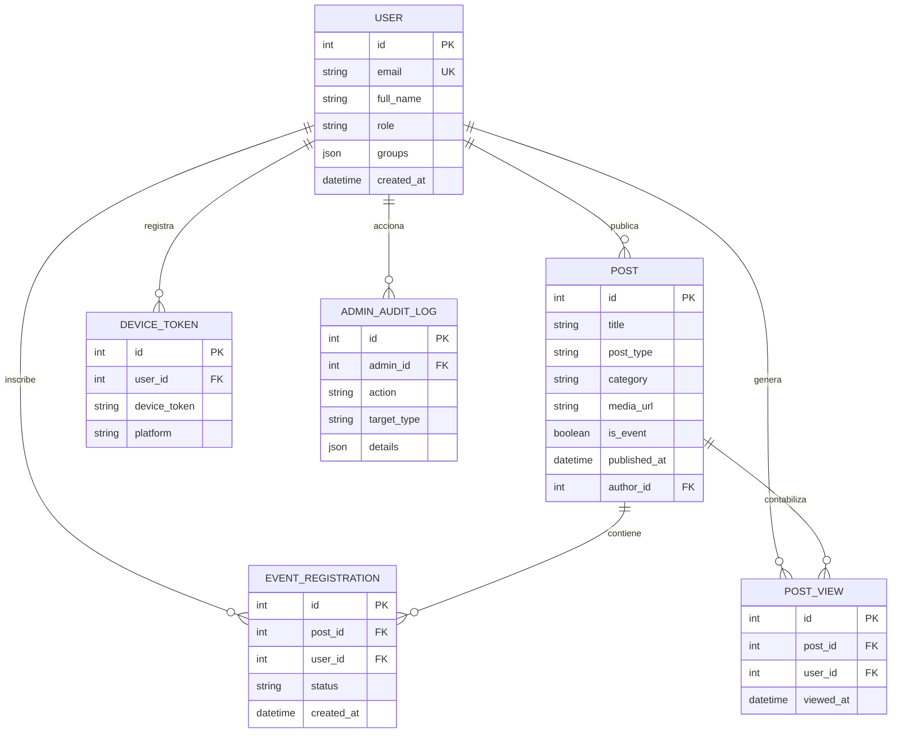
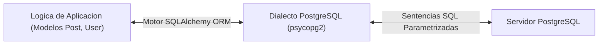
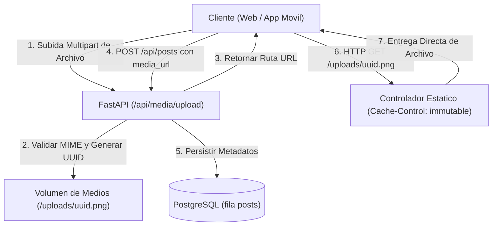
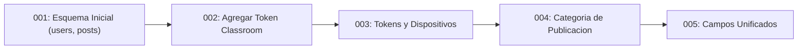

Las aplicaciones empresariales dependen por completo de la integridad, consistencia y rendimiento de su capa de persistencia. Tras examinar las interfaces REST y el enrutamiento ASGI con FastAPI en la parte 5, esta sexta entrega analiza la arquitectura de datos relacionales en UPA Campus App. Los temas centrales incluyen garantias de integridad relacional en PostgreSQL, mapeo objeto-relacional mediante SQLAlchemy, almacenamiento eficiente para imagenes y documentos, y migraciones disciplinadas con Alembic.

---

## Modelado de Datos Relacionales e Integridad en PostgreSQL

La eleccion de PostgreSQL como motor transaccional principal responde a la necesidad de garantias ACID estrictas (Atomicidad, Consistencia, Aislamiento, Durabilidad). Los procesos universitarios como inscripciones a eventos, asignacion de roles y control de acceso exigen fiabilidad transaccional absoluta: Ningun usuario debe poder registrarse dos veces en un evento con cupos limitados, y los registros huerfanos tras la eliminacion de contenidos deben impedirse a nivel de base de datos.

### 1. Tablas, Claves Primarias y Claves Foraneas

En el diseno relacional, cada tabla representa una entidad de negocio concreta. Las relaciones entre estas entidades se establecen mediante claves foraneas explicitas:

* **Claves Primarias (Primary Keys):** Identifican de forma univoca cada fila. Para tablas operativas con alta frecuencia de lectura y escritura, UPA Campus App utiliza enteros secuenciales indexados (`Integer`), optimizando el tamano del indice b-tree y el rendimiento de las consultas.
* **Claves Foraneas (Foreign Keys):** Vinculan logicamente los registros entre tablas. Un registro en `posts` referencia a `users` a traves de `author_id`. Un registro de asistencia en `event_registrations` vincula `user_id` con `users.id` y `post_id` con `posts.id`.
* **Reglas de Borrado en Cascada (`ON DELETE CASCADE`):** Al eliminar una publicacion, el motor relacional elimina automaticamente los registros dependientes en `event_registrations` y `post_views`. Esta configuracion evita inconsistencias y referencias huerfanas sin requerir rutinas manuales de limpieza.



### 2. Restricciones Declarativas de Integridad

El codigo de la aplicacion por si solo no puede garantizar la consistencia bajo alta concurrencia, ya que solicitudes simultaneas provocan condiciones de carrera. Las restricciones a nivel de motor garantizan la integridad directamente en el almacenamiento:

* **Restricciones de Unicidad (`UniqueConstraint`):** En `event_registrations`, la directiva `UniqueConstraint("post_id", "user_id", name="uq_post_user_registration")` asegura que solo exista un registro de inscripcion por usuario y evento. Clics dobles accidentales en la aplicacion movil no generan reservas duplicadas, dado que PostgreSQL rechaza la segunda transaccion con un error de restriccion.
* **Campos No Nulos:** Atributos esenciales como `title` o `email` estan marcados como `nullable=False`, rechazando datos incompletos antes de persistirlos en disco.

---

## Mapeo Objeto-Relacional (ORM) con SQLAlchemy

La redaccion manual de cadenas SQL en la logica de negocio introduce dificultades de mantenimiento y riesgos de seguridad. SQLAlchemy actua como capa de abstraccion entre la aplicacion en Python y la base de datos PostgreSQL.



### 1. Modelos Declarativos y Clases en Python

Utilizando el sistema declarativo de SQLAlchemy (`declarative_base`), las tablas se definen como clases de Python. Los atributos reflejan las columnas de la base de datos y facilitan la lectura y el tipado:

```python
from sqlalchemy import Column, Integer, String, Text, Boolean, DateTime, ForeignKey, UniqueConstraint, func
from sqlalchemy.orm import relationship
from app.database import Base

class Post(Base):
    __tablename__ = "posts"

    id = Column(Integer, primary_key=True, index=True)
    title = Column(String(255), nullable=False)
    content = Column(Text, nullable=True)
    post_type = Column(String(50), default="MANUAL", nullable=False)
    category = Column(String(50), nullable=True)
    media_url = Column(Text, nullable=True)
    is_event = Column(Boolean, default=False, nullable=False)
    published_at = Column(DateTime(timezone=True), nullable=True)

    author_id = Column(Integer, ForeignKey("users.id"), nullable=True)
    created_at = Column(DateTime(timezone=True), server_default=func.now(), nullable=False)

    # Relaciones relacionales
    author = relationship("User", back_populates="posts")
    registrations = relationship("EventRegistration", back_populates="post", cascade="all, delete-orphan")
```

### 2. Prevencion de Inyecciones SQL Mediante Consultas Parametrizadas

Una de las ventajas fundamentales de un ORM moderno es la parametrizacion automatica de todas las consultas. La concatenacion manual de cadenas permite que entradas maliciosas modifiquen la estructura sintactica del analizador SQL:

```python
# Ejemplo inseguro (concatenacion manual de cadenas):
# Entrada recibida en user_input: "test@example.com' OR '1'='1"
query = f"SELECT * FROM users WHERE email = '{user_input}'"
# Produce exposicion no autorizada de toda la tabla!
```

SQLAlchemy separa estrictamente la sintaxis de la consulta de los datos de usuario. El compilador genera consultas parametrizadas:

```python
# Patron seguro con SQLAlchemy:
user = db.query(User).filter(User.email == user_input).first()
```

PostgreSQL ejecuta esta instruccion como una consulta preparada:

```sql
SELECT users.id, users.email, users.full_name, users.role
FROM users
WHERE users.email = %(email_1)s
LIMIT 1;
```

El motor de base de datos procesa el valor recibido estrictamente como un dato literal, neutralizando ataques de inyeccion SQL a nivel de arquitectura.

### 3. Gestion de Sesiones y Ciclo de Transacciones

En FastAPI, las sesiones de base de datos se administran mediante un patron de inyeccion de dependencias basado en generadores (`get_db`). Cada solicitud HTTP opera con una sesion independiente y aislada:

```python
from sqlalchemy.orm import Session
from app.database import SessionLocal

def get_db():
    db = SessionLocal()
    try:
        yield db
    finally:
        db.close()
```

Si ocurre una excepcion durante el procesamiento del servicio, la sesion revierte los cambios (`db.rollback()`) antes de liberar la conexion al grupo de conexiones. Si la operacion concluye con exito, los cambios se confirman atomicamente con `db.commit()`.

---

## Estrategia de Almacenamiento para Imagenes y Medios

Las aplicaciones moviles gestionan a diario fotos de carteles, avisos institucionales y documentos. Almacenar estos archivos binarios directamente dentro de la base de datos relacional como BLOB (Binary Large Object) constituye un antipatron habitual que degrada el rendimiento.

### 1. Inconvenientes de Guardar Archivos Binarios en la Base de Datos

Persistir archivos binarios pesados dentro de filas de PostgreSQL genera dificultades operativas considerables:

1. **Crecimiento Excesivo y Copias de Seguridad Lentas:** Las tablas con campos binarios de gran tamano aumentan drasticamente los registros de transacciones (WAL) y los respaldos logicos. El tiempo requerido para crear o restaurar copias de seguridad se multiplica.
2. **Degradacion de la Memoria Cache:** PostgreSQL almacena paginas de indices y tablas en memoria principal (Shared Buffers). Leer bloques binarios voluminosos desaloja paginas operativas criticas de la memoria RAM, ralentizando consultas concurrentes.
3. **Limitaciones en Protocolos de Entrega:** Las bases de datos relacionales no estan optimizadas para solicitudes HTTP de rango de bytes (Byte-Range Requests) ni para distribucion en redes CDN.

### 2. Arquitectura Limpia: Separacion de Archivos y Metadatos

UPA Campus App desacopla fisicamente los archivos multimedia de los registros relacionales:

* **Almacenamiento de Archivos:** Los archivos subidos se escriben directamente en un directorio del contenedor vinculado a un volumen persistente de Docker (`/uploads`).
* **Nombres Unicos con UUID:** El nombre de archivo provisto por el cliente se descarta para evitar riesgos de navegacion por directorios (`../`). Se genera un identificador UUID version 4 junto con la extension MIME verificada (por ejemplo, `3f2b8c1e4d5a4f7e9a0b1c2d3e4f5a6b.png`).
* **Metadatos en PostgreSQL:** La tabla `posts` almacena unicamente la ruta relativa o absoluta (`posts.media_url`) como cadena de texto.
* **Distribucion Eficiente:** Los archivos se sirven mediante un controlador estatico que asigna cabeceras de cache de larga duracion (`Cache-Control: public, max-age=31536000, immutable`).



El endpoint de subida lee los datos en fragmentos continuos para mantener el consumo de memoria del servidor dentro de limites estrictos:

```python
import tempfile
import uuid
from pathlib import Path
from fastapi import APIRouter, UploadFile, HTTPException, status

router = APIRouter(prefix="/api/media", tags=["Media"])
ALLOWED_TYPES = {"image/jpeg": ".jpg", "image/png": ".png", "image/webp": ".webp"}

@router.post("/upload")
async def upload_media(file: UploadFile):
    if file.content_type not in ALLOWED_TYPES:
        raise HTTPException(status_code=status.HTTP_415_UNSUPPORTED_MEDIA_TYPE, detail="Formato no compatible.")

    extension = ALLOWED_TYPES[file.content_type]
    unique_filename = f"{uuid.uuid4().hex}{extension}"
    target_path = Path("/app/uploads") / unique_filename

    # Escritura por bloques para mantener constante el uso de memoria
    with open(target_path, "wb") as buffer:
        while chunk := await file.read(64 * 1024):
            buffer.write(chunk)

    return {"url": f"/uploads/{unique_filename}", "filename": unique_filename}
```

---

## Migraciones de Esquemas con Alembic

Los requisitos de cualquier software evolucionan a lo largo de su ciclo de vida. Durante el desarrollo inicial, `Base.metadata.create_all(bind=engine)` resulta suficiente. En produccion, este comando no modifica tablas existentes ni agrega columnas a estructuras ya creadas.

### 1. El Riesgo de Desviacion del Esquema (Schema Drift)

Modificar manualmente columnas en servidores de produccion mediante consolas SQL provoca discrepancias entre el estado de la base de datos y las definiciones en Git. Los entornos de desarrollo y produccion pierden sincronizacion, convirtiendo los despliegues en tareas propensas a errores.

Alembic implementa control de versiones para la base de datos: Cada cambio estructural se almacena como un script de revision numerado dentro del repositorio.



### 2. Estructura de una Revision en Alembic

Cada archivo de migracion define dos funciones principales: `upgrade()` para avanzar a la nueva version y `downgrade()` para revertir los cambios en caso de necesidad:

```python
"""add post category and publication date

Revision ID: 004_add_post_category
Revises: 003_add_refresh_and_device_tokens
Create Date: 2026-10-15 10:00:00.000000
"""
from alembic import op
import sqlalchemy as sa

revision = '004_add_post_category'
down_revision = '003_add_refresh_and_device_tokens'

def upgrade() -> None:
    op.add_column('posts', sa.Column('category', sa.String(length=50), nullable=True))
    op.add_column('posts', sa.Column('published_at', sa.DateTime(timezone=True), nullable=True))

def downgrade() -> None:
    op.drop_column('posts', 'published_at')
    op.drop_column('posts', 'category')
```

### 3. Ejecucion Automatizada en el Proceso de Despliegue

En entornos de contenedores, las migraciones se aplican automaticamente antes de iniciar el servidor web:

```bash
# Aplicar migraciones pendientes antes de iniciar la aplicacion
alembic upgrade head

# Iniciar el servidor web ASGI de produccion
uvicorn app.main:app --host 0.0.0.0 --port 8000
```

La ejecucion sistematica de `alembic upgrade head` garantiza que la base de datos posea exactamente la estructura requerida por el codigo antes de comenzar a recibir trafico de usuarios.

---

## Conclusion

1. **Integridad Relacional Garantizada:** Las claves primarias, foraneas y restricciones como `UniqueConstraint` protegen la coherencia de datos directamente en el motor de base de datos.
2. **Almacenamiento Desacoplado de Archivos:** PostgreSQL gestiona metadatos y rutas de forma eficiente, mientras los archivos multimedia se conservan en volumenes de almacenamiento preparados para distribucion en cache HTTP.
3. **Evolucion Controlada con Migraciones:** Las revisiones automatizadas con Alembic eliminan discrepancias entre entornos y aseguran despliegues deterministas.
