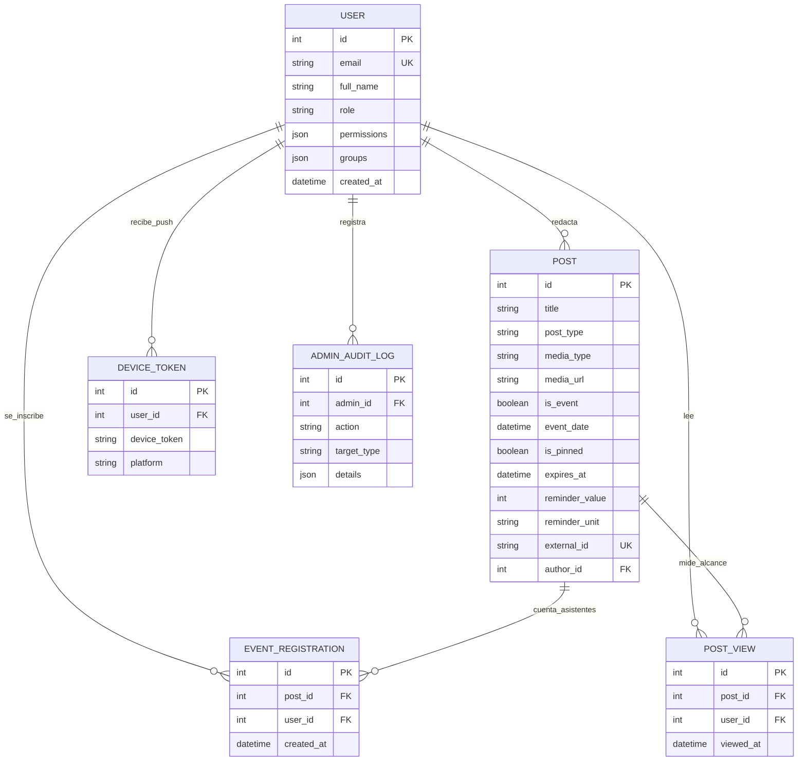

Las pantallas visuales pueden rediseñarse en pocos días, pero el esquema de base de datos constituye la columna vertebral permanente de cualquier sistema de software. Al crear prototipos rápidos con asistentes de IA (vibe-coding), un error frecuente es inventar una tabla nueva por cada pantalla hasta que un mismo evento académico aparece guardado en tres lugares con horarios contradictorios. Este sexto y último capítulo muestra cómo la UPA Campus App modela toda su información en PostgreSQL mediante seis tablas conectadas, bloquea inscripciones duplicadas en el motor de almacenamiento, mantiene los videos y PDFs fuera de la memoria RAM de la base de datos y evoluciona el esquema de forma segura con Alembic.

---

## El Diagrama Entidad-Relación: Seis Tablas para Todo el Campus

En lugar de dispersar noticias, fechas de calendario, alertas de emergencia y publicaciones de Instagram en silos separados, el esquema en PostgreSQL articula toda la actividad alrededor de la tabla central `POST`:



### Por Qué Este Diseño Evita Contradicciones de Raíz

1. **Una Sola Fila para Feed y Calendario (`POST`):** Una conferencia magistral es al mismo tiempo un anuncio con afiche en el feed y una fecha inscribible en la agenda. Como ambas pantallas consultan la misma fila (controlada mediante `is_event` y `event_date`), existe una única fuente de verdad en todo el sistema. Además, la columna única `external_id` guarda el identificador original de las publicaciones importadas desde Instagram para evitar duplicados en cada sincronización.
2. **Protección contra Inscripciones Duplicadas en Redes Lentas (`EVENT_REGISTRATION`):** Si un estudiante con baja señal móvil pulsa dos veces seguidas el botón "Inscribirse", llegan dos peticiones casi simultáneas al servidor. Una restricción de unicidad compuesta (`UniqueConstraint("post_id", "user_id")`) en PostgreSQL garantiza a nivel de disco que el segundo intento se rechace y que cada estudiante figure una sola vez en la lista.
3. **Medición Real de Lectura sin Inflación de Clics (`POST_VIEW`):** La misma llave compuesta (`post_id`, `user_id`) protege la tabla `post_views`. Aunque un alumno abra diez veces el mismo comunicado, PostgreSQL contabiliza exactamente un lector único, entregando métricas de alcance reales al equipo de comunicación.
4. **Limpieza Automática mediante `ON DELETE CASCADE`:** Al eliminar un evento antiguo, PostgreSQL borra en la misma transacción sus inscripciones y registros de lectura asociados, evitando filas huérfanas.

---

## Mapeo Tipado con SQLAlchemy y Prevención de Inyección SQL

En el backend de Python, **SQLAlchemy** traduce las tablas relacionales en clases con tipos estrictos:

```python
from sqlalchemy import Boolean, Column, DateTime, ForeignKey, Integer, String, Text, UniqueConstraint, func
from sqlalchemy.orm import relationship
from app.database import Base

class EventRegistration(Base):
    __tablename__ = "event_registrations"
    __table_args__ = (
        UniqueConstraint("post_id", "user_id", name="uq_event_registration_post_user"),
    )

    id = Column(Integer, primary_key=True, index=True)
    post_id = Column(Integer, ForeignKey("posts.id", ondelete="CASCADE"), nullable=False)
    user_id = Column(Integer, ForeignKey("users.id", ondelete="CASCADE"), nullable=False)
    created_at = Column(DateTime(timezone=True), server_default=func.now(), nullable=False)
```

Además de ordenar el código, SQLAlchemy aporta una defensa crítica: todas las consultas se envían a PostgreSQL como **sentencias preparadas parametrizadas**. Incluso si alguien introduce caracteres especiales de SQL en un cuadro de búsqueda, el motor los procesa únicamente como texto literal y no como instrucciones ejecutables.

---

## Por Qué las Imágenes, Videos y PDFs No Se Guardan Dentro de las Tablas SQL

La especificación ofrece en el editor administrativo un campo unificado para subir afiches (`JPG`, `PNG`, `WEBP`), videos cortos (`MP4`, `WEBM`) y documentos (`PDF`). Almacenar archivos binarios de varios megabytes dentro de columnas de PostgreSQL (`BLOB`) provocaría dos problemas graves:
* **Saturación de la Memoria Caché (`Shared Buffers`):** PostgreSQL conserva los índices más consultados en la memoria RAM rápida. Leer bloques pesados de video desde las tablas desplazaría esos índices de la memoria y volvería lentas todas las búsquedas.
* **Respaldos Pesados:** Mantener los archivos binarios fuera del motor SQL permite que las copias de seguridad diarias ocupen pocos megabytes y finalicen en segundos.

Por ello, la arquitectura separa el flujo de almacenamiento en dos vías complementarias:

```mermaid
flowchart LR
    Editor["Editor Web-Admin"] -->|1. Subir Archivo (Imagen / MP4 / PDF)| UploadAPI["FastAPI (/api/media/upload)"]
    UploadAPI -->|2. Escritura por Bloques de 64 KB con Nombre UUIDv4| Volume[("Volumen de Archivos\n/app/uploads/a8f9...mp4")]
    UploadAPI -->|3. Guardar Solo la Ruta de Texto| DB[("Tabla posts en PostgreSQL\nmedia_url = '/uploads/a8f9...mp4'")]
```

El endpoint de carga verifica el formato MIME, asigna un nombre aleatorio `UUIDv4` para evitar colisiones y escribe el archivo en bloques de 64 kilobytes sobre el volumen persistente, guardando en la tabla `posts` únicamente la ruta corta de texto:

```python
import uuid
from pathlib import Path
from fastapi import APIRouter, HTTPException, UploadFile, status

router = APIRouter(prefix="/api/media", tags=["Media"])

ALLOWED_TYPES = {
    "image/jpeg": (".jpg", "IMAGE"),
    "image/png": (".png", "IMAGE"),
    "image/webp": (".webp", "IMAGE"),
    "video/mp4": (".mp4", "VIDEO"),
    "video/webm": (".webm", "VIDEO"),
    "application/pdf": (".pdf", "DOCUMENT"),
}

@router.post("/upload")
async def upload_media_file(file: UploadFile):
    if file.content_type not in ALLOWED_TYPES:
        raise HTTPException(
            status_code=status.HTTP_415_UNSUPPORTED_MEDIA_TYPE,
            detail="Formatos admitidos: JPG, PNG, WEBP, MP4, WEBM y PDF.",
        )

    ext, category = ALLOWED_TYPES[file.content_type]
    safe_name = f"{uuid.uuid4().hex}{ext}"
    dest = Path("/app/uploads") / safe_name

    with open(dest, "wb") as out_file:
        while chunk := await file.read(64 * 1024):
            out_file.write(chunk)

    return {"url": f"/uploads/{safe_name}", "media_type": category}
```

---

## Evolución Controlada del Esquema con Alembic

Cuando durante el semestre se incorporan nuevos requerimientos al pliego funcional (como los campos configurables de recordatorio `reminder_value` y `reminder_unit`), no es posible borrar la base de datos en producción ni modificar tablas manualmente. **Alembic** versiona cada cambio estructural en archivos de migración numerados:

```python
"""add unified post expiry and reminder columns

Revision ID: 004_unified_post_fields
Revises: 003_add_views_and_audit
"""
from alembic import op
import sqlalchemy as sa

revision = "004_unified_post_fields"
down_revision = "003_add_views_and_audit"

def upgrade() -> None:
    op.add_column("posts", sa.Column("media_type", sa.String(length=20), server_default="NONE", nullable=False))
    op.add_column("posts", sa.Column("expires_at", sa.DateTime(timezone=True), nullable=True))
    op.add_column("posts", sa.Column("reminder_value", sa.Integer(), nullable=True))
    op.add_column("posts", sa.Column("reminder_unit", sa.String(length=20), nullable=True))

def downgrade() -> None:
    op.drop_column("posts", "reminder_unit")
    op.drop_column("posts", "reminder_value")
    op.drop_column("posts", "expires_at")
    op.drop_column("posts", "media_type")
```

Cada vez que arranca el contenedor del backend, el comando `alembic upgrade head` comprueba la versión actual del esquema y aplica automáticamente las columnas nuevas sin afectar los datos existentes.

---

## Conclusión General de la Serie

1. **Integridad de Datos en el Nivel de Almacenamiento:** La tabla unificada `posts` elimina contradicciones entre el feed y el calendario, mientras que las reglas `UniqueConstraint` en PostgreSQL impiden inscripciones duplicadas y conteos de lectura inflados.
2. **Metadatos Estructurados en SQL, Archivos Multimedia en Disco:** Alojar imágenes, videos y PDFs en el volumen `uploads_data` mantiene la memoria RAM de PostgreSQL libre para consultas relacionales rápidas.
3. **El Modelo Mental Completo de una Aplicación Web Moderna:** Recorrer el camino desde el pliego funcional (Capítulo 1), pasando por contenedores Docker aislados (Capítulo 2), túneles WireGuard y proxy inverso single-origin (Capítulo 3), clientes con soporte offline (Capítulo 4) y contratos Pydantic en el backend (Capítulo 5) hasta las transacciones SQL (Capítulo 6), brinda la base técnica necesaria para diseñar y construir sistemas web sólidos de principio a fin.
