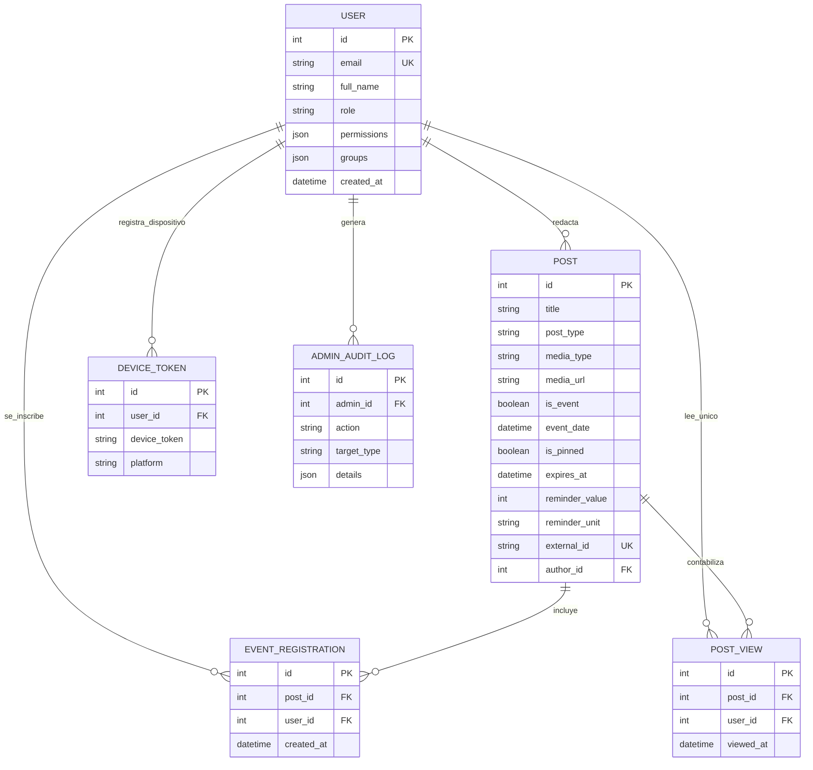
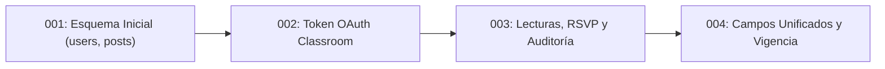

Las pantallas visuales pueden rediseñarse en pocos días, pero el modelo de datos constituye la columna vertebral permanente de cualquier sistema de software. Un error frecuente al programar rápidamente con asistentes de IA (vibe-coding) consiste en crear una tabla nueva por cada pantalla hasta que los datos se contradicen entre sí. En PostgreSQL, la UPA Campus App aplica el principio opuesto: un modelo relacional unificado y normalizado respalda cada proceso del campus con garantías ACID completas. Este sexto capítulo muestra cómo cada requisito de la especificación funcional se materializa en tablas relacionales, restricciones de unicidad, almacenamiento separado para imágenes, videos y PDFs, y migraciones versionadas con Alembic.

---

## El Modelo Relacional de Datos como Plano de la Especificación Funcional

¿Por qué la UPA Campus App utiliza PostgreSQL y cómo se conectan sus seis tablas principales? El diagrama Entidad-Relación (ER) resume toda la arquitectura de persistencia de un vistazo:



### Por Qué Este Esquema Sostiene Directamente el Pliego Funcional

1. **La Tabla `POST` como Fuente Única de Verdad (Single Source of Truth):** En lugar de dividir noticias, eventos de calendario, avisos de emergencia e importaciones de Instagram en tablas inconexas, la tabla `posts` unifica todos los formatos. Al activar `is_event` y `event_date`, la publicación aparece automáticamente en el calendario del módulo Agenda. Con `is_pinned` y `expires_at` se fija en la parte superior hasta su fecha de caducidad. Con `reminder_value` y `reminder_unit` (`MINUTES`, `HOURS`, `DAYS`) configura recordatorios, y mediante `external_id` evita duplicar publicaciones durante la sincronización automática con Instagram.
2. **Protección contra Inscripciones Duplicadas en 1 Clic (`EVENT_REGISTRATION`):** Si un estudiante con señal inestable pulsa dos veces seguidas el botón "Inscribirse", llegan dos peticiones simultáneas al servidor. Una restricción en la base de datos (`UniqueConstraint("post_id", "user_id")`) garantiza a nivel de disco que jamás se cree más de una inscripción por estudiante y evento.
3. **Métricas Reales de Lectura sin Inflación de Clics (`POST_VIEW`):** La tabla `post_views` también aplica una clave única compuesta por `post_id` y `user_id`. Aunque un estudiante abra diez veces el mismo comunicado, PostgreSQL contabiliza exactamente un lector único, entregando estadísticas reales al equipo de marketing en Web-Admin.
4. **Limpieza en Cascada (`ON DELETE CASCADE`):** Al eliminar un evento antiguo, PostgreSQL borra automáticamente sus registros asociados en `event_registrations` y `post_views`, impidiendo que queden datos huérfanos.

---

## Mapeo Objeto-Relacional (ORM) y Prevención de Inyección SQL

En el backend de Python, **SQLAlchemy** conecta las tablas relacionales con clases tipadas de Python y blinda al sistema frente a ataques de inyección SQL:

```python
from sqlalchemy import Column, Integer, String, Text, Boolean, DateTime, ForeignKey, UniqueConstraint, func
from sqlalchemy.orm import relationship
from app.database import Base

class Post(Base):
    __tablename__ = "posts"

    id = Column(Integer, primary_key=True, index=True)
    title = Column(String(200), nullable=False)
    content = Column(Text, nullable=True)
    post_type = Column(String(50), default="MANUAL", nullable=False)
    media_type = Column(String(20), default="NONE", nullable=False)
    media_url = Column(Text, nullable=True)

    is_event = Column(Boolean, default=False, nullable=False)
    event_date = Column(DateTime(timezone=True), nullable=True)
    is_pinned = Column(Boolean, default=False, nullable=False)
    expires_at = Column(DateTime(timezone=True), nullable=True)

    reminder_value = Column(Integer, nullable=True)
    reminder_unit = Column(String(20), nullable=True)
    external_id = Column(String(120), unique=True, nullable=True)

    author_id = Column(Integer, ForeignKey("users.id"), nullable=True)
    created_at = Column(DateTime(timezone=True), server_default=func.now(), nullable=False)

    registrations = relationship("EventRegistration", back_populates="post", cascade="all, delete-orphan")
```

Como SQLAlchemy envía siempre la estructura SQL separada de los parámetros del usuario (consultas preparadas parametrizadas), PostgreSQL trata cualquier texto ingresado únicamente como un valor literal y nunca como código SQL ejecutable.

---

## Estrategia de Almacenamiento para el Campo Multimedia Unificado (Imágenes, Videos y PDFs)

La especificación funcional establece un único campo de subida en el editor para afiches (`JPG`, `PNG`, `WEBP`), videos cortos (`MP4`, `WEBM`) y documentos (`PDF`). ¿Por qué no guardar esos archivos binarios directamente dentro de una columna `BLOB` en PostgreSQL?

1. **Protección de la Memoria Caché de PostgreSQL (`Shared Buffers`):** PostgreSQL mantiene en memoria RAM las páginas de tablas e índices más consultados. Si la base de datos tuviera que leer videos `MP4` de varios megabytes desde las filas, expulsaría los índices de búsqueda de la memoria RAM y degradaría la velocidad de todo el sistema.
2. **Copias de Seguridad Ligeras y Streaming HTTP Directo:** Al mantener los binarios fuera de las tablas relacionales, los respaldos diarios de la base de datos pesan pocos megabytes, mientras Nginx y el servidor de archivos entregan los videos directamente desde el volumen de disco hacia los teléfonos móviles.

```mermaid
flowchart TD
    Client["Editor Web-Admin"] -->|1. Subida Multipart (Imagen / MP4 / PDF)| API["FastAPI (/api/media/upload)"]
    API -->|2. Validar tipo MIME y generar nombre UUIDv4| Storage["Volumen Host (/uploads/uuid.mp4)"]
    API -->|3. Devolver ruta (/uploads/uuid.mp4)| Client
    Client -->|4. POST /api/publications con media_url y media_type| API
    API -->|5. Guardar solo la ruta de texto en la tabla| DB[("PostgreSQL (tabla posts)")]
```

El endpoint de subida valida el tipo MIME real, genera un identificador aleatorio `UUIDv4` para evitar colisiones o ataques de rutas (`../`) y escribe el archivo en bloques de 64 KB para no saturar la memoria RAM del servidor:

```python
import uuid
from pathlib import Path
from fastapi import APIRouter, UploadFile, HTTPException, status

router = APIRouter(prefix="/api/media", tags=["Media"])

ALLOWED_MEDIA = {
    "image/jpeg": (".jpg", "IMAGE"),
    "image/png": (".png", "IMAGE"),
    "image/webp": (".webp", "IMAGE"),
    "video/mp4": (".mp4", "VIDEO"),
    "video/webm": (".webm", "VIDEO"),
    "application/pdf": (".pdf", "DOCUMENT"),
}

@router.post("/upload")
async def upload_media(file: UploadFile):
    if file.content_type not in ALLOWED_MEDIA:
        raise HTTPException(
            status_code=status.HTTP_415_UNSUPPORTED_MEDIA_TYPE,
            detail="Formato no admitido. Se permiten archivos JPG, PNG, WEBP, MP4, WEBM y PDF.",
        )

    extension, media_category = ALLOWED_MEDIA[file.content_type]
    unique_filename = f"{uuid.uuid4().hex}{extension}"
    target_path = Path("/app/uploads") / unique_filename

    with open(target_path, "wb") as buffer:
        while chunk := await file.read(64 * 1024):
            buffer.write(chunk)

    return {
        "url": f"/uploads/{unique_filename}",
        "media_type": media_category,
    }
```

---

## Evolución Controlada del Esquema con Alembic

Cuando a mitad del semestre se incorporan nuevos requisitos en la especificación funcional (como la vigencia obligatoria `expires_at` o los recordatorios configurables `reminder_value` y `reminder_unit`), no es aceptable borrar la base de datos en producción ni ejecutar comandos SQL manuales sin registro. **Alembic** versiona cada cambio de estructura en archivos de migración dentro de Git:



```python
"""add unified post expiry and reminder columns

Revision ID: 004_unified_post_fields
Revises: 003_add_views_and_audit
"""
from alembic import op
import sqlalchemy as sa

revision = "004_unified_post_fields"
down_revision = "003_add_views_and_audit"

def upgrade() -> None:
    op.add_column("posts", sa.Column("media_type", sa.String(length=20), server_default="NONE", nullable=False))
    op.add_column("posts", sa.Column("expires_at", sa.DateTime(timezone=True), nullable=True))
    op.add_column("posts", sa.Column("reminder_value", sa.Integer(), nullable=True))
    op.add_column("posts", sa.Column("reminder_unit", sa.String(length=20), nullable=True))

def downgrade() -> None:
    op.drop_column("posts", "reminder_unit")
    op.drop_column("posts", "reminder_value")
    op.drop_column("posts", "expires_at")
    op.drop_column("posts", "media_type")
```

Cada vez que inicia el contenedor del backend, ejecuta automáticamente `alembic upgrade head` antes de levantar FastAPI. De este modo, el esquema de PostgreSQL y el código de Python permanecen sincronizados en todas las computadoras del equipo y en el servidor de producción.

---

## Conclusión General de la Serie

1. **El Modelo de Datos Blinda la Especificación Funcional:** La tabla unificada `posts` elimina silos entre el feed de noticias y el calendario, mientras las restricciones `UniqueConstraint` de PostgreSQL impiden inscripciones duplicadas y conteos artificiales de lectura.
2. **Metadatos en PostgreSQL, Archivos Binarios en el Volumen:** Al alojar imágenes, videos (`MP4`/`WEBM`) y documentos PDF en el volumen `uploads_data`, la memoria caché de la base de datos permanece libre para resolver consultas relacionales en milisegundos.
3. **De la Especificación Funcional a la Arquitectura Completa:** Comprender el recorrido de una petición desde el túnel cifrado de NetBird, pasando por el proxy inverso Nginx, el cliente con soporte offline y la validación de Pydantic hasta la transacción en PostgreSQL, brinda el modelo mental necesario para diseñar y construir cualquier aplicación web moderna con criterio de ingeniería.
