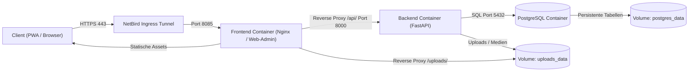

Die UPA Campus App bündelt akademische Ankündigungen, Vorlesungstermine und Event-Registrierungen in einer modularen Drei-Container-Infrastruktur. Diese sechsteilige Fachserie dokumentiert die vollständige Systemarchitektur: von der Netzwerksicherheit über die Container-Orchestrierung bis hin zur API-Verarbeitung und relationalen Datenpersistenz.

---

## Gesamtsystem und Architekturfluss

Der Datenfluss verläuft geradlinig vom Client über ein privates Overlay-Netzwerk bis in die isolierte Container-Landschaft:

---

## Architektonische Leitprinzipien

1. **Zero-Trust Netzwerkintegrität:** Der Produktionsserver öffnet keine öffentlichen Ports. Der gesamte Ingress-Verkehr läuft über ein privates WireGuard-Mesh via NetBird.
2. **Strikte Container-Isolation:** Frontend, API-Schicht und Datenbank laufen in separaten Containern innerhalb eines dedizierten Docker-Bridge-Netzwerks.
3. **Stateless Backend mit asynchroner I/O:** FastAPI gewährleistet typsichere Validierung über Pydantic und zustandslose Request-Verarbeitung.
4. **Deterministische Datenpersistenz:** Trennung von strukturierten relationalen Daten in PostgreSQL und unstrukturierten Mediendateien in dedizierten Host-Volumes.

---
