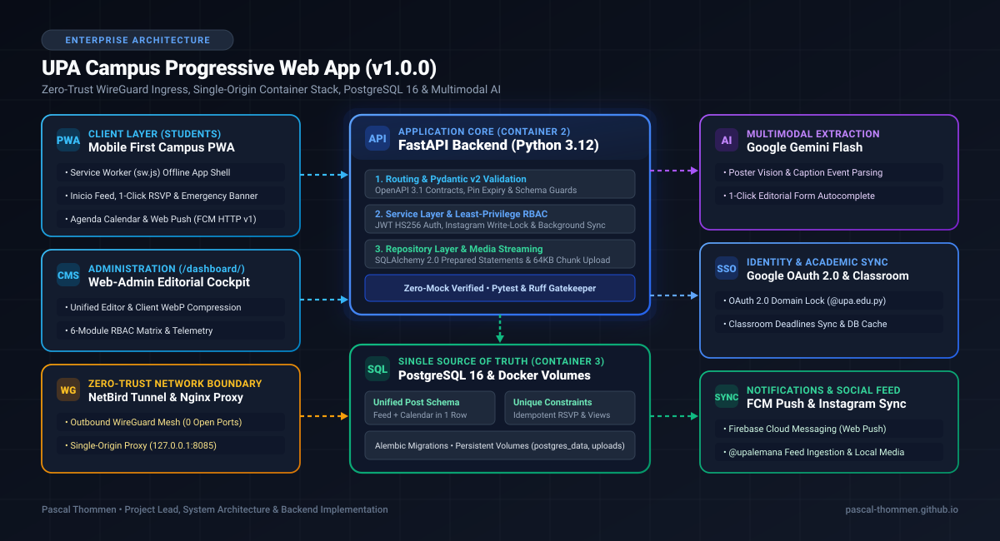
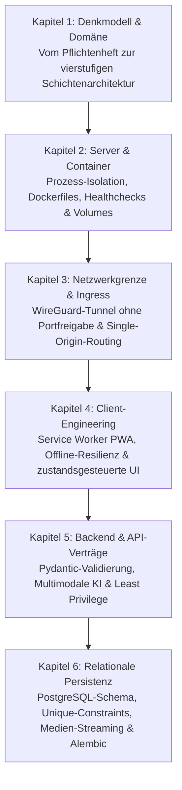

Die UPA Campus Progressive Web App bündelt Mitteilungen, Veranstaltungskalender, akademische Abgabefristen und Eilmeldungen der Universidad Paraguayo Alemana (UPA) in einer zentralen Plattform. Statt verteilter Kommunikationskanäle wie WhatsApp, E-Mail und Instagram entsteht eine einheitliche Quelle der Wahrheit (Single Source of Truth) für Studierende, Dozierende und Verwaltung.

---

## Projektprofil und Verantwortung

* **Projekt:** UPA Campus Progressive Web App (`v1.0.0`)
* **Rolle:** Projektleitung, Systemarchitektur und Backend Implementierung
* **Tech Stack:** FastAPI (Python 3.12), PostgreSQL 16, Service Worker PWA (`sw.js`), Google OAuth 2.0 (`@upa.edu.py`), NetBird Zero Trust Tunnel (WireGuard), Nginx Single-Origin Reverse Proxy
* **Kernfeatures:** Mobile First Campus PWA, automatische Event Extraktion mit multimodaler KI (Google Gemini Flash), Google Classroom Synchronisation, Web Push Benachrichtigungen (Firebase Cloud Messaging HTTP v1)
* **Quellcode und Dokumentation:** [GitHub Repository (Pascal-Thommen/upa-app)](https://github.com/Pascal-Thommen/upa-app)

---

## Technische Kernfunktionen im Überblick

### 1. Mobile First Campus PWA mit Service Worker
Die Anwendung für Studierende und Dozierende ist als plattformunabhängige Progressive Web App (`web-app/`) konzipiert, weil eine einheitliche Web-Codebasis den Wartungs- und Lizenzaufwand proprietärer App-Stores vermeidet und Updates über den Service Worker (`/sw.js`) ohne Verzögerung auf Android und iOS ausrollt. Das optische Grundgerüst (App Shell) wird lokal auf dem Endgerät zwischengespeichert, sodass Feed und Kalender auch in Hörsälen mit schwachem Mobilfunkempfang abrufbar bleiben. Auf Desktop-Bildschirmen leitet eine automatische Geräteweiche auf eine Vorschau mit dynamischem QR-Code zur direkten Smartphone-Installation weiter.

### 2. Automatische Event Extraktion mit multimodaler KI
Hochschulveranstaltungen werden vom Marketing-Team primär als grafische Plakate auf Instagram (`@upalemana`) veröffentlicht. Damit diese Termine ohne doppelte Texteingabe im akademischen Kalender erscheinen, analysiert das Backend (`backend/src/services/ai_extractor.py`) synchronisierte Plakate und Bildunterschriften über das multimodale Modell Google Gemini Flash und überführt Titel, Datum, Uhrzeit und Ort in strukturierte JSON-Felder. Im Redaktionsportal (`/dashboard/publicaciones`) steht diese Extraktion zusätzlich als 1-Klick-Funktion (`Autocompletar con IA`) bereit, ergänzt durch clientseitige WebP-Bildkomprimierung auf maximal 1080 Pixel Kantenlänge und ein dreistufiges Prüf-Badge (`No revisado`, `IA`, Vorname des Prüfers).

### 3. Google OAuth 2.0 und Google Classroom Synchronisation
Der Zugang zu internen Campus-Inhalten ist über Google OAuth 2.0 und signierte JWT-Sitzungstokens (`HS256`) kryptografisch auf verifizierte Konten der Hochschul-Domain `@upa.edu.py` beschränkt. Im Modul *Agenda* verknüpft das Backend die zentralen Hochschulveranstaltungen direkt mit den persönlichen Abgabefristen aus der Google Classroom API in der Zeitzone `America/Asuncion`. Ein automatischer OAuth-Token-Refresh und ein persistenter Datenbank-Fallback (`classroom_deadlines_cache`) stellen sicher, dass Fristen auch bei kurzzeitigen Ausfällen externer Google-Schnittstellen verfügbar bleiben.

### 4. Push Benachrichtigungen und NetBird Zero Trust Tunnel
Zeitkritische Hinweise (`EMERGENCY_BANNER`, etwa bei kurzfristigem Vorlesungsausfall) und Veranstaltungsupdates werden über Firebase Cloud Messaging (FCM HTTP v1) als native Web-Push-Benachrichtigungen zugestellt, wobei das Backend abgemeldete Gerätetokens automatisch bereinigt. Auf Netzwerkschicht verzichtet der Campus-Server auf eingehende Firewall-Portfreigaben: Ein ausgehender NetBird-Tunnel auf Basis von WireGuard verbindet den lokal an `127.0.0.1:8085` gebundenen Nginx-Reverse-Proxy verschlüsselt mit dem öffentlichen Ingress-Endpunkt.

---

## Der Lernpfad durch die sechs Architekturebenen

Anhand der UPA Campus Progressive Web App zerlegt diese Serie eine produktive Hochschulplattform systematisch von außen nach innen. Jedes Kapitel beleuchtet genau eine Systemebene und zeigt, welche konkreten Probleme des Hochschulalltags dort gelöst werden:

---
