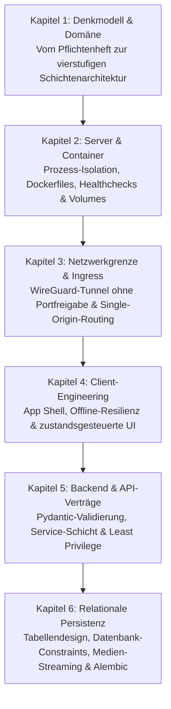

Warum scheitern viele Softwareprojekte im Studium oder beim KI-gestützten Programmieren (Vibe-Coding), sobald die erste Benutzeroberfläche steht? Weil Sprachmodelle zwar sekundenschnell funktionierenden Programmcode liefern, ohne architektonische Leitplanken jedoch unweigerlich widersprüchliche Datenstrukturen, offene Sicherheitslücken und instabile Schnittstellen erzeugen. Wer als Wirtschaftsinformatiker oder Entwickler eine belastbare Plattform baut, lernt kein Pflichtenheft auswendig, sondern durchdringt die technische Ursache hinter jeder einzelnen Anforderung.

---

## Der Lernpfad durch die sechs Architekturebenen

Anhand der UPA Campus App zerlegt diese Serie eine produktive Hochschulplattform systematisch von außen nach innen. Jedes Kapitel beleuchtet genau eine Systemebene und zeigt, welche konkreten Probleme des Hochschulalltags dort gelöst werden:

---

## Was diese Serie vermittelt

* **Architekturverständnis statt Syntax-Memorierung:** Programmierbefehle lassen sich jederzeit nachschlagen oder generieren. Systemgrenzen, Zustandsflüsse und Transaktionssicherheit müssen dagegen vom Menschen präzise vorgegeben werden.
* **Pflichtenheft als technischer Bauplan:** Jede Produktregel der UPA Campus App hat einen handfesten architektonischen Grund. Wer diesen Grund kennt, trifft bei Erweiterungen und Edge-Cases eigenständig die richtigen Designentscheidungen.
* **Vom großen Überblick bis zur Datenbankzeile:** Die Serie startet in Kapitel 1 mit dem Zusammenspiel der Gesamtschichten und führt Schritt für Schritt bis zur physischen Speicherung auf dem Server in Kapitel 6.

---
