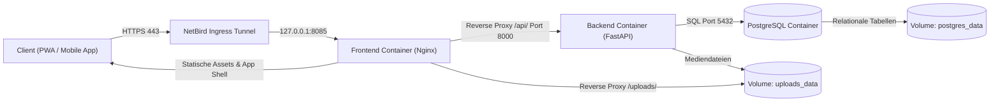

Moderne Web-Applikationen entstehen nicht durch das bloße Aneinanderreihen von Benutzeroberflächen, sondern durch das präzise Zusammenspiel von Netzwerksicherheit, Container-Isolation, zustandsloser Geschäftslogik und transaktionaler Datenhaltung. Gerade in einer Zeit, in der KI-Assistenten Programmcode in Sekunden generieren, entscheidet nicht mehr die Kenntnis einzelner Syntax-Schleifen über den Projekterfolg, sondern das holistische Systemverständnis: Systemgrenzen, Schnittstellenverträge, Datenflüsse und relationale Datenmodelle. Am Beispiel der UPA Campus App vermittelt diese sechsteilige Serie das universelle Denkmodell moderner Web-Architekturen und zeigt, warum jede fachliche Vorgabe im Pflichtenheft als logische Blaupause aus der Systemarchitektur hervorgeht.

---

## Gesamtsystem und Architekturfluss

Ein Klick auf dem Smartphone oder im Web-Portal durchläuft in wenigen Millisekunden vier streng getrennte Schichten, vom verschlüsselten Ingress-Tunnel bis in den persistenten Speicherkern:

---

## Warum Architektur und Pflichtenheft untrennbar sind

In Softwareprojekten wird ein Pflichtenheft oft als bürokratische Wunschliste missverstanden. In einer belastbaren Web-Architektur ist das Gegenteil der Fall: Jede Produktregel schützt das System vor inkonsistenten Daten, Sicherheitslücken oder unkontrolliertem Ressourcenverbrauch.

1. **Zero-Trust Netzwerk und Identität:** Der Server öffnet keine öffentlichen Router-Ports, sondern leitet den Verkehr durch einen verschlüsselten WireGuard-Tunnel (NetBird) an den lokalen Nginx-Proxy. Auf Anwendungsebene setzt sich dieses Prinzip durch den exklusiven Google OAuth Login für Universitäts-Accounts und das Prinzip minimaler Rechte (Least Privilege) bei der Rollenvergabe fort: Neue Konten starten ohne vorausgewählte Berechtigungen, und Entwickler-Schnellzugänge sind im Produktivbetrieb ausgebaut.
2. **Strikte Container- und Client-Entkopplung:** Die Plattform trennt die statische Auslieferung (Nginx) vom API-Kern (FastAPI) und der Datenbank (PostgreSQL). Dadurch bedient dasselbe Backend sowohl das Desktop-Redaktionsportal als auch die mobile Studierenden-Oberfläche mit Offline-Speicher und Google Classroom Synchronisation.
3. **Single Source of Truth im Backend:** Statt Nachrichten, Kalendertermine und Eilmeldungen in getrennten Silos zu verwalten, bündelt ein vereinheitlichtes Datenmodell (`/api/publications`) alle Formate. Daraus leiten sich die fachlichen Schutzregeln direkt ab: Angeheftete Beiträge (`is_pinned`) erzwingen ein Ablaufdatum (`expires_at`), damit veraltete Sturmwarnungen den Feed nicht dauerhaft blockieren. Aus Instagram synchronisierte Beiträge bleiben im Redaktionsportal schreibgeschützt (`Read-Only`), weil der periodische Hintergrund-Sync manuelle Textänderungen sonst beim nächsten Durchlauf überschreiben würde.
4. **Deterministische Datenpersistenz:** Strukturierte Metadaten, eindeutige Lesebestätigungen (`PostView`) und 1-Klick-Anmeldungen (`EventRegistration`) liegen transaktionssicher in PostgreSQL, während hochgeladene Bilder, Videos und PDF-Dokumente das Datenbanksystem nicht belasten, sondern über ein separates Host-Volume direkt ausgeliefert werden.

---
