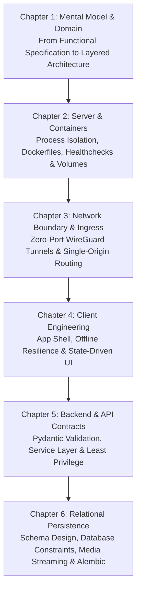

Why do so many university software projects and AI-assisted coding efforts (vibe-coding) stall right after the first user interface prototype is ready? Because language models generate working syntax in seconds, yet without clear architectural guardrails they inevitably produce conflicting data structures, open security holes, and fragile interfaces. Building a production-grade platform requires looking past surface checklists to understand the technical necessity behind every single specification rule.

---

## The Learning Path Across Six Architectural Layers

Using the UPA Campus App as a real-world reference system, this series dissects a modern university platform systematically from the outside in. Each chapter focuses on one dedicated architectural layer and explains which concrete operational challenges it solves:

---

## Core Engineering Takeaways

* **System Thinking Over Syntax Memorization:** Code snippets can be looked up or generated on demand. System boundaries, state transitions, and transactional guarantees must be deliberately designed by the engineer.
* **The Specification as an Engineering Blueprint:** Every product rule in the UPA Campus App exists to prevent a specific failure mode. Understanding the underlying mechanism makes it easy to make sound design choices when extending the platform.
* **From High-Level Flow to Disk Storage:** The series starts in Chapter 1 with the big-picture interaction of system layers and progresses step by step down to physical database transactions and volume storage in Chapter 6.

---
