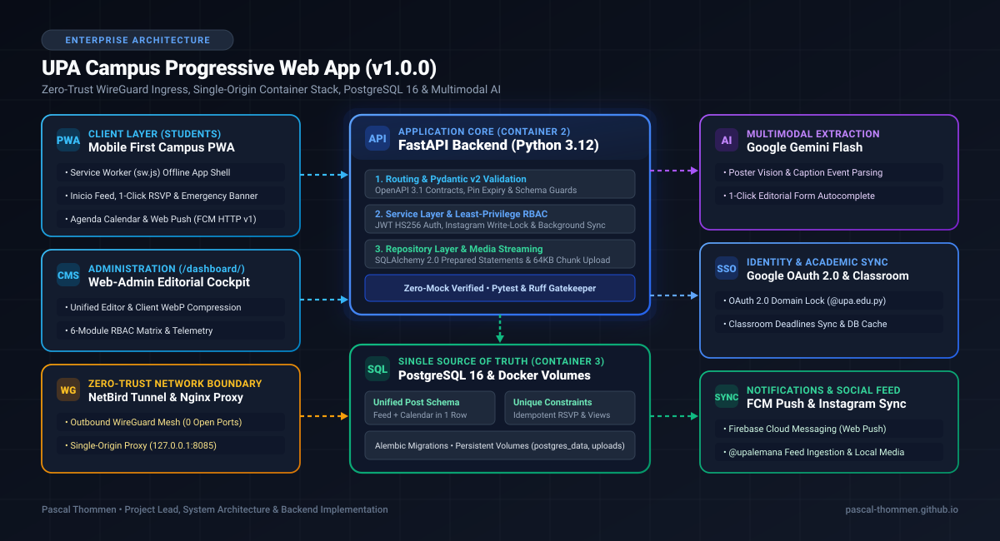
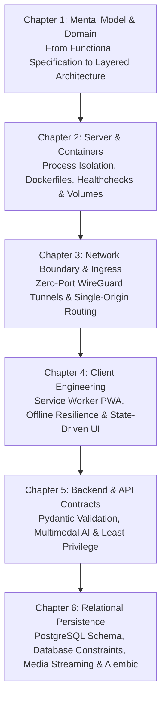

The UPA Campus Progressive Web App consolidates official announcements, academic event calendars, course deadlines, and emergency alerts for Universidad Paraguayo Alemana (UPA) into a single platform. Instead of scattered communication across WhatsApp groups, emails, and social media, the system establishes a relational Single Source of Truth for students, faculty, and administration.

---

## Project Profile and Responsibilities

* **Project:** UPA Campus Progressive Web App (`v1.0.0`)
* **Role:** Project Lead, System Architecture, and Backend Implementation
* **Tech Stack:** FastAPI (Python 3.12), PostgreSQL 16, Service Worker PWA (`sw.js`), Google OAuth 2.0 (`@upa.edu.py`), NetBird Zero Trust Tunnel (WireGuard), Nginx Single-Origin Reverse Proxy
* **Core Capabilities:** Mobile First Campus PWA, automated event extraction via multimodal AI (Google Gemini Flash), Google Classroom synchronization, Web Push notifications (Firebase Cloud Messaging HTTP v1)
* **Source Code and Documentation:** [GitHub Repository (Pascal-Thommen/upa-app)](https://github.com/Pascal-Thommen/upa-app)

---

## Core Engineering Capabilities

### 1. Mobile First Campus PWA with Service Worker
The student and faculty client is built as a cross-platform Progressive Web App (`web-app/`) because a single web codebase eliminates commercial app store licensing overhead and delivers instant updates across Android and iOS via Service Worker (`/sw.js`). Local App Shell caching keeps the feed and academic calendar accessible even in lecture halls with unstable mobile reception. On desktop screens, an automatic viewport switch presents a visual device preview with a dynamic QR code for immediate mobile installation.

### 2. Automated Event Extraction via Multimodal AI
University events are frequently published as visual posters on Instagram (`@upalemana`). To integrate these events into the structured campus calendar without manual re-entry, the backend (`backend/src/services/ai_extractor.py`) processes synchronized posters and captions through Google Gemini Flash, extracting event titles, dates, times, and locations into validated JSON fields. Inside the editorial cockpit (`/dashboard/publicaciones`), the same pipeline powers 1-click form autocompletion (`Autocompletar con IA`), paired with client-side WebP image compression (1080px max edge) and a three-state review badge (`No revisado`, `IA`, reviewer first name).

### 3. Google OAuth 2.0 and Google Classroom Synchronization
Access to internal campus resources is cryptographically restricted to verified `@upa.edu.py` accounts via Google OAuth 2.0 and signed JWT session tokens (`HS256`). Within the *Agenda* module, the backend merges institutional events with personal assignment deadlines fetched from the Google Classroom API in the `America/Asuncion` timezone. Automatic OAuth token refresh and a persistent PostgreSQL fallback cache (`classroom_deadlines_cache`) ensure high availability even during temporary upstream API outages.

### 4. Push Notifications and NetBird Zero Trust Tunnel
Time-critical alerts (`EMERGENCY_BANNER`, such as severe weather closures) and event reminders are dispatched as native Web Push notifications via Firebase Cloud Messaging (FCM HTTP v1), including automated cleanup of unregistered device tokens. At the network boundary, the campus server exposes zero inbound firewall ports: an outbound NetBird WireGuard tunnel securely connects the loopback-bound Nginx reverse proxy (`127.0.0.1:8085`) to the public ingress endpoint.

---

## The Learning Path Across Six Architectural Layers

Using the UPA Campus Progressive Web App as a production reference system, this series dissects a modern university platform systematically from the outside in. Each chapter focuses on one dedicated architectural layer and explains which concrete operational challenges it solves:

---
