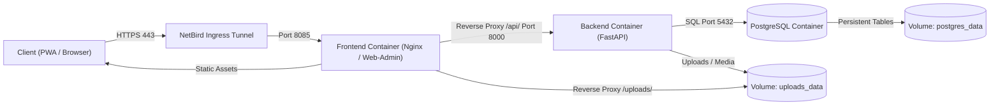

The UPA Campus App centralizes academic announcements, schedules, and event registrations within a modular three-container infrastructure. This six-part technical series documents the end-to-end system architecture: from network security and container orchestration to asynchronous API processing and relational data persistence.

---

## System Overview and Architectural Flow

The end-to-end data flow connects the client through a private overlay network into an isolated container cluster:

---

## Architectural Core Principles

1. **Zero-Trust Network Integrity:** The production server exposes zero public router ports. All ingress traffic traverses a private WireGuard mesh via NetBird.
2. **Strict Container Isolation:** Frontend, API layer, and database run in separate containers within a dedicated Docker bridge network.
3. **Stateless Backend with Asynchronous I/O:** FastAPI enforces strict type validation via Pydantic and stateless request handling.
4. **Deterministic Data Persistence:** Clear segregation between structured relational records in PostgreSQL and unstructured media files in dedicated host volumes.

---
