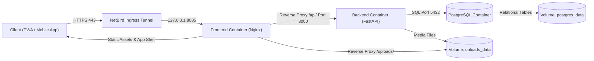

Modern web applications are not built by merely stitching user interfaces together, but by orchestrating network security, container isolation, stateless business logic, and transactional persistence. In an era where AI assistants generate syntax in seconds, engineering success no longer depends on memorizing loop constructs or CSS properties, but on holistic system thinking: system boundaries, interface contracts, data flows, and relational data models. Using the UPA Campus App as a concrete reference system, this six-part series conveys a universal mental model for modern web applications and demonstrates why every requirement in a functional specification acts as a logical blueprint derived from system architecture.

---

## System Overview and Architectural Flow

A single interaction on a smartphone or desktop portal traverses four strictly isolated layers within milliseconds, moving from the encrypted ingress tunnel down to the persistent storage engine:

---

## Why Architecture and Functional Specifications Are Inseparable

In software projects, a functional specification is often mistaken for an arbitrary wishlist. In a resilient web architecture, the opposite holds true: every product requirement protects the system against inconsistent state, security vulnerabilities, or resource exhaustion.

1. **Zero-Trust Networking and Identity:** The production host exposes zero public router ports, routing all ingress traffic through an encrypted WireGuard mesh (NetBird) to the local Nginx proxy. At the application layer, this security posture continues through mandatory Google OAuth authentication for institutional accounts and strict least-privilege role management: new accounts initialize with all permission checkboxes unchecked, and development login shortcuts are completely absent in production.
2. **Strict Container and Client Decoupling:** The platform isolates static delivery (Nginx), core API logic (FastAPI), and relational storage (PostgreSQL) in separate containers. Consequently, a single unified backend serves both the desktop editorial cockpit and the mobile student interface featuring local offline storage and Google Classroom deadline synchronization.
3. **Single Source of Truth in the Backend:** Instead of scattering campus news, calendar events, and emergency alerts across separate silos, a unified publication model (`/api/publications`) handles all formats in a single structure. Functional rules follow directly from this model: pinned items (`is_pinned`) require a mandatory expiration timestamp (`expires_at`) so outdated weather warnings never clutter the top of the feed permanently. Posts synchronized from Instagram remain read-only in the editorial portal because periodic background synchronization would otherwise overwrite manual edits on the next cycle.
4. **Deterministic Data Persistence:** Structured metadata, unique read receipts (`PostView`), and one-click event registrations (`EventRegistration`) reside with full ACID guarantees in PostgreSQL, whereas uploaded images, videos, and PDF documents bypass the database buffer pool entirely via a dedicated host volume.

---
