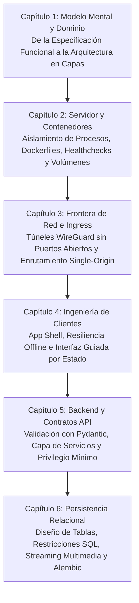

¿Por qué fracasan tantos proyectos universitarios de software o desarrollos asistidos por inteligencia artificial (vibe-coding) apenas terminada la primera pantalla visual? Porque los modelos de lenguaje generan código funcional en segundos, pero sin directrices arquitectónicas claras producen estructuras de datos contradictorias, brechas de seguridad e interfaces frágiles. Construir una plataforma sólida exige dejar de memorizar el pliego de especificaciones como una lista burocrática y comprender la necesidad técnica detrás de cada regla.

---

## Ruta de Aprendizaje por las Seis Capas de Arquitectura

Tomando la UPA Campus App como sistema de referencia real, esta serie desglosa una plataforma universitaria moderna de afuera hacia adentro. Cada capítulo aborda una capa específica del sistema y explica qué problemas operativos resuelve:

---

## Qué Aporta Esta Serie

* **Visión de Sistemas por Encima de la Sintaxis:** Los fragmentos de código se consultan o generan al instante. Las fronteras del sistema, el flujo de estados y la integridad transaccional deben ser diseñados con criterio humano.
* **La Especificación como Plano de Ingeniería:** Cada requisito funcional de la UPA Campus App responde a una razón técnica concreta. Comprender esa causa permite tomar decisiones acertadas al ampliar el sistema o resolver casos borde.
* **Del Panorama General al Almacenamiento Físico:** El recorrido comienza en el Capítulo 1 con la división conceptual del sistema y avanza paso a paso hasta las transacciones SQL y los volúmenes de disco en el Capítulo 6.

---
