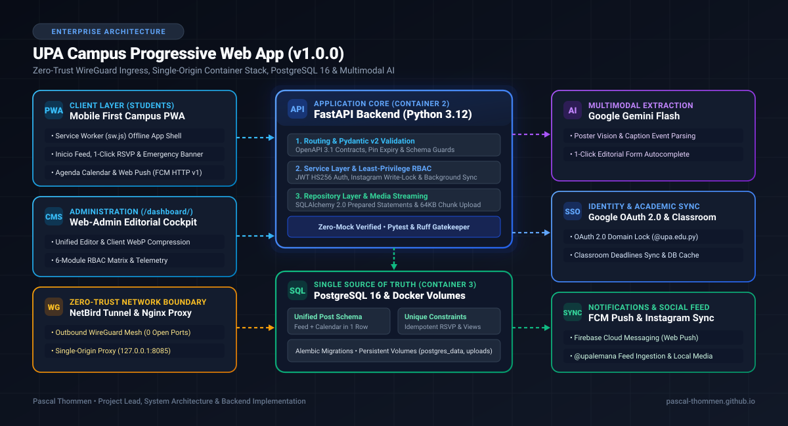
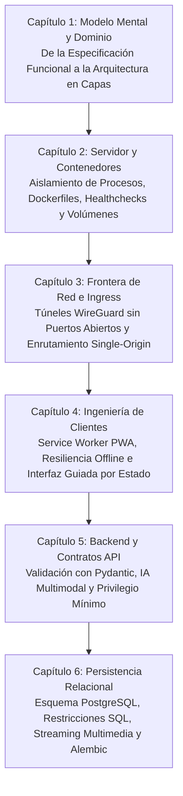

La UPA Campus Progressive Web App centraliza comunicados oficiales, calendario de eventos, entregas académicas y alertas urgentes de la Universidad Paraguayo Alemana (UPA) en una única plataforma. En lugar de canales dispersos entre grupos de WhatsApp, correos e Instagram, el sistema establece una Fuente Única de Verdad (Single Source of Truth) para estudiantes, docentes y administración.

---

## Perfil del Proyecto y Responsabilidades

* **Proyecto:** UPA Campus Progressive Web App (`v1.0.0`)
* **Rol:** Dirección de Proyecto, Arquitectura de Sistemas e Implementación Backend
* **Tech Stack:** FastAPI (Python 3.12), PostgreSQL 16, Service Worker PWA (`sw.js`), Google OAuth 2.0 (`@upa.edu.py`), NetBird Zero Trust Tunnel (WireGuard), Nginx Single-Origin Reverse Proxy
* **Funciones Clave:** Campus PWA Mobile First, extracción automática de eventos con IA multimodal (Google Gemini Flash), sincronización con Google Classroom, notificaciones Web Push (Firebase Cloud Messaging HTTP v1)
* **Código Fuente y Documentación:** [Repositorio en GitHub (Pascal-Thommen/upa-app)](https://github.com/Pascal-Thommen/upa-app)

---

## Capacidades Técnicas Principales

### 1. Campus PWA Mobile First con Service Worker
El cliente móvil para estudiantes y docentes está implementado como una Progressive Web App multiplataforma (`web-app/`) porque una base de código web unificada elimina costos y fricciones de tiendas de aplicaciones y despliega actualizaciones instantáneas en Android e iOS mediante el Service Worker (`/sw.js`). El almacenamiento local de la estructura visual (App Shell) mantiene accesibles el muro y el calendario incluso en aulas con baja señal móvil. En pantallas de escritorio, un selector automático muestra una vista previa interactiva con código QR dinámico para su instalación inmediata en el teléfono.

### 2. Extracción Automática de Eventos con IA Multimodal
El equipo de comunicación publica con frecuencia las actividades universitarias como afiches gráficos en Instagram (`@upalemana`). Para incorporar estos eventos al calendario académico sin carga manual duplicada, el backend (`backend/src/services/ai_extractor.py`) analiza los afiches y textos sincronizados mediante Google Gemini Flash y convierte título, fecha, hora y ubicación en datos JSON estructurados. En el portal editorial (`/dashboard/publicaciones`), esta misma función impulsa el autocompletado en un clic (`Autocompletar con IA`), acompañado de compresión de imágenes WebP en el navegador (máximo 1080 píxeles) y un sistema de estado en tres niveles (`No revisado`, `IA`, nombre del revisor).

### 3. Google OAuth 2.0 y Sincronización con Google Classroom
El acceso a contenidos internos del campus está restringido criptográficamente a cuentas institucionales verificadas `@upa.edu.py` mediante Google OAuth 2.0 y tokens de sesión JWT (`HS256`). En el módulo *Agenda*, el backend combina los eventos institucionales con las fechas de entrega personales obtenidas de Google Classroom API en la zona horaria `America/Asuncion`. La renovación automática de credenciales OAuth y una caché persistente en PostgreSQL (`classroom_deadlines_cache`) aseguran disponibilidad continua ante interrupciones externas.

### 4. Notificaciones Push y Túnel Zero Trust con NetBird
Los avisos urgentes (`EMERGENCY_BANNER`, como suspensiones de clases por tormentas) y recordatorios de eventos se envían como notificaciones Web Push nativas mediante Firebase Cloud Messaging (FCM HTTP v1), con depuración automática de tokens inactivos. En la frontera de red, el servidor del campus opera sin abrir puertos entrantes en el firewall: un túnel saliente NetBird basado en WireGuard enlaza de forma cifrada el proxy inverso Nginx local (`127.0.0.1:8085`) con el punto de acceso público.

---

## Ruta de Aprendizaje por las Seis Capas de Arquitectura

Tomando la UPA Campus Progressive Web App como sistema de referencia real, esta serie desglosa una plataforma universitaria moderna de afuera hacia adentro. Cada capítulo aborda una capa específica del sistema y explica qué problemas operativos resuelve:

---
