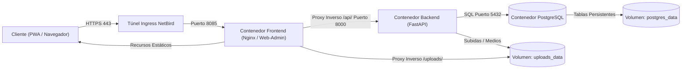

La UPA Campus App centraliza avisos académicos, calendarios y registros de eventos dentro de una infraestructura modular de tres contenedores. Esta serie técnica de seis capítulos documenta la arquitectura integral del sistema: desde la seguridad de red y la orquestación de contenedores hasta el procesamiento asíncrono de APIs y la persistencia relacional.

---

## Visión General del Sistema y Flujo Arquitectónico

El flujo de datos conecta directamente al cliente a través de una red superpuesta privada con el entorno aislado de contenedores:

---

## Principios Arquitectónicos Fundamentales

1. **Integridad de Red Zero-Trust:** El servidor de producción no expone puertos públicos en el enrutador. Todo el tráfico de entrada transita por una red mallada WireGuard privada mediante NetBird.
2. **Aislamiento Estricto de Contenedores:** Frontend, capa de API y base de datos operan en contenedores separados dentro de una red bridge dedicada de Docker.
3. **Backend Sin Estado con E/S Asíncrona:** FastAPI garantiza validación estricta de tipos mediante Pydantic y procesamiento sin estado de solicitudes.
4. **Persistencia Determinista de Datos:** Clara separación entre datos relacionales estructurados en PostgreSQL y archivos multimedia no estructurados en volúmenes dedicados del host.

---
